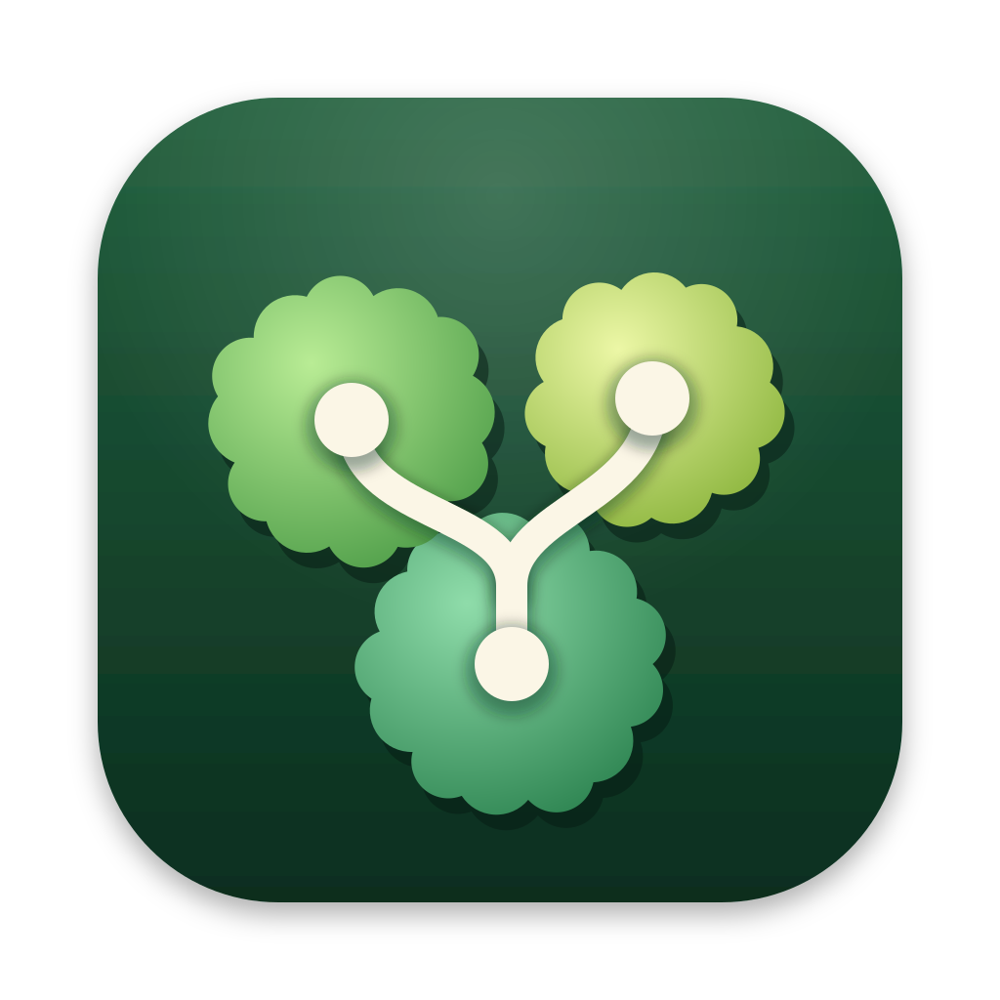
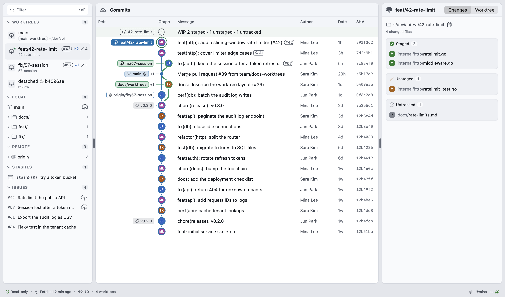
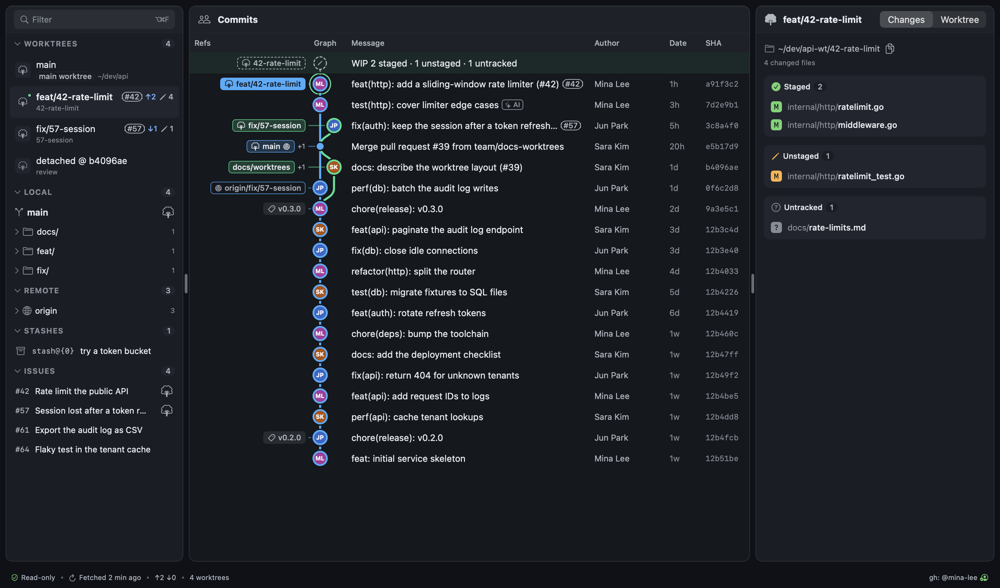
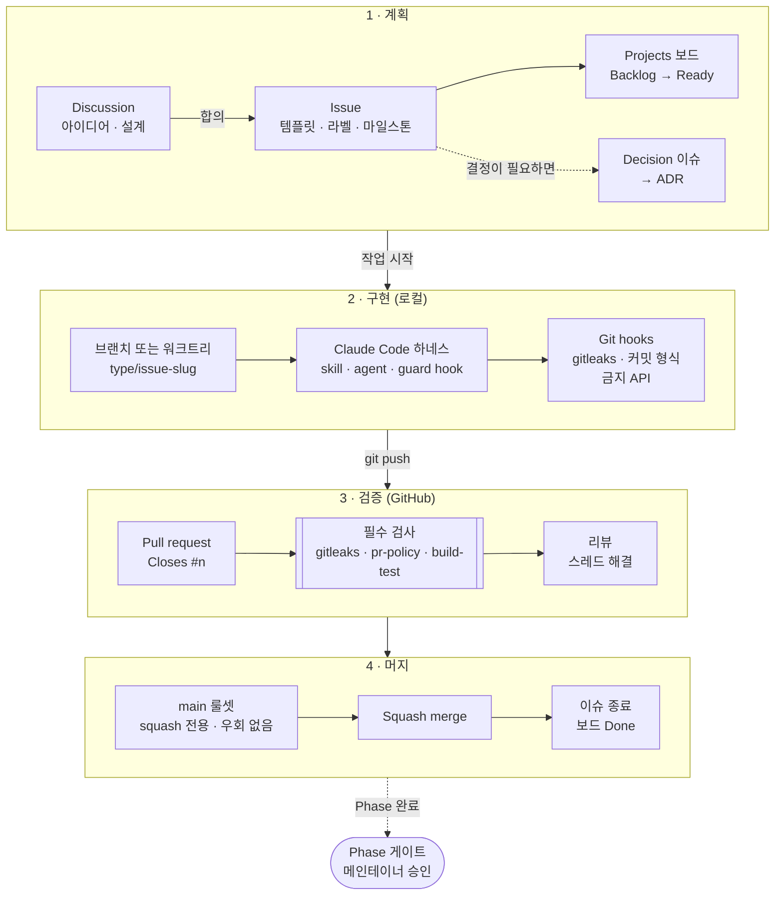

<p align="center">
  
</p>

<h1 align="center">Overgrove</h1>

<p align="center">
  <code>git worktree</code>를 여러 개 두고 동시에 작업하는 사람을 위한 macOS 네이티브 Git 클라이언트입니다.<br>
  모든 워크트리의 커밋하지 않은 변경, 원격보다 얼마나 앞서거나 뒤처졌는지, 저장소의 stash까지 창 하나에서 확인할 수 있습니다.
</p>

<p align="center">
  <a href="LICENSE"></a>
  
  
</p>

<p align="center">
  <a href="README.md">English</a> | <strong>한국어</strong>
</p>

---

> **상태: 프리알파. 소스에서 빌드해 씁니다.** 아래 v0.1 기능은 실제 저장소에서 동작하지만 아직 릴리스는 없습니다.
> 다듬어지지 않은 부분이 있을 수 있고, 서명·공증된 실행 파일도 없습니다. 진행 상황은 [로드맵](docs/roadmap.md)과
> [v0.1.0 마일스톤](https://github.com/kkdy21/overgrove/milestone/1)에서 볼 수 있습니다.

## 왜 만들었나

`git worktree`로 여러 기능을 동시에 개발하다 보면 간단한 질문에도 바로 답하기 어렵습니다.

- 어느 워크트리에 커밋하지 않은 작업이 남아 있고, stage는 해 두었나?
- stash에는 무엇이 들어 있고, 어느 브랜치에서 만들었나?
- 브랜치마다 upstream보다 얼마나 앞서 있거나 뒤처져 있나?
- 누가 언제 무엇을 바꿨나?

Overgrove는 이런 질문에 화면 하나로 답합니다. 쓰기 기능은 섞지 않았습니다.

## 누구에게 맞나

워크트리를 여러 개 동시에 돌리면서, 흔히 워크트리마다 AI 코딩 에이전트까지 붙여 두고, "지금 어디서 무슨 일이
벌어지고 있지?"를 창 하나에서 차분하게 보고 싶은 개발자를 위한 도구입니다.

이런 경우라면 잘 맞습니다.

- **Git GUI를 켜 두면 맥이 느려진다.** 저장소마다 파일 감시를 계속 돌리는 클라이언트는 워크트리가 늘어날수록 CPU와
  메모리를 많이 쓸 수 있습니다. Overgrove v0.1은 파일을 상시 감시하지 않습니다. 창이 활성화될 때, ⌘R을 누를 때, fetch가 끝났을
  때만 새로 고칩니다.
- **잘 쓰던 도구가 더는 업데이트되지 않는다.** Overgrove는 MIT 라이선스이고 외부 의존성이 하나도 없습니다. Xcode만
  있으면 소스에서 빌드할 수 있으니, 누구든 이어서 유지하기 쉽습니다.
- **지금 쓰는 클라이언트로는 워크트리를 나란히 볼 수 없다.** Overgrove는 워크트리를 중심에 둡니다. 사이드바 하나에
  워크트리별 브랜치, 커밋하지 않은 변경, ahead/behind가 나오고, 저장소의 stash도 함께 보입니다.
- **조회만 하는 도구에 구독료를 내고 싶지 않다.** 무료 오픈소스입니다. 회원 가입도, 텔레메트리도 없습니다.
- **`git status` 하나 보려고 터미널 탭을 오가는 게 번거롭다.** 워크트리마다 `cd`하고 `git status`를 치던 일을 창
  하나가 대신합니다. 실제 쓰기 작업은 지금처럼 CLI로 하면 됩니다.
- **워크트리마다 AI 에이전트를 병렬로 돌린다.** 리뷰하거나 머지하기 전에 에이전트가 각각 무엇을 바꿨는지 확인할 수
  있습니다.

이런 경우에는 아직 맞지 않을 수 있습니다.

- GUI에서 stage, commit, push, pull, rebase까지 하고 싶은 경우. Overgrove는 조회와 `git fetch`만 합니다. 커밋,
  푸시, 정리 같은 쓰기 작업은 터미널이나 AI 에이전트에 맡깁니다.
- Windows나 Linux에서 써야 하는 경우.
- 서명·공증을 거친 앱을 내려받아 바로 쓰고 싶은 경우. 지금은 소스로만 배포합니다.

## 스크린샷

앱에서 예시 데이터로 렌더링한 메인 창입니다(기능·수정·리뷰 워크트리가 있는 가상의 API 서비스). 창 위의 툴바에는
저장소·포커스 워크트리 전환, Fetch, Refresh, Compare, Terminal, Finder, 검색이 있습니다. 모든 화면의 디자인 목업은
[docs/design/mockups.md](docs/design/mockups.md)에 있습니다.

| 라이트 | 다크 |
|---|---|
|  |  |

## 기능 (v0.1)

- **워크트리:** 모든 워크트리의 브랜치, 경로, 잠김·정리 대상(prunable)·사라짐 상태와 변경·ahead/behind 배지
- **워크트리별 작업 상태:** staged, unstaged, untracked, 충돌 파일. 줄 수와 diff 뷰어 포함
- **기준 브랜치와 비교:** 워크트리가 `main`에서 갈라진 뒤 무엇이 바뀌었는지 PR처럼 보여 줍니다. `main`보다 앞선 커밋,
  바뀐 파일, untracked 파일까지 나오니 PR을 열기 전에 에이전트가 한 일을 검토할 수 있습니다.
- **커밋 그래프:** 브랜치·태그·워크트리를 그 커밋에 표시하고, 포커스 워크트리의 *WIP* 행을 둡니다. AI 에이전트의
  `Co-authored-by` 트레일러가 있는 커밋에는 *AI* 표시를 붙입니다. 메시지, 작성자, SHA, ref, `#이슈`로 검색합니다.
- **커밋 상세와 파일 이력:** 커밋의 메시지와 파일, 이름이 바뀐 것까지 따라가는 파일 이력
- **브랜치와 stash:** upstream 상태가 붙은 로컬·원격 브랜치, stash별 파일
- **Fetch:** 네트워크를 쓰는 유일한 동작. 마지막 fetch 시각과 선택 사항인 자동 fetch(기본 꺼짐)
- **GitHub 이슈(선택):** 이미 로그인해 둔 `gh`로 열린 이슈를 불러오고, 이슈 번호로 브랜치·워크트리·커밋과 연결합니다.
- **키보드와 접근성:** 모든 패널의 단축키, VoiceOver 라벨, 라이트·다크 모드

**처음부터 조회 전용으로 설계했습니다.** 원격 저장소에 접근하는 동작은 `git fetch` 하나뿐입니다. push, pull, merge,
reset, stage는 일부러 넣지 않았습니다. Overgrove는 쓰기를 맡는 터미널이나 AI 에이전트 옆에 띄워 두고 보는
도구입니다([범위](docs/scope-mvp.md)).

## 보안

신뢰할 수 없는 저장소를 Git 클라이언트로 열면, 그 저장소 설정에 심어 둔 코드(hook, 필터, fsmonitor, diff 드라이버,
credential helper, SSH 명령 등)가 실행될 수 있습니다. Overgrove는 신뢰하지 않는 저장소를 열어도 그런 코드가 실행되지
않도록 만들었습니다.

- `git`은 셸을 거치지 않고 인자 배열로만 실행합니다.
- 위험한 저장소 설정(fsmonitor, hooks, 필터, 외부 diff, credential helper, 별도로 지정한 SSH 명령 등)은 강제로 끕니다.
- 저장소가 지정한 프록시나 TLS 인증서를 `git fetch`에 쓰지 못하게 합니다.
- 자식 프로세스에는 허용 목록에 있는 환경 변수만 넘깁니다.
- 모든 명령에 시간 제한과 출력 크기 제한을 둡니다.
- 원격 URL에 들어 있는 자격 증명은 가려서 보여 줍니다.
- 토큰은 저장하지 않습니다. GitHub 접근은 `gh`에 맡깁니다.
- 워크트리마다 설정을 검사하고, 위험한 항목은 **Worktree** 패널에 보여 줍니다.

알아 둘 점:

- **터미널은 보호되지 않습니다.** *Open in Terminal*이나 Overgrove에서 복사한 명령은 보통의 `git`으로 실행되고, 이
  `git`은 저장소의 hook과 설정을 실행합니다. Overgrove는 위험한 설정이 있는 저장소에서 터미널을 열기 전에 묻고,
  설정 보고가 깨끗할 때만 `git` 명령을 제시합니다. 터미널은 신뢰하는 저장소에서만 쓰세요.
- **Fetch는 자격 증명을 들고 원격에 접속합니다.** 저장소는 자격 증명이 가는 길(프록시, 인증서, helper)을 바꿀 수
  없지만, 원격 URL은 저장소가 정합니다.
- 자체 호스팅·사내 서버에서는 토큰, SSH 호스트 키, 사설 CA, 프록시를 한 번 설정해야 할 수 있습니다.
  [자체 호스팅·사내 Git 서버](docs/guides/self-hosted-git.ko.md)를 보세요.

자세한 내용은 [SECURITY.md](SECURITY.md)(영문)에 있습니다. 취약점을 비공개로 제보하는 방법도 이 문서에 나와 있습니다.
위협 모델은 [보안 검토](docs/design/security-review.md)에 있습니다.

## 요구 사항

- macOS 14 Sonoma 이상 (Apple silicon 또는 Intel)
- 소스에서 빌드하려면 Xcode 26 이상 (Swift 6)
- Git 2.36 이상. Overgrove는 `xcode-select`로 지정한 개발자 디렉터리(Xcode 또는 Command Line Tools)에 있는 Apple Git을
  사용합니다. 처음 실행할 때 설정 도우미가 확인합니다.
- 선택: 이슈 패널을 쓰려면 `gh auth login`으로 로그인해 둔 [GitHub CLI](https://cli.github.com/)(`gh`)가 필요합니다.

## 소스에서 빌드하기

Overgrove는 **소스로만** 배포합니다. 서명·공증된 실행 파일은 제공하지 않습니다.

```sh
git clone https://github.com/kkdy21/overgrove.git
cd overgrove
./scripts/bootstrap.sh     # Git hooks를 설치하고 개발 도구를 점검합니다
open Overgrove.xcodeproj   # ⌘R로 빌드·실행, ⌘U로 테스트
```

명령줄에서:

```sh
xcodebuild -project Overgrove.xcodeproj -scheme Overgrove -configuration Release build
xcodebuild test -project Overgrove.xcodeproj -scheme Overgrove -destination 'platform=macOS'
```

처음 실행하면 설정 도우미가 `git`과 `gh`를 확인하고 저장소를 추가하라고 안내합니다(⌘O). README 스크린샷은
`ReadmeScreenshotTests`로 만듭니다. `TEST_RUNNER_OVERGROVE_README_SCREENSHOT_DIR`에 폴더를 지정해 실행하면 다시
렌더링됩니다.

## 작업 방식

모든 변경은 이슈에서 시작하고, `main`에는 PR로만 들어갑니다. PR은 로컬, CI, 브랜치 룰셋에서 같은 검사를 모두
통과해야 합니다. 기획 문서는 메인테이너가 승인하는 Phase 게이트를 거칩니다.



| 규칙 | 지키게 하는 장치 | 참고 문서 |
|---|---|---|
| 이슈부터 만든다 | `pr-policy` 검사, 템플릿 | [이슈 규칙](docs/process/issues.md) |
| 코드를 쓰기 전에 이슈를 선점한다(5시간 안에 draft PR, 먼저 연 PR 우선) | `/claim` 봇, `claim-expiry` 워크플로, `pr-policy` 검사 | [협업](docs/process/collaboration.md) |
| 의존 이슈를 기다리지 않는다. stand-in으로 개발하고 머지는 의존 순서대로 한다 | `pr-policy` 검사, `dependency-closed` 워크플로 | [협업](docs/process/collaboration.md) |
| 비밀 정보와 개인 경로를 올리지 않는다 | Git hooks, Claude Code hook, `gitleaks` 검사, GitHub push protection | [브랜치와 커밋](docs/process/branching-and-commits.md) |
| 프로세스·셸 API는 `Overgrove/Execution/`에서만 쓴다 | Git hook, Claude Code hook, `build-test` 검사 | [보안 검토](docs/design/security-review.md) |
| 리뷰를 거쳐 squash로만 머지한다 | `main` 룰셋(squash 전용, 필수 검사, 스레드 해결) | [Pull request](docs/process/pull-requests.md) |
| Phase는 메인테이너 승인을 받아야 넘어간다 | 메인테이너, `/phase-gate` 보고서 | [Phase 게이트](docs/process/phase-gates.md) |

전체 흐름은 [docs/process/development-workflow.md](docs/process/development-workflow.md)에, Claude Code 하네스는
[docs/process/claude-code-harness.md](docs/process/claude-code-harness.md)에 정리해 두었습니다.

## 프로젝트 문서

| | |
|---|---|
| 제품 | [PRD](docs/prd.md) · [MVP 범위](docs/scope-mvp.md) · [용어집](docs/glossary.md) · [로드맵](docs/roadmap.md) |
| 디자인 | [아트 디렉션](docs/design/art-direction.md) · [정보 구조](docs/design/information-architecture.md) · [화면](docs/design/screens.md) · [인터랙션](docs/design/interaction.md) · [디자인 토큰](docs/design/design-tokens.md) · [아이콘](docs/design/iconography.md) |
| 엔지니어링 | [아키텍처](docs/architecture/overview.md) · [Git 명령 카탈로그](docs/architecture/git-command-catalog.md) · [파싱 명세](docs/architecture/parsing-spec.md) · [ADR](docs/adr/) |
| 보안 | [보안 검토와 위협 모델](docs/design/security-review.md) · [SECURITY.md](SECURITY.md) |
| 품질 | [테스트 전략](docs/testing/test-strategy.md) · [성능 예산](docs/performance/performance-budget.md) · [QA 프로세스](docs/qa/process.md) |
| 프로세스 | [기여 안내](CONTRIBUTING.md) · [개발 흐름](docs/process/development-workflow.md) · [행동 강령](CODE_OF_CONDUCT.md) |

`docs/` 아래의 기획·설계 문서는 한국어로, 기여자가 처음 접하는 문서는 영어로
씁니다([ADR-0005](docs/adr/0005-documentation-language.md)). README는 영어판이 원본이고, 이 문서는 그 한국어판입니다.

## 기여하기

이슈, 아이디어, PR 모두 환영합니다. AI의 도움을 받은 기여도 마찬가지입니다. 먼저 [CONTRIBUTING.md](CONTRIBUTING.md)(영문)를
읽어 주세요. 핵심만 추리면 이렇습니다.

- 이슈에 `/claim` 댓글을 달고, 5시간 안에 draft PR을 엽니다.
- 모든 PR은 이슈 하나를 닫습니다.
- 아이디어는 [Discussions](https://github.com/kkdy21/overgrove/discussions)에서 시작합니다.
- 보안 문제는 [비공개 제보](https://github.com/kkdy21/overgrove/security/advisories/new)로 받습니다.

## 디자인 참고

사이드바, 커밋 그래프, 상세 패널로 나뉜 3단 구성은 여러 Git 클라이언트에서 흔히 쓰는 레이아웃을 따랐습니다. 다른 제품의
이름, 로고, 아이콘, 문구, 색상은 가져다 쓰지 않았습니다.

## 라이선스

[MIT](LICENSE)
