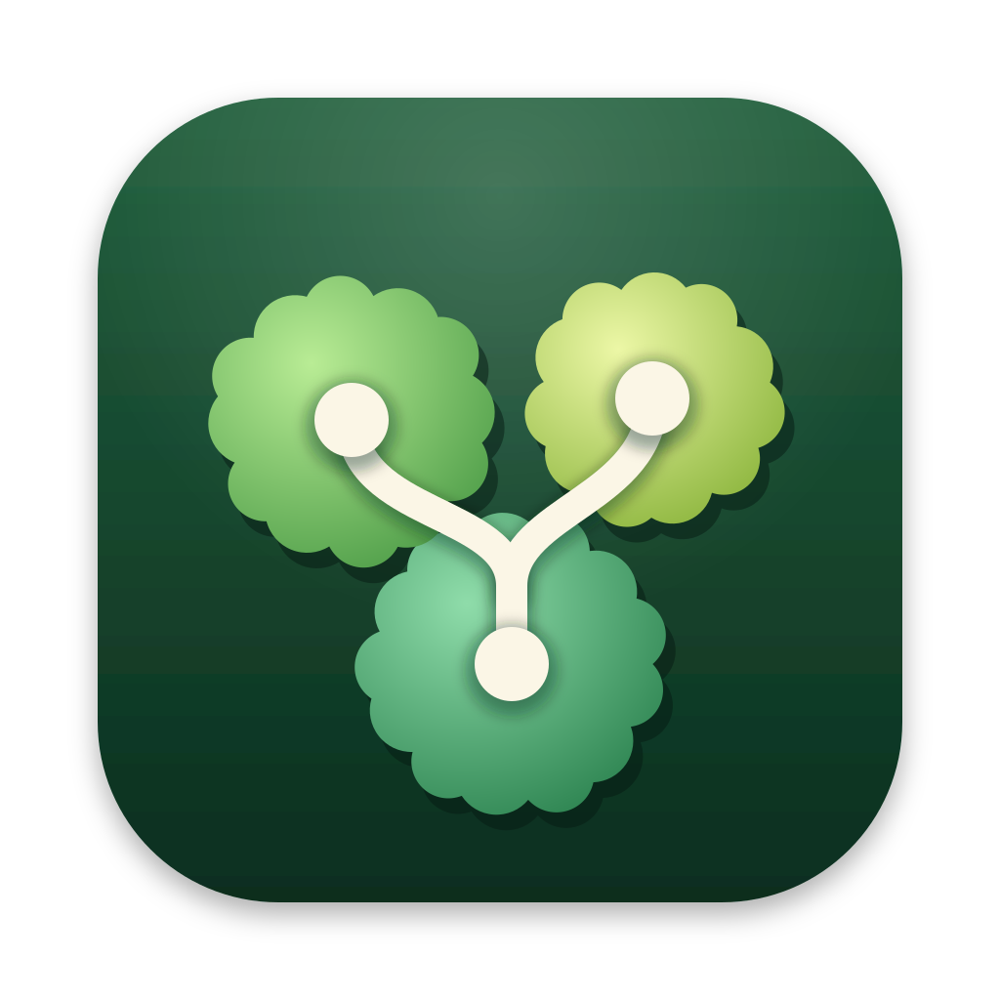
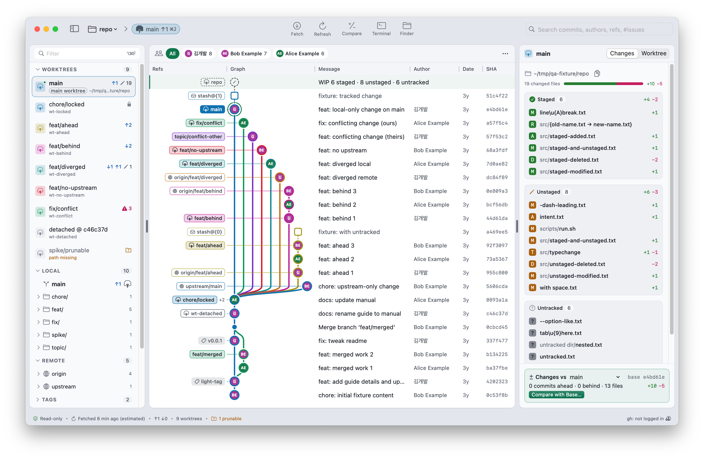
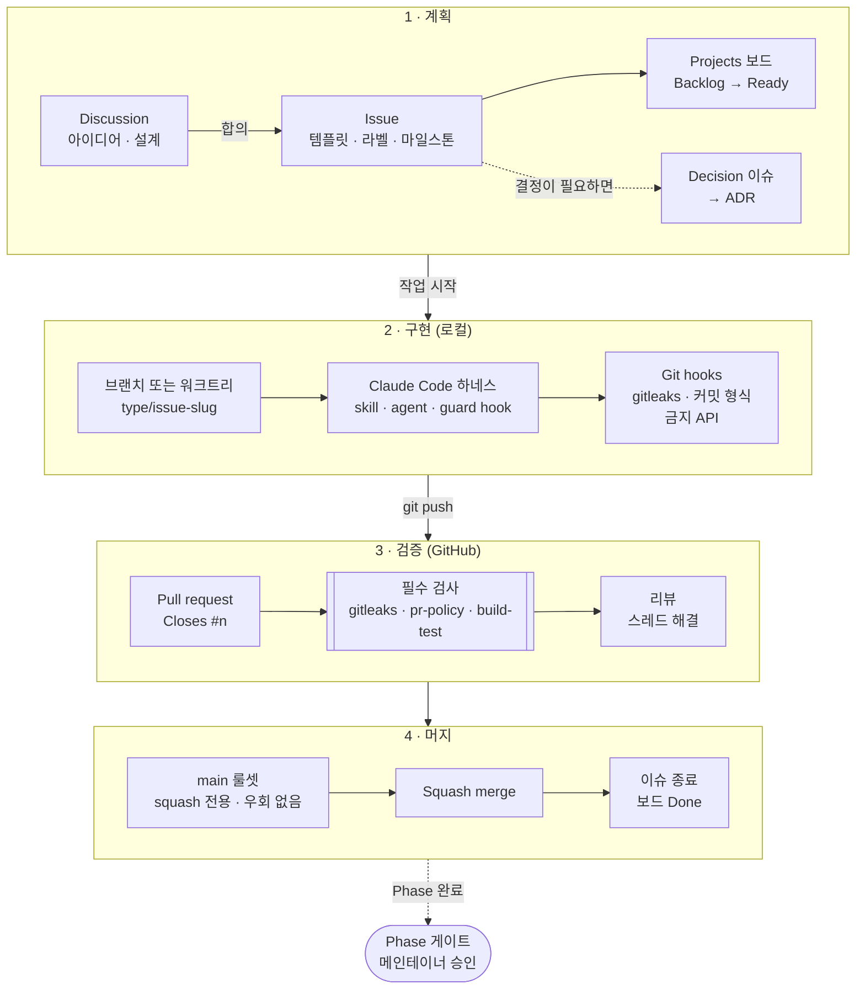

<p align="center">
  
</p>

<h1 align="center">Overgrove</h1>

<p align="center">
  <code>git worktree</code>를 여러 개 두고 동시에 작업하는 사람을 위한 macOS 네이티브 Git 클라이언트입니다.<br>
  모든 워크트리의 커밋하지 않은 변경, 원격보다 얼마나 앞서거나 뒤처졌는지, 저장소의 stash까지 창 하나에서 확인할 수 있습니다.
</p>

<p align="center">
  <a href="LICENSE"></a>
  
  
</p>

<p align="center">
  <a href="README.md">English</a> | <strong>한국어</strong>
</p>

---

> **상태: v0.1.0 릴리스를 준비하고 있습니다. 지금은 소스에서 빌드해 씁니다.** [기능](#기능)에 적은 내용은 실제
> 저장소에서 동작하지만, 아직 태그를 단 릴리스가 없고 Homebrew tap도 그 릴리스와 함께 공개됩니다. 다듬어지지 않은
> 곳이 있을 수 있으니 발견하면 [알려 주세요](https://github.com/kkdy21/overgrove/issues/new/choose). 남은 작업은
> [v0.1.0 마일스톤](https://github.com/kkdy21/overgrove/milestone/1)에서 볼 수 있습니다.

## 왜 만들었나

`git worktree`로 여러 기능을 동시에 개발하다 보면 간단한 질문에도 바로 답하기 어렵습니다.

- 어느 워크트리에 커밋하지 않은 작업이 남아 있고, stage는 해 두었나?
- stash에는 무엇이 들어 있고, 어느 브랜치에서 만들었나?
- 브랜치마다 upstream보다 얼마나 앞서 있거나 뒤처져 있나?
- 누가 언제 무엇을 바꿨나?

Overgrove는 이런 질문에 화면 하나로 답합니다. 쓰기 기능은 섞지 않았습니다.

## 누구에게 맞나

워크트리를 여러 개 동시에 돌리면서, 흔히 워크트리마다 AI 코딩 에이전트까지 붙여 두고, "지금 어디서 무슨 일이
벌어지고 있지?"를 창 하나에서 차분하게 보고 싶은 개발자를 위한 도구입니다.

이런 경우라면 잘 맞습니다.

- **Git GUI를 켜 두면 맥이 느려진다.** 저장소마다 파일 감시를 계속 돌리는 클라이언트는 워크트리가 늘어날수록 CPU와
  메모리를 많이 쓸 수 있습니다. Overgrove는 창이 화면에 보이는 동안에만 파일을 감시하고, 바뀐 워크트리에서만
  `git status`를 다시 실행합니다. 파일이 한꺼번에 많이 바뀌어도 실행 횟수를 제한합니다. 창이 가려지거나 최소화되면
  감시를 멈춰 자원을 쓰지 않고, 다시 보이면 한 번 새로 고칩니다.
- **잘 쓰던 도구가 더는 업데이트되지 않는다.** Overgrove는 MIT 라이선스이고 외부 의존성이 하나도 없습니다. Xcode만
  있으면 소스에서 빌드할 수 있으니, 누구든 이어서 유지하기 쉽습니다.
- **지금 쓰는 클라이언트로는 워크트리를 나란히 볼 수 없다.** Overgrove는 워크트리를 중심에 둡니다. 사이드바 하나에
  워크트리별 브랜치, 커밋하지 않은 변경, ahead/behind가 나오고, 저장소의 stash도 함께 보입니다.
- **조회만 하는 도구에 구독료를 내고 싶지 않다.** 무료 오픈소스입니다. 회원 가입도, 텔레메트리도 없습니다.
- **`git status` 하나 보려고 터미널 탭을 오가는 게 번거롭다.** 워크트리마다 `cd`하고 `git status`를 치던 일을 창
  하나가 대신합니다. 실제 쓰기 작업은 지금처럼 CLI로 하면 됩니다.
- **워크트리마다 AI 에이전트를 병렬로 돌린다.** 리뷰하거나 머지하기 전에 에이전트가 각각 무엇을 바꿨는지 확인할 수
  있습니다.

이런 경우에는 아직 맞지 않을 수 있습니다.

- GUI에서 stage, commit, push, pull, rebase까지 하고 싶은 경우. Overgrove는 조회와 `git fetch`만 합니다. 커밋,
  푸시, 정리 같은 쓰기 작업은 터미널이나 AI 에이전트에 맡깁니다.
- Windows나 Linux에서 써야 하는 경우.
- Developer ID로 서명하고 Apple 공증을 받은 앱이 꼭 필요한 경우. 그런 배포판은 없으니 Homebrew로 설치하거나 직접
  빌드해야 합니다.

## 스크린샷

<picture>
  <source media="(prefers-color-scheme: dark)" srcset="design/screenshots/main-window-dark.png">
  <source media="(prefers-color-scheme: light)" srcset="design/screenshots/main-window-light.png">
  
</picture>

macOS 14에서 `scripts/make-fixture-repo.sh`로 만든 테스트용 픽스처 저장소를 연 메인 창입니다. 이미지는 라이트·다크
모드 설정에 맞춰 바뀝니다. [라이트](design/screenshots/main-window-light.png)와
[다크](design/screenshots/main-window-dark.png) 이미지를 따로 열어 볼 수도 있습니다.

## 기능

- **워크트리:** bare 저장소를 포함해 저장소의 모든 워크트리를 보여 줍니다. 워크트리마다 브랜치, 경로,
  잠김(locked)·정리 대상(prunable) 여부, 변경 개수, ahead/behind, 연결된 이슈, GitHub PR 상태가 나옵니다.
- **워크트리별 작업 상태:** staged, unstaged, untracked, 충돌 파일을 줄 수와 함께 보여 주고, 서브모듈 상태도
  함께 나옵니다. diff 뷰어는 통합 보기와 좌우 분할 보기를 지원하고, 바뀐 단어를 강조하며, 원하면 공백 문자도
  표시합니다.
- **기준 브랜치와 비교:** 워크트리가 `main`에서 갈라진 뒤 무엇이 바뀌었는지 PR처럼 보여 줍니다. `main`보다 앞선
  커밋, 바뀐 파일, untracked 파일까지 나오니 PR을 열기 전에 에이전트가 한 일을 검토할 수 있습니다. 커밋 두 개를
  골라 비교할 수도 있습니다.
- **커밋 그래프:** 브랜치, 태그, stash, 워크트리를 해당 커밋 옆에 표시하고, 포커스한 워크트리의 커밋하지 않은
  변경은 *WIP* 행으로 보여 줍니다. AI 에이전트의 `Co-authored-by` 트레일러가 있는 커밋에는 *AI* 표시가 붙습니다.
  메시지, 작성자, SHA, ref, `#이슈 번호`로 검색하거나 작성자별로 걸러 볼 수 있고, 그래프를 확대할 수도 있습니다.
- **커밋 상세와 파일 이력:** 커밋 메시지와 바뀐 파일을 보여 줍니다. 파일 이력은 이름이 바뀌기 전까지 거슬러
  올라갑니다.
- **브랜치, 태그, stash:** 로컬·원격 브랜치와 upstream 상태, 태그, stash별로 바뀐 파일
- **폴링 없이 최신 상태 유지:** 창이 보이는 동안 워크트리의 파일 변경을 감시하고, 바뀐 워크트리만 새로 고칩니다.
  창이 가려지거나 최소화되면 감시를 멈춥니다.
- **fetch:** 원격마다 진행 상황을 보여 주며 fetch하고, 마지막 fetch 시각을 표시합니다. 자동 fetch도 켤 수
  있습니다(기본값은 꺼짐).
- **이슈(선택):** 이미 로그인해 둔 CLI로 열린 이슈를 불러옵니다. GitHub(github.com과 Enterprise 호스트)는 `gh`,
  GitLab은 `glab`, Gitea는 `gt`를 씁니다. 이슈는 번호로 브랜치, 워크트리, 커밋과 연결됩니다.
- **다른 도구와 함께:** 워크트리나 파일을 원하는 터미널·편집기에서 열고, 커밋·브랜치·파일을 GitHub에서 열 수
  있습니다. macOS 15 이상에서는 훑어보기(Quick Look)로 파일을 미리 볼 수 있습니다.
- **macOS 네이티브 앱:** 키보드 탐색과 단축키, 선택 이력 뒤로·앞으로 가기, VoiceOver 레이블, 대비 증가, 라이트·다크
  모드, 영어·한국어 UI를 지원합니다.

**처음부터 조회 전용으로 설계했습니다.** 원격 저장소에 접근하는 동작은 `git fetch` 하나뿐입니다. push, pull, merge,
reset, stage는 일부러 넣지 않았습니다. Overgrove는 쓰기를 맡는 터미널이나 AI 에이전트 옆에 띄워 두고 보는
도구입니다([범위](docs/scope-mvp.md)). v0.1.0에 들어간 기능 전체와 알려진 제약은 [변경 기록](CHANGELOG.md)(영문)에
있습니다.

## 보안

신뢰할 수 없는 저장소를 Git 클라이언트로 열면, 그 저장소 설정에 심어 둔 코드가 실행될 수 있습니다. hooks, 필터,
fsmonitor, diff 드라이버, credential helper, SSH 명령 같은 것들입니다. Overgrove는 믿을 수 없는 저장소를 열어
보더라도 이런 코드가 실행되지 않게 만들었습니다.

- `git`은 셸을 거치지 않고 인자 배열로만 실행합니다. 코드에 들어 있는 명령은 조회 명령과 `git fetch`뿐입니다.
- 위험한 저장소 설정(fsmonitor, hooks, 필터, 외부 diff, credential helper, 별도로 지정한 SSH 명령 등)은 강제로
  끕니다. 안전하게 끌 수 없는 설정이 있으면 조회를 멈춥니다.
- 저장소가 지정한 프록시, 쿠키, TLS 인증서를 `git fetch`에 쓰지 못하게 하고, Git에 내장된 전송 방식만 허용합니다.
- 자식 프로세스에는 허용 목록에 있는 환경 변수만 넘깁니다.
- 모든 명령에 시간 제한과 출력 크기 제한을 둡니다.
- 원격 URL과 git 오류 메시지에 들어 있는 자격 증명은 가려서 보여 줍니다.
- 토큰을 묻지도 저장하지도 않습니다. 이슈와 PR 정보는 이미 로그인해 둔 `gh`, `glab`, `gt`로 가져옵니다.
- 워크트리마다 설정을 검사하고, Overgrove가 끈 설정은 그 워크트리의 **보안**(Security) 카드에 보여 줍니다.

주의할 점도 있습니다.

- **터미널과 편집기는 보호하지 못합니다.** *터미널에서 열기*, *편집기에서 열기*, 그리고 Overgrove가 복사해 주는
  명령은 일반 `git`과 사용자의 도구로 실행되고, 이 도구들은 저장소의 hooks와 설정을 그대로 따릅니다. 워크트리
  폴더를 열 때 Overgrove는 설정을 검사해 문제가 없다고 확인된 경우에만 바로 열고, 그 밖에는 먼저 묻습니다. 파일
  하나를 편집기로 열 때는 묻지 않습니다. 열린 뒤에 실행되는 일까지 막지는 못하니 신뢰하는 저장소에서만 쓰세요.
- **fetch는 사용자의 자격 증명으로 원격에 접속합니다.** 자격 증명을 보내는 방식(프록시, 인증서, helper)은 저장소가
  바꿀 수 없지만, 원격 URL은 저장소가 정합니다. 믿을 수 없는 원격에서는 fetch하지 마세요.
- 미심쩍은 저장소는 보안 카드의 **신뢰하지 않음으로 취급**(Treat as untrusted)이나 **설정 › 저장소**에서
  신뢰하지 않음으로 표시해 두세요. 그러면 이 Mac 안의 폴더를 가리키는 원격은 fetch하지 않습니다. 그런 원격을 fetch하면 상대 저장소에서
  `git`이 실행되기 때문입니다. 터미널이나 편집기로 열 때도 항상 먼저 묻습니다.
- 저장소 필터를 끄기 때문에, Git LFS처럼 필터가 내용을 바꾸는 파일은 변경된 것으로 보일 수 있습니다.
- 자체 호스팅 서버나 사내 서버에서는 토큰, SSH 호스트 키, 사설 CA, 프록시를 한 번 설정해야 할 수 있습니다.
  [자체 호스팅·사내 Git 서버](docs/guides/self-hosted-git.ko.md) 안내를 참고하세요.

자세한 내용은 [SECURITY.md](SECURITY.md)(영문)에 있습니다. 취약점을 비공개로 제보하는 방법도 이 문서에 나와 있습니다.
위협 모델은 [보안 검토](docs/design/security-review.md)에 정리해 두었습니다.

## 요구 사항

- 실행: macOS 14 Sonoma 이상
- 빌드(직접 빌드하거나 Homebrew가 소스에서 빌드할 때): Xcode 26 이상. Xcode 26.0–26.3은 macOS Sequoia 15.6 이상,
  26.4부터는 macOS Tahoe 26.2 이상에서 실행됩니다. Homebrew bottle에는 Xcode가 필요 없습니다.
- Git 2.36 이상. Overgrove는 기본적으로 `xcode-select`가 가리키는 개발자 디렉터리(Xcode 또는 Command Line Tools)의
  `git`을 씁니다. 셸의 `PATH`에서 먼저 잡히는 `git`과는 다를 수 있습니다. Homebrew로 설치한 `git` 같은 다른 실행 파일은
  **설정 › 고급**에서 고를 수 있습니다. 처음 실행하면 설정 도우미가 버전을 확인합니다.
- 선택: 이슈 패널을 쓰려면 원격 호스트에 로그인해 둔 [GitHub CLI](https://cli.github.com/)(`gh`, PR 상태 표시에도
  씀), [GitLab CLI](https://gitlab.com/gitlab-org/cli)(`glab`), Gitea CLI(`gt`, Gitea 28 이상) 중 하나가 필요합니다.

## Homebrew로 설치하기

```sh
brew install kkdy21/tap/overgrove
```

- Apple silicon Mac에서 macOS 14 이상을 쓰고 Homebrew가 기본 위치인 `/opt/homebrew`에 있으면, 미리 빌드한 bottle을
  설치합니다. Xcode는 필요 없습니다.
- Intel Mac이거나, Homebrew를 `/opt/homebrew`가 아닌 곳에 두었거나, `--build-from-source`를 주면 Homebrew가 릴리스
  태그의 소스에서 앱을 빌드합니다. 이때는 Xcode 26이 필요하고, Xcode 26은 macOS 15.6 이상에서 실행됩니다. Intel
  Mac에서의 동작은 테스트하지 않았습니다.
- 이름 전체로 설치하면 tap 전체가 아니라 이 formula 하나만 신뢰합니다([tap trust](https://docs.brew.sh/Tap-Trust)).
- 앱은 `$(brew --prefix)/opt/overgrove/Overgrove.app`에 설치됩니다. `~/Applications`에 링크하거나 복사하는 방법은
  설치가 끝날 때 나오는 안내에 있습니다.

bottle은 ad-hoc 서명만 되어 있습니다. Developer ID 서명도, Apple 공증도 거치지 않았습니다. Homebrew는 formula로
내려받은 파일에 격리 표시를 붙이지 않으므로, 직접 빌드한 앱과 마찬가지로 Gatekeeper 확인 창 없이 열립니다.

bottle을 tap의 GitHub Actions 워크플로우가 만들었는지는 build provenance attestation으로 확인할 수 있습니다. 방법은
두 가지이고, 둘 다 [GitHub CLI](https://cli.github.com/) 로그인이 필요하며 bottle을 설치할 때만 해당합니다.

```sh
# Homebrew가 bottle을 설치하기 전에 attestation을 확인하게 한다
HOMEBREW_VERIFY_ATTESTATIONS=1 brew install kkdy21/tap/overgrove

# 또는 내려받은 bottle을 직접 확인한다
brew tap kkdy21/tap
brew trust --formula kkdy21/tap/overgrove
brew fetch kkdy21/tap/overgrove
gh attestation verify "$(brew --cache kkdy21/tap/overgrove)" --repo kkdy21/homebrew-tap \
  --signer-workflow kkdy21/homebrew-tap/.github/workflows/bottle.yml
```

Homebrew가 `Skipping attestation verification`을 출력했다면 확인을 거치지 않은 것입니다. 미리 빌드한 바이너리를
쓰고 싶지 않다면 `brew install --build-from-source kkdy21/tap/overgrove`로 같은 formula를 소스에서 빌드할 수 있습니다.

## 소스에서 빌드하기

Overgrove는 소스와 ad-hoc 서명된 Homebrew bottle로 배포합니다. Developer ID로 서명하고 공증받은 배포판은 없습니다.
직접 빌드할 때 Apple Developer 계정은 없어도 됩니다. 프로젝트가 앱을 내 Mac에서 실행할 수 있게만 서명합니다
("Sign to Run Locally"). Xcode가 설치되어 있다면
아래 과정은 몇 분이면 끝납니다.

**1. Xcode 설치.** App Store에서 Xcode 26 이상을 설치하고 한 번 실행해, 라이선스에 동의하고 추가 구성 요소를
설치합니다.

**2. 코드 받기와 환경 점검.**

```sh
git clone https://github.com/kkdy21/overgrove.git
cd overgrove
./scripts/bootstrap.sh --build   # macOS, Xcode, Overgrove가 쓸 git을 점검합니다. 아무것도 바꾸지 않습니다
```

점검에 실패하면 해결 명령을 함께 보여 줍니다. 새 Mac이라면 보통 다음 중 하나입니다.

```sh
sudo xcode-select -s /Applications/Xcode.app/Contents/Developer   # Xcode 대신 Command Line Tools가 선택된 경우
sudo xcodebuild -license accept                                    # Xcode 라이선스에 아직 동의하지 않은 경우
sudo xcodebuild -runFirstLaunch                                    # Xcode 첫 실행 준비가 끝나지 않은 경우
```

**3. 빌드와 실행.** 프로젝트를 열고 ⌘R을 누릅니다.

```sh
open Overgrove.xcodeproj
```

`/Applications`에 두고 쓸 앱이 필요하면 명령줄에서 빌드합니다.

```sh
xcodebuild -project Overgrove.xcodeproj -scheme Overgrove -configuration Release \
  -destination 'platform=macOS' -derivedDataPath build build
ditto build/Build/Products/Release/Overgrove.app /Applications/Overgrove.app
open /Applications/Overgrove.app
```

내 Apple Development 인증서로 서명하고 싶다면 `Config/Personal.xcconfig.local.example`을
`Config/Personal.xcconfig.local`로 복사해 내용을 채우세요. 이 파일은 Git이 추적하지 않습니다.

**4. 첫 실행.** 설정 도우미가 `git`과 `gh`를 확인하고 저장소를 추가하라고 안내합니다. Overgrove는 추가한 폴더만
읽습니다. 저장소는 나중에 ⌘O로 더 추가할 수 있습니다. 이슈 패널을 쓰려면 `gh auth login`(또는 `glab`, `gt`)으로 한
번 로그인한 뒤 **다시 확인**을 누르세요. 원격 호스트에 맞는 명령은 패널에 나옵니다. 설정 도우미는
**도움말 › 설정 도우미…**에서 다시 열 수 있습니다.

**테스트**는 Xcode에서 ⌘U를 누르거나 다음 명령으로 실행합니다.

```sh
xcodebuild test -project Overgrove.xcodeproj -scheme Overgrove -destination 'platform=macOS'
```

전체 테스트에는 몇 분이 걸립니다. 성능 벤치마크는 따로 켜지 않으면 건너뜁니다([벤치마크 계획](docs/performance/benchmark-plan.md)).

기여하려면 `--build` 없이 `./scripts/bootstrap.sh`를 실행해 Git hooks까지 설치하세요. 이 모드는 클론의
`core.hooksPath`를 바꾸고, [gitleaks](https://github.com/gitleaks/gitleaks)가 있어야 합니다. 그다음
[CONTRIBUTING.md](CONTRIBUTING.md)(영문)를 읽어 주세요.

## 작업 방식

모든 변경은 이슈에서 시작하고, `main`에는 PR로만 들어갑니다. PR은 로컬, CI, 브랜치 룰셋에서 같은 검사를 모두
통과해야 합니다. 기획 문서는 메인테이너가 승인하는 Phase 게이트를 거칩니다.



| 규칙 | 지키게 하는 장치 | 참고 문서 |
|---|---|---|
| 이슈부터 만든다 | `pr-policy` 검사, 템플릿 | [이슈 규칙](docs/process/issues.md) |
| 코드를 쓰기 전에 이슈를 선점한다(5시간 안에 draft PR, 먼저 연 PR 우선) | `/claim` 봇, `claim-expiry` 워크플로, `pr-policy` 검사 | [협업](docs/process/collaboration.md) |
| 의존 이슈를 기다리지 않는다. stand-in으로 개발하고 머지는 의존 순서대로 한다 | `pr-policy` 검사, `dependency-closed` 워크플로 | [협업](docs/process/collaboration.md) |
| 비밀 정보와 개인 경로를 올리지 않는다 | Git hooks, Claude Code hook, `gitleaks` 검사, GitHub push protection | [브랜치와 커밋](docs/process/branching-and-commits.md) |
| 프로세스·셸 API는 `Overgrove/Execution/`에서만 쓴다 | Git hook, Claude Code hook, `build-test` 검사 | [보안 검토](docs/design/security-review.md) |
| 리뷰를 거쳐 squash로만 머지한다 | `main` 룰셋(squash 전용, 필수 검사, 스레드 해결) | [Pull request](docs/process/pull-requests.md) |
| Phase는 메인테이너 승인을 받아야 넘어간다 | 메인테이너, `/phase-gate` 보고서 | [Phase 게이트](docs/process/phase-gates.md) |

전체 흐름은 [docs/process/development-workflow.md](docs/process/development-workflow.md)에, Claude Code 하네스는
[docs/process/claude-code-harness.md](docs/process/claude-code-harness.md)에 정리해 두었습니다.

## 프로젝트 문서

| | |
|---|---|
| 제품 | [PRD](docs/prd.md) · [MVP 범위](docs/scope-mvp.md) · [용어집](docs/glossary.md) · [로드맵](docs/roadmap.md) |
| 디자인 | [아트 디렉션](docs/design/art-direction.md) · [정보 구조](docs/design/information-architecture.md) · [화면](docs/design/screens.md) · [인터랙션](docs/design/interaction.md) · [디자인 토큰](docs/design/design-tokens.md) · [아이콘](docs/design/iconography.md) |
| 엔지니어링 | [아키텍처](docs/architecture/overview.md) · [Git 명령 카탈로그](docs/architecture/git-command-catalog.md) · [파싱 명세](docs/architecture/parsing-spec.md) · [ADR](docs/adr/) |
| 보안 | [보안 검토와 위협 모델](docs/design/security-review.md) · [SECURITY.md](SECURITY.md) |
| 품질 | [테스트 전략](docs/testing/test-strategy.md) · [성능 예산](docs/performance/performance-budget.md) · [QA 프로세스](docs/qa/process.md) |
| 프로세스 | [기여 안내](CONTRIBUTING.md) · [개발 흐름](docs/process/development-workflow.md) · [행동 강령](CODE_OF_CONDUCT.md) |

`docs/` 아래의 기획·설계 문서는 한국어로, 기여자가 처음 접하는 문서는 영어로
씁니다([ADR-0005](docs/adr/0005-documentation-language.md)). README는 영어판이 원본이고, 이 문서는 그 한국어판입니다.

## 기여하기

이슈, 아이디어, PR 모두 환영합니다. AI의 도움을 받은 기여도 마찬가지입니다. 먼저 [CONTRIBUTING.md](CONTRIBUTING.md)(영문)를
읽어 주세요. 핵심만 추리면 이렇습니다.

- 이슈에 `/claim` 댓글을 달고, 5시간 안에 draft PR을 엽니다.
- 모든 PR은 이슈 하나를 닫습니다.
- 아이디어는 [Discussions](https://github.com/kkdy21/overgrove/discussions)에서 시작합니다.
- 보안 문제는 [비공개 제보](https://github.com/kkdy21/overgrove/security/advisories/new)로 받습니다.

## 디자인 참고

사이드바, 커밋 그래프, 상세 패널로 나뉜 3단 구성은 여러 Git 클라이언트에서 흔히 쓰는 레이아웃을 따랐습니다. 다른 제품의
이름, 로고, 아이콘, 문구, 색상은 가져다 쓰지 않았습니다.

## 라이선스

[MIT](LICENSE)
