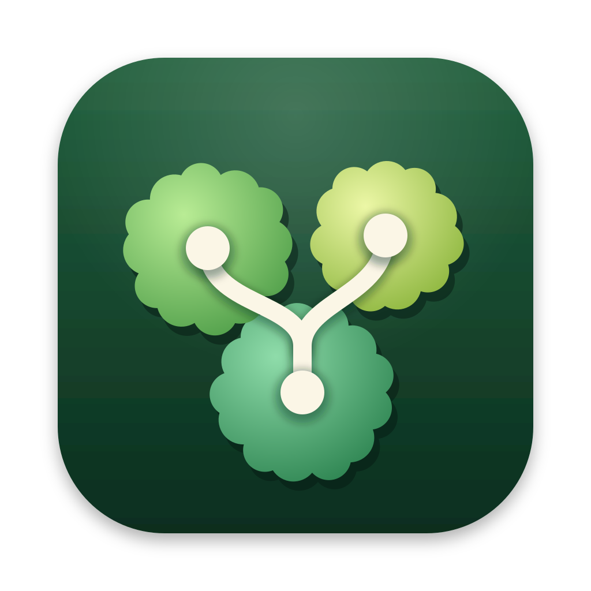
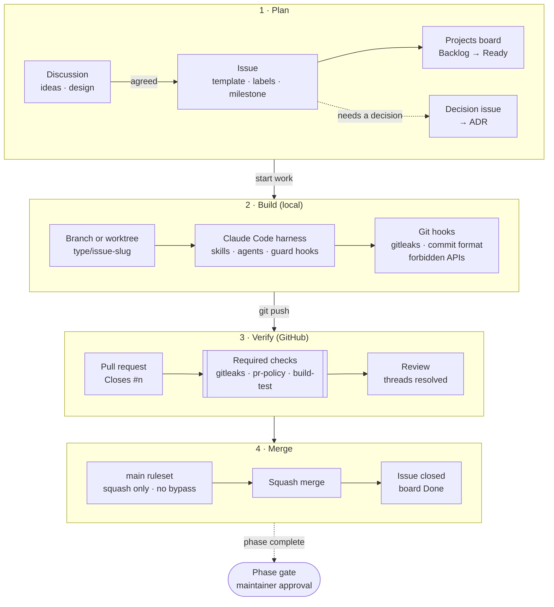

<p align="center">
  
</p>

<h1 align="center">Overgrove</h1>

<p align="center">
  A native macOS Git client for people who work in many <code>git worktree</code>s at once.<br>
  See every worktree, its uncommitted changes, stashes, and how far it is from its remote, all in one window.
</p>

<p align="center">
  <a href="LICENSE"></a>
  
  
</p>

---

> **Status: planning and design (pre-alpha).** There is no app code yet. This repository currently holds the product
> spec, design, architecture, security review, and project tooling. Follow the
> [roadmap](docs/roadmap.md) and the [v0.1.0 milestone](https://github.com/kkdy21/overgrove/milestone/1).

## Why

If you develop several features in parallel with `git worktree`, it is hard to answer simple questions quickly:

- Which worktree has uncommitted work, and is it staged?
- What is sitting in the stash, and which branch did it come from?
- How far ahead or behind its upstream is each branch?
- Who changed what, and when?

Overgrove answers those questions on one screen, without mixing in write operations.

## Planned features (v0.1.0)

- **Worktrees:** every worktree with its branch, HEAD, path, and locked or prunable state
- **Working state per worktree:** staged, unstaged, untracked, and conflicted files
- **Stashes:** the repository's stash list with a per-stash change summary
- **Ahead/behind:** compared with each branch's upstream after `git fetch`, with the last fetch time
- **Commit graph:** author, date, and message, with a *WIP* row on top for uncommitted changes
- **Commit details and file history**
- **GitHub issues (optional):** listed through your existing `gh` login and linked to branches by issue number

**Read-only by design.** The only operation that touches a remote is `git fetch`. Push, pull, merge, reset, and staging
are intentionally out of scope for v0.1 ([scope](docs/scope-mvp.md)).

## Security

Opening an untrusted repository in a Git client can run code that the repository configures. Overgrove takes a
defensive approach:

- `git` is invoked with argument arrays, never through a shell
- dangerous repository settings (fsmonitor, hooks, filters, external diff, custom SSH commands, …) are forced off
- the child environment is built from an allowlist
- every command has a timeout and an output limit
- credentials in remote URLs are masked
- tokens are never stored: GitHub access goes through `gh`

Read [SECURITY.md](SECURITY.md) for details and for how to report a vulnerability privately.

## Requirements

- macOS 14 Sonoma or later
- Xcode (a recent release) to build from source
- `git` 2.36 or later (the system `/usr/bin/git` is used by default)
- Optional: [GitHub CLI](https://cli.github.com/) (`gh`), logged in, for the issues panel

## Build from source

Overgrove is distributed **as source only**. No signed or notarized binaries are provided.

```sh
git clone https://github.com/kkdy21/overgrove.git
cd overgrove
./scripts/bootstrap.sh
open Overgrove.xcodeproj   # available from Phase 3
# then press ⌘R in Xcode
```

## How we work

Every change starts as an issue and reaches `main` only through a pull request that passes the same safety net
locally, in CI, and in the branch ruleset. Planning documents move through phase gates that the maintainer approves.



| Layer | Enforced by | Details |
|---|---|---|
| Issue first | `pr-policy` check, templates | [Issues](docs/process/issues.md) |
| Secrets and personal paths | Git hooks, Claude Code hook, `gitleaks` check, GitHub push protection | [Branching and commits](docs/process/branching-and-commits.md) |
| Process and shell APIs only in `Overgrove/Execution/` | Git hook, Claude Code hook, `build-test` check | [Security review](docs/design/security-review.md) |
| Review and merge | `main` ruleset (squash only, required checks, resolved threads) | [Pull requests](docs/process/pull-requests.md) |
| Phase approval | Maintainer, `/phase-gate` report | [Phase gates](docs/process/phase-gates.md) |

The full flow is described in [docs/process/development-workflow.md](docs/process/development-workflow.md), and the
Claude Code harness in [docs/process/claude-code-harness.md](docs/process/claude-code-harness.md).

## Project documents

| | |
|---|---|
| Product | [PRD](docs/prd.md) · [MVP scope](docs/scope-mvp.md) · [Glossary](docs/glossary.md) · [Roadmap](docs/roadmap.md) |
| Design | [Information architecture](docs/design/information-architecture.md) · [Screens](docs/design/screens.md) · [Interaction](docs/design/interaction.md) · [Design tokens](docs/design/design-tokens.md) · [Iconography](docs/design/iconography.md) |
| Engineering | [Architecture](docs/architecture/overview.md) · [Git command catalog](docs/architecture/git-command-catalog.md) · [Parsing spec](docs/architecture/parsing-spec.md) · [ADRs](docs/adr/) |
| Security | [Security review & threat model](docs/design/security-review.md) · [SECURITY.md](SECURITY.md) |
| Quality | [Test strategy](docs/testing/test-strategy.md) · [Performance budget](docs/performance/performance-budget.md) · [QA process](docs/qa/process.md) |
| Process | [Contributing](CONTRIBUTING.md) · [Development workflow](docs/process/development-workflow.md) · [Code of Conduct](CODE_OF_CONDUCT.md) |

Internal planning and design documents are written in Korean; contributor-facing documents are in English
([ADR-0005](docs/adr/0005-documentation-language.md)).

## Contributing

Issues, ideas, and pull requests are welcome. Start with [CONTRIBUTING.md](CONTRIBUTING.md). The short version: every
PR closes an issue, ideas start in [Discussions](https://github.com/kkdy21/overgrove/discussions), and security
reports go through [private reporting](https://github.com/kkdy21/overgrove/security/advisories/new).

## Acknowledgements

The three-pane layout (sidebar, commit graph, detail) follows a common pattern among Git clients. Overgrove does not
use any other product's name, logo, icons, wording, or color palette.

## License

[MIT](LICENSE)
