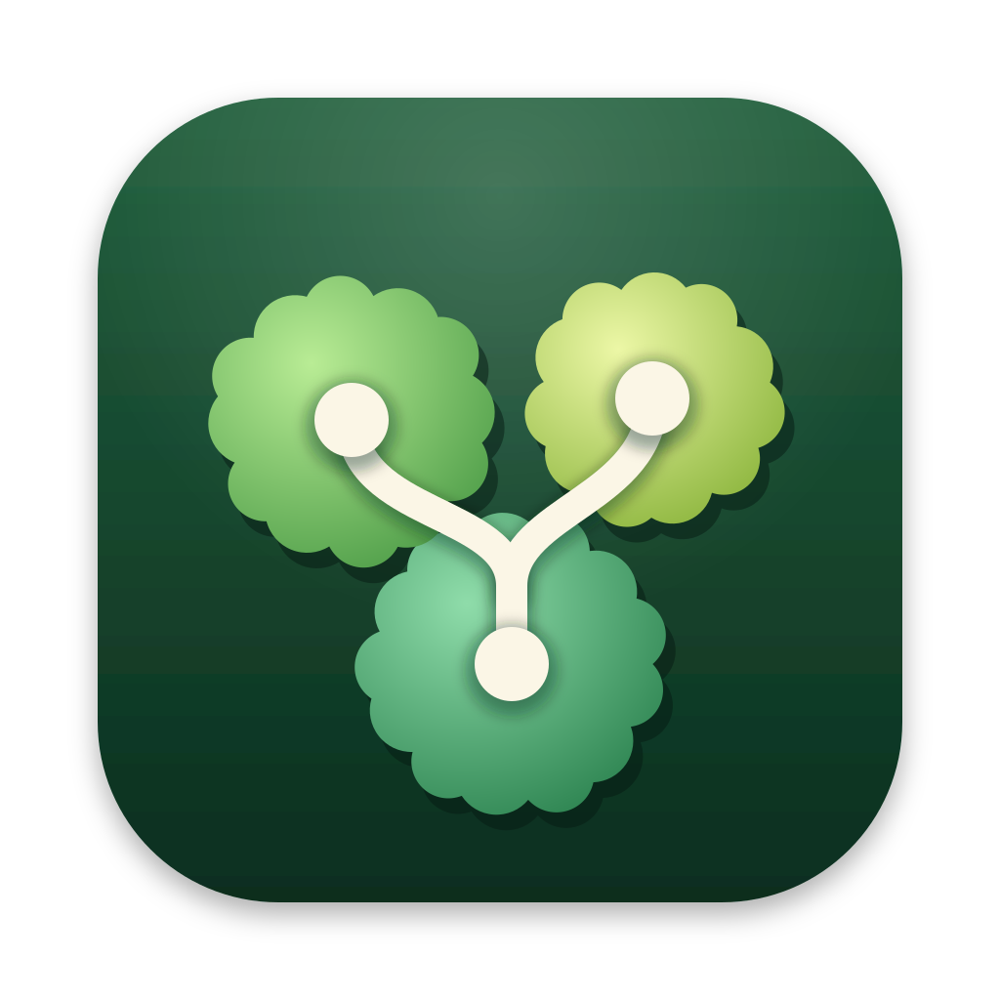
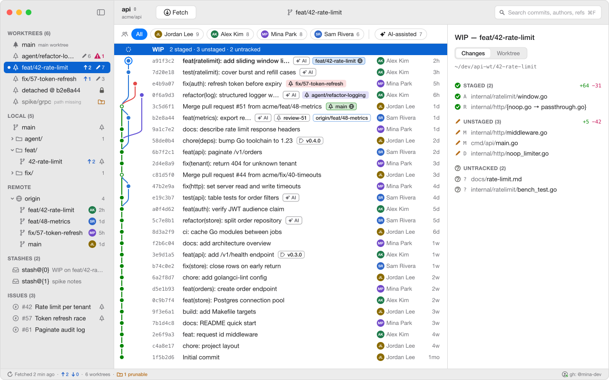
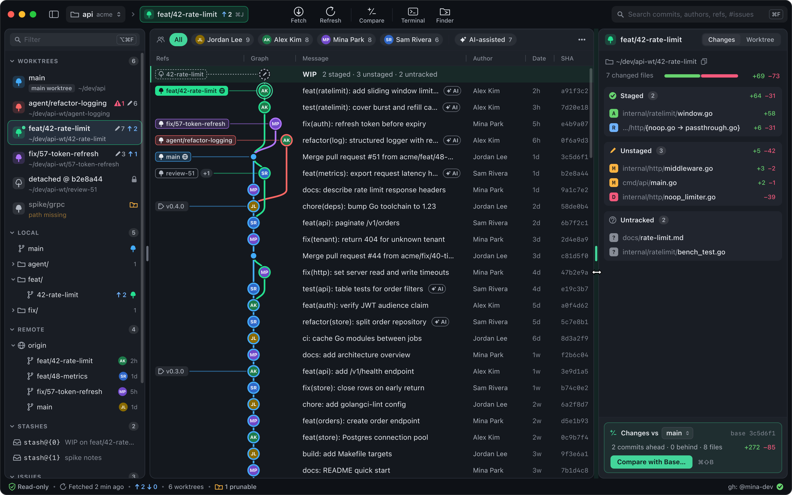
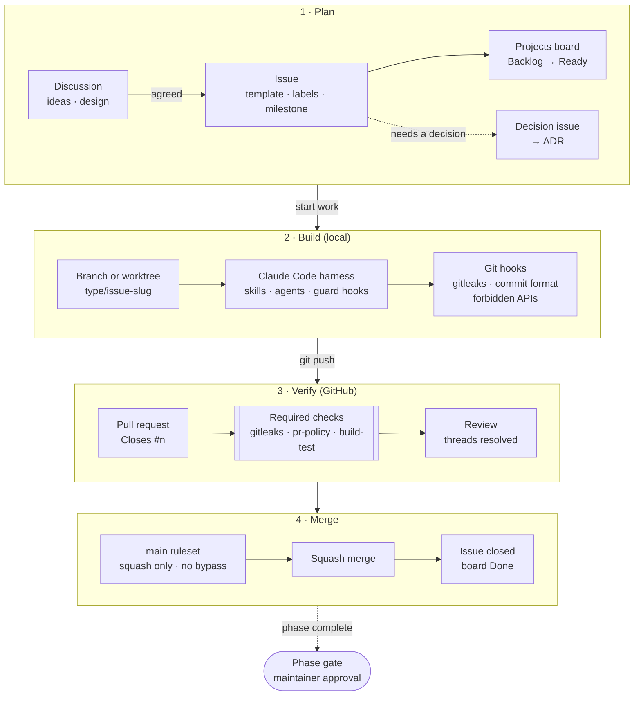

<p align="center">
  
</p>

<h1 align="center">Overgrove</h1>

<p align="center">
  A native macOS Git client for people who work in many <code>git worktree</code>s at once.<br>
  See every worktree, its uncommitted changes, stashes, and how far it is from its remote, all in one window.
</p>

<p align="center">
  <a href="LICENSE"></a>
  
  
</p>

<p align="center">
  <strong>English</strong> | <a href="README.ko.md">한국어</a>
</p>

---

> **Status: preparing v0.1.0, build from source.** Everything under [Features](#features) works on real repositories,
> but there is no tagged release and no prebuilt app yet. Expect rough edges, and please
> [report them](https://github.com/kkdy21/overgrove/issues/new/choose). The
> [v0.1.0 milestone](https://github.com/kkdy21/overgrove/milestone/1) shows what is left.

## Why

If you develop several features in parallel with `git worktree`, it is hard to answer simple questions quickly:

- Which worktree has uncommitted work, and is it staged?
- What is sitting in the stash, and which branch did it come from?
- How far ahead or behind its upstream is each branch?
- Who changed what, and when?

Overgrove answers those questions on one screen, without mixing in write operations.

## Who is it for

Overgrove is for developers who keep several worktrees going at once, often with an AI coding agent working in each,
and want one calm window that answers *"what is going on where?"*

It is a good fit if:

- **Your Git GUI slows your Mac down.** Clients that keep file watchers running on every repository can use a lot of
  CPU and memory once you have many worktrees open. Overgrove watches files only while its window is visible, re-runs
  `git status` only for the worktrees that changed, and rate-limits that even during a burst of file writes. A covered
  or minimized window stops watching and costs nothing; it refreshes once when you bring it back.
- **A tool you relied on stopped getting updates.** Overgrove is MIT-licensed, has zero third-party dependencies, and
  builds from source with Xcode alone, so it is easy to keep alive.
- **Your current client cannot show your worktrees side by side.** Worktrees are the primary object here: each one with
  its branch, uncommitted changes, and ahead/behind status, plus the repository's stashes, all in one sidebar.
- **You don't want to pay a subscription for a read-only overview.** Free and open source. No account, no telemetry.
- **You are tired of hopping between terminal tabs to run `git status`.** One window replaces the round of `cd` and
  `git status`, and you keep using the CLI for the actual writes.
- **You run AI agents in parallel worktrees** and need to see what each one changed before you review or merge.

It is probably not for you yet if:

- you want to stage, commit, push, pull, or rebase from a GUI. Overgrove stays read-only plus `git fetch`; commits,
  pushes, and cleanup are left to your terminal or your AI agents.
- you need Windows or Linux.
- you want a signed, notarized download. Overgrove is source-only for now.

## Screenshots

> These are design mockups drawn from the design tokens with sample data, not screenshots of the app. More screens
> are in [docs/design/mockups.md](docs/design/mockups.md).

| Light | Dark |
|---|---|
|  |  |

## Features

- **Worktrees:** every worktree of a repository, bare repositories included, with its branch, path, locked or
  prunable state, change counts, ahead/behind, linked issue, and GitHub pull request status
- **Working state per worktree:** staged, unstaged, untracked, and conflicted files with line counts, submodule
  status, and a diff viewer (unified or split, changed words highlighted, whitespace shown on request)
- **Changes against the base branch:** a PR-style view of what a worktree changed since it branched off `main`
  (commits ahead, changed files, untracked files), so you can review an agent's work before opening the pull request.
  You can also compare any two commits
- **Commit graph:** branches, tags, stashes, and worktrees on their commits, a *WIP* row for the focused worktree, and
  an *AI* mark on commits with an AI agent's `Co-authored-by` trailer. Search by message, author, SHA, ref, or
  `#issue`, filter by author, and zoom
- **Commit details and file history:** a commit's message and files, and a file's history across renames
- **Branches, tags, and stashes:** local and remote branches with their upstream status, tags, and each stash's files
- **Stays current without polling:** while the window is visible it watches the worktrees for file changes and
  refreshes only the ones that changed. A covered or minimized window stops watching
- **Fetch:** per remote, with progress, the last fetch time, and optional automatic fetch (off by default)
- **Issues (optional):** open issues from GitHub (github.com and Enterprise hosts) through `gh`, from GitLab through
  `glab`, or from Gitea through `gt`, using your existing CLI login. Issues are linked to branches, worktrees, and
  commits by number
- **Works with your tools:** open a worktree or file in the terminal or editor you choose, open commits, branches,
  and files on GitHub, and preview files with Quick Look (macOS 15 and later)
- **Native Mac app:** keyboard navigation and shortcuts, back and forward through selections, VoiceOver labels,
  Increase Contrast, light and dark appearances, and English and Korean UI

**Read-only by design.** The only operation that touches a remote is `git fetch`. Push, pull, merge, reset, and staging
are intentionally left out: Overgrove sits next to your terminal or AI agents, which do the writing
([scope](docs/scope-mvp.md)). The full list of what v0.1.0 ships, and its known limitations, is in the
[changelog](CHANGELOG.md).

## Security

Opening an untrusted repository in a Git client can run code that the repository configures: hooks, filters,
fsmonitor, diff drivers, credential helpers, SSH commands, and more. Overgrove is built so that browsing a repository
you do not trust does not run any of that:

- `git` is invoked with argument arrays, never through a shell, and only read-only commands and `git fetch` exist in
  the code
- dangerous repository settings (fsmonitor, hooks, filters, external diff, credential helpers, custom SSH commands, …)
  are forced off, and a setting that cannot be turned off safely stops the query
- a repository cannot send `git fetch` through its own proxy, cookies, or TLS certificates, and only Git's built-in
  transports are allowed
- the child environment is built from an allowlist
- every command has a timeout and an output limit
- credentials in remote URLs and in git's error output are masked
- tokens are never asked for or stored: issue and pull request access goes through your `gh`, `glab`, or `gt` login
- each worktree's configuration is checked, and what Overgrove turned off is listed in the worktree's **Security** card

Things to keep in mind:

- **Your terminal and editor are not protected.** *Open in Terminal*, *Open in Editor*, and the commands Overgrove
  offers to copy run plain `git` and your own tools, which do use a repository's hooks and settings. Before opening a
  worktree folder, Overgrove asks unless the worktree's settings were checked and found clean; a single file opens in
  the editor without asking. What runs there is outside its protection. Use them only in repositories you trust.
- **Fetch contacts the remote** with your credentials. A repository cannot change how those credentials are sent
  (proxies, certificates, helpers), but it does choose the remote URL. Don't fetch from remotes you don't trust.
- **Treat as untrusted** (in the Security card or **Settings › Repositories**) is there for repositories you are
  unsure about. Overgrove then never fetches from remotes that are folders on this Mac, because that would run `git`
  in the other repository, and it always asks before opening the repository in a terminal or editor.
- Repository filters are turned off, so files that a filter such as Git LFS rewrites can show as changed.
- Self-hosted or corporate servers may need a one-time setup for tokens, SSH host keys, private CAs, or proxies: see
  [Self-hosted and corporate Git servers](docs/guides/self-hosted-git.md).

Read [SECURITY.md](SECURITY.md) for details and for how to report a vulnerability privately. The threat model is in
the [security review](docs/design/security-review.md).

## Requirements

- macOS 14 Sonoma or later to run Overgrove
- Xcode 26 or later to build it. Xcode 26 itself needs macOS Sequoia 15.6 or later
- Git 2.36 or later. By default Overgrove runs the `git` of the developer directory that `xcode-select` points to
  (Xcode or the Command Line Tools), not the first `git` on your `PATH`. You can choose another `git`, such as
  Homebrew's, in **Settings › Advanced**. The setup assistant checks it on first launch
- Optional, for the issues panel: [GitHub CLI](https://cli.github.com/) (`gh`, also used for pull request status),
  [GitLab CLI](https://gitlab.com/gitlab-org/cli) (`glab`), or the Gitea CLI (`gt`, Gitea 28 or later), logged in
  to the host of your remote

## Build from source

Overgrove is distributed **as source only**. No signed or notarized binaries are provided. You don't need an Apple
Developer account: the project signs the app to run on your own Mac ("Sign to Run Locally"). Once Xcode is installed,
the steps below take a few minutes.

**1. Install Xcode.** Get Xcode 26 or later from the App Store and open it once to accept the license and let it
install its components.

**2. Get the code and check your Mac.**

```sh
git clone https://github.com/kkdy21/overgrove.git
cd overgrove
./scripts/bootstrap.sh --build   # checks macOS, Xcode, and the git Overgrove will run; changes nothing
```

If a check fails, it prints the command that fixes it. On a fresh Mac it is usually one of these:

```sh
sudo xcode-select -s /Applications/Xcode.app/Contents/Developer   # the Command Line Tools were selected, not Xcode
sudo xcodebuild -license accept                                    # the Xcode license was not accepted yet
sudo xcodebuild -runFirstLaunch                                    # Xcode has not finished its first launch
```

**3. Build and run.** Open the project and press ⌘R:

```sh
open Overgrove.xcodeproj
```

Or build from the command line to get an app you can keep in `/Applications`:

```sh
xcodebuild -project Overgrove.xcodeproj -scheme Overgrove -configuration Release \
  -destination 'platform=macOS' -derivedDataPath build build
ditto build/Build/Products/Release/Overgrove.app /Applications/Overgrove.app
open /Applications/Overgrove.app
```

To sign with your own Apple Development certificate instead, copy `Config/Personal.xcconfig.local.example` to
`Config/Personal.xcconfig.local` and fill it in. Git ignores that file.

**4. First launch.** The setup assistant checks `git` and `gh` and asks you to add a repository. Overgrove reads only
the folders you add; add more later with ⌘O. For the issues panel, log in once with `gh auth login` (or `glab` or
`gt`; the panel shows the exact command for your remote's host) and press **Check Again**. You can reopen the
assistant from **Help › Setup Assistant…**.

**Run the tests** with ⌘U in Xcode, or:

```sh
xcodebuild test -project Overgrove.xcodeproj -scheme Overgrove -destination 'platform=macOS'
```

The full suite takes several minutes. Performance benchmarks are skipped unless you turn them on
([benchmark plan](docs/performance/benchmark-plan.md), in Korean).

Contributors: run `./scripts/bootstrap.sh` without `--build` to also install the Git hooks (it sets `core.hooksPath`
in your clone and needs [gitleaks](https://github.com/gitleaks/gitleaks)), and read [CONTRIBUTING.md](CONTRIBUTING.md).

## How we work

Every change starts as an issue and reaches `main` only through a pull request that passes the same safety net
locally, in CI, and in the branch ruleset. Planning documents move through phase gates that the maintainer approves.



| Layer | Enforced by | Details |
|---|---|---|
| Issue first | `pr-policy` check, templates | [Issues](docs/process/issues.md) |
| Claim before code (5h to open a draft PR, first PR wins) | `/claim` bot, `claim-expiry` workflow, `pr-policy` check | [Collaboration](docs/process/collaboration.md) |
| Don't wait for unfinished dependencies: build stand-ins, merge in dependency order | `pr-policy` check, `dependency-closed` workflow | [Collaboration](docs/process/collaboration.md) |
| Secrets and personal paths | Git hooks, Claude Code hook, `gitleaks` check, GitHub push protection | [Branching and commits](docs/process/branching-and-commits.md) |
| Process and shell APIs only in `Overgrove/Execution/` | Git hook, Claude Code hook, `build-test` check | [Security review](docs/design/security-review.md) |
| Review and merge | `main` ruleset (squash only, required checks, resolved threads) | [Pull requests](docs/process/pull-requests.md) |
| Phase approval | Maintainer, `/phase-gate` report | [Phase gates](docs/process/phase-gates.md) |

The full flow is described in [docs/process/development-workflow.md](docs/process/development-workflow.md), and the
Claude Code harness in [docs/process/claude-code-harness.md](docs/process/claude-code-harness.md).

## Project documents

| | |
|---|---|
| Product | [PRD](docs/prd.md) · [MVP scope](docs/scope-mvp.md) · [Glossary](docs/glossary.md) · [Roadmap](docs/roadmap.md) |
| Design | [Art direction](docs/design/art-direction.md) · [Information architecture](docs/design/information-architecture.md) · [Screens](docs/design/screens.md) · [Interaction](docs/design/interaction.md) · [Design tokens](docs/design/design-tokens.md) · [Iconography](docs/design/iconography.md) |
| Engineering | [Architecture](docs/architecture/overview.md) · [Git command catalog](docs/architecture/git-command-catalog.md) · [Parsing spec](docs/architecture/parsing-spec.md) · [ADRs](docs/adr/) |
| Security | [Security review & threat model](docs/design/security-review.md) · [SECURITY.md](SECURITY.md) |
| Quality | [Test strategy](docs/testing/test-strategy.md) · [Performance budget](docs/performance/performance-budget.md) · [QA process](docs/qa/process.md) |
| Process | [Contributing](CONTRIBUTING.md) · [Development workflow](docs/process/development-workflow.md) · [Code of Conduct](CODE_OF_CONDUCT.md) |

Internal planning and design documents are written in Korean; contributor-facing documents are in English
([ADR-0005](docs/adr/0005-documentation-language.md)). This README is also available in [Korean](README.ko.md).

## Contributing

Issues, ideas, and pull requests are welcome, including AI-assisted ones. Start with [CONTRIBUTING.md](CONTRIBUTING.md).
The short version: comment `/claim` on an issue and open a draft PR within 5 hours, every PR closes an issue, ideas start in [Discussions](https://github.com/kkdy21/overgrove/discussions), and security
reports go through [private reporting](https://github.com/kkdy21/overgrove/security/advisories/new).

## Acknowledgements

The three-pane layout (sidebar, commit graph, detail) follows a common pattern among Git clients. Overgrove does not
use any other product's name, logo, icons, wording, or color palette.

## License

[MIT](LICENSE)
