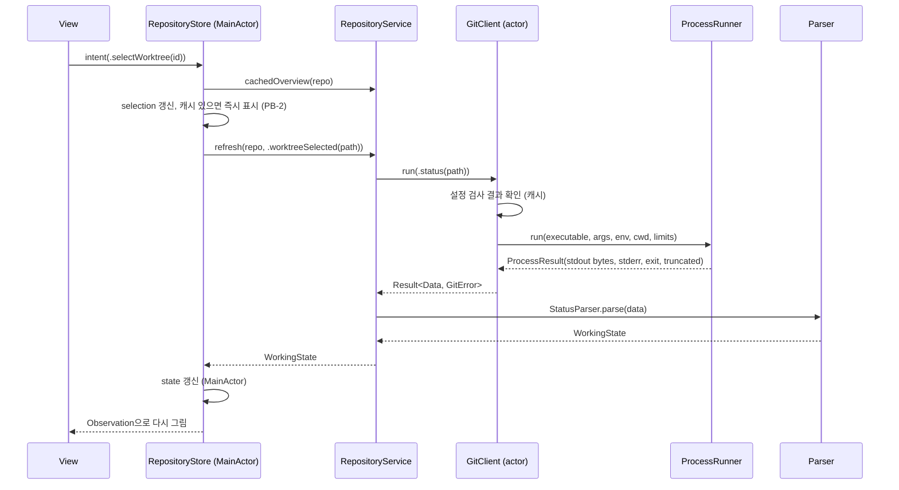

# 아키텍처 개요

> 상태: Accepted (Phase 2 게이트, 2026-11-05) · 관련: ADR-0003, ADR-0006, ADR-0008, ADR-0009, ADR-0018, ADR-0010, [git-command-catalog.md](git-command-catalog.md), [parsing-spec.md](parsing-spec.md), [../design/security-review.md](../design/security-review.md)

이 문서는 Overgrove 앱의 구조를 정의한다. 명령 단위 세부 사항은 [git-command-catalog.md](git-command-catalog.md), 출력 형식은 [parsing-spec.md](parsing-spec.md), 보안 근거는 [security-review.md](../design/security-review.md)에 있다.

---

## 1. 설계 원칙

1. **조회 전용.** 원격 쓰기는 `git fetch` 하나다. 쓰기 명령은 타입으로 존재하지 않는다 (ADR-0008, ADR-0011).
2. **단일 실행 경로.** 모든 외부 프로세스는 `ProcessRunner` 한 곳에서 만든다. 보안 인자와 환경은 그 위의 `GitClient`·`GHClient`가 강제한다.
3. **순수 로직과 I/O 분리.** 파서(`Parsing/`)와 그래프 계산(`GraphEngine/`)은 입력 바이트나 값만 받아 결과를 돌려주는 순수 함수다. 프로세스와 파일 시스템을 모르므로 단위 테스트가 쉽다.
4. **단방향 데이터 흐름.** 뷰는 Store의 상태를 읽고 의도(intent)만 보낸다. 상태 변경은 Store 안에서만 일어난다.
5. **실패는 닫힌 쪽으로(fail closed).** 보안 검사(설정 검사, 인자 검증)가 실패하면 git을 실행하지 않는다.
6. **외부 의존성 0개** (ADR-0006).

---

## 2. 계층과 모듈

```mermaid
flowchart TD
    subgraph UI["Features/ (SwiftUI Views)"]
        V1[Worktrees] --- V2[Graph] --- V3[Detail] --- V4[Stash] --- V5[Issues] --- V6[Onboarding/Settings]
    end
    DS[DesignSystem/]
    subgraph State["App/ (MainActor)"]
        AS[AppState]
        RS[RepositoryStore<br/>@Observable]
        IS[IssueStore<br/>@Observable]
    end
    subgraph Services["Services (App/ 내부)"]
        RSV[RepositoryService]
        ISV[IssueService]
    end
    subgraph Clients
        GC[GitClient<br/>actor]
        GHC[GHClient<br/>actor]
        RCI[RepoConfigInspector]
    end
    PR[Execution/ProcessRunner]
    P[Parsing/]
    GE[GraphEngine/]
    SEC[Security/<br/>CredentialMasker, PathValidator]
    M[Models/]

    UI --> State
    UI --> DS
    State --> Services
    Services --> Clients
    Services --> P
    Services --> GE
    GC --> RCI
    GC --> PR
    GHC --> PR
    Clients --> SEC
    P --> M
    GE --> M
    Services --> M
    State --> M
```

### 2.1 의존 방향 규칙

| 모듈 | 의존할 수 있는 것 | 의존하면 안 되는 것 |
|---|---|---|
| `Features/` | `App/`의 Store, `DesignSystem/`, `Models/` | `Git/`, `GitHub/`, `Execution/`, `Parsing/` |
| `App/` (AppState, Store, Service) | `Git/`, `GitHub/`, `Parsing/`, `GraphEngine/`, `Models/`, `Security/` | `Execution/` 직접 사용 |
| `Git/`, `GitHub/` | `Execution/`, `Security/`, `Models/` | `Features/`, SwiftUI |
| `Parsing/`, `GraphEngine/` | `Models/`, Foundation | 프로세스, 파일 I/O, SwiftUI |
| `Execution/` | Foundation | 다른 모든 앱 모듈 |
| `Models/` | Foundation | 다른 모든 앱 모듈 |

단일 앱 타깃 안의 폴더라서 컴파일러가 이 규칙을 강제하지는 않는다. 그래서 두 가지로 지킨다.

- **`scripts/lint/check-forbidden-apis.sh`**: 프로세스 API 사용 위치를 검사한다. `Overgrove/Execution/`과 `OvergroveTests/Support/`만 허용한다.
- **코드 리뷰 체크리스트**: import와 타입 참조 방향을 확인한다.

모듈이 커지면 로컬 Swift Package로 나눠 컴파일러가 강제하게 할지 검토한다. 이때 외부 의존성이 아니므로 ADR-0006과 충돌하지 않는다.

### 2.2 주요 타입 책임

| 타입 | 위치 | 책임 |
|---|---|---|
| `OvergroveApp` | `App/` | 진입점, 창 구성, 의존성 조립 |
| `AppState` | `App/` | 창 하나의 상태: 열린 저장소, 패널 레이아웃, 저장소 추가·전환·제거, 알림 |
| `RepositoryLoading`, `LiveRepositoryLoader` | `App/` | 연 저장소의 `configList` → `RepoConfigInspector` → 워크트리 목록(§3.2). 목록과 워크트리별 확인·조회는 `RepositoryService`(#87)가 하고, 결과(`RepositoryOverview`)를 `WorktreeListing`으로 옮긴다 (#65) |
| `WorktreeListing` | `App/` | 워크트리마다 status 결과(`loaded`, `missing`, `failed`, `notQueried`)와 목록 잘림 여부. 사이드바 `WorktreeListModel`(`Features/Worktrees/`)의 입력 |
| `RepositoryRegistry` | `App/` | 등록된 저장소 목록과 마지막 선택(모든 창이 공유). `UserDefaults`에 경로와 신뢰하지 않음 표시(#107)만 저장 (§8) |
| `RepositoryRegistrar` | `App/` | 고른 폴더 → `PathValidator` → probe(`GitClient`, 검사 전 허용 명령) → 등록할 저장소. 같은 공통 git 디렉터리는 한 저장소 (§9) |
| `RepositoryStore` | `App/` | 선택된 저장소 하나의 화면 상태: 워크트리, 상태, stash, 그래프 페이지, 선택 항목, 로딩·에러 |
| `IssueStore` | `App/` | gh 로그인 상태, 이슈 목록, 이슈 번호 매칭 결과 |
| `RepositoryService` | `App/` | 조회 조합: 병렬 실행, 취소, 디바운스, 캐시, 기준 브랜치 비교(`compare`, #157) |
| `GitClient` | `Git/` | `ReadOnlyGitCommand`/`FetchCommand`를 받아 최종 인자·환경을 만들고 `ProcessRunner`로 실행 |
| `GitCommand` | `Git/` | allowlist 열거형. case마다 인자 배열, 타임아웃, 출력 상한, 파서 종류를 정의 |
| `GitEnvironment` | `Git/` | 환경 변수 allowlist 생성, git 실행 파일 위치·버전 |
| `RepoConfigInspector` | `Git/` | 설정 검사, 동적 무력화 인자 생성, 보안 보고서 (ADR-0009) |
| `GitError` | `Git/` | 에러 분류 (§6) |
| `GHClient` | `GitHub/` | gh allowlist 명령 실행, 중립 작업 디렉터리, gh 전용 환경 |
| `ProcessRunner` | `Execution/` | `Process` 생성, 타임아웃, 출력 상한, 취소, 종료 코드 수집 |
| `CredentialMasker` | `Security/` | URL·문자열의 자격 증명 마스킹 |
| `PathValidator` | `Security/` | 등록 경로 검증, 심볼릭 링크 탈출 감지 |
| `GraphEngine` | `GraphEngine/` | 커밋 순서 + 부모 목록 → 레인 레이아웃. 레인 색 인덱스는 레인이 생길 때의 열 인덱스 mod 8로 고정한다. 입력에서 `refs/stash`는 빠져 있다 (ADR-0010) |

---

## 3. 데이터 흐름

### 3.1 단방향 흐름



- 뷰는 `RepositoryStore`의 프로퍼티를 읽기만 한다. 변경은 `send(_ intent:)` 같은 메서드로만 요청한다.
- Store는 서비스의 결과를 받아 상태를 바꾼다. 서비스는 상태를 갖지 않고, 캐시만 actor 안에 둔다.
- 오래된 응답이 새 상태를 덮어쓰지 않도록, 요청마다 세대 번호(generation)를 붙인다. Store는 최신 세대의 결과만 반영한다.

### 3.2 저장소 열기 순서

1. `PathValidator`로 등록된 경로를 검증한다.
2. `git --version`을 확인한다. 이 결과는 앱 실행당 한 번만 구한다.
3. `RepoConfigInspector`를 실행한다. 실패하면 중단한다.
4. `worktree list --porcelain -z`로 워크트리 목록을 얻는다.
5. 다음을 병렬로 실행한다.
   - 워크트리별 `status --porcelain=v2 -z --branch --show-stash`
   - `for-each-ref`
   - `stash list`
6. 그래프 첫 페이지(500개)를 가져온다.
7. 이슈 패널은 별도 경로(`IssueStore`)로 독립 실행한다. Git 조회를 막지 않는다.

PB-1(워크트리 10개 목록과 상태 요약 1초 이내)은 4~5단계까지를 기준으로 한다.

---

## 4. 동시성 모델 (Swift 6)

| 요소 | 격리 | 이유 |
|---|---|---|
| Store, AppState, 뷰 | `@MainActor` | UI 상태는 메인 스레드에서만 바꾼다 |
| `GitClient`, `GHClient` | `actor` | 실행 파일 위치, 설정 검사 캐시, 동시 실행 수 제한을 안전하게 공유 |
| `RepositoryService` | `actor` | 결과 캐시와 진행 중 작업 관리 |
| `ProcessRunner` | `Sendable` struct + 내부 동기화 | 프로세스 하나의 수명 관리 |
| 파서, GraphEngine | 비격리 순수 함수, 입출력 모두 `Sendable` 값 타입 | 어느 스레드에서나 호출 가능 |

- **Swift 6 언어 모드**와 strict concurrency(`complete`)를 켠다. 경고 없이 빌드되어야 한다.
- 모델은 모두 `struct` + `Sendable` + `Equatable`이다. 바이트 데이터는 `Data`로 넘긴다.
- **동시 실행 상한**: `GitClient`는 조회와 fetch에 서로 다른 슬롯을 쓴다.
  - 조회(`run`)는 동시에 최대 min(코어, 8)개, 최소 2개(`GitClient.defaultConcurrency`, #87). 워크트리 10개 PB-1을 재 보면 기본값 8이 4보다 p50 약 18% 빠르고 직렬보다 약 2.5배 빠르다([results/2026-11-07-pb1-parallel-worktree-queries.md](../performance/results/2026-11-07-pb1-parallel-worktree-queries.md)).
  - fetch는 앱 전체에서 동시에 최대 2개(`GitClient.defaultFetchConcurrency`). fetch는 120초까지 슬롯을 잡을 수 있으므로 조회 슬롯을 쓰지 않는다. fetch가 진행 중이어도 status 새로고침은 기다리지 않는다(#76).
- **취소**: 저장소나 워크트리를 바꾸면 이전 Task를 취소한다. `ProcessRunner`는 `withTaskCancellationHandler`로 취소를 받으면 프로세스를 종료한다 (SIGTERM → 2초 → SIGKILL).
- **디바운스**: 같은 워크트리의 새로고침 요청이 300ms 안에 반복되면 마지막 요청만 실행한다. 사용자가 누른 `⌘R`은 디바운스하지 않는다.
- **저장소 새로고침(`RepositoryService`, #87)**: `loadOverview`가 `worktree list` 뒤에 워크트리별 status, `for-each-ref`, `stash list`를 병렬로 실행한다(§3.2 4–5단계). 정리할 대상(prunable)과 bare 워크트리는 목록에만 두고 status를 실행하지 않는다. 워크트리 하나의 실패는 그 행에만 남는다.
  - 워크트리 경로는 저장소가 쓰는 파일(`.git/worktrees/<id>/gitdir`)에서 오므로 믿지 않는다(#221, #226 보안 검토). 나열된 경로는 `realpath(3)`로 한 번 정규화해 그 폴더에서만 명령을 실행한다. 각 워크트리는 status 전에 세 가지를 확인한다.
    1. 등록과 같은 기준으로 이 저장소의 워크트리인지 파일 시스템으로 본다. 메인은 `.git`이 공통 디렉터리로 이어지고, 연결 워크트리는 `checkLinkedWorktree`가 `.linked`다.
    2. `probeRepository`가 그 폴더를 워크트리 루트로, 이 저장소의 공통 git 디렉터리를 보고하는지 본다(`core.worktree`가 다른 곳을 가리키면 어긋난다). 1·2가 어긋나면 `.notQueried(.foreignRepository)`다.
    3. 그 워크트리에서 `configList`를 검사해 그 워크트리의 `RepoSafetyContext`로 status를 실행한다(연결 워크트리의 `config.worktree`는 메인 검사에 나오지 않는다). 검사가 막으면 `.notQueried(.inspectionBlocked)`다.
  - 같은 경로는 한 번만 나열하고(`entries`의 경로는 고유하다), 다른 경로가 같은 폴더로 이어지면 한 번만 조회한다(`.duplicate`). 한 번에 status를 실행하는 워크트리는 최대 64개이고 나머지는 `.notQueried(.limit)`다(`RepositoryOverview.isQueryLimited`, security-review.md T15).
  - `refresh(_:trigger:)`는 저장소마다 세대 번호를 매긴다. 새 요청은 진행 중인 요청을 취소한다(git 프로세스 종료). 최신 세대가 아닌 결과와 취소된 결과는 `nil`로 버린다. 그래서 Store는 받은 결과를 그대로 반영하면 된다.
  - 자동 요청(`.automatic` 창 활성화, `.fetchCompleted`)은 300ms(`debounceInterval`) 동안 기다리고, 그 사이 더 새 요청이 오면 실행하지 않는다. 사용자 요청(`.user` ⌘R·저장소 선택, `.worktreeSelected`)은 기다리지 않고 기다리던 자동 요청을 대체한다. 무엇을 다시 조회하는지는 §5다.
  - 화면 쪽은 `RepositoryOverview.snapshot(focusing:)`으로 `AppState.snapshot`을 채운다(#65에서 연결).
- **fetch**는 저장소당 한 번에 하나만 실행한다. 기준은 `Repository.id`(공통 git 디렉터리)라서 같은 저장소의 워크트리끼리도 겹치지 않는다. 원격별 fetch를 연달아 요청하면 `GitClient`가 요청 순서대로 하나씩 실행하고, 기다리는 동안에는 fetch 슬롯을 잡지 않는다. 사용자가 진행 중에 다시 누르면 화면 쪽(Store/Service)이 무시하고 진행 상태를 보여 준다.
- **fetch 진행률**: `GitClient.fetch(progress:)`가 stderr의 `--progress` 메시지를 `FetchProgressParser`로 읽어 단계와 숫자만 담은 `FetchProgress`로 넘긴다([parsing-spec.md §11.4](parsing-spec.md)). 콜백은 백그라운드 큐에서 불리므로 UI 상태는 메인 액터로 옮겨 바꾼다. 취소는 Task 취소(⌘.)로 하고, 120초가 지나면 `GitError.timeout`이 된다.

---

## 5. 캐시와 무효화

| 캐시 | 키 | 무효화 조건 |
|---|---|---|
| git 실행 파일·버전 | 앱 실행 | 설정에서 git 경로 변경 (v0.2.0). → `LiveGitClient.shared`가 앱 실행당 한 번 `GitEnvironment.discover` |
| 설정 검사 결과 (`RepoConfigInspector`) | 저장소 + 워크트리 폴더 | 그 폴더에서 git이 읽는 설정 파일의 변경, 수동 새로고침. → #88 |
| 워크트리 목록 | 저장소 | 수동 새로고침, fetch 완료, 창 활성화. → #88 |
| `WorkingState` (status) | 워크트리 경로 | 수동 새로고침, 워크트리 선택, 창 활성화(마지막 조회 후 5초 이상), fetch 완료. → #88 |
| WIP 줄 수 (`worktreeNumstat`) | 워크트리 경로 | 그 워크트리의 status를 다시 조회했을 때(status와 같은 무효화). 포커스 워크트리를 상세로 볼 때만 조회한다. → #230 |
| stash 목록 | 저장소 | `# stash N` 헤더 값 변화, 수동 새로고침. → #88 |
| 브랜치·ahead/behind | 저장소 | fetch 완료, 수동 새로고침, status가 보고한 브랜치 tip이 캐시와 다를 때. → #88 |
| 그래프 페이지 | 저장소 + ref 집합(브랜치·원격·태그 tip과 워크트리 HEAD의 정렬된 목록 그 자체, 해시 충돌 없음) + skip·limit | ref 집합이 바뀌면 새 키. 수동 새로고침(⌘R)과 `forget`이면 그 저장소 페이지를 모두 버림(목록에 없는 ref 이름공간이 움직일 수 있다). 최대 40페이지 LRU. → #68 (`RepositoryService.graphPage`, `GraphStore`) |
| 커밋 상세 | 저장소 + object ID | 무효화 없음 (불변). 최대 200개 LRU, `forget`이면 함께 버림. 잘린 결과는 캐시하지 않는다. 파일 patch는 캐시하지 않는다. → #69 (`RepositoryService.commitDetail`, `CommitDetailStore`) |
| 이슈 목록 | 저장소 원격(owner/name) | 수동 새로고침, 5분 경과. → #81에서 구현 |
| 기준 브랜치 비교 (`WorktreeComparison`) | 워크트리 + 기준 ref + 기준 tip + HEAD (+ 작업 트리 포함이면 그 워크트리의 status 조회 시각) | 키가 바뀌면 새 항목. 커밋만 비교하면 불변이라 status가 새로 와도 유지하고, 작업 트리 포함이면 status를 다시 조회할 때 무효. 최대 32개 LRU, `forget`이면 함께 버림. → #157 |

위 캐시는 모두 메모리에만 있다. 실행 간 디스크 캐시는 사이드바 워크트리 요약 스냅샷 하나로 정했다. 표시 전용이고 보안 판단에 쓰지 않는다([ADR-0018](../adr/0018-launch-snapshot-disk-cache.md), 구현 #109).

#88이 구현한 행은 `RepositoryService` 안에 있다.
- **결과 캐시**: 저장소마다 마지막 `RepositoryOverview`와 워크트리별 마지막 status 조회 시각을 메모리에 둔다. `cachedOverview(of:)`는 git 없이 돌려준다(PB-2: 먼저 그리고, 뒤에서 새로고침). 저장소는 최대 8개(`defaultCachedRepositories`)이고, 넘으면 가장 오래 쓰지 않은 저장소를 버린다(`BoundedCache`). 저장소를 제거하면 `forget(_:)`으로 함께 버린다.
- **트리거별 재조회** (`refresh(_:trigger:)`):

  | 트리거 | 설정 검사 | 워크트리 목록 | status | refs | stash |
  |---|---|---|---|---|---|
  | `.user` (⌘R, 저장소 열기) | 모두 버리고 다시 | 조회 | 전부 | 조회 | 조회 |
  | `.worktreeSelected(path)` | 지문이 같으면 캐시 | 캐시 | 그 워크트리만 | 파생 | 파생 |
  | `.automatic` (창 활성화) | 지문이 같으면 캐시 | 조회 | 5초 이상 지난 것 | 파생 | 파생 |
  | `.fetchCompleted` | 지문이 같으면 캐시 | 조회 | 전부(ahead/behind) | 조회 | 파생 |
  | `.filesChanged` (자동 새로고침, #119) | 지문이 같으면 캐시 | 목록이 바뀌었을 때만 | 바뀐 워크트리만 | refs가 바뀌었을 때만 | 파생 |

  - 캐시가 없으면 어느 트리거든 전부 조회한다.
  - 처음 보는 워크트리는 항상 조회한다.
  - "파생"은 이번에 받은 결과로 판단한다는 뜻이다. status·워크트리 목록의 브랜치 tip이 캐시한 refs와 다르면 refs를 다시 조회하고, `# stash N`이 캐시한 stash 수와 다르면 stash 목록을 다시 조회한다.
  - fetch 완료 때 status도 다시 조회한다. 워크트리 행의 ahead/behind가 status에서 오기 때문이다(표의 "브랜치·ahead/behind" 행).
  - 실패한 새로고침(예: 설정이 이제 조회를 막음)은 그 저장소의 캐시를 버린다. 막히기 전 결과를 계속 보여 주지 않는다.
- **설정 검사 캐시** (`RepoConfigInspectionCache`, 최대 256개):
  - 키는 저장소 ID + 워크트리 폴더다. 연결 워크트리마다 `config.worktree`가 다르기 때문이다.
  - 지문은 `stat(2)`의 장치·inode·크기·mtime·ctime이다. 대상 파일은 공통 `config`, 두 `config.worktree`, 그 워크트리의 `commondir`, `.git` 항목이다. 사용자 공간에서 mtime은 되돌릴 수 있지만 ctime은 되돌릴 수 없다. 장치·inode는 다른 파일로 바꿔 넣은 경우를 잡는다.
  - 지문은 `config --list`를 실행하기 **전에** 찍는다. 그래서 읽는 도중 바뀐 파일은 다음 조회에서 다시 검사한다.
  - 저장소가 제어하는(local·worktree 범위) `include.path`·`includeIf.*.path`가 있으면 캐시하지 않는다. 표의 원래 규칙은 "include 대상 파일의 mtime"이었지만, git은 상대·중첩 include를 포함한 파일 기준으로 해석하고 목록에는 그 파일 이름이 없다. 그래서 대상을 정확히 찍을 수 없어 fail closed로 바꿨다. `includeIf.onbranch:`도 HEAD에 따라 달라지므로 캐시하지 않는다(기존).
  - probe(같은 저장소인지 확인)는 캐시하지 않는다. 비용이 작고 #226의 소속 확인을 매번 새로 하기 위해서다.
  - 워크트리 항목(`RepositoryOverview.Entry.inspection`)에 그 워크트리의 검사 결과를 담는다(#240). 그 워크트리의 status가 실제로 쓴 검사이고, `.loaded`와 `.notQueried(.inspectionBlocked)`에 있고 검사하지 않은 항목(prunable, 다른 저장소 등)에는 없다. 캐시한 항목은 마지막 조회 때의 검사를 그대로 가진다. S-05(워크트리 상세)는 이것을 보여 주므로 git을 따로 실행하지 않는다. 명령을 실행하는 diff 뷰어(#232)는 실행 직전에 소속과 설정을 다시 확인한다.
  - 전역·시스템 설정은 지문에 넣지 않는다. 신뢰하는 범위라 무력화 판단에 영향이 없고, 바뀌면 ⌘R로 다시 검사한다.

- **화면 연결 (`AppState`, #243)**: 창의 계기를 위 트리거로 보낸다.

  | 계기 | 트리거 |
  |---|---|
  | 저장소 열기 | `cachedOverview`가 있으면 먼저 그리고(git 없음, PB-2) `.user` |
  | ⌘R (View › Refresh, 도구 막대 Refresh) | `.user` |
  | 워크트리 선택 | 메모리의 목록으로 즉시 바꾸고 `.worktreeSelected(path)`를 백그라운드로 보낸다 |
  | 창이 key window가 됨 | `.automatic`(디바운스). 첫 로드 전이나 다른 로드 중에는 보내지 않는다 |
  | 저장소 제거 | `forget` |

  - 진행 중인 `.user`는 더 좁은 트리거(선택, 창 활성화)로 대체하지 않는다. 그 결과가 이미 모든 것을 가져온다. ⌘R은 진행 중인 좁은 요청을 대체한다.
  - 결과가 `nil`이면(더 새 요청에 밀렸거나 디바운스로 사라짐) 검증된 목록은 그대로 둔다. 서비스의 세대는 저장소마다 하나이고 모든 창이 공유한다. 그래서 다른 창의 요청이 이 창의 첫 `.user`를 밀어낼 수 있다. 이번 열기에서 검증된 결과가 아직 없으면 캐시로 그린 화면을 현재 상태처럼 두지 않는다. `.user`를 최대 2번 다시 보내고, 그래도 밀리면 Loading으로 되돌린다. 창 활성화가 다시 `.user`를 보낸다(#243 보안 검토).
  - 실패(예: 설정이 이제 조회를 막음)는 이전 목록 대신 에러를 보여 준다.
  - 사이드바는 `isWorktreeListPartial`·`isQueryLimited`를 비차단 경고로 목록 위에 보여 준다.
  - 창을 닫아도 캐시는 남는다. 서비스는 창 사이에 공유되고 LRU(8개)로 상한이 있다.
- 캐시는 메모리에만 둔다. 앱을 다시 실행하면 처음부터 다시 조회한다. 디스크 캐시는 v0.2.0에서 검토한다.
- 파일 시스템 감시(FSEvents) 자동 새로고침(#119): 창이 보이는 동안만 검증된 워크트리와 공통 git 디렉터리를 감시한다. 바뀐 것만 `.filesChanged(worktrees:refs:worktreeList:)` 트리거로 다시 조회한다(워크트리 목록은 캐시, 지정한 워크트리 status만, refs와 목록은 요청할 때만, stash는 파생). 묶음과 상한, 감시 범위는 [interaction.md §4](../design/interaction.md)에 있다.

---

## 6. 에러 모델

### 6.1 GitError 분류

| case | 의미 | 사용자 메시지 (요약) | 재시도 |
|---|---|---|---|
| `executableNotFound` | git·gh 실행 파일 없음 | "git을 찾을 수 없습니다. Xcode Command Line Tools를 설치하세요." | 설치 후 |
| `launchFailed(errno)` | 실행 파일은 있으나 프로세스를 시작하지 못함 (`posix_spawn` 실패) | "git을 시작하지 못했습니다 (오류 N)." | 수동 |
| `unsupportedVersion(found)` | git < 2.36 | "git 2.36 이상이 필요합니다 (현재 X)." | 업데이트 후 |
| `notARepository` | 경로가 저장소가 아님 | "Git 저장소가 아닙니다." | — |
| `dubiousOwnership` | `safe.directory` 거부 | "다른 사용자가 소유한 저장소라 git이 거부했습니다. 앱은 이 검사를 우회하지 않습니다." | — |
| `worktreeMissing` | 워크트리 경로가 사라짐 (prunable) | "워크트리 경로가 없습니다. 터미널에서 `git worktree prune`을 검토하세요." | — |
| `configInspectionFailed` | 설정 검사 실패 (fail closed) | "저장소 설정을 검사하지 못해 조회를 멈췄습니다." | 수동 |
| `invalidArgument` | 인자 검증 실패 (T9) | "안전하지 않은 이름이 있어 실행하지 않았습니다." | — |
| `blockedBySecurityPolicy(detail)` | 보안 정책이 막은 동작 | "보안 정책으로 차단된 원격 형식입니다." | — |
| `transportNotAllowed(transport, detail)` | git이 허용 목록 밖의 전송을 거부함 (`ext::`·`fd::`, `codecommit::` 같은 원격 helper, #161) | "'<이름>' 전송을 쓰는 원격은 fetch하지 않습니다. https, ssh, git, http, 로컬 파일 원격만 가능합니다." | — |
| `timeout(seconds)` | 타임아웃 | "git 응답이 X초를 넘어 중단했습니다." | 수동 |
| `outputTruncated` | 출력 상한 초과 | "출력이 너무 커서 일부만 표시합니다." (경고 수준) | — |
| `authenticationFailed` | HTTPS 인증 실패, 프롬프트 없이 쓸 자격 증명이 없음 | "원격 인증에 실패했습니다. 터미널에서 git 자격 증명을 확인하세요." | 수동 |
| `sshAuthenticationFailed` | SSH 서버가 키를 모두 거부함 (#78) | "서버가 SSH 키를 거부했습니다. 터미널에서 SSH agent를 확인하세요." | 수동 |
| `hostKeyVerificationFailed(changed)` | ssh가 호스트 키를 거부함. 처음 보는 키 / `known_hosts`와 다른 키 (#78) | "SSH 호스트 키를 아직 신뢰하지 않습니다." / "SSH 호스트 키가 바뀌었습니다. 새 키를 믿기 전에 확인하세요." | — |
| `accessDenied` | 인증은 됐지만 읽을 권한이 없음 (HTTP 403, #78) | "원격이 이 저장소에 대한 접근을 거부했습니다." | — |
| `remoteNotFound` | 원격 저장소가 없거나 원격 이름이 설정되지 않음 (HTTP 404, 없는 경로, #78) | "원격 저장소를 찾을 수 없습니다." | — |
| `networkUnavailable` | DNS·연결 실패 | "원격에 연결할 수 없습니다." | 수동 |
| `partialCloneObjectMissing` | partial clone에 없는 객체가 조회에 필요함. 조회는 lazy fetch를 하지 않는다 (#212) | "partial clone이라 이 내용이 로컬에 없습니다. 조회 중에는 누락 객체를 내려받지 않습니다." | — |
| `noMergeBase` | 기준 브랜치와 갈라진 지점이 없음(관련 없는 이력). 기준 브랜치 비교에서만 생긴다 (#157) | "This branch shares no history with the base branch, so there is nothing to compare." | — |
| `nonZeroExit(code, summary)` | 그 밖의 실패 | 마스킹한 stderr 첫 줄 요약 | 수동 |
| `parseFailed(parser, offset)` | 파서가 형식 위반을 만남 | "git 출력을 해석하지 못했습니다. 버그로 제보해 주세요." | — |
| `cancelled` | 사용자가 취소함 | 표시하지 않음 | — |

fetch 실패의 **분류는 이 에러 모델이 맡는다.** 화면(S-01 상태바, S-05)은 분류 결과와 메시지를 표시만 하고, stderr를 직접 해석하지 않는다. stderr의 `remote:` 줄(서버가 쓴 글)은 분류에 쓰지 않는다([git-command-catalog.md §6](git-command-catalog.md)).

fetch 실패 안내는 `FetchFailureGuidance(error:remote:endpoint:report:)`(`Overgrove/Git/`, #78)가 만든다. 화면은 이것을 그대로 그린다.
- **4분류**([interaction.md §4.2](../design/interaction.md))
  - 인증: `authenticationFailed`, `sshAuthenticationFailed`, `hostKeyVerificationFailed`, `accessDenied`
  - 네트워크: `networkUnavailable`
  - 시간 초과: `timeout`
  - 기타: `remoteNotFound`, `transportNotAllowed`, 설정 때문에 꺼진 fetch(`configInspectionFailed`), 그 밖
- **필드**: 한 줄 요약(`summary`), 해결 안내(`guidance`), 복사 가능한 명령(`commands`), 마스킹한 stderr(`detail`, 끝 5줄은 `detailTail`)
- **문구**: 모두 앱이 쓴다. 명령에는 검증된 원격 이름, 호스트 이름, 포트만 넣는다. 호스트는 `Endpoint(remoteURL:)`로 자격 증명과 경로를 뺀 이름만 쓴다.
- **터미널 git**: 터미널의 git은 앱처럼 무력화되지 않는다. 저장소의 hook, 로컬 `core.sshCommand`, 프록시, credential helper, pager가 그대로 실행된다. 그래서 `git` 명령(`git fetch <remote>`, `git --no-pager remote -v`)은 저장소 설정 보고(`RepoSecurityReport`)에 항목이 없을 때만 넣고, 그때도 "신뢰하는 저장소에서만"이라고 쓴다. 보고에 항목이 있으면 저장소를 읽지 않는 명령(`ssh-add -l`, `ssh-keyscan`, `ssh-keygen -F`)만 넣고 보안 보고서를 먼저 보라고 안내한다(#200 보안 검토).
- **취소**: 실패가 아니다. 안내를 만들지 않는다(`nil`). 원격이 없을 때는 `FetchFailureGuidance.noRemotes`를 쓴다.
- **호스트 키**: 앱은 받아들이지 않는다. 바뀐 키에는 가로채기 가능성을 경고하고, 읽기 전용 확인 명령(`ssh-keygen -F <host>`)만 제안한다. 키를 지우는 `ssh-keygen -R`은 제안하지 않는다.

gh 실패는 `GHError`(`Overgrove/GitHub/GHError.swift`)로 따로 분류한다: `notInstalled`, `notLoggedIn`(종료 코드 4), `launchFailed`, `invalidArgument`, `timeout`, `outputTruncated`(잘린 JSON은 해석하지 않으므로 실패), `nonZeroExit`, `parseFailed`, `cancelled`. gh 문제는 이슈 패널만 끄고 Git 조회에는 영향을 주지 않는다 (ADR-0004 §4). 로그인 상태 조회(`authStatus()`)에서 gh가 없거나 로그인하지 않은 것은 에러가 아니라 `GHAuthStatus` 값이다. 상세는 [git-command-catalog.md §5](git-command-catalog.md).

### 6.2 메시지 원칙

- v0.1 UI는 영어만 쓴다(ADR-0005). 위 표의 메시지는 의미 요약이며, 실제 문구는 `Overgrove/Git/GitError.swift`의 `message`가 원본이다.
- stderr에서 온 텍스트는 `MaskedText`로만 보관한다. 이 타입은 `CredentialMasker`를 거치는 생성자만 있어서, 마스킹하지 않은 stderr가 에러·화면·로그에 들어갈 수 없다.

- stderr를 그대로 보여 주지 않는다. 다음 순서로 처리한다.
  1. `CredentialMasker`로 마스킹
  2. 제어 문자 제거
  3. 첫 줄을 200자 이내로 요약
  4. "자세히" 펼침에서 마스킹된 전체 stderr(최대 64KB)를 보여 준다
- 분류 기준인 stderr 패턴은 `LC_ALL=C`로 고정한 영어 메시지다. 패턴 목록과 예시는 [git-command-catalog.md §6](git-command-catalog.md)에 있다.
- 사용자 메시지에는 원인과 해결 방법을 함께 쓰고, 앱이 대신 실행하지 않는 명령(`git worktree prune`, `gh auth login`)은 복사 가능한 텍스트로만 보여 준다.

---

## 7. 로깅 정책

- `os.Logger`를 쓴다. subsystem은 `io.github.kkdy21.overgrove`이고 category는 `git`, `gh`, `ui`, `security`, `perf`다.
- 기본 수준은 `notice` 이상만 남긴다. `debug`는 개발 빌드에서만 켠다.
- 경로, 저장소 이름, 브랜치명, 커밋 메시지, 원격 URL은 `privacy: .private`로 남긴다. macOS 기본 설정에서는 `<private>`로 가려진다.
- 원격 URL과 stderr는 **로깅 전에도** `CredentialMasker`를 거친다. `.private`는 개발 장비에서 풀릴 수 있기 때문이다.
- 명령 로그에는 서브커맨드 이름, 소요 시간, 종료 코드, 출력 바이트 수만 남긴다. 전체 인자 배열은 남기지 않는다.
- 텔레메트리, 크래시 리포트 전송은 없다.

---

## 8. 설정 저장

- `UserDefaults`에 다음만 저장한다.
  - 등록된 저장소 경로 목록과 저장소별 신뢰하지 않음 표시(#107, 기본 신뢰함)
  - 마지막 선택 저장소
  - 자동 fetch 사용 여부와 주기(기본 꺼짐)
  - 원격 URL 표시 여부(기본: 마스킹)
  - 마지막 fetch 시각(`FetchRecord`)
- 토큰, 비밀번호, 원격 URL 원문 등 비밀 값은 저장하지 않는다. Keychain도 쓰지 않는다.
- `UserDefaults` 밖에는 실행 간 워크트리 요약 스냅샷만 `~/Library/Caches`에 둔다. 저장하는 필드와 무효화는 [ADR-0018](../adr/0018-launch-snapshot-disk-cache.md)과 [security-review.md T19](../design/security-review.md#t19-디스크에-남는-저장소-데이터)를 따른다(#109).
- 마지막 fetch 시각은 앱이 실행한 fetch의 완료 시각을 기록한다. 기록이 없으면 `<common-dir>/FETCH_HEAD`의 수정 시각을 대신 보여 주고, 화면에 "추정"으로 표시한다.
  - 구현(#77): `FetchRecordStore`가 저장소 ID마다 마지막 시도(`FetchRecord`: 완료 시각, 성공 여부, 앱이 쓴 요약)와 마지막 성공 시각을 JSON 하나로 저장한다. 요약은 `FetchFailureGuidance`의 문구라 검증된 원격 이름과 호스트 이름이 들어갈 수 있다. 원격 URL 원문, 자격 증명, stderr는 저장하지 않는다. 저장소를 제거하면 그 기록도 지운다. 사용자가 멈춘 fetch는 기록하지 않는다.
  - `FETCH_HEAD`는 심볼릭 링크를 따라가지 않고(`attributesOfItem`은 링크 자체를 본다) 일반 파일일 때만 쓴다. 시각은 저장소가 정할 수 있는 값이므로 "추정"으로만 보여 준다.
  - fetch(`RepositoryService.fetch`)는 먼저 설정을 검사한다(지문이 같으면 캐시). 그다음 원격을 하나씩 그 검사의 안전 컨텍스트로 가져온다. 실패는 `FetchFailureGuidance`로 바꾼다. 검사가 조회를 막으면 git을 실행하지 않고 모든 원격을 막힘으로 보고한다. fetch가 끝나면(멈춤 포함) `.fetchCompleted`로 워크트리 목록, status(ahead/behind), refs를 다시 조회한다(§5).

---

## 9. 저장소 등록과 파일 시스템 범위

- 저장소는 `NSOpenPanel`로 사용자가 고른 디렉터리만 등록한다. 등록된 목록은 설정 화면에서 명시적으로 지울 수 있다.
- 등록할 때 다음을 확인한다.
  1. 고른 경로를 `realpath(3)`로 정규화하고 심볼릭 링크를 해석한다(`PathValidator`). 제어 문자가 있으면 거부한다.
  2. `probeGitDirectory`(`rev-parse --path-format=absolute --git-common-dir --absolute-git-dir --is-bare-repository --is-inside-work-tree`)로 저장소 여부, 공통 디렉터리, 이 위치의 git 디렉터리를 얻는다. bare 저장소에서도 성공한다(#222).
  3. 결과에 따라 나눈다.
     - **bare**: 고른 폴더가 공통 git 디렉터리 자체이거나, 공통 디렉터리를 바로 아래에 두고 `.git`이 디스크에서 그곳으로 이어지는 폴더여야 한다(`repo/.git`·`repo/.bare` 배치). 다른 곳의 bare 저장소를 가리키는 `.git` 파일은 거부한다. 이 위치의 git 디렉터리도 공통 디렉터리여야 한다. 그래서 bare 안의 하위 폴더와 관리 디렉터리 `worktrees/<id>`는 거부한다(git은 둘 다 bare라고 답한다). 등록 항목은 `rootPath`가 없다(`Repository.rootURL == nil`).
     - **워크트리 안**: `probeRepository`(`rev-parse --path-format=absolute --show-toplevel --git-common-dir --is-bare-repository`)로 워크트리 최상위를 얻는다. 두 probe의 공통 디렉터리가 같아야 한다.
     - **그 밖**(`.git` 안, 다른 곳을 가리키는 `core.worktree`): 거부한다.
  4. probe 결과를 파일 시스템과 맞춰 본다(SEC-T14-04).
     - 고른 폴더가 probe의 워크트리 안에 있어야 한다.
     - 그 워크트리의 `.git`이 첫 probe의 git 디렉터리로 이어져야 한다.
     - 그 git 디렉터리가 공통 디렉터리이거나(메인 워크트리, `--separate-git-dir`), back-pointer가 맞는 연결 워크트리여야 한다.
     - 연결 워크트리면 공통 디렉터리에서 `probeGitDirectory`를 한 번 더 실행한다. bare 저장소면 bare 항목으로 등록한다. 그래서 bare 저장소와 그 링크 워크트리 중 어느 것을 골라도 같은 항목이 된다.
  5. 등록 경로가 사용자가 고른 경로와 다르면 알린다.
- 연결된 워크트리는 `worktree list`가 알려 주는 경로에 접근한다. 워크트리가 등록 경로 밖에 있어도 정상이다. 대신 그 경로가 존재하는 디렉터리인지, 그 안의 `.git` 파일이 이 저장소의 `worktrees/<name>`을 가리키는지 확인한다.
- **샌드박스를 끄는 이유**: 임의 위치의 저장소와 워크트리에 접근해야 한다. 샌드박스를 켜면 워크트리마다 security-scoped bookmark와 권한 팝업이 필요하다. 또 git 자식 프로세스도 샌드박스를 상속해 사용자의 credential helper나 SSH 설정에 접근하지 못한다. 그래서 security-scoped bookmark는 쓰지 않는다. 그 대신 Hardened Runtime을 켜고, 이 문서의 실행 경로 통제와 [security-review.md](../design/security-review.md)로 보완한다.
- 앱이 내용을 읽는 파일(diff 대상 등)은 git 출력으로만 얻는다. 파일 시스템을 직접 읽는 경우는 `FETCH_HEAD` mtime과 설정 파일 mtime뿐이다.

---

## 10. 빌드 구성

| 항목 | 값 |
|---|---|
| Deployment Target | macOS 14.0 |
| Swift | Swift 6 언어 모드, strict concurrency complete |
| App Sandbox | 끔 |
| Hardened Runtime | 켬. 예외 entitlement 없음 |
| 서명 | 소스 빌드 사용자는 "Sign to Run Locally"(ad-hoc). 팀 ID를 저장소에 넣지 않는다 |
| 사용자별 설정 | `*.xcconfig.local`(gitignore)로 덮어쓴다 |
| 테스트 | `OvergroveTests` (XCTest, 필요하면 Swift Testing 병행) |

---

## 11. 이 문서에서 정하지 않은 것

| 항목 | 정할 곳 |
|---|---|
| 화면 구성과 상호작용 | [../design/screens.md](../design/screens.md), [../design/interaction.md](../design/interaction.md) |
| 테스트 계층과 픽스처 | [../testing/test-strategy.md](../testing/test-strategy.md), [../testing/fixtures.md](../testing/fixtures.md) |
| 성능 측정 방법 | [../performance/benchmark-plan.md](../performance/benchmark-plan.md) |
