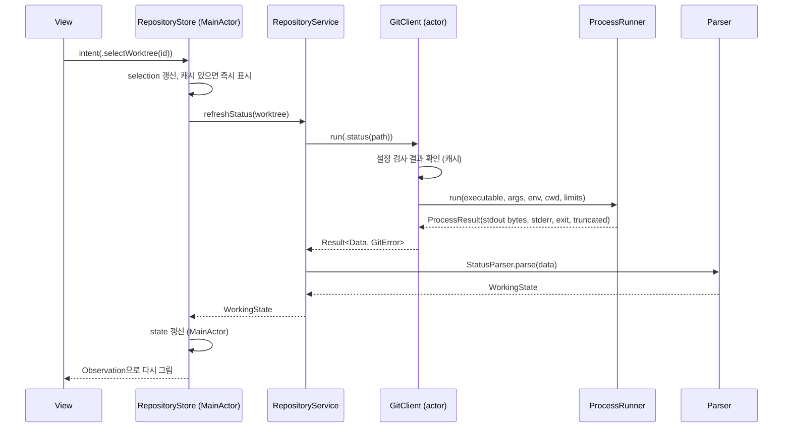

# 아키텍처 개요

> 상태: Accepted (Phase 2 게이트, 2026-11-05) · 관련: ADR-0003, ADR-0006, ADR-0008, ADR-0009, ADR-0010, [git-command-catalog.md](git-command-catalog.md), [parsing-spec.md](parsing-spec.md), [../design/security-review.md](../design/security-review.md)

이 문서는 Overgrove 앱의 구조를 정의한다. 명령 단위 세부 사항은 [git-command-catalog.md](git-command-catalog.md), 출력 형식은 [parsing-spec.md](parsing-spec.md), 보안 근거는 [security-review.md](../design/security-review.md)에 있다.

---

## 1. 설계 원칙

1. **조회 전용.** 원격 쓰기는 `git fetch` 하나다. 쓰기 명령은 타입으로 존재하지 않는다 (ADR-0008, ADR-0011).
2. **단일 실행 경로.** 모든 외부 프로세스는 `ProcessRunner` 한 곳에서 만든다. 보안 인자와 환경은 그 위의 `GitClient`·`GHClient`가 강제한다.
3. **순수 로직과 I/O 분리.** 파서(`Parsing/`)와 그래프 계산(`GraphEngine/`)은 입력 바이트나 값만 받아 결과를 돌려주는 순수 함수다. 프로세스와 파일 시스템을 모르므로 단위 테스트가 쉽다.
4. **단방향 데이터 흐름.** 뷰는 Store의 상태를 읽고 의도(intent)만 보낸다. 상태 변경은 Store 안에서만 일어난다.
5. **실패는 닫힌 쪽으로(fail closed).** 보안 검사(설정 검사, 인자 검증)가 실패하면 git을 실행하지 않는다.
6. **외부 의존성 0개** (ADR-0006).

---

## 2. 계층과 모듈

```mermaid
flowchart TD
    subgraph UI["Features/ (SwiftUI Views)"]
        V1[Worktrees] --- V2[Graph] --- V3[Detail] --- V4[Stash] --- V5[Issues] --- V6[Onboarding/Settings]
    end
    DS[DesignSystem/]
    subgraph State["App/ (MainActor)"]
        AS[AppState]
        RS[RepositoryStore<br/>@Observable]
        IS[IssueStore<br/>@Observable]
    end
    subgraph Services["Services (App/ 내부)"]
        RSV[RepositoryService]
        ISV[IssueService]
    end
    subgraph Clients
        GC[GitClient<br/>actor]
        GHC[GHClient<br/>actor]
        RCI[RepoConfigInspector]
    end
    PR[Execution/ProcessRunner]
    P[Parsing/]
    GE[GraphEngine/]
    SEC[Security/<br/>CredentialMasker, PathValidator]
    M[Models/]

    UI --> State
    UI --> DS
    State --> Services
    Services --> Clients
    Services --> P
    Services --> GE
    GC --> RCI
    GC --> PR
    GHC --> PR
    Clients --> SEC
    P --> M
    GE --> M
    Services --> M
    State --> M
```

### 2.1 의존 방향 규칙

| 모듈 | 의존할 수 있는 것 | 의존하면 안 되는 것 |
|---|---|---|
| `Features/` | `App/`의 Store, `DesignSystem/`, `Models/` | `Git/`, `GitHub/`, `Execution/`, `Parsing/` |
| `App/` (AppState, Store, Service) | `Git/`, `GitHub/`, `Parsing/`, `GraphEngine/`, `Models/`, `Security/` | `Execution/` 직접 사용 |
| `Git/`, `GitHub/` | `Execution/`, `Security/`, `Models/` | `Features/`, SwiftUI |
| `Parsing/`, `GraphEngine/` | `Models/`, Foundation | 프로세스, 파일 I/O, SwiftUI |
| `Execution/` | Foundation | 다른 모든 앱 모듈 |
| `Models/` | Foundation | 다른 모든 앱 모듈 |

단일 앱 타깃 안의 폴더라서 컴파일러가 이 규칙을 강제하지는 않는다. 그래서 두 가지로 지킨다.

- **`scripts/lint/check-forbidden-apis.sh`**: 프로세스 API 사용 위치를 검사한다. `Overgrove/Execution/`과 `OvergroveTests/Support/`만 허용한다.
- **코드 리뷰 체크리스트**: import와 타입 참조 방향을 확인한다.

모듈이 커지면 로컬 Swift Package로 나눠 컴파일러가 강제하게 할지 검토한다. 이때 외부 의존성이 아니므로 ADR-0006과 충돌하지 않는다.

### 2.2 주요 타입 책임

| 타입 | 위치 | 책임 |
|---|---|---|
| `OvergroveApp` | `App/` | 진입점, 창 구성, 의존성 조립 |
| `AppState` | `App/` | 등록된 저장소 목록, 선택된 저장소, 전역 설정, 온보딩 상태 |
| `RepositoryStore` | `App/` | 선택된 저장소 하나의 화면 상태: 워크트리, 상태, stash, 그래프 페이지, 선택 항목, 로딩·에러 |
| `IssueStore` | `App/` | gh 로그인 상태, 이슈 목록, 이슈 번호 매칭 결과 |
| `RepositoryService` | `App/` | 조회 조합: 병렬 실행, 취소, 디바운스, 캐시 |
| `GitClient` | `Git/` | `ReadOnlyGitCommand`/`FetchCommand`를 받아 최종 인자·환경을 만들고 `ProcessRunner`로 실행 |
| `GitCommand` | `Git/` | allowlist 열거형. case마다 인자 배열, 타임아웃, 출력 상한, 파서 종류를 정의 |
| `GitEnvironment` | `Git/` | 환경 변수 allowlist 생성, git 실행 파일 위치·버전 |
| `RepoConfigInspector` | `Git/` | 설정 검사, 동적 무력화 인자 생성, 보안 보고서 (ADR-0009) |
| `GitError` | `Git/` | 에러 분류 (§6) |
| `GHClient` | `GitHub/` | gh allowlist 명령 실행, 중립 작업 디렉터리, gh 전용 환경 |
| `ProcessRunner` | `Execution/` | `Process` 생성, 타임아웃, 출력 상한, 취소, 종료 코드 수집 |
| `CredentialMasker` | `Security/` | URL·문자열의 자격 증명 마스킹 |
| `PathValidator` | `Security/` | 등록 경로 검증, 심볼릭 링크 탈출 감지 |
| `GraphEngine` | `GraphEngine/` | 커밋 순서 + 부모 목록 → 레인 레이아웃. 레인 색 인덱스는 레인이 생길 때의 열 인덱스 mod 8로 고정한다. 입력에서 `refs/stash`는 빠져 있다 (ADR-0010) |

---

## 3. 데이터 흐름

### 3.1 단방향 흐름



- 뷰는 `RepositoryStore`의 프로퍼티를 읽기만 한다. 변경은 `send(_ intent:)` 같은 메서드로만 요청한다.
- Store는 서비스의 결과를 받아 상태를 바꾼다. 서비스는 상태를 갖지 않고, 캐시만 actor 안에 둔다.
- 오래된 응답이 새 상태를 덮어쓰지 않도록, 요청마다 세대 번호(generation)를 붙인다. Store는 최신 세대의 결과만 반영한다.

### 3.2 저장소 열기 순서

1. `PathValidator`로 등록된 경로를 검증한다.
2. `git --version`을 확인한다. 이 결과는 앱 실행당 한 번만 구한다.
3. `RepoConfigInspector`를 실행한다. 실패하면 중단한다.
4. `worktree list --porcelain -z`로 워크트리 목록을 얻는다.
5. 다음을 병렬로 실행한다.
   - 워크트리별 `status --porcelain=v2 -z --branch --show-stash`
   - `for-each-ref`
   - `stash list`
6. 그래프 첫 페이지(500개)를 가져온다.
7. 이슈 패널은 별도 경로(`IssueStore`)로 독립 실행한다. Git 조회를 막지 않는다.

PB-1(워크트리 10개 목록과 상태 요약 1초 이내)은 4~5단계까지를 기준으로 한다.

---

## 4. 동시성 모델 (Swift 6)

| 요소 | 격리 | 이유 |
|---|---|---|
| Store, AppState, 뷰 | `@MainActor` | UI 상태는 메인 스레드에서만 바꾼다 |
| `GitClient`, `GHClient` | `actor` | 실행 파일 위치, 설정 검사 캐시, 동시 실행 수 제한을 안전하게 공유 |
| `RepositoryService` | `actor` | 결과 캐시와 진행 중 작업 관리 |
| `ProcessRunner` | `Sendable` struct + 내부 동기화 | 프로세스 하나의 수명 관리 |
| 파서, GraphEngine | 비격리 순수 함수, 입출력 모두 `Sendable` 값 타입 | 어느 스레드에서나 호출 가능 |

- **Swift 6 언어 모드**와 strict concurrency(`complete`)를 켠다. 경고 없이 빌드되어야 한다.
- 모델은 모두 `struct` + `Sendable` + `Equatable`이다. 바이트 데이터는 `Data`로 넘긴다.
- **동시 실행 상한**: `GitClient`는 git 프로세스를 동시에 최대 `min(활성 CPU 코어 수, 8)`개까지만 띄운다. 워크트리 10개를 동시에 조회해도 시스템을 포화시키지 않는다.
- **취소**: 저장소나 워크트리를 바꾸면 이전 Task를 취소한다. `ProcessRunner`는 `withTaskCancellationHandler`로 취소를 받으면 프로세스를 종료한다 (SIGTERM → 2초 → SIGKILL).
- **디바운스**: 같은 워크트리의 새로고침 요청이 300ms 안에 반복되면 마지막 요청만 실행한다. 사용자가 누른 `⌘R`은 디바운스하지 않는다.
- **fetch**는 저장소당 한 번에 하나만 실행한다. 진행 중에 다시 누르면 무시하고 진행 상태를 보여 준다.

---

## 5. 캐시와 무효화

| 캐시 | 키 | 무효화 조건 |
|---|---|---|
| git 실행 파일·버전 | 앱 실행 | 설정에서 git 경로 변경 (v0.2.0) |
| 설정 검사 결과 (`RepoConfigInspector`) | 저장소 common dir | `.git/config`, `config.worktree`, include 대상 파일의 mtime 변경, 수동 새로고침 |
| 워크트리 목록 | 저장소 | 수동 새로고침, fetch 완료, 창 활성화 |
| `WorkingState` (status) | 워크트리 경로 | 수동 새로고침, 워크트리 선택, 창 활성화(마지막 조회 후 5초 이상) |
| stash 목록 | 저장소 | `# stash N` 헤더 값 변화, 수동 새로고침 |
| 브랜치·ahead/behind | 저장소 | fetch 완료, 수동 새로고침 |
| 그래프 페이지 | 저장소 + ref 집합 해시 | ref 집합 변경(for-each-ref 결과 해시) |
| 커밋 상세 | object ID | 무효화 없음 (불변) |
| 이슈 목록 | 저장소 원격(owner/name) | 수동 새로고침, 5분 경과 |

- 캐시는 메모리에만 둔다. 앱을 다시 실행하면 처음부터 다시 조회한다. 디스크 캐시는 v0.2.0에서 검토한다.
- 파일 시스템 감시(FSEvents) 기반 자동 새로고침은 `later` 범위다. v0.1.0은 창 활성화와 수동 새로고침으로 갱신한다.

---

## 6. 에러 모델

### 6.1 GitError 분류

| case | 의미 | 사용자 메시지 (요약) | 재시도 |
|---|---|---|---|
| `executableNotFound` | git·gh 실행 파일 없음 | "git을 찾을 수 없습니다. Xcode Command Line Tools를 설치하세요." | 설치 후 |
| `launchFailed(errno)` | 실행 파일은 있으나 프로세스를 시작하지 못함 (`posix_spawn` 실패) | "git을 시작하지 못했습니다 (오류 N)." | 수동 |
| `unsupportedVersion(found)` | git < 2.36 | "git 2.36 이상이 필요합니다 (현재 X)." | 업데이트 후 |
| `notARepository` | 경로가 저장소가 아님 | "Git 저장소가 아닙니다." | — |
| `dubiousOwnership` | `safe.directory` 거부 | "다른 사용자가 소유한 저장소라 git이 거부했습니다. 앱은 이 검사를 우회하지 않습니다." | — |
| `worktreeMissing` | 워크트리 경로가 사라짐 (prunable) | "워크트리 경로가 없습니다. 터미널에서 `git worktree prune`을 검토하세요." | — |
| `configInspectionFailed` | 설정 검사 실패 (fail closed) | "저장소 설정을 검사하지 못해 조회를 멈췄습니다." | 수동 |
| `invalidArgument` | 인자 검증 실패 (T9) | "안전하지 않은 이름이 있어 실행하지 않았습니다." | — |
| `blockedBySecurityPolicy(detail)` | 보안 정책이 막은 동작 (예: `ext::`·`fd::` 원격) | "보안 정책으로 차단된 원격 형식입니다." | — |
| `timeout(seconds)` | 타임아웃 | "git 응답이 X초를 넘어 중단했습니다." | 수동 |
| `outputTruncated` | 출력 상한 초과 | "출력이 너무 커서 일부만 표시합니다." (경고 수준) | — |
| `authenticationFailed` | fetch 인증 실패 (stderr 패턴) | "원격 인증에 실패했습니다. 터미널에서 git 자격 증명을 확인하세요." | 수동 |
| `networkUnavailable` | DNS·연결 실패 | "원격에 연결할 수 없습니다." | 수동 |
| `nonZeroExit(code, summary)` | 그 밖의 실패 | 마스킹한 stderr 첫 줄 요약 | 수동 |
| `parseFailed(parser, offset)` | 파서가 형식 위반을 만남 | "git 출력을 해석하지 못했습니다. 버그로 제보해 주세요." | — |
| `cancelled` | 사용자가 취소함 | 표시하지 않음 | — |

fetch 실패는 `authenticationFailed`, `networkUnavailable`, `timeout`, 그 밖(`nonZeroExit`, `blockedBySecurityPolicy`)으로 분류한다. **분류는 이 에러 모델이 맡는다.** 화면(S-01 상태바, S-05)은 분류 결과와 메시지를 표시만 하고, stderr를 직접 해석하지 않는다.

### 6.2 메시지 원칙

- v0.1 UI는 영어만 쓴다(ADR-0005). 위 표의 메시지는 의미 요약이며, 실제 문구는 `Overgrove/Git/GitError.swift`의 `message`가 원본이다.
- stderr에서 온 텍스트는 `MaskedText`로만 보관한다. 이 타입은 `CredentialMasker`를 거치는 생성자만 있어서, 마스킹하지 않은 stderr가 에러·화면·로그에 들어갈 수 없다.

- stderr를 그대로 보여 주지 않는다. 다음 순서로 처리한다.
  1. `CredentialMasker`로 마스킹
  2. 제어 문자 제거
  3. 첫 줄을 200자 이내로 요약
  4. "자세히" 펼침에서 마스킹된 전체 stderr(최대 64KB)를 보여 준다
- 분류 기준인 stderr 패턴은 `LC_ALL=C`로 고정한 영어 메시지다. 패턴 목록과 예시는 [git-command-catalog.md §6](git-command-catalog.md)에 있다.
- 사용자 메시지에는 원인과 해결 방법을 함께 쓰고, 앱이 대신 실행하지 않는 명령(`git worktree prune`, `gh auth login`)은 복사 가능한 텍스트로만 보여 준다.

---

## 7. 로깅 정책

- `os.Logger`를 쓴다. subsystem은 `io.github.kkdy21.overgrove`이고 category는 `git`, `gh`, `ui`, `security`, `perf`다.
- 기본 수준은 `notice` 이상만 남긴다. `debug`는 개발 빌드에서만 켠다.
- 경로, 저장소 이름, 브랜치명, 커밋 메시지, 원격 URL은 `privacy: .private`로 남긴다. macOS 기본 설정에서는 `<private>`로 가려진다.
- 원격 URL과 stderr는 **로깅 전에도** `CredentialMasker`를 거친다. `.private`는 개발 장비에서 풀릴 수 있기 때문이다.
- 명령 로그에는 서브커맨드 이름, 소요 시간, 종료 코드, 출력 바이트 수만 남긴다. 전체 인자 배열은 남기지 않는다.
- 텔레메트리, 크래시 리포트 전송은 없다.

---

## 8. 설정 저장

- `UserDefaults`에 다음만 저장한다.
  - 등록된 저장소 경로 목록
  - 마지막 선택 저장소
  - 자동 fetch 사용 여부와 주기(기본 꺼짐)
  - 원격 URL 표시 여부(기본: 마스킹)
  - 마지막 fetch 시각(`FetchRecord`)
- 토큰, 비밀번호, 원격 URL 원문 등 비밀 값은 저장하지 않는다. Keychain도 쓰지 않는다.
- 마지막 fetch 시각은 앱이 실행한 fetch의 완료 시각을 기록한다. 기록이 없으면 `<common-dir>/FETCH_HEAD`의 수정 시각을 대신 보여 주고, 화면에 "추정"으로 표시한다.

---

## 9. 저장소 등록과 파일 시스템 범위

- 저장소는 `NSOpenPanel`로 사용자가 고른 디렉터리만 등록한다. 등록된 목록은 설정 화면에서 명시적으로 지울 수 있다.
- 등록할 때 다음을 확인한다.
  1. `rev-parse --path-format=absolute --show-toplevel --git-common-dir`로 저장소 여부와 공통 디렉터리를 얻는다.
  2. 경로를 정규화하고 심볼릭 링크를 해석한다(`URL.resolvingSymlinksInPath()`).
  3. 사용자가 고른 경로와 다르면 경고한다.
- 연결된 워크트리는 `worktree list`가 알려 주는 경로에 접근한다. 워크트리가 등록 경로 밖에 있어도 정상이다. 대신 그 경로가 존재하는 디렉터리인지, 그 안의 `.git` 파일이 이 저장소의 `worktrees/<name>`을 가리키는지 확인한다.
- **샌드박스를 끄는 이유**: 임의 위치의 저장소와 워크트리에 접근해야 한다. 샌드박스를 켜면 워크트리마다 security-scoped bookmark와 권한 팝업이 필요하다. 또 git 자식 프로세스도 샌드박스를 상속해 사용자의 credential helper나 SSH 설정에 접근하지 못한다. 그래서 security-scoped bookmark는 쓰지 않는다. 그 대신 Hardened Runtime을 켜고, 이 문서의 실행 경로 통제와 [security-review.md](../design/security-review.md)로 보완한다.
- 앱이 내용을 읽는 파일(diff 대상 등)은 git 출력으로만 얻는다. 파일 시스템을 직접 읽는 경우는 `FETCH_HEAD` mtime과 설정 파일 mtime뿐이다.

---

## 10. 빌드 구성

| 항목 | 값 |
|---|---|
| Deployment Target | macOS 14.0 |
| Swift | Swift 6 언어 모드, strict concurrency complete |
| App Sandbox | 끔 |
| Hardened Runtime | 켬. 예외 entitlement 없음 |
| 서명 | 소스 빌드 사용자는 "Sign to Run Locally"(ad-hoc). 팀 ID를 저장소에 넣지 않는다 |
| 사용자별 설정 | `*.xcconfig.local`(gitignore)로 덮어쓴다 |
| 테스트 | `OvergroveTests` (XCTest, 필요하면 Swift Testing 병행) |

---

## 11. 이 문서에서 정하지 않은 것

| 항목 | 정할 곳 |
|---|---|
| 화면 구성과 상호작용 | [../design/screens.md](../design/screens.md), [../design/interaction.md](../design/interaction.md) |
| 테스트 계층과 픽스처 | [../testing/test-strategy.md](../testing/test-strategy.md), [../testing/fixtures.md](../testing/fixtures.md) |
| 성능 측정 방법 | [../performance/benchmark-plan.md](../performance/benchmark-plan.md) |
