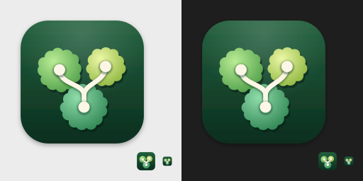

# 아이콘과 심볼 (Iconography)

> 상태: Accepted (Phase 2 게이트, 2026-11-05), 심볼 추가 (#166) · 관련: [`design/icon/`](../../design/icon/), [art-direction.md](art-direction.md), [design-tokens.md](design-tokens.md), [interaction.md §6](interaction.md#6-접근성), [screens.md](screens.md)

---

## 1. 앱 아이콘 콘셉트

**Overgrove = 숲 위에서 여러 나무를 내려다본다.**

- 위에서 내려다본 나무 수관(樹冠) 세 개가 겹쳐 있다. 아래의 큰 수관은 main 워크트리, 위의 두 수관은 linked 워크트리를 뜻한다.
- 수관 위로 크림색 가지 선이 지나간다. 아래 노드에서 시작해 Y자로 두 노드로 갈라진다. 커밋 그래프의 분기를 나타내며, 공통 조상에서 갈라진 워크트리들을 뜻한다.
- 수관의 가장자리는 둥근 잎 뭉치처럼 물결진다. 그래서 단순한 원(버블)이 아니라 나무로 읽힌다.
- 색은 숲의 초록 계열(`primitive.color.forest.*`)만 쓴다. 다른 Git 클라이언트의 브랜드 색(청록, 보라 등)과 겹치지 않는다. 이 색은 아이콘과 마크 전용이고 앱 UI의 강조색으로 쓰지 않는다 ([design-tokens.md §1](design-tokens.md#1-원칙)).
- 아이콘에는 SF Symbols를 쓰지 않았다. SF Symbols 라이선스는 앱 아이콘과 로고에 쓰는 것을 허용하지 않는다. 모든 형태를 직접 그렸다.

---

## 2. 파일

| 파일 | 용도 |
|---|---|
| [`app-icon.svg`](../../design/icon/app-icon.svg) | 완성본 원본. 1024 캔버스, 그림자 포함. 64px 이상 크기의 기준 |
| [`app-icon-small.svg`](../../design/icon/app-icon-small.svg) | 16·32px용 단순화 버전. 수관은 매끈한 원, 가지 선과 노드는 굵게, 선 그림자 없음 |
| [`app-icon-background.svg`](../../design/icon/app-icon-background.svg) | Icon Composer용 배경 레이어. 둥근 사각형 없이 1024 정사각형 전체를 채움 |
| [`app-icon-foreground.svg`](../../design/icon/app-icon-foreground.svg) | Icon Composer용 전경 레이어. 투명 배경, 수관과 가지 선, 그림자 없음 |
| [`mark.svg`](../../design/icon/mark.svg) | README, 온보딩(S-07), 문서용 단색 마크. 투명 배경, 가지 선은 뚫린 공간(knockout)으로 표현 |
| [`preview.png`](../../design/icon/preview.png) | 검토용 미리보기 (512×256). 밝은 배경·어두운 배경, 216px·32px·16px |

SVG는 사람이 읽을 수 있는 형태로 유지한다. 작은 생성 스크립트로 만들었으며 수관 좌표와 반지름은 §3의 표와 같다.

---

## 3. 그리드

| 항목 | 값 |
|---|---|
| 캔버스 | 1024 × 1024 |
| 본체 | 824 × 824, 원점 (100, 100) |
| 모서리 | 반지름 185 (macOS 아이콘 템플릿의 연속 곡률 모서리를 원호로 근사) |
| 그림자 | 본체 아래 y 12, blur 14, 검정 32% (`app-icon.svg`에만 포함) |
| 수관 (중심, 반지름) | main (524, 680) r164 · 왼쪽 (360, 430) r154 · 오른쪽 (668, 408) r136 |
| 가지 선 | 폭 32, 둥근 끝. main 노드 → (524, 600)에서 분기 → 두 노드 |
| 노드 | 반지름 38, 크림 `#fbf6e6` |
| 배경 그라데이션 | 위 `#22603d` → 아래 `#0b2e1f` + 위쪽 흰빛 16% 방사형 하이라이트 |
| 수관 색 | main `#8fdcaa`→`#2c8350`, 왼쪽 `#b9ec95`→`#4c9c47`, 오른쪽 `#ecf7a6`→`#8ab43b` (왼쪽 위 광원) |

전체 형태는 본체 중앙보다 약간 위(무게중심 y≈540)에 놓이고, 좌우 균형은 오른쪽 수관을 작게 두어 맞춘다.

---

## 4. 크기별 규칙

| 크기 (px) | 사용 원본 | 확인한 점 |
|---|---|---|
| 1024, 512, 256, 128, 64 | `app-icon.svg` | 수관의 물결 가장자리, 가지 선 그림자, 노드가 모두 읽힌다 |
| 32 | `app-icon-small.svg` | 세 수관과 Y자 선이 구분된다 |
| 16 | `app-icon-small.svg` | 초록 사각형 안에 밝은 Y자와 세 덩어리가 보인다. 세부는 사라져도 실루엣이 유지된다 |

검증 방법: `rsvg-convert`로 각 크기를 렌더링한 뒤 밝은 배경(`#ececec`)과 어두운 배경(`#1e1e1e`)에 놓고 눈으로 확인했다. 결과는 [`preview.png`](../../design/icon/preview.png)이다.

---

## 5. 상태 심볼 매핑

앱 안의 아이콘은 **SF Symbols만** 쓴다. v0.1에는 직접 그린 글리프가 없다(그래프의 노드와 레인은 도형으로 그린다).

규칙:

1. 상태 색은 반드시 심볼과 함께 쓴다. 심볼은 반드시 텍스트 라벨이나 VoiceOver 라벨과 함께 쓴다.
2. **같은 맥락에 함께 나오는 상태는 실루엣이 달라야 한다.** 색각 이상이 있어도 모양으로 구분할 수 있게 하기 위해서다. 상태 색은 색각 이상 시뮬레이션에서 일부 쌍이 구분되지 않는다 ([design-tokens.md §5.2](design-tokens.md#52-상태-색)).
3. 선택된 행(`surface.selection`)에서도 심볼 색을 유지한다. light 모드에서 3:1에 못 미치는 `status.untracked`와 레인 7 심볼만 `text.secondary`로 바꾼다(#166). 그때도 모양으로 상태를 알 수 있어야 한다.
4. 렌더링 모드는 기본 monochrome이다. 크기는 `size.symbol-small`(12) 또는 `size.symbol-medium`(14)을 쓴다.

### 5.1 파일 상태 (S-02 그룹 헤더와 행)

| 상태 | 심볼 | 실루엣 | 색 토큰 | VoiceOver |
|---|---|---|---|---|
| Staged | `checkmark.circle.fill` | 채운 원 + 체크 | `status.staged` | `Staged` |
| Unstaged | `pencil` | 사선 연필 | `status.unstaged` | `Unstaged` |
| Untracked | `questionmark.circle` | 빈 원 + 물음표 | `status.untracked` | `Untracked` |
| Conflicted | `exclamationmark.triangle.fill` | 채운 삼각형 | `status.conflicted` | `Conflicted` |

파일의 **변경 종류**는 심볼이 아니라 git 관례 글자로 표시한다: `M` 수정, `A` 추가, `D` 삭제, `R` 이름 변경, `C` 복사, `T` 타입 변경, `U` 미병합. 글꼴은 `typography.mono-small`, 색은 `text.secondary`이고, VoiceOver는 단어(`modified`, `added` …)로 읽는다.

### 5.2 워크트리와 브랜치 배지 (사이드바)

| 상태 | 심볼 | 색 토큰 | 비고 |
|---|---|---|---|
| 충돌 있음 | `exclamationmark.triangle.fill` + 수 | `status.conflicted` | |
| 디렉터리 없음 (prunable) | `questionmark.folder` | `status.prunable` | |
| 변경 파일 수 | `pencil` + 수 | `text.secondary` | 정보이므로 색 없음 |
| ahead / behind | `arrow.up` / `arrow.down` + 수 | `status.ahead` / `status.behind` | 같은 색. 방향이 의미 |
| 잠김 | `lock.fill` | `status.locked` | |
| 포커스 워크트리 | 행 앞 점 `circle.fill` (작게) | `accent` | |
| 워크트리가 체크아웃한 브랜치 | `tree` | `text.secondary` | 로컬 브랜치 행 |

### 5.3 객체와 동작

| 대상 | 심볼 |
|---|---|
| 워크트리 (linked / main) | `tree` / `tree.fill` |
| 로컬 브랜치 | `arrow.triangle.branch` |
| 원격 | `network` |
| 태그 | `tag` |
| stash | `tray.full` |
| 이슈 (열림 / 닫힘) | `number.circle` / `checkmark.seal` |
| Fetch / Stop | `arrow.down.circle` / `stop.fill` |
| Refresh | `arrow.clockwise` |
| 검색 | `magnifyingglass` |
| 보안 항목 정상 / 주의 | `checkmark.shield` / `exclamationmark.shield` |
| gh 로그인됨 / 미로그인 / 미설치 | `person.crop.circle.badge.checkmark` / `person.crop.circle.badge.xmark` / `person.crop.circle.badge.questionmark` |
| 복사 | `doc.on.doc` |
| Finder에서 보기 | `folder` |
| 터미널에서 열기 | `terminal` |
| 브라우저에서 열기 | `arrow.up.right.square` |
| 에러 | `exclamationmark.triangle` |
| 작업 트리 깨끗함 | `checkmark.circle` |
| AI 공동 작성 | `sparkles` |
| 작성자 필터 | `person.2` |
| 기준 브랜치 대비 변경 (Compare) | `plus.forwardslash.minus` |
| 열·밀도 메뉴 | `ellipsis` |
| 사이드바 / 상세 패널 토글 | `sidebar.left` / `sidebar.right` |
| 읽기 전용 표시 (상태바) | `checkmark.shield` |

**워크트리 타일 (#166).** 사이드바 워크트리 행, 상세 패널 머리, 툴바 포커스 칩에서는 `tree.fill`을 둥근 사각형 타일 안에 둔다. 타일은 그 브랜치 레인 색 18%로 채우고 심볼은 레인 색이다. detached와 prunable 워크트리는 중립 색(`text.secondary`) 타일에 `tree`를 쓴다. 규칙은 [art-direction.md §6](art-direction.md#6-사이드바)에 있다.

- 최소 지원 OS(macOS 14)에서 쓸 수 있는 SF Symbols 5 이름만 고른다. Phase 3 첫 UI 이슈에서 SF Symbols 앱으로 이름과 가용 OS를 확인하고, 없는 이름은 이 표를 고친다.
- 다른 Git 클라이언트나 GitHub의 고유 아이콘(Octicons 등)을 흉내 내지 않는다.

---

## 6. AppIcon 에셋 생성 계획 (Phase 3)

### 6.1 macOS 14~15용 PNG 세트

`Overgrove/Resources/Assets.xcassets/AppIcon.appiconset`에 PNG 10장을 둔다.

| 슬롯 | 픽셀 | 원본 |
|---|---|---|
| 16pt @1x | 16 | `app-icon-small.svg` |
| 16pt @2x | 32 | `app-icon-small.svg` |
| 32pt @1x | 32 | `app-icon-small.svg` |
| 32pt @2x | 64 | `app-icon.svg` |
| 128pt @1x / @2x | 128 / 256 | `app-icon.svg` |
| 256pt @1x / @2x | 256 / 512 | `app-icon.svg` |
| 512pt @1x / @2x | 512 / 1024 | `app-icon.svg` |

- PNG는 `scripts/render-app-icon.sh`로 만들고 **커밋한다**(#38). 소스에서 빌드하는 사람은 별도 도구가 필요 없다. `Config/Overgrove.xcconfig`의 `ASSETCATALOG_COMPILER_APPICON_NAME = AppIcon`이 이 세트를 앱 아이콘으로 쓴다.
- **렌더러: WebKit**(macOS 기본 포함, 추가 도구 없음, ADR-0006). `scripts/icon/render-app-icon.swift`가 화면 밖 `WKWebView`의 HTML canvas에 SVG를 슬롯 픽셀 크기로 그리고 PNG로 읽어 낸다.
  - AppKit의 `NSImage` SVG 지원은 `feGaussianBlur`를 무시한다. 그래서 그림자가 흐려지지 않고 딱딱하게 남는다(1024px에서 `rsvg-convert` 대비 채널 최대 차이 175). 따라서 쓰지 않는다.
  - WebKit은 같은 비교에서 1024px 평균 0.88, 최대 30이다. 64px 이하에서는 가장자리 몇 픽셀이 더 다르지만 눈으로는 구분되지 않는다(2026-11-07 확인, macOS 26).
- **재현성**: 같은 기계에서는 다시 렌더링해도 바이트 단위로 같다(확인). 기계마다(GPU, macOS 버전) 안티에일리어싱이 조금 다를 수 있으므로, `scripts/render-app-icon.sh --check`는 디코딩한 픽셀을 비교한다. 슬롯마다 평균 채널 차이 1.0 이하, 최대 64 이하이면 최신으로 본다. CI(`build-test`의 "App icon is up to date")가 이 검사를 실행하고, `Contents.json`과 `Mark.imageset/mark.svg`(아래)는 바이트 단위로 확인한다.
- **대체 경로**: `scripts/render-app-icon.sh --rsvg`는 `rsvg-convert`(Homebrew `librsvg`, 선택)로 `build/appicon-rsvg/`에 같은 세트를 만든다. 비교와 검토용일 뿐 커밋하지 않는다. 커밋하는 세트는 항상 WebKit 결과여야 `--check`가 추가 도구 없이 재현할 수 있다. WebKit을 쓸 수 없는 환경이면(예: GUI 세션 없는 원격 셸) GUI 세션에서 실행한다.
- 렌더링 결과는 sRGB, 8-bit RGBA다. 그림자는 `app-icon.svg`에 이미 들어 있으므로 따로 넣지 않는다.
- **마크 에셋**: `mark.svg`는 필터 없이 마스크만 쓰므로 AppKit이 그대로 그린다(확인). `Assets.xcassets/Mark.imageset`에 벡터 그대로(`preserves-vector-representation`) 두고 온보딩(S-07)이 쓴다. 원본의 복사본이며, 렌더 스크립트가 함께 갱신하고 `--check`가 같은지 확인한다.

### 6.2 Icon Composer (`.icon`)

- 최신 Xcode는 레이어로 구성한 `.icon` 파일(Icon Composer)을 지원한다. 이 형식을 쓰면 최신 macOS에서 시스템이 유리 재질 효과와 다크·틴트 변형을 입힌다.
- 레이어 원본은 `app-icon-background.svg`와 `app-icon-foreground.svg`다. 전경 레이어는 그림자 없이 둔다. 시스템이 깊이 효과를 더하기 때문이다.
- **Phase 3에서 확인할 것**
  1. `.icon` 파일과 `AppIcon.appiconset`을 함께 두었을 때 macOS 14~15에서 PNG 세트가 쓰이는지 (최소 지원 OS 유지)
  2. 다크·틴트 모양에서 크림색 가지 선과 수관의 대비가 유지되는지
  3. 레이어를 SVG 그대로 넣을 수 있는지, PNG로 바꿔야 하는지

  확인 결과는 이 절에 적고, 구성이 복잡해지면 ADR로 남긴다.

### 6.3 README와 문서

- README 머리에는 `mark.svg`를 너비 96px로 넣는다. 마크 색 `#3a9a5c`는 GitHub의 밝은 테마(흰색)와 어두운 테마(`#0d1117`) 모두에서 3:1 이상이다.
- 문서 안의 아이콘 이미지는 `preview.png`를 쓴다.

---

## 7. 변경 절차

1. 이슈(`type:feature`, `area:ui`)를 연다.
2. SVG를 고친다. §3 표의 좌표·색과 SVG가 같도록 함께 고친다.
3. 1024·128·32·16px로 렌더링해 밝은·어두운 배경에서 확인하고 `preview.png`를 다시 만든다.
4. (Phase 3 이후) `scripts/render-app-icon.sh`로 AppIcon PNG를 다시 만들어 커밋한다.
5. PR에 변경 전후 미리보기를 붙인다.

## 목업에서 추가한 심볼 (#159)

| 쓰임 | SF Symbol 후보 | 비고 |
|---|---|---|
| AI 공동 작성 배지 | `sparkles` | 항상 `AI` 텍스트와 함께 쓴다 |
| 다른 워크트리에 체크아웃된 브랜치(ref 칩 안) | `tree` 계열 | 앱 아이콘의 수관 모티프와 맞춘다 |
| 작성자 필터 | `person.2` | |
| 기준 브랜치와 비교 | `arrow.left.arrow.right` 또는 `plusminus` | S-05 버튼, S-11 |

이름과 지원 OS는 #40 스파이크에서 확정한다.
