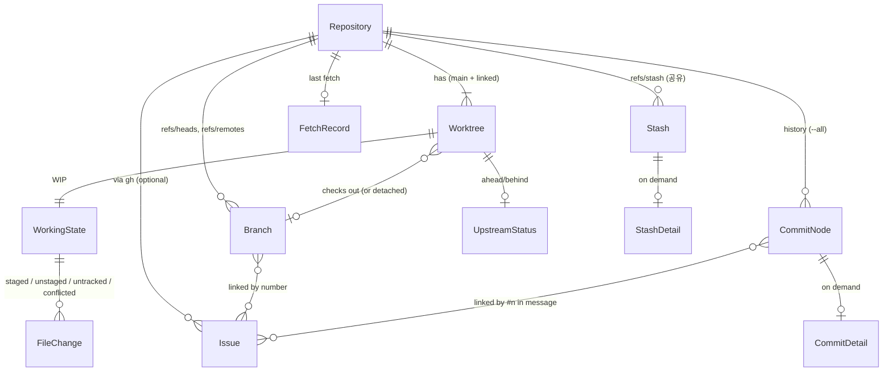
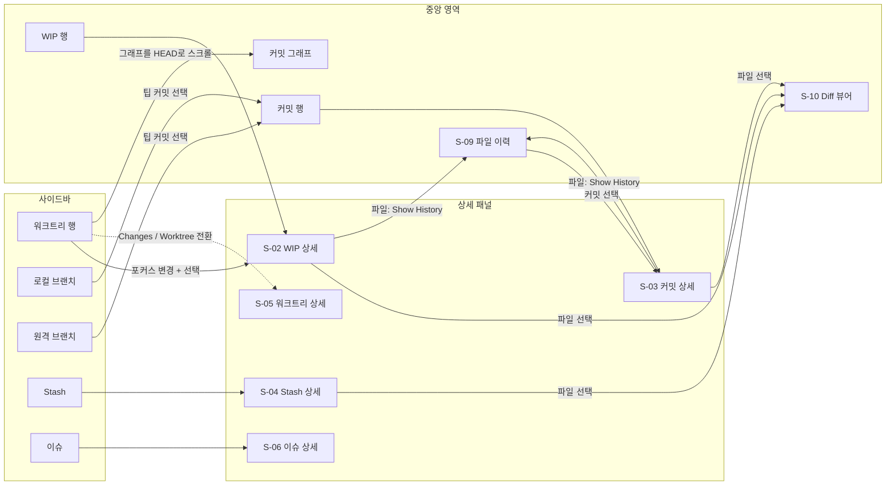

# 정보 구조 (Information Architecture)

> 상태: Proposed (Phase 2 승인 대기) · 관련: [screens.md](screens.md), [interaction.md](interaction.md), [../architecture/overview.md](../architecture/overview.md), ADR-0010, ADR-0011

이 문서는 Overgrove가 보여 주는 **객체**, 객체 사이의 **관계**, 사용자가 객체 사이를 **이동하는 길**을 정한다. 화면별 배치는 [screens.md](screens.md), 조작 방식은 [interaction.md](interaction.md)에 있다.

---

## 1. 설계 원칙

1. **워크트리가 1급 객체다.** 일반 Git 클라이언트는 "현재 체크아웃"이 하나라고 가정한다. Overgrove는 모든 워크트리를 나란히 놓고, 그중 하나를 **포커스 워크트리**로 골라 자세히 본다.
2. **저장소 단위 정보와 워크트리 단위 정보를 섞지 않는다.** 커밋 그래프, 브랜치, stash, fetch 시각은 저장소 전체의 것이다. WIP(미커밋 변경), HEAD, 잠금 상태는 워크트리마다 다르다. 화면에서도 이 경계가 드러나야 한다.
3. **조회 전용이 화면 구조에도 드러난다.** v0.1에는 체크아웃, 스테이징 토글, stash 적용 같은 쓰기 동작의 자리를 만들지 않는다. 비활성 버튼으로라도 보여 주지 않는다 (ADR-0011).
4. **선택은 하나, 맥락은 둘.** 화면에는 항상 선택된 항목이 하나 있고(상세 패널이 보여 주는 것), 그와 별개로 포커스 워크트리가 하나 있다(WIP 행과 HEAD 강조의 기준).

---

## 2. 객체 모델

모델 이름은 [docs/README.md §2.3](../README.md#23-모델-이름)을 따른다.

| 객체 | 범위 | 설명 | 데이터가 바뀌는 계기 |
|---|---|---|---|
| `Repository` | 앱 | 사용자가 `NSOpenPanel`로 등록한 저장소. 창 하나가 저장소 하나를 보여 준다 | 등록, 삭제 |
| `Worktree` | 저장소 | main 워크트리와 linked 워크트리. 경로, HEAD, 브랜치, locked, prunable | 새로고침 |
| `WorkingState` | 워크트리 | 그 워크트리의 WIP 전체. `FileChange` 목록과 요약 수치 | 새로고침, 창 활성화 |
| `FileChange` | 워크트리 | 파일 하나의 상태. XY 코드, 종류(M/A/D/R/C/T/U), 경로, 원래 경로(rename) | 새로고침 |
| `UpstreamStatus` | 워크트리 | 체크아웃한 브랜치의 upstream과 ahead/behind 수 | 새로고침, fetch |
| `Branch` | 저장소 | 로컬과 원격 브랜치. 어느 워크트리가 체크아웃했는지 역참조 | 새로고침, fetch |
| `CommitNode` | 저장소 | 그래프의 한 행. SHA, 부모, 작성자, 날짜, 제목, ref 이름, 레인 정보 | 새로고침, fetch |
| `CommitDetail` | 저장소 | 선택 시 지연 로드. 변경 파일과 numstat, 본문 | 선택 |
| `Stash` | **저장소** | `refs/stash`는 워크트리들이 공유한다. 어느 워크트리에서 만들었는지는 메시지(`WIP on <branch>`)로만 추정 | 새로고침 |
| `StashDetail` | 저장소 | 선택 시 지연 로드. 변경 파일, untracked 포함 여부 | 선택 |
| `FileHistoryEntry` | 저장소 | 파일 하나를 바꾼 커밋 목록의 한 항목 | 요청 시 |
| `Issue` | 저장소 | `gh issue list`로 읽은 GitHub 이슈. 번호, 제목, 상태, 라벨, 담당자, 수정 시각 | 새로고침, 수동 갱신 |
| `GHAuthStatus` | 앱 | `gh` 설치 여부와 로그인 상태 | 앱 시작, 수동 재확인 |
| `FetchRecord` | 저장소 | 마지막 fetch 시각, 결과(성공, 인증 실패, 시간 초과, 취소) | fetch |

### 2.1 저장소와 창

- 창 하나가 저장소 하나를 보여 준다. 툴바의 저장소 전환 메뉴로 그 창의 저장소를 바꾼다.
- `⌘N`(새 창)으로 다른 저장소를 다른 창에 띄울 수 있다. 창마다 선택 상태와 포커스 워크트리를 따로 가진다.
- 같은 저장소를 두 창에서 열 수 있다. 데이터 캐시는 저장소 단위로 공유하고, 선택 상태만 창마다 따로 둔다. 캐시 구조는 [architecture/overview.md](../architecture/overview.md)를 따른다.

### 2.2 포커스 워크트리

- 저장소를 처음 열면 **main 워크트리**가 포커스된다. 마지막으로 보던 워크트리가 있고 아직 존재하면 그것을 복원한다.
- 포커스 워크트리가 정하는 것은 세 가지다.
  - 그래프 맨 위 WIP 행이 누구의 WIP인가
  - 그래프에서 HEAD 링을 어느 커밋에 그리는가
  - 상태바와 툴바의 "Branch:" 표시
- 포커스 워크트리를 바꾸는 방법은 사이드바에서 워크트리 행을 고르는 것 **하나뿐**이다. 브랜치나 커밋을 골라도 포커스는 바뀌지 않는다. 사용자가 "지금 어느 워크트리를 보고 있는지" 잃지 않게 하기 위해서다.

---

## 3. 화면 영역과 내비게이션

창은 다섯 영역으로 나뉜다. 화면 ID는 [screens.md](screens.md)를 따른다.

| 영역 | 역할 | 바뀌는 계기 |
|---|---|---|
| 툴바 | 저장소 전환, Fetch, 포커스 워크트리의 브랜치 표시, 검색 | 저장소 전환, 포커스 변경 |
| 사이드바 | 저장소 안의 탐색 목록: WORKTREES, LOCAL, REMOTE, STASHES, ISSUES | 새로고침 |
| 중앙 영역 | 기본은 커밋 그래프. 필요할 때 Diff 뷰어(S-10)나 파일 이력(S-09)으로 바뀐다 | 선택, `⎋`로 복귀 |
| 상세 패널 | 선택한 항목 하나의 상세 (S-02 ~ S-06) | 선택 |
| 상태바 | 저장소 단위 요약: 마지막 fetch, ahead/behind, 워크트리 수, 경고, gh 상태 | 새로고침, fetch |

### 3.1 선택이 바꾸는 패널

| 사용자가 고른 것 | 포커스 워크트리 | 중앙 영역 | 상세 패널 |
|---|---|---|---|
| 사이드바 워크트리 행 | **그 워크트리로 바뀜** | 그래프. 그 워크트리의 HEAD로 스크롤하고 WIP 행을 갱신 | S-02 (상단 세그먼트로 S-05 전환) |
| 그래프의 WIP 행 | 유지 | 그래프 | S-02 |
| 그래프의 커밋 행 | 유지 | 그래프 | S-03 |
| 사이드바 로컬·원격 브랜치 | 유지 | 그래프. 팁 커밋으로 스크롤하고 선택 | S-03 (팁 커밋) |
| 사이드바 stash | 유지 | 그래프 (변화 없음) | S-04 |
| 사이드바 이슈 | 유지 | 그래프. 연결된 브랜치가 있으면 그 팁을 강조만 하고 선택은 하지 않음 | S-06 |
| 상세 패널의 파일 | 유지 | **S-10 Diff 뷰어로 전환** | 그대로 (파일 목록 유지, ↑↓로 다음 파일) |
| 파일 컨텍스트 메뉴 "Show History" | 유지 | **S-09 파일 이력으로 전환** | 이력에서 고른 커밋의 S-03 |
| `⎋` (S-09, S-10에서) | 유지 | 그래프로 복귀, 이전 선택 복원 | 이전 상세 |

### 3.2 stash와 그래프

- v0.1의 그래프는 stash를 노드로 그리지 않는다. stash 커밋은 index 커밋과 untracked 커밋을 부모로 가져서 그래프를 어지럽히기 때문이다. stash는 사이드바와 S-04에서만 다룬다.
- 그래프에 stash 위치를 표시하는 기능은 `later`로 둔다.

### 3.3 이슈 연결

- 이슈와 브랜치, 커밋을 잇는 규칙(브랜치명 `<type>/<n>-<slug>`, 커밋 메시지의 `#n`)의 정확한 정의는 [architecture/overview.md](../architecture/overview.md)에 둔다. 이 문서는 표시 방식만 정한다.
- 연결은 양방향으로 보인다.
  - 이슈 행: 연결된 브랜치와 워크트리 배지
  - 브랜치·워크트리 행: 이슈 번호 배지 `#12`
- `gh`가 없거나 로그인하지 않았으면 ISSUES 섹션은 접힌 안내 행 하나만 보여 준다. 나머지 기능에는 영향이 없다.

---

## 4. 사이드바 섹션

### 4.1 섹션 순서

고정 순서이며 사용자가 바꾸지 않는다. 각 섹션은 접을 수 있고, 접힘 상태는 저장소별로 기억한다.

1. **WORKTREES** — 항상 펼쳐서 시작
2. **LOCAL** — 로컬 브랜치
3. **REMOTE** — 원격 브랜치 (원격 이름별 하위 그룹)
4. **STASHES**
5. **ISSUES** — `gh` 연동. 미로그인이면 안내 행

섹션 헤더에는 항목 수를 붙인다. 예: `WORKTREES (3)`.

### 4.2 정렬 규칙

| 섹션 | 정렬 | 이유 |
|---|---|---|
| WORKTREES | main 워크트리를 맨 위에 둔다. 나머지는 브랜치 이름 오름차순이고, detached는 경로 이름으로 정렬한다. prunable은 맨 아래 | 위치가 활동량에 따라 움직이면 기억으로 찾을 수 없다. 정렬을 안정적으로 유지한다 |
| LOCAL | `/` 앞부분으로 폴더를 묶는다(`feat/`, `fix/`). 폴더와 이름은 각각 오름차순. 기본 브랜치(`main`, `master`, 또는 `origin/HEAD`가 가리키는 것)는 맨 위에 고정 | 워크트리 운영자는 브랜치가 많다 |
| REMOTE | 원격 이름(`origin` 먼저, 나머지는 오름차순) → `/` 폴더 → 이름. `origin/HEAD` 심볼릭 ref는 숨긴다 | |
| STASHES | `stash@{0}`(최신)부터 | git과 같은 순서 |
| ISSUES | 열린 이슈만 기본 표시. 로컬 브랜치나 워크트리와 연결된 이슈를 먼저, 그다음 `updatedAt` 내림차순 | "지금 손대고 있는 이슈"가 위로 온다 |

### 4.3 행 구성과 배지

배지는 **0이면 숨긴다.** 999를 넘으면 `999+`로 줄인다. 한 행에 배지가 여럿이면 아래 우선순위대로 오른쪽 끝부터 채우고, 폭이 모자라면 낮은 우선순위부터 숨긴다. 숨긴 정보는 툴팁과 VoiceOver 라벨에 모두 남긴다.

| 우선순위 | 배지 | 심볼 / 형식 | 색 토큰 | 적용 행 |
|---|---|---|---|---|
| 1 | 충돌 수 | `exclamationmark.triangle.fill` + n | `status.conflicted` | 워크트리 |
| 2 | prunable | `questionmark.folder` | `status.prunable` | 워크트리 |
| 3 | 변경 파일 수 | `pencil` + n (staged + unstaged + untracked 합) | `text.secondary` | 워크트리 |
| 4 | ahead / behind | `↑n` `↓n` | `status.ahead` / `status.behind` | 워크트리, 로컬 브랜치 |
| 5 | locked | `lock.fill` | `status.locked` | 워크트리 |
| 6 | 이슈 번호 | `#12` 알약 | `text.secondary` 테두리 | 워크트리, 로컬 브랜치 |
| — | 워크트리 체크아웃 표시 | `tree` 심볼 | `text.secondary` | 로컬 브랜치 (그 브랜치를 체크아웃한 워크트리가 있을 때) |
| — | 포커스 표시 | 행 앞의 `●` | `accent` | 워크트리 (포커스 워크트리만) |

변경 파일 수는 경고가 아니라 정보이므로 색을 쓰지 않는다. 세부 구분(staged, unstaged, untracked)은 S-02와 툴팁에서 본다. 상태 색과 심볼의 전체 규칙은 [iconography.md §5](iconography.md#5-상태-심볼-매핑)와 [design-tokens.md](design-tokens.md)를 따른다.

### 4.4 워크트리 행의 이름

| 경우 | 주 텍스트 | 보조 텍스트 |
|---|---|---|
| 브랜치를 체크아웃함 | 브랜치 이름 | 경로의 마지막 디렉터리 이름 (브랜치 이름과 다를 때만) |
| detached HEAD | `detached @ a1b2c3d` | 경로의 마지막 디렉터리 이름 |
| main 워크트리 | 브랜치 이름 + `main worktree` 태그 | — |
| prunable | 마지막으로 알려진 브랜치 이름, 흐리게 | `path missing` |
| bare 저장소 항목 | 목록에서 숨긴다. bare 저장소 자체는 상태바에 `bare` 표시 | — |

전체 경로는 툴팁, S-05, 컨텍스트 메뉴 "Copy Path"에서만 보여 준다. 홈 디렉터리는 `~`로 줄인다.

---

## 5. 용어 표기

화면에 보이는 문구는 영어로 통일한다(앱 UI 언어). 한국어 현지화는 `later`로 둔다. 화면 문구 목록은 [screens.md](screens.md)에 있고, 용어 정의는 [../glossary.md](../glossary.md)를 따른다.

| 개념 | 화면 표기 |
|---|---|
| 미커밋 변경 전체 | `WIP` (행), `Changes` (상세 탭) |
| 스테이징된 변경 | `Staged` |
| 스테이징 안 된 변경 | `Unstaged` |
| 추적하지 않는 파일 | `Untracked` |
| 병합 충돌 | `Conflicted` |
| 원격보다 앞섬 / 뒤처짐 | `ahead` / `behind` (`↑` / `↓`) |
| 정리 필요 워크트리 | `prunable` |
| 잠긴 워크트리 | `locked` |

---

## 6. v0.1 범위 밖 (later)

- 그래프에 stash 노드 표시
- 파일 시스템 감시(FSEvents) 기반 자동 새로고침. v0.1은 창 활성화, `⌘R`, fetch 후에 새로고침한다 ([interaction.md §4](interaction.md#4-새로고침과-fetch))
- 사이드바 섹션 순서 바꾸기, 사용자 정의 그룹
- 태그 섹션. v0.1은 태그를 그래프의 ref 알약으로만 보여 준다
- 여러 저장소를 한 창에서 동시에 보는 화면
- UI 한국어 현지화
