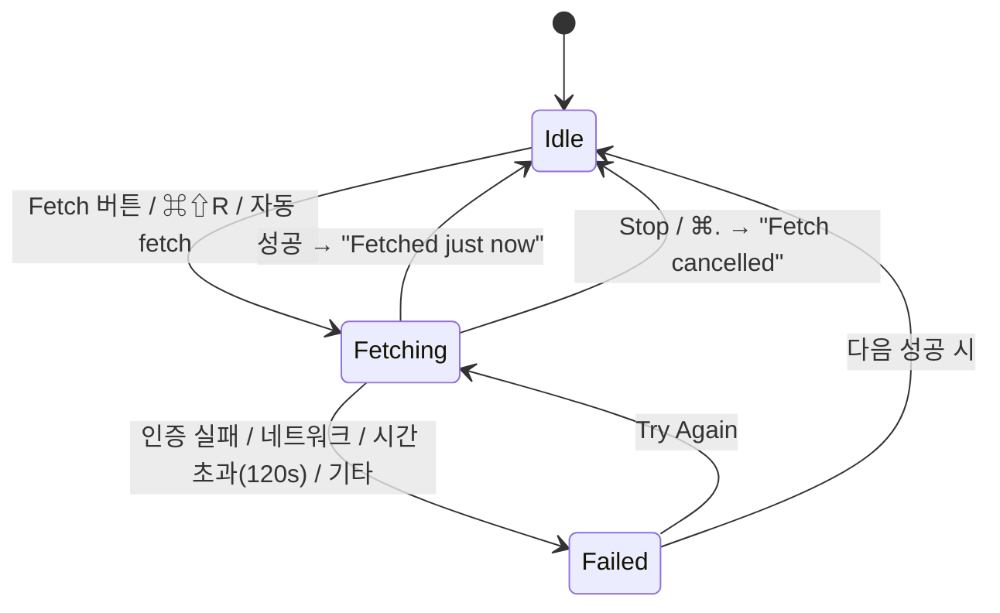

# 상호작용 명세 (Interaction)

> 상태: Accepted (Phase 2 게이트, 2026-11-05), 패널 크기 조절 추가 (#166), 선택 이력 설계 추가 (#123, v0.2.0), 두 커밋 비교 진입 추가 (#122, v0.2.0) · 관련: [art-direction.md](art-direction.md), [information-architecture.md](information-architecture.md), [screens.md](screens.md), [design-tokens.md](design-tokens.md), [iconography.md](iconography.md), [security-review.md](security-review.md), ADR-0008, ADR-0011

이 문서는 선택과 포커스, 키보드, 새로고침과 fetch, 취소, 컨텍스트 메뉴, 접근성을 정한다. 화면 배치는 [screens.md](screens.md)에 있다.

---

## 1. 선택과 포커스 모델

### 1.1 세 가지 상태

| 상태 | 개수 | 설명 | 바뀌는 계기 |
|---|---|---|---|
| **포커스 워크트리** | 창마다 1 | WIP 행과 HEAD 링의 기준 | 사이드바 워크트리 행 선택. 그리고 선택 이력 이동(그때의 포커스로 복원, §1.4) ([information-architecture.md §2.2](information-architecture.md#22-포커스-워크트리)) |
| **주 선택(selection)** | 창마다 1 | 상세 패널이 보여 주는 항목. `wip(worktree)`, `worktreeInfo(worktree)`, `commit(sha)`, `stash(index)`, `issue(number)` 중 하나 | 사이드바·그래프에서 항목 선택 |
| **보조 선택(file)** | 0 또는 1 | 주 선택 안의 파일 하나. 중앙 Diff 뷰어(S-10)를 구동 | 상세 패널 파일 목록에서 선택 |

- 주 선택은 비지 않는다. 선택을 해제하면 포커스 워크트리의 `wip`로 돌아간다. WIP가 비어 있으면 `worktreeInfo`로 돌아간다. 상세 패널이 빈 채로 남는 순간을 만들지 않는다.
- 사이드바와 그래프는 같은 주 선택을 공유한다. 사이드바에서 브랜치를 고르면 그래프의 팁 커밋 행이 선택되고 사이드바 브랜치 행도 강조된다. 그 뒤 그래프에서 다른 커밋을 고르면 사이드바 강조는 사라진다.
- **다중 선택은 없다.** 두 커밋 비교(S-12, v0.2.0 #122)도 다중 선택 없이 한다: 주 선택인 커밋을 기준으로, 다른 커밋 행의 메뉴 `Compare with Selected Commit`으로 연다.
- 저장소를 다시 열면 포커스 워크트리와 주 선택을 복원한다. 대상이 사라졌으면 기본값(main 워크트리의 `wip`)으로 돌아간다.

### 1.2 패널 포커스

- 키보드 포커스는 사이드바, 중앙(그래프 / 파일 이력 / Diff), 상세 패널 중 한 곳에 있다.
- 포커스된 패널의 선택 행은 `color.surface.selection`, 포커스가 없는 패널의 선택 행은 `color.surface.selection-inactive`로 칠한다 (macOS 표준).
- `Tab` / `⇧Tab`으로 사이드바 → 중앙 → 상세 순서로 포커스를 옮긴다. `⌘1`~`⌘4`로 바로 옮길 수도 있다.

### 1.3 중앙 영역 전환

- S-09(파일 이력), S-10(Diff 뷰어), S-11(기준 대비), S-12(두 커밋 비교)는 중앙 영역을 **잠시 덮는다.** 왼쪽 위 `‹ Graph` 버튼이나 `⎋`로 그래프에 돌아간다.
- 돌아가면 그래프 스크롤 위치와 이전 주 선택을 그대로 복원한다.
- 덮인 상태에서 사이드바 항목을 고르면 그래프로 돌아간 뒤 그 항목을 선택한다.

### 1.4 선택 이력

(#123, v0.2.0 설계. 구현: #378, `SelectionHistory`와 `AppState+SelectionHistory`.) 사이드바와 그래프를 오가며 커밋, 워크트리, stash를 살피다가 "아까 보던 것"으로 돌아가는 동작이다. Finder, Safari, Xcode의 뒤로/앞으로와 같은 모델이다.

| 항목 | 규칙 |
|---|---|
| 명령 | `⌘[` Back, `⌘]` Forward (Navigate 메뉴). 갈 곳이 없으면 메뉴 항목이 꺼진다 |
| 기록하는 것 | 주 선택(§1.1)이 **다른 대상으로** 바뀔 때마다 하나: `wip(worktree)`, `worktreeInfo(worktree)`, `commit(sha)`, `stash(oid)`, `issue(number)`. 사이드바 태그나 브랜치를 골라 커밋이 선택되면 `commit`으로 기록한다. 각 항목은 그때의 포커스 워크트리를 함께 기억한다 |
| 기록하지 않는 것 | 같은 워크트리 안의 `Changes` ↔ `Worktree` 세그먼트 전환(`⌘I`, 보기 전환이라서), 보조 선택(파일)과 S-10 Diff 뷰어, S-09·S-11·S-12 열기·닫기(`⎋`가 맡는다), 새로고침이나 자동 갱신이 선택을 다시 정하는 것, 이력 이동 자체. 바로 앞 항목과 같은 대상이면 새로 쌓지 않는다 |
| 쌓는 방식 | 브라우저와 같다. Back으로 간 뒤 새로 고르면 앞쪽(Forward) 기록은 버린다 |
| 이동 | 그 항목을 다시 고른 것처럼 한다: 기억한 포커스 워크트리로 되돌리고(정보 구조의 예외, [information-architecture.md §2.2](information-architecture.md#22-포커스-워크트리)), S-09·S-10이 덮여 있으면 그래프로 돌아가고, 그래프에 있는 대상이면 스크롤해 선택하고, 상세 패널을 그 대상으로 연다. 키보드 포커스는 옮기지 않는다 |
| 사라진 대상 | 지운 stash, 제거된 워크트리, 지금 그래프 범위에 없는 커밋(예: fetch로 사라진 원격 브랜치에만 있던 커밋), 목록에 없는 이슈는 건너뛰고 그 다음 항목으로 간다. 갈 수 있는 항목이 하나도 없으면 시스템 경고음만 내고 그대로 둔다. 건너뛴 항목은 기록에서 지운다 |
| 범위 | 창마다 하나. 저장소를 바꾸면 비운다(항목이 그 저장소의 객체를 가리키고, 다시 열 때는 §1.1의 선택 복원이 맡으므로). 실행 사이에 저장하지 않는다 |
| 상한 | 창마다 50개. 넘으면 가장 오래된 것부터 버린다. 기록은 대상의 식별자(경로, SHA, OID, 번호)만 담는다 |
| 텍스트 입력 중 | 검색·필터 필드에 포커스가 있어도 동작한다. `⌘[`·`⌘]`는 macOS 텍스트 필드에서 쓰는 단축키가 아니다 |
| 접근성 | 이동한 뒤 VoiceOver에 새 선택을 알린다(예: `Commit 4fa02a1, Fix token refresh`). 경고음 대신 `Nothing to go back to`를 알린다 |

---

## 2. 포인터 동작

| 동작 | 대상 | 결과 |
|---|---|---|
| 클릭 | 사이드바 워크트리 행 | 포커스 워크트리 변경 + 주 선택 `wip` + 그래프를 HEAD로 스크롤 |
| 클릭 | 사이드바 브랜치 행 | 주 선택 = 팁 커밋, 그래프 스크롤 |
| 클릭 | 그래프 행 | 주 선택 = 그 커밋 (WIP 행이면 `wip`) |
| 클릭 | 상세 패널 파일 행 | 보조 선택 + 중앙을 S-10으로 |
| 더블클릭 | S-09 행 | 그 커밋의 해당 파일 diff (S-10) |
| 클릭 | 상태바 경고 `⚠ 1 prunable` | 그 워크트리를 주 선택 |
| 클릭 | 상태바 gh 상태 | S-07의 GitHub 단계 열기 |
| 호버 | 배지, 상대 시각, 잘린 경로 | 툴팁: 전체 값 (`size` 제한 없음, 0.5초 지연) |
| 우클릭 | 행 | 컨텍스트 메뉴 (§5) |
| 드래그 | 패널 사이 홈(분할선) | 패널 폭 조절 (§2.1) |
| 더블클릭 | 패널 사이 홈 | 양쪽 패널을 기본 폭으로 |
| 드래그 | 그래프 열 머리의 구분선 | 열 폭 조절 (§2.1) |

그래프의 드래그 앤 드롭, 사이드바 재정렬은 없다.

### 2.1 패널 크기 조절과 스크롤

메인 창은 사이드바, 중앙, 상세 세 패널을 둥근 상자로 나누고 그 사이 8pt 홈을 분할선으로 쓴다(#166, [ADR-0014](../adr/0014-panel-theme-and-split-layout.md)). 모양은 [art-direction.md §3](art-direction.md#3-창-구조)에 있다.

| 항목 | 규칙 |
|---|---|
| 잡는 영역 | 홈 전체(폭 `size.panel-gap` 8pt, 패널 높이 전체). 가운데의 4×28pt 손잡이는 표시일 뿐이고 영역을 줄이지 않는다 |
| 포인터 표시 | 올리면 손잡이가 액센트 색이 되고 홈에 액센트 10%를 칠한다. 커서는 `resizeLeftRight`. 최소 폭에 닿으면 넓히는 쪽, 최대 폭에 닿으면 좁히는 쪽 한 방향 커서 |
| 폭 범위 | 사이드바 220~420(기본 256), 상세 300~560(기본 344), 중앙 최소 480. 중앙은 나머지를 모두 차지한다 |
| 더블클릭 | 그 분할선 양쪽 패널을 기본 폭으로 되돌린다 |
| 접기 | 사이드바나 상세를 최소 폭보다 40pt 넘게 더 좁히면 접힌다. 놓기 전까지는 접힐 자리를 반투명 미리보기로 보여 준다. 다시 열기: 툴바 사이드바 버튼, `⌃⌘S`(사이드바), `⌥⌘0`(상세), View 메뉴. 중앙 패널은 접히지 않는다 |
| 창 크기 변경 | 중앙이 먼저 늘고 준다. 중앙이 최소 폭에 닿으면 상세 → 사이드바 순으로 최소 폭까지 줄어든다. 창 최소 폭은 1040pt이고, 패널을 접으면 그만큼 작아진다 |
| 기억 | 패널 폭, 접힘 상태, 그래프 열 폭과 표시 여부를 저장소마다 저장한다. 저장소를 다시 열면 복원한다 |
| 키보드 | 분할선은 VoiceOver에서 조절 가능한 요소다(`Sidebar width, 256 points`). 포커스를 둔 뒤 `←` `→`로 8pt씩, `⌥←` `⌥→`로 최소·최대까지 옮긴다 |
| 움직임 | 끄는 동안 애니메이션 없이 포인터를 따른다. 접기·펼치기는 `motion.duration-standard`, Reduce Motion이면 즉시 |

**그래프 열.**
- 열 머리(Refs, Graph, Message, Author, Date, SHA)의 구분선을 끌어 폭을 바꾼다. 더블클릭하면 내용에 맞춘다.
- 패널 머리 오른쪽 `⋯` 메뉴에서 Author, Date, SHA를 숨기거나 보인다. Refs, Graph, Message는 숨길 수 없다.
- Graph 열은 레인 수에 맞춰 자동으로 정해진다. 레인이 `size.graph-max-lanes-visible`(12)을 넘으면 Graph 열 안에서만 가로로 스크롤한다.

**스크롤.**
- 세 패널은 각자 따로 세로 스크롤한다. 패널 머리와 그래프 열 머리는 고정이다.
- 사이드바 섹션 머리는 스크롤할 때 패널 위쪽에 붙는다.
- 상세 패널 아래의 비교 카드(S-02, S-05)는 고정이고, 그 위 목록만 스크롤한다.
- 스크롤바는 시스템 설정을 따르는 오버레이 스타일이다(`surface.scrollbar-thumb`).

---

## 3. 키보드 단축키

### 3.1 최종안

HANDOFF §8.6 초안을 기준으로 macOS 표준 단축키와 겹치는지 확인했다. 시스템이나 SwiftUI가 기본으로 주는 명령(`⌘Q`, `⌘H`, `⌘M`, `⌘W`, `⌘N`, `⌘,`, `⌃⌘F` 전체 화면 등)은 그대로 두고 덮어쓰지 않는다.

| 단축키 | 명령 | 메뉴 위치 | 비고 |
|---|---|---|---|
| `⌘O` | Add Repository… | File | 표준 Open |
| `⌘N` | New Window | File | 표준 |
| `⌘R` | Refresh | View | 로컬 git 조회만. 네트워크 없음 |
| `⌘⇧R` | Fetch | Repository | **HANDOFF의 `⌘⇧F`에서 변경.** 아래 3.2 참고 |
| `⌘.` | Stop | Repository | 진행 중인 fetch나 긴 조회를 취소. macOS 표준 취소 단축키 |
| `⌘F` | Find | Edit › Find | 그래프 필터 |
| `⌘G` / `⌘⇧G` | Find Next / Previous | Edit › Find | 표준. 검색 필드에서 `⏎`는 Find Next |
| `⌥⌘F` | Filter Sidebar | Edit › Find | 사이드바 필터 필드로 포커스. `⎋`로 필터를 지운다 |
| `⌘J` | Jump to HEAD | Navigate | 포커스 워크트리의 HEAD로 스크롤하고 선택. TextEdit 등의 "Jump to Selection" 관례 |
| `⌘⇧B` | Compare with Base | Navigate | 포커스 워크트리를 기준 브랜치와 비교(S-11). 툴바 `Compare`와 같다. 상태를 읽지 못한 워크트리에서는 꺼진다 (#158) |
| `⌘I` | Show Worktree Info | Navigate | 워크트리 맥락에서 `Changes` ↔ `Worktree` 세그먼트 전환. Finder의 Get Info 관례 |
| `⌘⇧B` | Compare with Base… | Repository | 포커스 워크트리를 기준 브랜치와 비교(S-11, #158). Xcode의 Build는 `⌘B`라 겹치지 않는다 |
| `⌘1` | Focus Sidebar | Navigate | |
| `⌘2` | Focus Graph | Navigate | S-09, S-10이 열려 있으면 그쪽 |
| `⌘3` | Focus Detail | Navigate | |
| `⌘4` | Focus Issues | Navigate | 사이드바 ISSUES 섹션으로 이동하고 펼친다 |
| `⌃⌘S` | Show/Hide Sidebar | View | macOS 표준 단축키. 사용자 정의 분할 컨테이너에 직접 연결한다 (ADR-0014) |
| `⌥⌘0` | Show/Hide Detail | View | Xcode 관례 |
| `⌘C` | Copy | Edit | 선택에 따라 SHA, 파일 경로(저장소 기준), stash ref, 이슈 URL |
| `⌥⌘C` | Copy Full Path | Edit | 파일·워크트리의 절대 경로. Finder "Copy as Pathname" 관례 |
| `↑` / `↓` | 이전 / 다음 행 | — | 모든 목록 |
| `⌘↑` / `⌘↓` | 처음 / 마지막 행 | — | 그래프에서 `⌘↑`는 WIP 행(있으면) |
| `⌘[` / `⌘]` | Back / Forward | Navigate | 선택 이력(§1.4). v0.2.0 (#123) |
| `←` / `→` | 접기 / 펼치기 | — | 사이드바 섹션과 폴더 |
| `⏎` | Open | — | 사이드바·그래프 → 상세 패널로 포커스 이동. 상세 파일 목록 → S-10 열기 |
| `⎋` | Back / Clear | — | 우선순위: ① S-09·S-10 닫기 ② 검색어 지우기 ③ 주 선택을 기본값으로 |
| `Tab` / `⇧Tab` | 다음 / 이전 패널 | — | 전체 키보드 접근 |

**구현 상태 (#73)**: Navigate 메뉴(`⌘J`, `⌘I`, `⌘1`~`⌘4`)와 Edit › Copy Full Path(`⌥⌘C`), 선택에 따른 `⌘C`, 그래프·사이드바·상세 목록의 `↑`/`↓`·`⌘↑`/`⌘↓`, 그래프의 `⏎`(상세로 포커스), `⎋`의 ②③이 들어왔다. `⎋` ①은 각 화면의 `‹ Graph` 버튼이 맡는다. `⌘F`·`⌘G`·`⌘⇧G`·`⌥⌘F`는 검색(#74)이 넣었다(Edit › Find, `SearchCommands`). `⌘F`는 툴바 검색 필드로 포커스를 옮긴다. `.searchFocused`는 macOS 15부터라서, 14와 15 모두 AppKit의 `NSSearchToolbarItem`을 통해 포커스를 준다. `Tab`/`⇧Tab`은 시스템의 전체 키보드 접근을 따른다. 사이드바 섹션의 `←`/`→`는 아직 없다.

### 3.2 바꾼 이유와 확인한 충돌

| 후보 | 판단 |
|---|---|
| `⌘⇧F` (HANDOFF 초안) | 시스템 예약은 아니지만 IntelliJ, VS Code, Xcode에서 "Find in Files/Project"다. 사용자가 검색하려다 네트워크 fetch를 시작하게 된다. **제외** |
| `⌘⇧R` | 브라우저의 "강제 새로고침" 관례와 의미가 맞다. `⌘R`은 로컬 새로고침, `⌘⇧R`은 원격까지 새로고침이라는 짝이 생긴다. 시스템 예약 아님. **채택** |
| `⌘1`~`⌘4` | Finder(보기 방식), Xcode(내비게이터)에서도 앱 고유 용도로 쓰는 영역이다. 시스템 예약 아님. 유지 |
| `Space` (Quick Look) | 저장소 파일을 Quick Look 플러그인에 넘기게 된다. 보안 검토 전까지 `later` |
| `⌘[` / `⌘]` (선택 이력 뒤로/앞으로) | v0.1 범위 밖이었다. v0.2.0에서 **채택**(#123, §1.4). Finder·Safari·Xcode 문서 탐색의 뒤로/앞으로와 같아 의미가 바로 읽힌다. 시스템 예약 아님. 앱의 다른 단축키와 겹치지 않는다 |
| `⌘+` / `⌘−` / `⌘0` (확대) | 그래프 행 높이와 글자 크기 배율. v0.2.0에서 **채택**(#121, §6.3). 보기 메뉴의 Zoom In·Zoom Out·Actual Size. 브라우저·텍스트 편집기의 확대 관례와 같다. 시스템 예약 아님 |

---

## 4. 새로고침과 fetch

### 4.1 새로고침 (로컬 조회)

새로고침은 네트워크를 쓰지 않는 git 조회 묶음이다. 대상은 워크트리 목록, 워크트리별 status, 브랜치, stash, upstream 비교, 그래프 첫 페이지다. 명령 목록은 [git-command-catalog.md](../architecture/git-command-catalog.md)에 있다.

| 계기 | 범위 | 비고 |
|---|---|---|
| 저장소 열기 | 전체 | PB-1 (1초 이내) |
| 창이 key window가 됨 | 전체 | 마지막 새로고침 후 3초가 지나지 않았으면 건너뛴다 |
| `⌘R` | 전체 | 항상 실행 |
| fetch 완료 | 브랜치, upstream 비교, 그래프 | |
| 설정 변경 (untracked 표시 등) | 영향받는 워크트리 status | |
| 파일이 바뀜 (창이 보이는 동안) | 바뀐 워크트리의 status, 필요하면 refs·워크트리 목록 | 자동 새로고침, 아래 |
| 창이 다시 보임 (가려짐·최소화 뒤) | 창 활성화와 같음 | 한 번 |

**자동 새로고침 (#119, #163 결정 B).** 창이 화면에 보이는 동안(`NSWindow.occlusionState`)만 FSEvents로 감시한다.
- **감시 범위**: #226으로 검증된 워크트리 폴더들과 공통 git 디렉터리. 공통 디렉터리 안에서는 `HEAD`·`index`(메인 워크트리), `refs/`·`packed-refs`(refs), `worktrees/<id>/HEAD|index`(그 연결 워크트리), `worktrees/<id>` 자체와 `gitdir`·`locked`(워크트리 목록), `config`(전부)만 반영한다. `objects/`, `logs/`, `FETCH_HEAD`, `ORIG_HEAD`, hooks 등은 무시한다. 그래서 fetch나 gc가 모든 status를 다시 돌리지 않는다. 시스템이 세부를 잃었다고 알리면(rescan) 전부 다시 조회한다.
- **경로**: 이벤트 경로는 신뢰하지 않는 문자열이다. 검증된 폴더와 경로 구성 요소로만 비교하고, 디스크에서 읽지 않는다. 폴더 밖의 경로는 버린다. 워크트리가 다른 워크트리 안에 있으면 가장 깊은 폴더에 속한다.
- **묶음과 상한**:
  - 이벤트 지연 1초. 마지막 이벤트 후 1초 디바운스한다. 이벤트가 계속 오더라도 첫 변경 후 최대 5초 안에는 요청한다(쉬지 않고 쓰는 에이전트를 지켜볼 때도 화면이 따라온다).
  - 한 번에 하나만 요청하고, 그동안 온 변경은 끝난 뒤 한 번에 보낸다.
  - 재실행 간격은 max(2초, 마지막 소요 시간 × 10)이다. 5초짜리 status도 50초에 한 번, 한 코어의 약 10%로 묶인다.
  - 요청은 `.filesChanged` 트리거 하나로, 바뀐 워크트리들의 status만 다시 조회한다(필요하면 refs·목록도).
  - 분류는 스트림 큐에서 하고 메인 액터로는 묶은 변경만 넘긴다. 한 묶음이 10,000개를 넘으면 경로를 보지 않고 rescan으로 친다(SEC-T15-17).
- **되먹임 없음**: 앱의 git 조회는 index를 쓰지 않으므로(#211) 자기 이벤트로 다시 새로고침하지 않는다. 실제 FSEvents로 검증한다.
- 가려지거나 최소화되면 스트림을 멈춘다(비용 0). 다시 보이면 모든 워크트리·refs·목록을 한 번 대기열에 넣는다. 같은 디바운스와 재실행 간격을 거치므로, Spaces를 오가며 여러 번 보였다 가려져도 요청은 하나다.
- 다른 로드(⌘R, 선택, 다른 창의 로드)가 도는 동안에는 보내지 않고, 끝나면 보낸다. 대체된 요청은 다시 보내고, 실패한 요청은 버린다(오류는 화면에 남고, 다음 변경이나 ⌘R이 다시 시도한다).
- 측정: PERF-10(파일 6,000개를 8초 동안 쓰는 동안 새로고침 3회, status 3회, git CPU 약 0.7%, [결과](../performance/results/2026-11-07-perf10-auto-refresh-storm.md)).
- **화면을 막지 않는다.** 새로고침 중에도 이전 데이터를 그대로 보여 주고 상태바에 `Refreshing…`과 작은 스피너만 둔다. 워크트리 하나의 status가 500ms를 넘기면 그 행에만 작은 스피너를 붙인다.
- 결과가 오면 제자리에서 바꾼다. 정렬이 안정적이므로 행이 튀지 않는다. 배지 수가 바뀌면 `motion.duration-fast` 동안 옅게 페이드한다. Reduce Motion이면 애니메이션을 끈다.
- 실패하면 이전 데이터를 `opacity.stale`로 흐리게 두고, 상태바에 `Refresh failed — Details`를 띄운다.
  - 워크트리 목록 읽기가 실패했을 때 S-11 비교가 열려 있으면 닫지 않는다. 마지막 결과를 `opacity.stale`로 흐리게 두고, 머리글 아래에 `The worktree list could not be read, so this comparison may be out of date.`를 띄운다. 실패한 뒤의 재시도가 도는 동안에도 같다. 목록 읽기가 다시 성공할 때까지 기준 브랜치 선택, `Include uncommitted`, 파일 선택은 막고 git을 다시 실행하지 않는다. 실패 전에 시작된 비교·patch는 버린다. `‹ Graph`와 `⎋`로는 닫을 수 있다(#374).
  - 실패 원인이 설정 검사의 차단(`.blocked`)이면 예외로 S-11을 닫고 진행 중인 비교·patch를 취소한다. 보안 중단은 "읽지 못함"이 아니므로, 사용자는 흐린 비교 대신 보안 상태를 본다(#401).
  - S-12(두 커밋 비교)도 차단(`.blocked`)이면 S-11이 열려 있든 아니든 닫고, 진행 중인 파일 목록·커밋 목록·patch를 취소한다(#405). 그 밖의 목록 실패에서는 그대로 둔다(흐리게 하지 않음). S-12는 두 커밋의 내용이라 워크트리 목록을 못 읽어도 낡지 않고, 그 git 호출은 매번 설정 검사를 다시 거친다.
  - 목록은 읽었지만 비교 대상 워크트리만 읽지 못한 경우도 같은 규칙을 따른다(#413). 폴더가 사라졌거나(`prunable`), 경로가 이제 다른 항목의 폴더로 이어지거나(`duplicate`), 그 워크트리 설정이 차단 대상이거나, 다른 저장소의 것이면 S-11을 닫는다. 조회 상한 밖이거나 status가 실패한 것처럼 읽지만 못한 경우에는 흐리게 두고 `This worktree's status could not be read, so this comparison may be out of date.`를 띄운다.

### 4.2 fetch (원격)

fetch는 **저장소 단위**이고 사용자의 git 자격 증명 설정(credential helper, SSH)을 그대로 쓴다. 앱은 자격 증명을 묻지 않는다 (HANDOFF §7).

| 상태 | 툴바 버튼 | 상태바 |
|---|---|---|
| Idle | `↓ Fetch` | `Fetched 2 min ago` / `Never fetched` |
| Fetching | `■ Stop` (같은 자리) | `Fetching origin… 12 s` (원격이 여럿이면 `Fetching 2 remotes…`) |
| 성공 | `↓ Fetch` | `Fetched just now`, 이후 상대 시각 |
| 실패 | `↓ Fetch` | `⚠ Fetch failed — Details`. 마지막 성공 시각도 남긴다: `Last fetched 2 h ago · last attempt failed` |

실패 문구는 마스킹한 stderr의 패턴으로 분류한다. 분류 규칙은 [architecture/overview.md](../architecture/overview.md)의 에러 모델을 따른다. 아래 표의 요약 문구, 안내, 복사 가능한 명령은 `FetchFailureGuidance`(#78)가 만든다. 인증 분류는 HTTPS 자격 증명, SSH 키, 호스트 키(처음 봄 / 바뀜), 접근 거부로 다시 나뉜다.

| 분류 | 요약 문구 | Details에 넣는 안내 |
|---|---|---|
| 인증 | `Authentication failed for origin` | `Run "git fetch" in Terminal to check your credentials. Overgrove does not prompt for passwords.` |
| 네트워크 | `Could not reach github.com` | 원격 호스트 이름(자격 증명 제거) |
| 시간 초과 | `Fetch timed out after 120 s` | 원격 이름 |
| 원격 없음 | `No remotes configured` | — |
| 기타 | `Fetch failed` | 마스킹한 stderr 마지막 몇 줄. 진행률처럼 `\r`로 다시 쓴 줄은 마지막 상태만, 줄마다 300 유니코드 스칼라까지(#362) |

- 저장소 하나에 fetch는 동시에 하나만 돈다. 자동 fetch가 도는 중에 사용자가 Fetch를 누르면 새로 시작하지 않고 진행 중인 작업을 보여 준다.
- 자동 fetch(S-08, 기본 끔)는 창이 비활성일 때 건너뛰고, 실패해도 알림을 띄우지 않는다. 상태바에만 남긴다.
  - 구현(`AutoFetchScheduler`, #79): 창마다 하나다. 설정한 간격(기본 10분, 5·10·15·30·60분)마다 확인하고, 다음을 모두 만족할 때만 fetch한다.
    - 자동 fetch가 켜져 있다.
    - 저장소가 열려 있다.
    - 창이 key window다.
    - 진행 중인 fetch(수동이나 이전 자동)가 없다.
  - **앱이나 창이 비활성일 때**: 그동안의 틱은 건너뛴다. 백그라운드에서는 아무것도 실행하지 않는다. 창이 다시 key가 되었을 때 마지막 fetch가 한 간격 이상 지났으면 그때 한 번 fetch한다. 다만 마지막 자동 시도 후 한 간격이 지나야 하므로, 계속 실패하는 원격을 창을 바꿀 때마다 다시 시도하지 않는다.
  - 자동 fetch의 결과는 상태바에만 남긴다. 알림, 경고창, VoiceOver 알림이 없다. 기록(`FetchRecord`)과 이후의 ahead/behind 새로고침(`.fetchCompleted`)은 수동 fetch와 같다.
  - 창을 닫으면 그 창의 자동 fetch도 멈춘다. 간격이나 켜기·끄기를 바꾸면 타이머를 다시 시작한다.
- v0.1은 시스템 알림(Notification Center)을 쓰지 않는다.

### 4.3 긴 작업과 취소

| 작업 | 취소 방법 | 시간 제한 |
|---|---|---|
| fetch | `Stop` 버튼, `⌘.` | 120초 (ADR-0008) |
| 그래프 다음 페이지 | 스크롤로 벗어나면 자동 취소 | 15초 |
| Diff 로드 | 다른 파일·항목으로 이동하면 자동 취소 | 15초 |
| 파일 이력 | `⎋`로 닫으면 자동 취소 | 15초 |
| 이슈 목록 | 저장소 전환 시 자동 취소 | 15초 |

- 취소하면 해당 git 프로세스를 종료한다. 종료 절차는 `ProcessRunner`가 맡는다 ([architecture/overview.md](../architecture/overview.md)).
- 시간 제한을 넘기면 해당 영역에 에러 상태(`Timed out after 15 s` + `Try Again`)를 보여 준다. 다른 영역은 영향받지 않는다.
- 로딩 표시는 150ms가 지나도 결과가 없을 때만 보여 준다. 짧은 작업에서 깜빡임을 막는다.

---

## 5. 컨텍스트 메뉴

모든 메뉴는 **조회와 복사만** 한다. 쓰기 동작은 비활성 항목으로도 넣지 않는다.

| 대상 | v0.1 포함 | later |
|---|---|---|
| 커밋 행 (그래프, S-09) | Copy SHA, Copy Short SHA, Copy Message, Show Changes (S-03). 그래프 행에는 v0.2.0부터 `Compare with Selected Commit`(S-12, #122. 다른 커밋이 주 선택일 때만 켜짐) | Open on GitHub, Copy Permalink |
| WIP 행 | Show Changes (S-02), Show Worktree Info (S-05) | — |
| 파일 행 (S-02~S-04) | Show Diff, Show History (S-09), Copy Path, Copy Full Path, Reveal in Finder | Quick Look, Open With… |
| 워크트리 행 | Show Changes, Show Info, Copy Path, Copy Branch Name, Reveal in Finder, Open in Terminal | Open in 사용자 지정 터미널·에디터 |
| 브랜치 행 | Show in Graph, Copy Name, Copy Upstream Name | — |
| 태그 행 (v0.2.0, #123) | Show in Graph, Copy Tag Name, Copy SHA (가리키는 커밋) | Show on GitHub |
| 원격 그룹 행 | Copy Remote URL (자격 증명 제거), Fetch This Remote → v0.1 제외 | Fetch This Remote |
| Stash 행 | Show Changes, Copy Ref, Copy SHA | — |
| 이슈 행 | Open in Browser, Copy URL, Copy Number, Show Linked Branch | — |

**구현 상태 (#73)**: 위 v0.1 항목을 넣었다. 파일 행의 Show History는 S-09와 함께, 원격 그룹 행 메뉴는 v0.1 범위 밖이라 넣지 않았다. 워크트리 행에는 기존 Compare with Base(#158)도 남긴다. 커밋·stash 파일 행의 Reveal in Finder와 Copy Full Path는 포커스 워크트리 기준이다.

**보안 조건** ([security-review.md](security-review.md)):

- **Reveal in Finder** — 경로를 `PathValidator`로 확인한다. 실제 경로가 저장소(또는 워크트리) 밖이면 열지 않고 `This path points outside the repository`를 보여 준다 (T14). `NSWorkspace.activateFileViewerSelecting`을 쓰고 파일을 실행하지 않는다.
- **Open in Terminal** — `NSWorkspace`로 Terminal.app에 폴더 URL을 넘긴다. 셸 문자열을 만들지 않으므로 `Overgrove/Execution/` 규칙과 충돌하지 않는다. 그 워크트리의 설정을 검사하지 못했거나, 검사 결과에 항목이 하나라도 있거나(사용자가 칠 git의 pager·editor·`!` alias 포함, #278), 실행 가능한 hook이 있으면 먼저 `Open in Terminal?` 확인을 받는다. 버튼은 `Open Anyway`와 `Cancel`(기본)이다(security-review.md T14, #73). 사용자 지정 터미널(iTerm, Ghostty 등)은 `later`.
- **Open With… / 기본 앱으로 열기는 넣지 않는다.** 저장소 안의 `.command`, `.app`, 스크립트를 실행할 수 있기 때문이다.
- **Copy Remote URL** — 항상 자격 증명을 제거한 URL을 복사한다. "Show full remote URLs" 설정을 켜도 마찬가지다 (T11).
- **Open in Browser** — `https://` URL만 연다.

---

## 6. 접근성

### 6.1 VoiceOver

| 요소 | 라벨 예 | 비고 |
|---|---|---|
| 워크트리 행 | `feat/12-worktree-list, worktree, focused, 6 changed, 2 ahead, locked` | 화면에서 숨긴 배지도 모두 읽는다 |
| 그래프 행 | `Commit a1b2c3d, feat: add status parser, Ko, 2 hours ago, branches feat/12 and origin/feat/12, HEAD of worktree feat/12` | 레인 그림은 `accessibilityHidden`. merge 커밋이면 `merge commit, 2 parents`를 덧붙인다 |
| WIP 행 | `Uncommitted changes in feat/12: 3 staged, 2 unstaged, 1 untracked, 1 conflicted` | |
| 파일 행 | `Staged, modified, Sources/Parsing/Status.swift, 42 lines added, 8 removed` | 상태와 종류를 단어로 읽는다 |
| 상태 심볼 | `Staged`, `Conflicted` 등 | 심볼 단독으로 쓰일 때 |
| 상대 시각 | `2 hours ago` + hint `3 November 2026, 14:22` | |
| 상태바 | 요소별로 분리해 읽는다 | |

- 사용자 지정 rotor: `Worktrees`, `Conflicted Files`, `Changes` 그룹(STAGED, UNSTAGED…).

**구현 상태 (#75)**:
- 위 표의 레이블은 모델에서 만들고 문자열을 테스트한다. 대상은 그래프 행(`GraphRowAccessibility`), WIP 행, 파일 행(S-02·S-03·S-04·S-11, `WipDetailModel.fileAccessibilityLabel`)이다. 상대 시각은 레이블에, 절대 시각은 hint에 둔다.
- rotor 세 개를 넣었다. `Changes`는 그룹 헤더로 이동하고, 헤더는 기본 Headings rotor에도 나온다.
- 선택 행은 `isSelected` trait를 가진다.
- 인라인 아이콘 버튼은 `hitTarget()`(20pt)을 쓴다.
- 대비 증가에서 컨트롤 테두리는 `Tokens.controlOutlineWidth`(1.5pt)와 `border.strong`을 쓴다. 패널 안 칩·컨트롤은 `controlOutline(_:normal:increased:)`로 그린다(#304). 대상은 툴바 워크트리 칩, 사이드바 Filter 필드, `Changes | Worktree` 세그먼트, 태그 캡슐(`main worktree`, `submodule`, `WIP`, `renamed from …`, 이슈 상태·라벨), 이슈 번호 배지, AI 배지, 그래프 작성자 칩이다. 평소에 테두리가 없던 것은 평소 화면이 그대로다. 링크인 이슈 번호와 AI 배지는 원래 글자색 테두리를 굵기만 올린다. 그래프 ref 알약 테두리와 ref 연결선은 레인 색 100%로 그린다(평소 75%·55%).
- 툴바의 워크트리 칩(`⌘J`), Terminal, Finder 버튼은 #73의 동작에 연결했다. Terminal은 `TerminalGuard`를 거친다.
- 실제 VoiceOver 동작(읽는 순서, rotor 이동, 알림)은 [qa/checklist.md](../qa/checklist.md) QA-A11Y-01–11에서 사람이 확인한다(#96).
- 새로고침이나 fetch 결과처럼 상태가 바뀌면 `AccessibilityNotification.Announcement`로 짧게 알린다. 예: `Fetch finished`, `Fetch failed: authentication`.

### 6.2 색에만 의존하지 않는다

| 정보 | 색 외의 구분 수단 |
|---|---|
| 파일 상태 | 그룹 헤더 텍스트 + 상태별 SF Symbol 모양 ([iconography.md §5](iconography.md#5-상태-심볼-매핑)) |
| ahead / behind | `↑` / `↓` 방향 (두 상태는 의도적으로 같은 색이다) |
| 충돌, prunable, locked | 서로 다른 심볼 + 툴팁 텍스트 |
| 그래프 레인 | 위치 + 각 행의 ref 알약 텍스트. 레인 색은 보조 수단이다 |
| diff 추가/삭제 | `+` / `−` 기호와 줄 번호 열 |
| 선택 행 | `surface.selection` 배경. 상태 심볼과 레인 색은 그대로 둔다. light 모드에서 3:1에 못 미치는 `status.untracked`(2.93)와 레인 7(2.48)만 `text.secondary`로 바꾼다. 모양은 그대로다 |

상태 색 쌍 중 일부는 색각 이상 시뮬레이션에서 구분되지 않는다(초록 staged와 주황 unstaged 등). 그래서 위 보조 수단은 **선택 사항이 아니라 필수**다. 측정값은 [design-tokens.md §5](design-tokens.md#5-검증-결과)에 있다.

**구현 상태 (#37)**: 상태 심볼, ahead/behind 화살표, 변경 종류 글자는 모델(`WorkingChangeGroup.symbol`, `WorktreeRow.Badge.symbol`·`text`, `FileChange.Status.code`)에서 정하고 외형·대비 값을 입력으로 받지 않는다. 그래서 Increase Contrast에서도 색만 High Contrast 변형으로 바뀌고 보조 수단은 그대로다. `NonColorCueTests`가 이 매핑을 고정하고, `TokensTests`는 4.5:1 검사 대상이 모든 상태 색과 레인 8색을 빠짐없이 덮는지 확인한다.

### 6.3 글자 크기와 확대

- 모든 텍스트는 SwiftUI 텍스트 스타일(`Font.body`, `.callout` 등)로 지정한다. 포인트 크기를 직접 쓰지 않는다.
- 사이드바와 그래프의 행 높이는 고정이다(`size.row-sidebar` 28, `size.row-worktree` 46, `size.row-graph` 30).
- macOS는 iOS 같은 전역 Dynamic Type이 없다. 그래프는 가상화를 위해 행 높이를 `size.row-graph`(30px)로 고정한다. v0.1의 그래프는 글자 크기 확대에 대응하지 않았다.
- **그래프 확대 (#121, v0.2.0).** 보기 메뉴의 `Zoom In ⌘+`, `Zoom Out ⌘−`, `Actual Size ⌘0`. 그래프 패널만 확대한다(행 높이, 레인 간격, 노드, 그래프 행의 글자와 알약, 열 너비). 사이드바와 상세 패널은 그대로다.
  - 단계는 85·100·115·130·150%이고 행 높이는 각각 26·30·34·39·45pt다. 단계마다 행 높이가 고정이라 가상화가 유지된다.
  - 앱 전역 값 하나(`AppSettings.graphZoomStep`)로 모든 창에 적용하고 다음 실행에도 유지한다. 그래프에 포커스가 없어도 동작한다.
  - 확대·축소 때 선택한 커밋이 화면 가운데에 오도록 스크롤하고, 레인이 옆으로 스크롤된 상태면 그 커밋의 레인이 보이게 맞춘다.
  - 열 너비는 100% 기준으로 저장하고 그릴 때 배율을 곱한다. 확대한 상태에서 열 경계를 끌어도 저장값은 100% 기준이다.
  - **포인트 크기 예외.** 그래프 행의 글자는 100%에서 디자인 토큰의 텍스트 스타일 그대로 쓰고, 다른 단계에서는 그 스타일의 macOS 크기(body 13, callout 12, subheadline 11, caption 10pt)에 배율을 곱한 포인트 크기를 쓴다(`GraphTypography`). macOS에서 텍스트 스타일을 확대할 방법이 없어서 둔, 이 규칙의 유일한 예외다.

### 6.4 대비

- 텍스트는 배경 대비 4.5:1 이상이다. 패널 테마의 모든 표면에서 검증했다. `text.tertiary`는 선택 행과 컨트롤 위에서 `text.secondary`로 바꾼다.
- 상태 심볼, 그래프 레인, 분할선 손잡이처럼 의미를 가진 그래픽은 3:1 이상이다. 상태 색은 최저 3.20, 레인은 최저 3.10(light) / 5.71(dark), 손잡이는 홈 대비 4.22 / 3.59다. 근거는 [design-tokens.md §5](design-tokens.md#5-검증-결과)에 있다.
- **Increase Contrast**: 패널 테마는 앱이 직접 대응한다. 패널 테두리 → `border.strong`, `text.tertiary` → `text.secondary`, 컨트롤 테두리 1.5pt. 상태·레인 색과 diff 전경색은 Asset Catalog의 High Contrast 변형을 쓴다(모든 패널 표면 대비 4.5:1 이상, [design-tokens.md §4·§5.6](design-tokens.md#56-increase-contrast-35)).
- **Reduce Transparency**: 메인 창은 반투명 재질을 쓰지 않는다. 시스템이 그리는 메뉴·팝오버만 영향을 받는다.

### 6.5 움직임과 키보드

- Reduce Motion이 켜져 있으면 이동 애니메이션을 크로스페이드(`motion.duration-fast`)로 바꾸거나 없앤다.
- 모든 기능은 키보드만으로 쓸 수 있어야 한다 (전체 키보드 접근). 포커스 링은 시스템 기본(`color.border.focus`)을 쓴다.
- 인라인 아이콘 버튼의 클릭 영역은 `size.hit-target-min`(20px) 이상이다.

---

## 7. 화면 문구 원칙

- 영어, 문장형 대문자(Sentence case)를 쓴다. 메뉴 항목과 버튼은 macOS 관례대로 Title Case를 쓴다(`Show History`, `Open in Terminal`).
- 에러 문구는 "무엇이 실패했는가 + 사용자가 할 수 있는 일" 순서로 쓴다. 내부 예외 이름이나 마스킹하지 않은 stderr를 그대로 보여 주지 않는다.
- 앱이 하지 않는 일(토큰 저장, 자동 로그인, prune)은 필요한 곳에서 짧게 밝힌다. 예: `Overgrove never asks for or stores tokens.`
- GitKraken을 포함한 다른 제품의 고유 명칭과 문구를 쓰지 않는다.
