# 목업 갤러리 (Mockups)

> 상태: Draft (#159) · 관련: [screens.md](screens.md), [references.md](references.md), [design-tokens.md](design-tokens.md), [iconography.md](iconography.md), [interaction.md](interaction.md), #158, #159

주요 화면의 고충실도 목업을 모은다. 화면의 동작과 문구는 [screens.md](screens.md)가 기준이고, 이 문서는 그 명세를 그림으로 보여 준다. 그림과 명세가 다르면 명세를 따르고 목업을 고친다.

---

## 1. 만드는 방법과 규칙

| 항목 | 규칙 |
|---|---|
| 위치 | [`design/mockups/`](../../design/mockups/). 파일 이름은 `<화면 ID>-<이름>-<light\|dark>.svg/.png`. S-01만 기존 이름 `main-window-<light\|dark>`를 유지한다 |
| 원본 | SVG가 원본이다. PNG는 `rsvg-convert -w 1280`으로 렌더링하고 무손실로 다시 압축했다(각 400KB 이하) |
| 크기 | 창 1280×800. 상세 패널 화면(S-02, S-03, S-05)과 S-10, S-11도 전체 창으로 그려 중앙·상세의 관계가 보이게 했다 |
| 색 | 모든 색은 [`design/tokens/tokens.json`](../../design/tokens/tokens.json)의 값이다. 이번에 더한 토큰(`color.avatar.*`, `surface.control`, `typography.large-title`, 창 버튼 근삿값)은 [design-tokens.md §3.4–3.5, §5.4–5.5](design-tokens.md#34-작성자-아바타-159)에 대비 수치와 함께 있다 |
| 글꼴 | `-apple-system, 'SF Pro Text', 'Helvetica Neue', sans-serif`와 `'SF Mono', Menlo, monospace`. SF Pro가 없는 렌더러에서는 Helvetica Neue와 Menlo로 보인다. 기준은 PNG다 |
| 심볼 | SF Symbol을 흉내 낸 단순 도형이다(실제 앱은 SF Symbols를 쓴다). 상태 색은 항상 서로 다른 실루엣과 함께 쓴다: staged 채운 원+체크, unstaged 연필, untracked 빈 원+물음표, conflicted 채운 삼각형 |
| 간격 | 8pt 격자. 사이드바·그래프 행 24px, 파일 행 22px, 사이드바 240px, 상세 패널 340px, 툴바 52px, 상태바 24px |
| 샘플 데이터 | 가상의 저장소 `acme/api`(Go)와 가상 인물(Mina Park, Alex Kim, Jordan Lee, Sam Rivera), AI 공동 작성자 `Coding Agent <agent@example.com>`. 경로는 `~/dev/...`. 실제 개인 정보는 없다 |
| 브랜드 | 다른 제품의 로고, 아이콘, 팔레트, 문구를 쓰지 않았다. 참고한 것은 배치 패턴뿐이다 ([references.md §1](references.md#1-참고-범위와-원칙)). S-07의 마크는 Overgrove의 [`mark.svg`](../../design/icon/mark.svg)다 |

샘플 데이터는 화면끼리 맞물린다. S-01의 WIP(staged 2, unstaged 3, untracked 2)는 S-11의 미커밋 파일 5개와 untracked 2개가 되고, S-03의 커밋 `a91f3c2` 파일 목록은 S-10과 S-11의 `middleware.go` 패치와 같다.

---

## 2. 화면별

### S-01 메인 창

| Light | Dark |
|---|---|
| 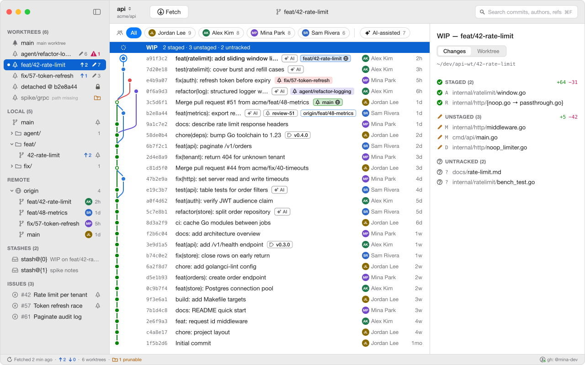 | 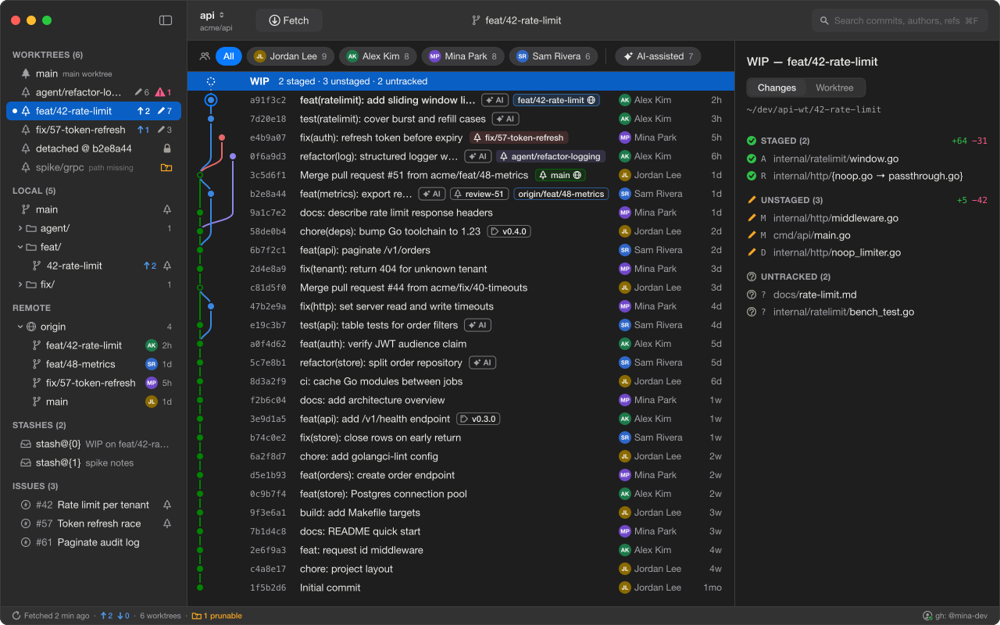 |

원본: [`main-window-light.svg`](../../design/mockups/main-window-light.svg), [`main-window-dark.svg`](../../design/mockups/main-window-dark.svg)

- 사이드바: 워크트리 6개(main, AI 에이전트용 `agent/refactor-logging`, 포커스 워크트리 `feat/42-rate-limit`, detached 리뷰 워크트리, prunable). 배지는 우선순위 순서로 오른쪽 끝부터 채운다(충돌 → 변경 수 → ahead). REMOTE의 브랜치 행에 **마지막 커미터 아바타와 상대 시각**.
- 그래프 위 **작성자 필터 칩 줄**: `All`, 작성자 칩(아바타 + 이름 + 커밋 수), `AI-assisted` 칩.
- 그래프: WIP 행(점선 중립 노드, 선택됨), 포커스 HEAD 링, 레인 `color.graph.lane.0~3`, merge 노드(작고 속이 빈 원). 작성자 열은 **이니셜 아바타** + 이름. AI 공동 작성 커밋에 **AI 배지**. 로컬과 원격이 같은 커밋이면 알약 하나(채움 + 테두리 + `network`), 다른 워크트리가 체크아웃한 브랜치 알약에는 `tree`, detached 워크트리는 별도 `tree` 알약.
- 상세 패널: S-02(Staged / Unstaged / Untracked). 상태바: fetch 시각, ↑↓, 워크트리 수, prunable 경고, gh 상태.
- 명세: [screens.md S-01](screens.md#s-01-메인-창), [작성자 표현과 AI 배지](screens.md#작성자-표현과-ai-배지). 이슈: #159

### S-02 WIP 상세

| Light | Dark |
|---|---|
| 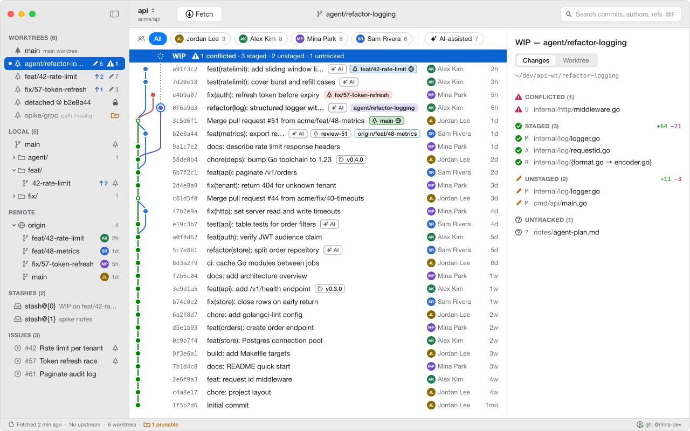 | 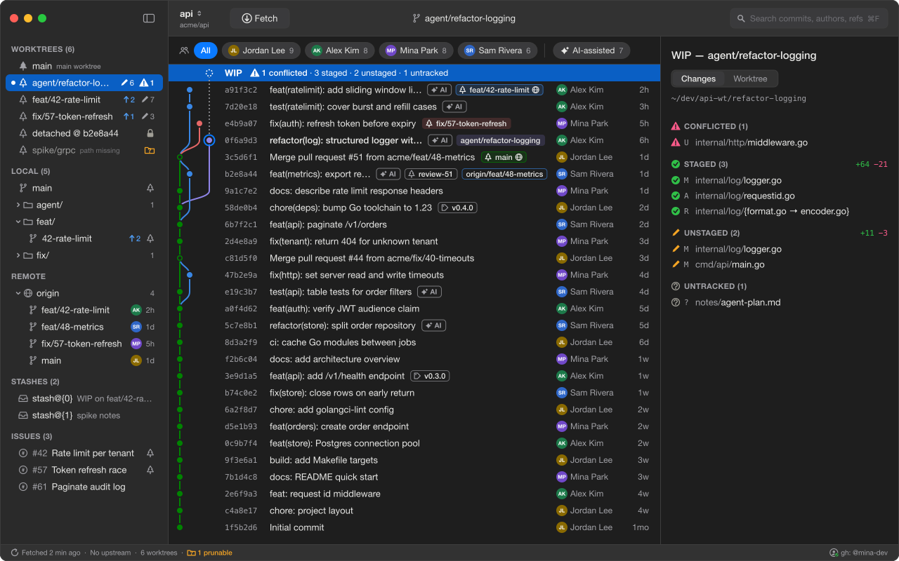 |

원본: [`s02-wip-detail-light.svg`](../../design/mockups/s02-wip-detail-light.svg), [`s02-wip-detail-dark.svg`](../../design/mockups/s02-wip-detail-dark.svg)

- 충돌이 있는 에이전트 워크트리로 포커스를 옮긴 상태. 사이드바 행 배지 `⚠1 ✎6`, 그래프 WIP 행 앞에 `⚠ 1 conflicted`, 상태바는 `No upstream`.
- 그룹 순서 CONFLICTED → STAGED → UNSTAGED → UNTRACKED. 그룹 헤더에 상태 심볼, 개수, `+n −m`.
- `logger.go`는 staged와 unstaged에 한 번씩 나온다(`MM`). rename은 `internal/log/{format.go → encoder.go}`.
- 명세: [screens.md S-02](screens.md#s-02-wip-상세)

### S-03 커밋 상세

| Light | Dark |
|---|---|
| 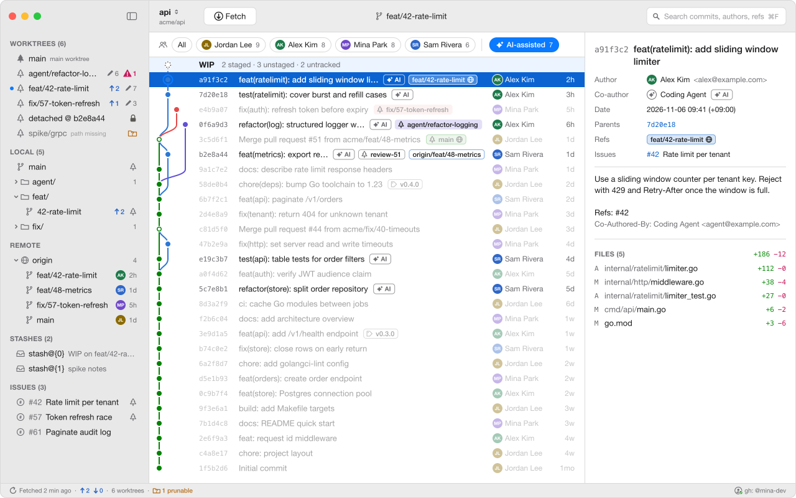 | 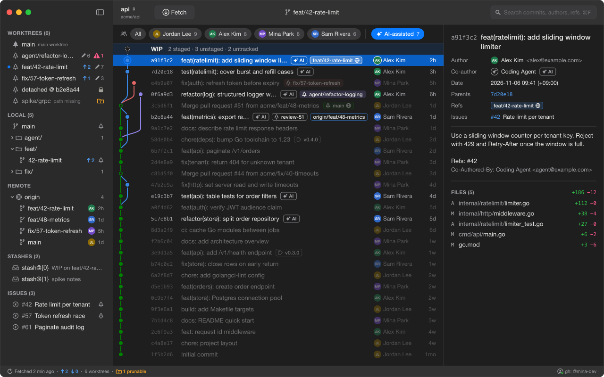 |

원본: [`s03-commit-detail-light.svg`](../../design/mockups/s03-commit-detail-light.svg), [`s03-commit-detail-dark.svg`](../../design/mockups/s03-commit-detail-dark.svg)

- `AI-assisted` 칩을 켠 상태. 일치하지 않는 행은 숨기지 않고 흐리게 둔다(그래프 모양 유지). 선택 행의 아바타에는 흰 링.
- 메타: Author(아바타 + 이름 + 이메일), **Co-author**(AI는 `sparkles` 원 + 이름 + AI 배지), Date, Parents(링크), Refs(합친 알약), Issues.
- 본문의 `Co-Authored-By:` 트레일러 줄은 `text.secondary`. 파일 목록은 종류 글자 + 경로 + `+n −m`.
- 명세: [screens.md S-03](screens.md#s-03-커밋-상세)

### S-05 워크트리 상세

| Light | Dark |
|---|---|
| 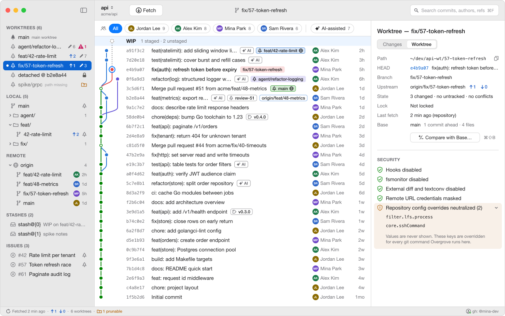 | 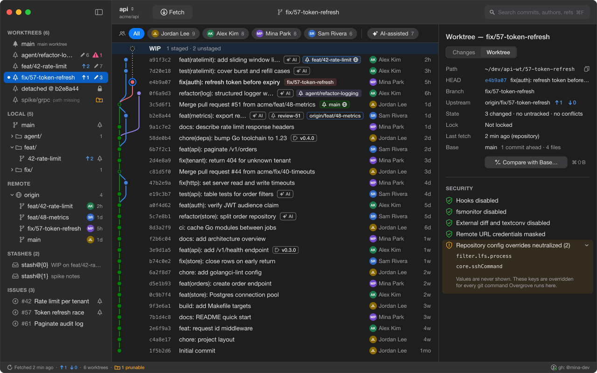 |

원본: [`s05-worktree-detail-light.svg`](../../design/mockups/s05-worktree-detail-light.svg), [`s05-worktree-detail-dark.svg`](../../design/mockups/s05-worktree-detail-dark.svg)

- `Worktree` 세그먼트. Path(복사), HEAD, Branch, Upstream ↑1 ↓0, State, Lock, Last fetch `(repository)`, **Base** + `Compare with Base…`(S-11 진입, `⌘⇧B`).
- **SECURITY**: 항상 켜진 4개 항목은 `checkmark.shield` + `status.ok`. 무력화된 저장소 설정은 `exclamationmark.shield` + `status.warning`, 펼치면 키 이름만(`filter.lfs.process`, `core.sshCommand`). 값은 보여 주지 않는다.
- 명세: [screens.md S-05](screens.md#s-05-워크트리-상세), [security-review.md](security-review.md)

### S-10 Diff 뷰어

| Light | Dark |
|---|---|
| 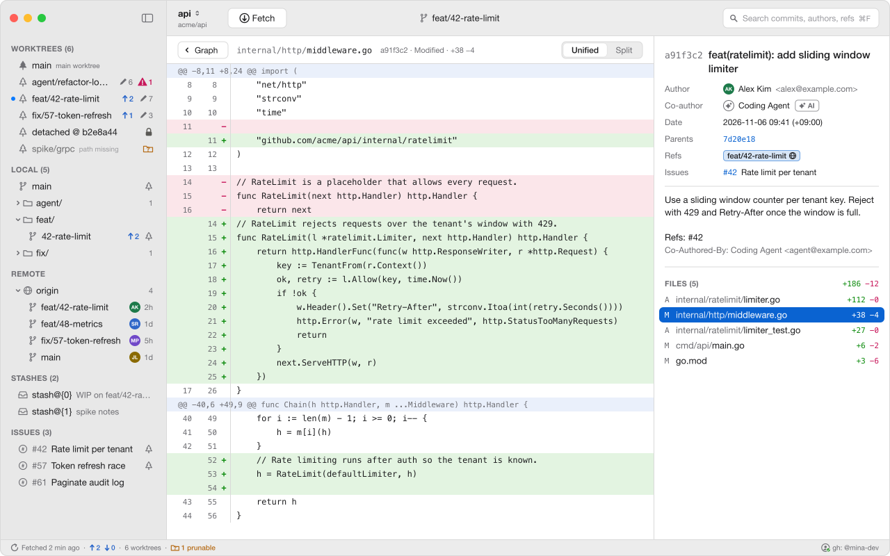 | 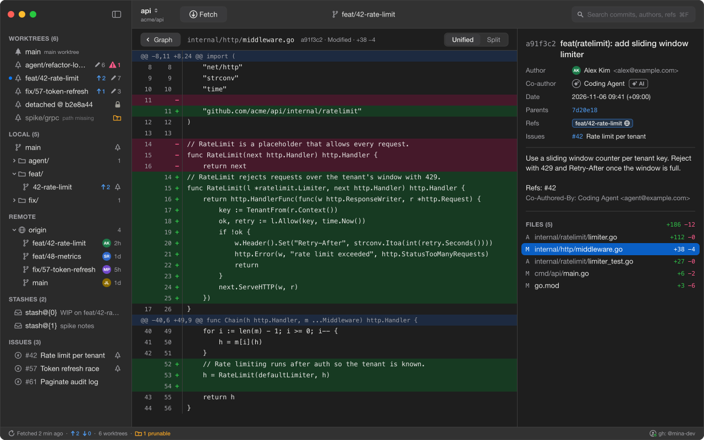 |

원본: [`s10-diff-viewer-light.svg`](../../design/mockups/s10-diff-viewer-light.svg), [`s10-diff-viewer-dark.svg`](../../design/mockups/s10-diff-viewer-dark.svg)

- 중앙을 덮은 Unified 보기. 머리에 `‹ Graph`, 경로(디렉터리 흐리게), 출처 `a91f3c2 · Modified · +38 −4`, `Unified | Split`.
- 이전·이후 줄 번호, `+`/`−` 기호(색만으로 구분하지 않음), `diff.added-bg` / `removed-bg` / `hunk-header-bg`. 문법 강조 없음(v0.1).
- 상세 패널은 S-03 그대로이고 고른 파일 행이 선택되어 있다.
- 명세: [screens.md S-10](screens.md#s-10-diff-뷰어). 이슈: #69

### S-11 기준 브랜치 대비 변경

| Light | Dark |
|---|---|
| 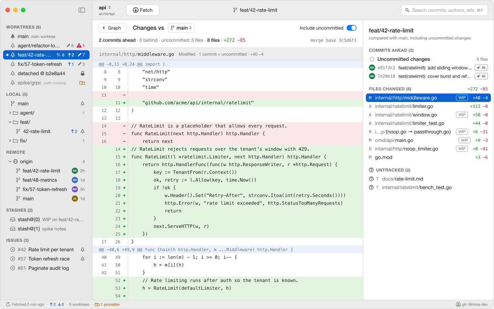 | 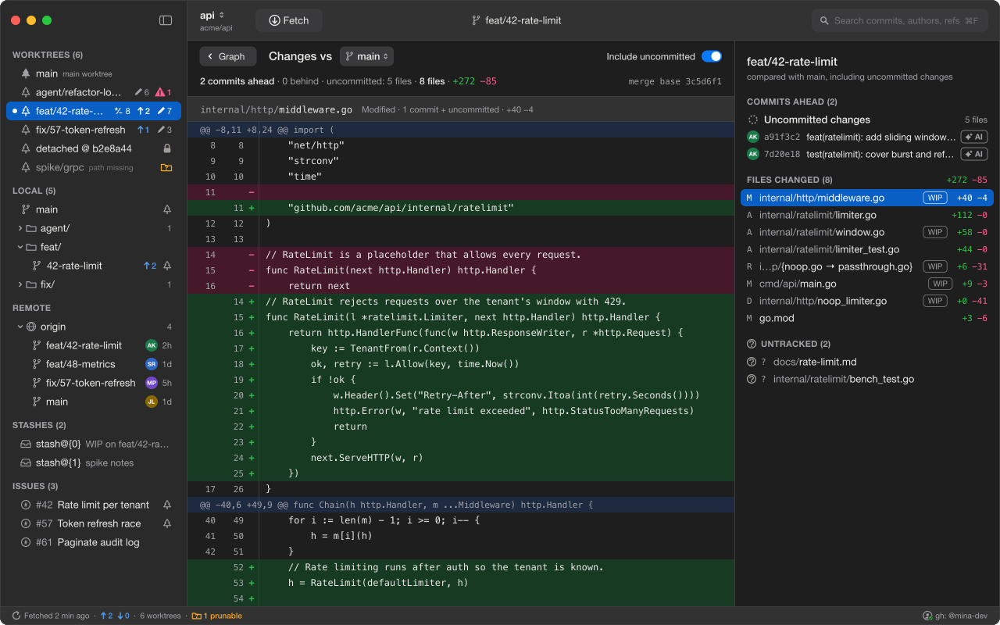 |

원본: [`s11-changes-vs-base-light.svg`](../../design/mockups/s11-changes-vs-base-light.svg), [`s11-changes-vs-base-dark.svg`](../../design/mockups/s11-changes-vs-base-dark.svg)

- 중앙 머리: `‹ Graph`, `Changes vs [main]` 기준 선택 팝업, `Include uncommitted` 토글(켜짐). 요약 줄: `2 commits ahead · 0 behind · uncommitted: 5 files · 8 files · +272 −85`, merge base.
- 상세 패널: COMMITS AHEAD(맨 위 `Uncommitted changes` 점선 노드, 아바타 + SHA + 제목 + AI 배지), FILES CHANGED(종류 글자, `{old → new}` rename, 미커밋이 섞인 파일에 `WIP` 알약, `+n −m`), UNTRACKED.
- 중앙 본문은 선택한 파일의 패치(S-10 뷰어). 사이드바 포커스 워크트리 행에 선택 기능인 기준 대비 변경 파일 수 배지(`±8`).
- 명세: [screens.md S-11](screens.md#s-11-기준-브랜치-대비-변경). 이슈: #158

### S-07 온보딩

| Light | Dark |
|---|---|
| 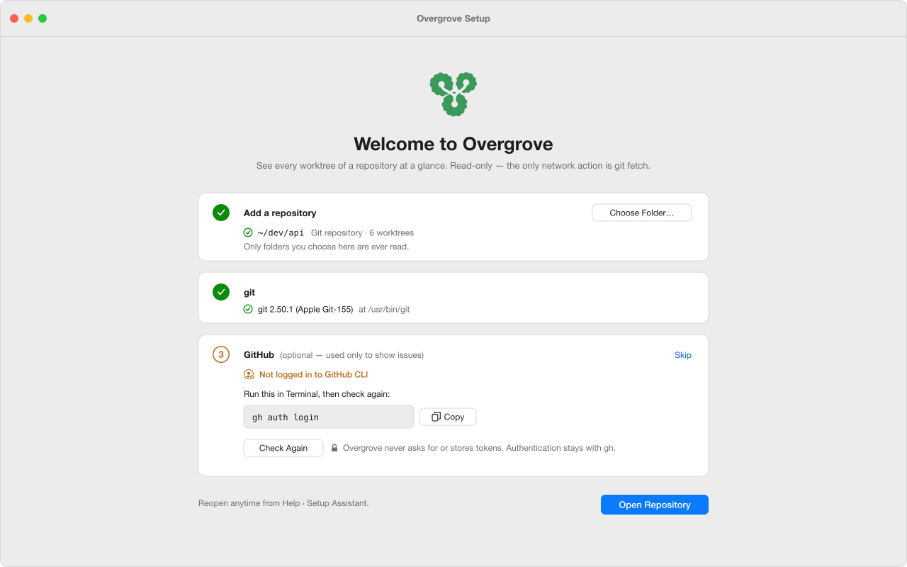 | 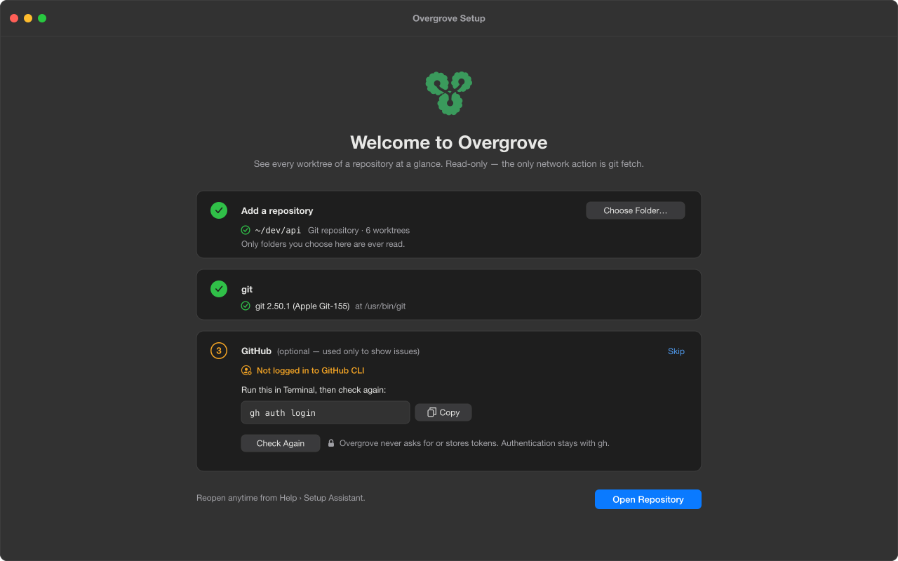 |

원본: [`s07-onboarding-light.svg`](../../design/mockups/s07-onboarding-light.svg), [`s07-onboarding-dark.svg`](../../design/mockups/s07-onboarding-dark.svg)

- 저장소가 없을 때 창 전체가 온보딩이 된다. 마크, `typography.large-title` 제목, 한 줄 설명.
- 단계 카드 3개: 1 저장소(성공), 2 git(성공), 3 GitHub(선택 사항, 미로그인). 3단계는 `gh auth login`을 복사만 할 수 있게 하고 `Check Again`과 `Skip`을 둔다. 앱은 명령을 직접 실행하지 않는다.
- `Open Repository`(액센트 버튼)는 1, 2단계가 성공해서 활성화된 상태.
- 명세: [screens.md S-07](screens.md#s-07-온보딩)

---

## 3. 후속 작업

- AI 배지는 커밋 트레일러를 읽어야 한다. 로그 포맷에 트레일러 필드를 더하는 변경을 [git-command-catalog.md](../architecture/git-command-catalog.md)와 파싱 명세의 후속 이슈로 남긴다. 서명 관련 `%G` 필드는 계속 쓰지 않는다 (T7).
- 새 심볼(`sparkles`, `person.2`, `plus.forwardslash.minus`)을 [iconography.md §5.3](iconography.md#53-객체와-동작)에 더한다.
- `⌘⇧B`(Compare with Base)를 [interaction.md §3](interaction.md#3-키보드-단축키)에 더하고, S-11을 [scope-mvp.md](../scope-mvp.md)에 포함 항목으로 기록한다 (#158).
- 목업 생성 스크립트는 저장소에 넣지 않았다. SVG를 직접 고치거나, 필요해지면 외부 의존성 없는 생성기를 별도 이슈로 제안한다.
