# 화면 명세 (Screens)

> 상태: Accepted (Phase 2 게이트, 2026-11-05), S-11·작성자 표현 추가 (#158, #159), 패널 테마 레이아웃으로 개정 (#166), 사이드바 TAGS·선택 이력 설계 (#123, v0.2.0), 두 커밋 비교(S-12)·단어 단위 강조·공백 표시 설계 (#122, v0.2.0) · 관련: [art-direction.md](art-direction.md), [information-architecture.md](information-architecture.md), [interaction.md](interaction.md), [design-tokens.md](design-tokens.md), [iconography.md](iconography.md), [security-review.md](security-review.md), [mockups.md](mockups.md), [references.md](references.md), ADR-0004, ADR-0011

HANDOFF §8의 와이어프레임을 출발점으로 S-01부터 S-10까지 화면을 확정한다. S-11(기준 브랜치 대비 변경)은 #158에서, S-12(두 커밋 비교)는 #122에서 추가했다. 고충실도 목업은 [mockups.md](mockups.md)에 모았고, 각 절에도 링크를 둔다. 와이어프레임의 문자열은 실제 UI 문구(영어)다. 색, 간격, 크기는 [design-tokens.md](design-tokens.md)의 토큰 이름으로 적는다. 패널, 그래프, 알약을 그리는 규칙(수치)은 [art-direction.md](art-direction.md)에 있다.

**HANDOFF 대비 바뀐 점**

| 항목 | HANDOFF | 확정 | 근거 |
|---|---|---|---|
| 툴바 Pull 버튼 | 있음 (비활성 권장) | **제거.** 자리도 남기지 않음 | ADR-0011 |
| Fetch 단축키 | `⌘⇧F` | `⌘⇧R` | IDE의 "Find in Files" 습관과 충돌 회피. [interaction.md §3](interaction.md#3-키보드-단축키) |
| 워크트리 행 `✎5` | 색 있는 배지 | 중립 색 `pencil` + 수. 색은 충돌, prunable 같은 경고에만 사용 | [information-architecture.md §4.3](information-architecture.md#43-행-구성과-배지) |
| 상세 패널 하단 `[Diff] [Files] [Log]` 버튼 | 있음 | 제거. 파일을 고르면 중앙이 Diff 뷰어로 바뀐다. 이력은 컨텍스트 메뉴 "Show History" | 패널 안에 탭을 겹치지 않기 위해 |
| Stash 상세의 `(apply / pop / drop 은 1차 범위 외)` 문구 | 화면에 표시 | 표시하지 않음. 범위 밖 기능은 화면에 흔적을 남기지 않는다 | [information-architecture.md §1](information-architecture.md#1-설계-원칙) |

**공통 상태 표기.** 모든 화면은 아래 상태를 가진다. 화면별 문구는 각 절에 적는다.

| 상태 | 표현 |
|---|---|
| 로딩 | 150ms가 지나도 데이터가 없을 때만 `ProgressView` + 문구를 보여 준다. 이전 데이터가 있으면 그대로 두고 작은 진행 표시만 붙인다 |
| 빈 상태 | 가운데 정렬 심볼 + 한 줄 설명 + (가능하면) 다음 행동 |
| 에러 | 심볼 `exclamationmark.triangle` + 요약 한 줄 + `Details` 버튼. Details는 마스킹한 stderr 요약을 popover로 보여 준다 |
| 오래된 데이터 | 새로고침이 실패하면 이전 데이터를 `opacity.stale`로 흐리게 두고 상태바에 실패를 표시한다 |
| gh 미로그인 | 이슈 관련 영역만 안내로 바뀐다. 나머지는 정상 |

---

## S-01 메인 창

**목적.** 저장소 하나의 모든 워크트리, 브랜치, stash, 이슈를 한 화면에 놓고, 포커스 워크트리의 WIP와 커밋 그래프를 함께 보여 준다.

**진입.** 앱 실행 시 마지막으로 연 저장소. 등록한 저장소가 없으면 S-07 온보딩.

**레이아웃.** 툴바 + **둥근 상자 패널 3개**(사이드바 / 중앙 / 상세) + 하단 상태바. 패널 사이 8pt 홈이 크기 조절 손잡이다. `NavigationSplitView`가 아니라 사용자 정의 분할 컨테이너를 쓴다([ADR-0014](../adr/0014-panel-theme-and-split-layout.md)). 크기, 표면, 분할선, 스크롤 규칙은 [art-direction.md §3](art-direction.md#3-창-구조), 동작은 [interaction.md §2.1](interaction.md#21-패널-크기-조절과-스크롤)에 있다.

```
┌───────────────────────────────────────────────────────────────────────────────────────────────────────────────────────┐
│ ● ● ● ◧ [overgrove ⌃] › [◆ feat/12-worktree… ↑2]  ↓Fetch ⟳Refresh │ ±Compare │ ▭Terminal ▭Finder  [⌕ Search ⌘F]       │
│ ╭──────────────────────╮ ╭─────────────────────────────────────────────────────────╮ ╭──────────────────────────────╮ │
│ │⌕ Filter          ⌥⌘F │ │☺ All · Ko 12 · Lee 4 · Park 3   ✦ AI-assisted 5   ⋯     │ │◆ feat/12…  Changes│Worktree  │ │
│ ├──────────────────────┤ ├─────────────────────────────────────────────────────────┤ ├──────────────────────────────┤ │
│ │˅ WORKTREES        4  │ │Refs           │Graph │Message               │Author│Date│ │⌂ ~/dev/overgrove-wt/12-…     │ │
│ │◆ main                │ ├─────────────────────────────────────────────────────────┤ │6 changed files ▬▬▬▬ +54 −12  │ │
│ │  main worktree  ~/dev│ │┆12-worktree┆┈┈┈┈◌    WIP  3 staged · 2 unstaged · 1 unt…│ │╭ ⚠ Conflicted  1 ─────────╮  │ │
│ │◆ feat/12-wor…  ✎6 ↑2 │ │[■ feat/12 ⊕]────◉    feat: add status parser   Ko    2h │ ││ U Sources/…/Layout.swift │  │ │
│ │  12-worktree-list    │ │                 ◉    fix: handle empty stash   Ko    1d │ │╰──────────────────────────╯  │ │
│ │◆ hotfix           ⌧  │ │                 ◉─╮  Merge branch 'docs'     Ko    3d   │ │╭ ✓ Staged  3      +54 −12 ╮  │ │
│ │◆ old-spike         ⚠ │ │[origin/docs]────┼─◉  docs: add ADR-0008 ✦AI  Lee    4d  │ ││ M …/Status.swift  +40 −8 │  │ │
│ │  path missing        │┃│[main ⊕] +1──────◉─╯  chore: bootstrap repo     Ko    5d │┃││ A …/GitClient.swift  +14 │  │ │
│ │˅ LOCAL            4  │┃│                 │                                       │┃│╰──────────────────────────╯  │ │
│ │  ⑂ main            ◆ │ │                 ◉    init                      Ko    6d │ │╭ ✎ Unstaged  2     +11 −3 ╮  │ │
│ │  › feat/           2 │ │                                                         │ ││ M …/Graph.swift   +11 −1 │  │ │
│ │˅ REMOTE           3  │ │                                                         │ │╰──────────────────────────╯  │ │
│ │  › origin            │ │                                                         │ │                              │ │
│ │˅ STASHES          2  │ │                                                         │ │                              │ │
│ │  stash@{0}  WIP on … │ │                                                         │ │╭ ± Changes vs [main ⌃]    ╮  │ │
│ │˅ ISSUES           5  │ │                                                         │ ││ 1 ahead · 0 behind · 4 f │  │ │
│ │  #12 Worktree list ◆ │ │                                                        ▐│ ││ [Compare with Base…] ⌘⇧B │  │ │
│ │                    ▐ │ │                                                         │ │╰──────────────────────────╯  │ │
│ ╰──────────────────────╯ ╰─────────────────────────────────────────────────────────╯ ╰──────────────────────────────╯ │
│ ◈ Read-only · ⟳ Fetched 2 min ago · ↑2 ↓0 · 4 worktrees · ⚠ 1 prunable                                 gh: @octocat ✓ │
└───────────────────────────────────────────────────────────────────────────────────────────────────────────────────────┘
```

와이어프레임의 기호는 자리 표시다.
- `◆`: 레인 색 워크트리 타일(`tree`)
- `■`: 레인 색으로 채운 알약
- `⊕`: `network`
- `┆…┆`: WIP 점선 알약
- `◌`: WIP 노드
- `◉`: 아바타 노드
- `▐`: 스크롤바
- `┃`: 분할선 손잡이
- `⌧`: `lock.fill`
- `◈`: `checkmark.shield`

실제 심볼은 [iconography.md §5](iconography.md#5-상태-심볼-매핑)를 따른다.

**고충실도 목업 (#166).** 토큰 값으로 그린 S-01이다. 글리프는 SF Symbol을 흉내 낸 단순 도형이고 글꼴은 SF Pro·SF Mono다. 기준은 PNG 렌더다. 설명은 [mockups.md](mockups.md#s-01-메인-창)에 있다.

| Light | Dark |
|---|---|
| 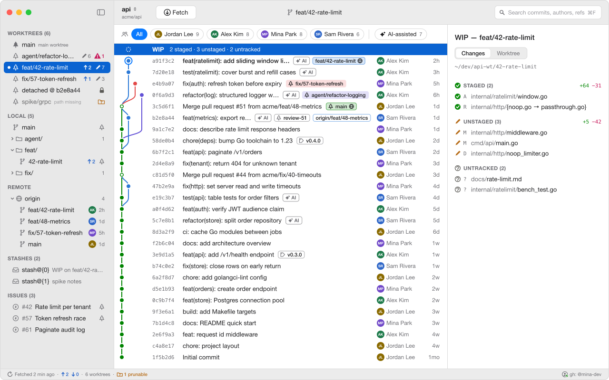 | 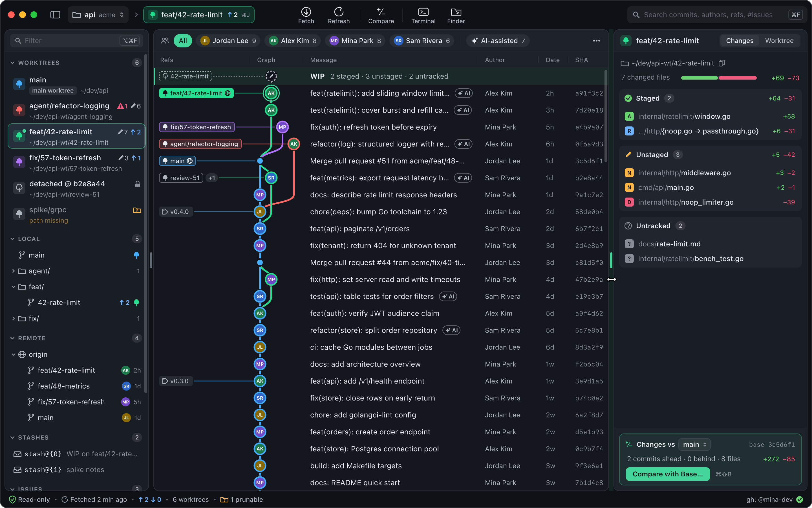 |

원본: [`main-window-light.svg`](../../design/mockups/main-window-light.svg), [`main-window-dark.svg`](../../design/mockups/main-window-dark.svg)

### 툴바

| 요소 | 동작 | 비고 |
|---|---|---|
| 사이드바 토글 | 사이드바를 접거나 연다 | `⌃⌘S` |
| 저장소 전환 메뉴 `[overgrove ⌃]` | 등록한 저장소 목록, `Add Repository…` (`⌘O`), `Manage Repositories…` | 저장소 이름은 디렉터리 이름, 옆에 원격 소유자(있으면) |
| 포커스 워크트리 칩 `◆ feat/12-… ↑2 ⌘J` | 누르면 그래프를 포커스 워크트리의 HEAD로 스크롤 (`⌘J`와 같음) | 레인 색 틴트 + 워크트리 타일. detached면 `detached @ a1b2c3d`. 체크아웃 기능 없음 |
| `Fetch` | 저장소의 모든 원격을 fetch. 진행 중에는 `Stop`으로 바뀐다 | `⌘⇧R`. 피드백은 [interaction.md §4](interaction.md#4-새로고침과-fetch) |
| `Refresh` | 로컬 git 조회만 다시 한다. 네트워크 없음 | `⌘R` |
| `Compare` | 포커스 워크트리를 기준 브랜치와 비교(S-11) | `⌘⇧B` |
| `Terminal`, `Finder` | 포커스 워크트리 폴더를 Terminal.app / Finder로 연다. 워크트리 컨텍스트 메뉴의 `Open in Terminal`, `Reveal in Finder`와 같고 보안 조건도 같다 | [interaction.md §5](interaction.md#5-컨텍스트-메뉴) |
| 검색 필드 | 그래프를 커밋 메시지, 작성자(co-author 포함), SHA 앞부분(4자 이상), ref 이름, 이슈 번호(`#12`: 제목의 참조나 그 번호로 이름 붙은 브랜치)로 필터 | `⌘F`. 일치 행만 강조하고 나머지는 흐리게(`opacity.disabled`, 행을 숨기지 않음). `⏎`·`⌘G` / `⌘⇧G`로 다음·이전 일치(그 커밋을 고르고 스크롤). **로드된 페이지만 검색한다**(git을 실행하지 않음). 그래프 머리 아래 줄에 `3 matches in 1,500 loaded commits · older commits are searched as they load`처럼 범위를 알린다(#74) |

가운데 동작 버튼은 아이콘 위에 라벨을 둔다(NSToolbar의 icon-and-label 모드). v0.1 툴바에는 Pull, Push, Branch, Stash, Checkout 버튼이 **없다.** 비활성 버튼으로도 두지 않는다.

### 사이드바

섹션, 정렬, 배지 규칙은 [information-architecture.md §4](information-architecture.md#4-사이드바-섹션)를 따른다.

- 너비: `size.sidebar-width-*`(220 / 256 / 420)
- 행 높이: 워크트리는 두 줄 `size.row-worktree`(46), 나머지는 `size.row-sidebar`(28)
- 섹션 헤더: `typography.section-header`
- 패널 머리: 필터 필드(`⌥⌘F`)

워크트리 행 왼쪽의 타일은 그 브랜치의 레인 색이라 그래프의 같은 줄과 색으로 이어진다. 세부 모양은 [art-direction.md §6](art-direction.md#6-사이드바)에 있다.

**TAGS 섹션 (v0.2.0, #123).** REMOTE 아래, STASHES 위다. 처음에는 접혀 있다. 규칙은 [information-architecture.md §4.5](information-architecture.md#45-tags-섹션-123-v020)에 있다. 펼친 모습(와이어프레임, 위 S-01 와이어프레임의 사이드바 열과 같은 폭):

```
│˅ TAGS            38  │
│  ⌂ v1.4.0        3d  │   ⌂ = `tag` 심볼, 오른쪽은 만든 날짜의 상대 시각
│  ⌂ v1.4.0-rc.2  12d  │
│  ⌂ v1.3.2  🌲   1mo  │   🌲 = 이 커밋에 detached HEAD로 선 워크트리가 있음(`tree` 심볼)
│  ⌂ v1.3.1       2mo  │
│  …                   │
│  38 more tags — filter to find one │   200개를 넘을 때만
```

- 행 높이는 `size.row-sidebar`(28). 심볼과 글자 색은 REMOTE 브랜치 행과 같다(`text.secondary` 심볼, `text.primary` 이름, `text.tertiary` 시각).
- 태그 행을 고르면 그래프가 그 커밋으로 스크롤해 선택하고 상세 패널에 S-03이 열린다.
- 고충실도 목업: [mockups.md](mockups.md)의 "S-01 사이드바 TAGS" (#377).

### 중앙: 커밋 그래프

패널 머리(40)에는 작성자 필터 칩 줄을, 그 아래(28)에는 열 머리를 둔다. 열 머리의 구분선을 끌어 열 폭을 바꾸고, 패널 머리 오른쪽 `⋯` 메뉴에서 Author, Date, SHA 열을 숨기거나 보인다.

| 열 | 내용 | 토큰 |
|---|---|---|
| Refs | ref 알약 하나 + `+n` 칩(툴팁에 나머지). 알약 오른쪽 끝에서 노드까지 레인 색 연결선 | `size.column-refs-ideal`(172), 알약 `size.ref-pill-height` |
| Graph | 레인, 간선, 노드. 레인 색은 `color.graph.lane.0~7` 순환 (ADR-0010) | `size.graph-lane-width`, `size.graph-node`, `size.graph-edge` |
| Message | 커밋 제목 첫 줄 + AI 배지(있으면). 폭이 모자라면 제목을 줄인다 | `typography.body` |
| Author | 작성자 이름. 얼굴(이니셜 아바타)은 노드에 있다 | `size.column-author-ideal`, `text.secondary` |
| Date | 상대 시각(`2h`, `3d`), 툴팁에 절대 시각(ISO 8601, 로컬 시간대) | `size.column-date-ideal`, `text.tertiary` |
| SHA | 짧은 SHA 7자 | `typography.mono-small`, `text.tertiary` |

- **노드.** 일반 커밋은 작성자 이니셜 아바타를 레인 색 링으로 감싼 원(지름 22)이다. 병합 커밋은 레인 색 작은 원(10)이다. 모든 노드에 캔버스 색 후광을 둘러 뒤로 지나가는 선과 떨어뜨린다.
- **선택 행.** 그 커밋의 레인 색 16%(`graph.selection-opacity`) + 왼쪽 3pt 레인 색 막대. 선택 행의 `text.tertiary`는 `text.secondary`로 바꾼다.
- **WIP 행.** 포커스 워크트리에 미커밋 변경이 있을 때만 맨 위에 둔다.
  - 노드: 속이 빈 점선 노드(`color.graph.wip-node`)와 HEAD까지의 점선
  - 배경: `color.surface.wip-row`
  - Refs 열: 워크트리 폴더 이름을 쓴 점선 알약
  - 요약 문구: `WIP 3 staged · 2 unstaged · 1 untracked`. 충돌이 있으면 맨 앞에 `⚠ 2 conflicted`
  - 변경이 없으면 WIP 행을 숨긴다.
- **HEAD 링.** 포커스 워크트리의 HEAD 노드 바깥에 `color.graph.head-ring`(액센트) 링을 한 겹 더 두른다.
- **ref 알약.** 종류별 모양은 [art-direction.md §5.5](art-direction.md#55-ref-알약)를 따른다. 요약:
  - 포커스 워크트리가 체크아웃한 브랜치는 레인 색으로 채운다(`graph.on-lane.*` 글자).
  - 다른 워크트리가 체크아웃한 브랜치는 레인 색 20% 채움 + 테두리 + `tree`다.
  - 그 밖의 로컬 브랜치는 `tree` 없이 같은 모양이다.
  - 원격 브랜치는 테두리 + `network`, 태그는 중립 색 + `tag`다.
  - (#159) 로컬 브랜치와 같은 이름의 `origin/` 브랜치가 같은 커밋을 가리키면 알약 하나로 합친다(끝에 `network`). 툴팁에 두 ref 이름을 모두 쓴다. 다른 커밋을 가리키면 따로 그린다.
  - (#159) 별도 워크트리 알약은 브랜치가 없는 **detached HEAD 워크트리**에만 `tree` + 디렉터리 이름으로 그린다. 같은 행에 같은 뜻의 알약이 두 개 생기지 않게 하기 위해서다.
  - 한 행에 ref가 여럿이면 순서는 포커스 워크트리 브랜치 → 로컬 → 원격 → 태그이고, 첫 번째만 알약으로 보인다.
- **페이지 단위 로드.** 처음 500개를 그리고 스크롤에 따라 다음 페이지를 불러온다 (PB-3, PB-4). 행 높이는 `size.row-graph`(30px)로 고정한다.
  - 구현 메모(#68): 끝에서 100행 전에 다음 페이지를 미리 읽는다. 다음 페이지가 다른 ref 집합으로 읽히면(이력이 움직임) 처음부터 다시 그린다. 새로고침에서 ref 집합이 그대로면 행·선택·스크롤을 유지한다. WIP 행은 맨 위에 두고, HEAD 행까지 점선을 잇는다.
  - 구현 메모(#255):
    - 작성자 칩은 불러온 커밋을 작성자 주소(소문자)로 묶어 센다. 주소가 없으면 이름으로 묶는다. 이름은 그 주소의 가장 최근 커밋에서 가져온다. 새 페이지는 그 커밋만 더한다. 고른 칩을 다시 누르면 `All`로 돌아가고, 저장소를 바꾸면 `All`로 돌아간다.
    - 칩과 검색을 함께 쓰면 검색 요약(`n matches in …`)과 `⌘G`도 둘 다 맞는 행만 센다.
    - 열 폭과 표시 여부는 패널 폭과 별도 값으로 저장소마다 저장한다. 끌어서 넓힐 때는 Message가 최소 200 아래로 줄지 않는 데서 멈춘다. 더블클릭은 불러온 행(최대 2,000행)을 재서 맞춘다. 구분선 포커스 후 `←` `→`로 8pt씩 옮긴다. `⋯`에 `Reset Column Widths`도 둔다.
    - 12레인을 넘으면 Graph 열 머리 아래쪽에 얇은 스크롤 막대가 생긴다. Graph 열 위에서 가로로 쓸거나 `⇧` + 휠로 옮긴다. 화면 밖 레인의 커밋을 고르면 그 레인이 보이게 옮긴다.
    - 사이드바 타일 색은 워크트리 HEAD 커밋 노드의 레인 색이다. 그 커밋을 아직 불러오지 않았으면 중립 타일로 둔다.
- **가로 넘침.** 레인이 12개(`size.graph-max-lanes-visible`)를 넘으면 Graph 열 안에서만 가로로 스크롤한다.

### 작성자 표현과 AI 배지

팀과 AI 에이전트가 함께 쓰는 저장소에서 "누가(무엇이) 이 커밋을 만들었는가"를 그래프에서 바로 읽게 한다 (#159). 근거 조사는 [references.md](references.md)에 있다.

| 요소 | 위치 | 표현 | 규칙 |
|---|---|---|---|
| 이니셜 아바타 | **그래프 노드**(지름 17 + 레인 색 링), S-03 Author, S-11 커밋 목록, 작성자 칩, 사이드바 원격 브랜치(16px) | 원 + 이니셜 최대 2자(굵게, `avatar.initials`) | 색 = `color.avatar.(FNV-1a(소문자 이메일) mod 8)` ([design-tokens.md §3.5](design-tokens.md#35-작성자-아바타-159)). 네트워크 아바타(Gravatar, GitHub 프로필)는 쓰지 않는다. 노드의 이름은 Author 열, 툴팁, VoiceOver로 함께 준다 |
| 작성자 필터 칩 줄 | 그래프 패널 머리(40px, `person.2` 심볼로 시작) | `All` + 작성자 칩(아바타 + 이름 + 불러온 커밋 수) + 구분선 + `AI-assisted` 칩(`sparkles`) | 칩 순서는 불러온 커밋 수 내림차순. 5명을 넘으면 `+n` 메뉴로 접는다. 칩 하나를 고르면 검색과 같은 방식으로 일치 행만 강조하고 나머지는 `opacity.disabled`로 흐린다(행을 숨기지 않는다. 그래프 모양이 유지된다). 고른 칩은 `accent` 채움 + `text.on-accent`. 검색어와 함께 쓰면 AND |
| AI 배지 | 그래프 Message 열의 제목 뒤, S-03 Co-author 행, S-11 커밋 목록 | `sparkles` + `AI` 글자, `text.tertiary` 테두리 알약 | 커밋 메시지에 AI 도구를 가리키는 `Co-Authored-By:` 트레일러가 있을 때만 붙인다. 판별 목록(이름·이메일 패턴)은 후속 이슈에서 정한다. 색은 쓰지 않는다(상태 색, 레인 색과 겹치지 않게). 글자 `AI`가 의미를 전달한다 |
| AI 공동 작성자 | S-03 메타 | `text.tertiary` 테두리 원 + `sparkles` (이니셜 아바타를 쓰지 않음) + 이름 + AI 배지 | 사람 아바타처럼 보이지 않게 한다 |
| 원격 브랜치 마지막 커미터 | 사이드바 REMOTE의 브랜치 행 오른쪽 | 아바타(16px) + 팁 커밋의 상대 시각 | 이름은 툴팁과 VoiceOver(`Last commit by Alex Kim, 2 hours ago`). 배지 우선순위는 행에서 가장 낮다. 폭이 모자라면 시각 → 아바타 순으로 숨긴다 |

**데이터와 후속 작업.** 아바타와 칩은 이미 읽는 작성자 이름·이메일만 쓴다. AI 배지는 커밋 트레일러를 읽어야 하므로 로그 포맷에 트레일러 필드(예: `%(trailers:key=Co-authored-by,valueonly)`)를 더해야 한다. 이 변경은 [git-command-catalog.md](../architecture/git-command-catalog.md)와 파싱 명세를 고치는 후속 이슈로 남긴다. 서명 관련 `%G` 필드는 계속 쓰지 않는다 (T7).

**새 심볼.** `sparkles`(AI), `person.2`(작성자 필터), `plus.forwardslash.minus`(기준 대비 변경), `ellipsis`(열·밀도 메뉴), `terminal`, `folder`(툴바). [iconography.md §5.3](iconography.md#53-객체와-동작)에 있다.

### 상세 패널

선택에 따라 S-02~S-06 중 하나를 보여 준다. 너비는 `size.detail-width-*`(300 / 344 / 560)이다. 분할선을 최소 폭 아래로 끌거나 View 메뉴 `Hide Detail`(`⌥⌘0`)로 접는다. 패널 안 묶음은 카드(`surface.raised`)로 나누고, S-02와 S-05는 아래에 **기준 브랜치 비교 카드**를 고정한다([art-direction.md §7](art-direction.md#7-상세-패널)).

### 상태바

| 요소 | 예 | 출처 |
|---|---|---|
| 읽기 전용 표시 | `🛡 Read-only` (`checkmark.shield`, `status.ok`). 항상 맨 앞 | — |
| 마지막 fetch | `Fetched 2 min ago` / `Never fetched` / `Fetch failed — Details` | `FetchRecord` |
| 포커스 워크트리의 ahead/behind | `↑2 ↓0` / `No upstream` | `UpstreamStatus` |
| 워크트리 수 | `3 worktrees` | `Worktree` |
| 경고 | `⚠ 1 prunable`. 누르면 해당 워크트리 선택 | `Worktree.prunable` |
| 느린 status | `🐢 Status 5.2 s`(`tortoise`, 경고 색). 포커스 워크트리의 마지막 status가 1초를 넘었을 때만. 툴팁에 이유(git 밖에서 바뀐 파일을 index가 갱신될 때까지 매번 다시 읽음)를 적는다. 앱은 index를 쓰지 않는다(#168) | `WorktreeListing.Entry.statusDuration` |
| 진행 중 작업 | `Refreshing…` (작은 스피너) | — |
| gh 상태 | 열린 저장소의 GitHub 호스트(없으면 github.com)에 gh 활성 계정이 있으면 `gh: login@host ✓`, 같은 호스트에 계정이 더 있으면 `gh: login@host +n ✓`(ADR-0025 §4, #451). 없으면 `gh: @login ✓` / `gh: not logged in` / `gh: not installed`. 누르면 S-07의 GitHub 단계 | `GHAuthStatus`, `GHAccount` |

### 상태

| 상태 | 표현 |
|---|---|
| 저장소 경로가 사라짐 | 창 전체에 빈 상태: `Repository not found at ~/dev/app` + `Locate…` / `Remove from List` |
| 저장소가 아님 / 소유권 거부(`safe.directory`) | 빈 상태 + 이유 한 줄. 앱은 `safe.directory`를 대신 설정하지 않는다 ([security-review.md](security-review.md)) |
| git 없음 또는 2.36 미만 | S-07의 git 단계로 안내 |
| 커밋이 없는 저장소 | 그래프 빈 상태: `No commits yet`. WIP 행은 정상 표시 |

**v0.1 제외.** Pull/Push 버튼, 그래프에서 드래그 앤 드롭, 그래프의 stash 노드(v0.2.0 #384에서 들어옴), 탭으로 여러 저장소 보기.

**그래프의 stash 행 (#384).** 기준 커밋 바로 위에 `stash@{n}` 알약(`tray` 심볼, 레인 색 테두리), 기준 커밋 레인 색의 속 빈 사각 노드와 점선, 메시지(`text.secondary`), Date·SHA를 둔다. Author는 비운다. 같은 기준 커밋의 stash는 `stash@{0}`부터 위에서 쌓는다. 누르면 S-04, 선택하면 커밋 행과 같은 레인 색 강조. 검색·작성자 필터 중에는 숨기고, 그래프 `⋯` 메뉴의 `Show Stashes`(기본 켬)로 끈다. 키보드 `↑`/`↓`는 커밋 행만 오간다.

---

## S-02 WIP 상세

**목적.** 포커스 워크트리의 미커밋 변경을 Staged / Unstaged / Untracked / Conflicted로 나눠 보여 준다.

**진입.** 그래프의 WIP 행 선택, 또는 사이드바에서 워크트리 행 선택 (`Changes` 세그먼트가 기본).

```
╭──────────────────────────────────────────╮
│ ◆ feat/12-worktree-list  Changes│Worktree│
├──────────────────────────────────────────┤
│ ⌂ ~/dev/overgrove-wt/12-worktree-list  ⧉ │
│ 7 changed files  ▬▬▬▬▬▬▬▬▬▬▬▬   +65 −15  │
│ ╭ ⚠ Conflicted  1 ─────────────────────╮ │
│ │ U Sources/Graph/Layout.swift         │ │
│ ╰──────────────────────────────────────╯ │
│ ╭ ✓ Staged  3  ──────────── +54 −12 ───╮ │
│ │ M Sources/Parsing/Status.swift +40 −8│ │
│ │ A Sources/Git/GitClient.swift    +12 │ │
│ │ R {Old.swift → New.swift}     +2 −4 │ │
│ ╰──────────────────────────────────────╯ │
│ ╭ ✎ Unstaged  2  ───────────── +11 −3 ─╮ │
│ │ M Sources/Graph/Graph.swift   +11 −1 │ │
│ │ D Sources/Legacy.swift            −2 │ │
│ ╰──────────────────────────────────────╯ │
│ ╭ ? Untracked  1 ──────────────────────╮ │
│ │ ? notes.md                           │ │
│ ╰──────────────────────────────────────╯ │
├──────────────────────────────────────────┤
│ ╭ ± Changes vs [main ⌃]   base 3c5d6f1 ╮ │
│ │ 1 commit ahead · 0 behind · 4 files  │ │
│ │ [Compare with Base…]  ⌘⇧B            │ │
│ ╰──────────────────────────────────────╯ │
╰──────────────────────────────────────────╯
```

| 요소 | 내용 |
|---|---|
| 머리 | 워크트리 타일(레인 색) + `<브랜치>` 또는 `detached @ <sha>`(`typography.body-emphasized`). 그 아래 본문 첫 줄에 경로와 복사 버튼, 둘째 줄에 `n changed files`, 추가·삭제 비율 막대, 합계 `+n −m` |
| 세그먼트 | `Changes`(S-02) / `Worktree`(S-05). 워크트리 행에서 들어왔을 때만 보인다 |
| 그룹 순서 | **CONFLICTED → STAGED → UNSTAGED → UNTRACKED.** 충돌을 가장 먼저 본다. 빈 그룹은 숨긴다 |
| 그룹 | 그룹마다 카드(`surface.raised`) 하나. 카드 머리는 상태 심볼, 이름, 개수 칩, 그룹 합계 `+n −m` (untracked는 합계 없음) |
| 파일 행 | 변경 종류 배지(M/A/D/R/C/T/U/?, 상태 색으로 채운 16pt 사각형 + `on-status.*` 글자) + 경로 + `+n −m`(0인 쪽은 숨김). 경로는 디렉터리를 `text.tertiary`, 파일 이름을 `text.primary` Medium으로 쓴다. 길면 디렉터리 앞부분을 `…/`로 줄인다 |
| rename | `{Old.swift → New.swift}` (공통 디렉터리는 앞에 한 번) |
| 한 파일이 staged와 unstaged에 모두 있음 (`MM`) | 두 그룹에 각각 한 번씩 나타난다 |
| 서브모듈 | 경로 옆에 `submodule` 태그. 내부 변경은 파일 목록에서 펼치지 않는다 |
| Submodules 카드 (#108) | 그룹 카드 아래. 선택한 워크트리의 서브모듈마다 한 줄: 경로(`font.mono`, 이스케이프), `.gitmodules`에 없으면 `not in .gitmodules`, 오른쪽에 상태(`clean` / `n changed · n untracked` / `not checked out` / `git directory missing` / `not inspected` / `failed`). `not inspected`는 이유를 툴팁으로 보인다(경로가 워크트리 밖·심볼릭 링크, `.git`이 저장소의 `modules/` 밖, 서브모듈 자체 설정이 조회를 막음). `git directory missing`은 `.git` 파일이 가리키는 git 디렉터리가 없는 깨진 체크아웃이다(#430, 아무것도 실행하지 않음). 읽는 동안 `Checking submodules…`. 첫 읽기에서 답이 없으면(서비스가 그 status를 더 갖고 있지 않음) `Submodules could not be read.`로 끝낸다(#431). 32개까지만 검사하고 나머지는 `n more not inspected`. `.gitmodules`가 일반 파일이 아니면 읽지 않고 알린다. 서브모듈이 없으면 카드를 숨긴다. 행을 눌러도 아무 일도 없다 |
| 비교 카드 (하단 고정) | `Changes vs [기준 ⌃]`, `n commits ahead · n behind · n files`, `+n −m`, 기준 커밋, `Compare with Base…`(`⌘⇧B`, S-11). 위 목록만 스크롤된다 (#166) |

**데이터.** `WorkingState`, `FileChange`. staged numstat은 `diff --cached --numstat`, unstaged는 `diff --numstat`에서 온다 ([git-command-catalog.md](../architecture/git-command-catalog.md)).

**동작.** 파일을 고르면 중앙이 S-10 Diff 뷰어로 바뀐다. 컨텍스트 메뉴는 [interaction.md §5](interaction.md#5-컨텍스트-메뉴)를 따른다.

| 상태 | 표현 |
|---|---|
| 변경 없음 | `checkmark.circle` + `Working tree clean` |
| untracked가 상한 초과 | `UNTRACKED (5,000+)` + `Showing first 5,000 files`. 상한은 성능 측정 후 확정 ([performance-budget.md](../performance/performance-budget.md)) |
| 워크트리 경로 없음 (prunable) | `questionmark.folder` + `Worktree directory is missing` + `Run git worktree prune in Terminal to clean up`. 앱은 prune하지 않는다 |

**목업.** 충돌이 있는 에이전트 워크트리를 포커스한 상태. `logger.go`가 staged와 unstaged에 모두 나오고(`MM`), rename은 `{old → new}`로 줄여 쓴다. 아래에 `main` 대비 비교 카드(`1 commit ahead · 3 behind`)가 고정되어 있다. [mockups.md](mockups.md#s-02-wip-상세)

| Light | Dark |
|---|---|
| 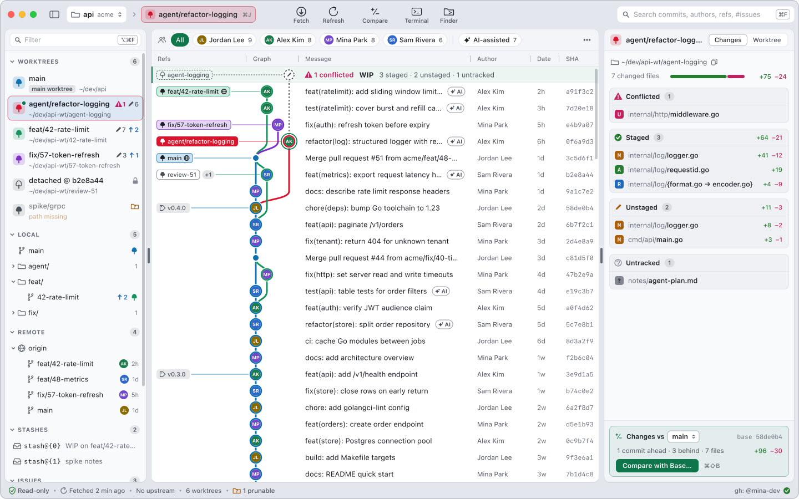 | 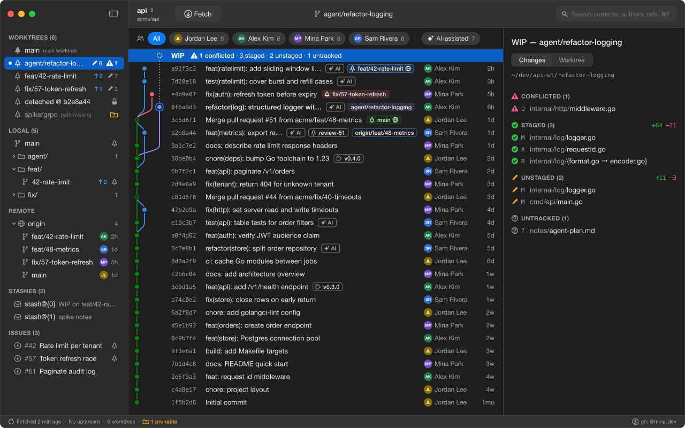 |

**v0.1 제외.** 스테이징 토글 체크박스, discard, 부분 스테이징, 커밋 메시지 입력.

---

## S-03 커밋 상세

**목적.** 커밋 하나의 메타데이터, 메시지, 변경 파일을 보여 준다.

**진입.** 그래프의 커밋 행, 사이드바 브랜치(팁 커밋), 사이드바 태그(가리키는 커밋, v0.2.0 #123), S-09에서 커밋 선택, 선택 이력 이동(`⌘[` / `⌘]`, v0.2.0 #123).

```
┌──────────────────────────────────────┐
│ a1b2c3d  feat: add status parser     │
├──────────────────────────────────────┤
│ Author     Ko <ko@example.com>       │
│ Date       2026-11-03 14:22 (+09:00) │
│ Committer  (same as author)          │
│ Parents    e4f5a6b                   │
│ Refs       ⟨feat/12⟩ ⟨origin/feat/12⟩│
│ Issues     #12 Worktree list         │
├──────────────────────────────────────┤
│ Parse porcelain v2 output with NUL   │
│ separators.                          │
│                                      │
│ Refs: #12                            │
├──────────────────────────────────────┤
│ FILES (4)                   +73 −11  │
│  M  Sources/Parsing/Status.swift +42 −8 │
│  A  Tests/StatusParserTests.swift +20 │
│  M  Sources/Graph/Graph.swift  +11 −3 │
│  M  README.md                   ±2   │
└──────────────────────────────────────┘
```

| 요소 | 내용 |
|---|---|
| 제목줄 | 전체 SHA는 툴팁과 `Copy SHA`로, 화면에는 7자 |
| 메타 | Author(아바타 + 이름 + 이메일), Co-author(트레일러가 있을 때만, AI면 AI 배지), Date(작성 시각), Committer(다를 때만), Parents(merge면 둘 이상, 누르면 그 커밋 선택), Refs, Issues(메시지와 ref에서 찾은 번호, gh 로그인 시 제목 표시) |
| 본문 | 메시지 전체. 고정폭이 아닌 `typography.body`. URL은 링크로 만들지 않는다(v0.1) |
| 파일 | 종류 글자 + 경로 + `+n −m`. 바이너리는 `binary`. merge 커밋은 첫 번째 부모 기준 diff이고 그 사실을 헤더에 적는다 (`Changes vs first parent`) |
| 서명 | 표시하지 않는다. 서명 검증은 `gpg.program`을 실행하므로 v0.1에서 하지 않는다 (T7) |

**데이터.** `CommitDetail` (선택 시 지연 로드).

| 상태 | 표현 |
|---|---|
| 로딩 | 메타는 `CommitNode`에 이미 있으므로 즉시 표시한다. 파일 목록만 로딩 |
| 파일 수가 많음 | 처음 1,000개를 보여 주고 `Show all 4,213 files` |

**목업.** `AI-assisted` 칩으로 그래프를 거른 상태에서 AI 공동 작성 커밋을 고른 화면. 제목은 두 줄까지 감싼다. 트레일러 줄은 본문에서 `text.secondary`로 쓴다. [mockups.md](mockups.md#s-03-커밋-상세)

| Light | Dark |
|---|---|
| 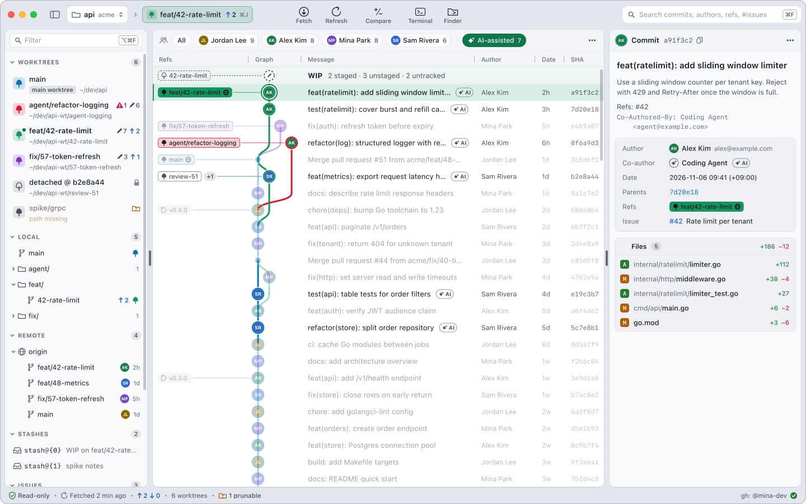 | 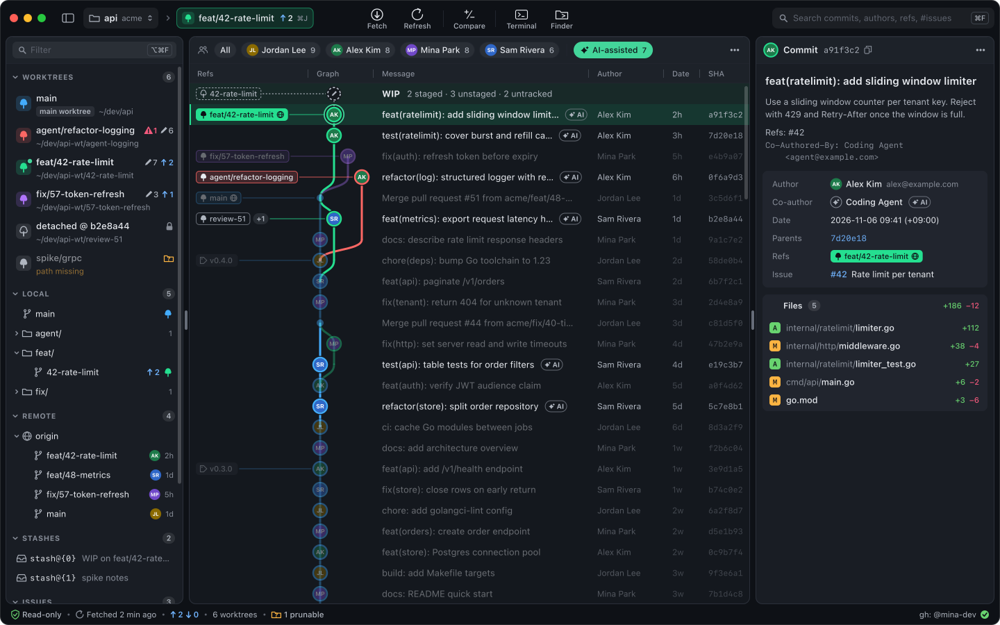 |

**v0.1 제외.** cherry-pick, revert, 이 커밋으로 체크아웃, GitHub에서 열기.

**구현 메모(#69).**
- 그래프 행을 누르면 S-03이 열리고, 파일을 누르면 S-10이 중앙을 덮는다. `⎋`이나 `‹ Graph`로 그래프에 돌아가도 커밋은 선택된 채로 남는다.
- merge 커밋의 파일 patch도 첫 번째 부모 기준이고, S-10 머리에 `vs first parent`를 쓴다.
- Parents를 누르면 그래프가 그 커밋을 불러왔을 때만 선택된다.
- Issues는 메시지 제목과 트레일러에서 찾은 번호만 보여 준다. gh 제목 표시는 #82에서 다룬다.
- 사이드바 브랜치와 S-09에서 들어오는 진입은 아직 없다.

---

## S-04 Stash 상세

**목적.** stash 하나의 내용과 기준 커밋을 보여 준다.

**진입.** 사이드바 STASHES의 항목.

```
┌──────────────────────────────────────────────────┐
│ stash@{0}                              3 days ago │
│ WIP on feat/12: 9c8d7e6 docs: add ADR-0008        │
├──────────────────────────────────────────────────┤
│ Base commit  9c8d7e6  docs: add ADR-0008          │
│ Branch       feat/12  (from message)              │
│ Includes     index · working tree · untracked     │
├──────────────────────────────────────────────────┤
│ FILES (4)                                         │
│  M  Sources/Parsing/Status.swift     +42  −8      │
│  M  Sources/Graph/Graph.swift        +11  −3      │
│  A  Sources/Untracked.swift          +20  −0  ?   │
│  M  README.md                         +2  −2      │
├──────────────────────────────────────────────────┤
│ [ Copy Ref ]                                      │
└──────────────────────────────────────────────────┘
```

| 요소 | 내용 |
|---|---|
| 제목 | `stash@{n}` + 상대 시각. 메시지 전체를 다음 줄에 |
| Base commit | stash의 첫 번째 부모. 누르면 그래프에서 그 커밋 선택 |
| Branch | 메시지 `WIP on <branch>` / `On <branch>`에서 추정. 추정임을 `(from message)`로 밝힌다 |
| Includes | index 커밋(두 번째 부모), untracked 커밋(세 번째 부모) 존재 여부 |
| 파일 | 종류 배지 + 경로 + `+n −m`. untracked 커밋에서 온 파일은 `questionmark` 심볼로 표시하고, 파일 카드 아래에 범례 한 줄(`From the stash’s untracked-files commit`)을 둔다 |
| 버튼 | `Copy Ref`만 둔다 |

**데이터.** `Stash`, `StashDetail`.

| 상태 | 표현 |
|---|---|
| stash 없음 | 사이드바 섹션에 `No stashes` 한 줄 (섹션은 유지) |

**목업 (#176).** 사이드바에서 `stash@{0}`을 고른 상태. 사이드바는 STASHES가 보이도록 스크롤되어 있고 맨 위에 WORKTREES 섹션 머리가 붙어 있다. 상세 패널은 메시지, 정보 카드(Base commit, Branch `(from message)`, Includes), Files 카드, 아래 고정 `Copy Ref` 버튼이다. 그래프는 바뀌지 않는다(stash 노드 없음). [mockups.md](mockups.md#s-04-stash-상세)

| Light | Dark |
|---|---|
| 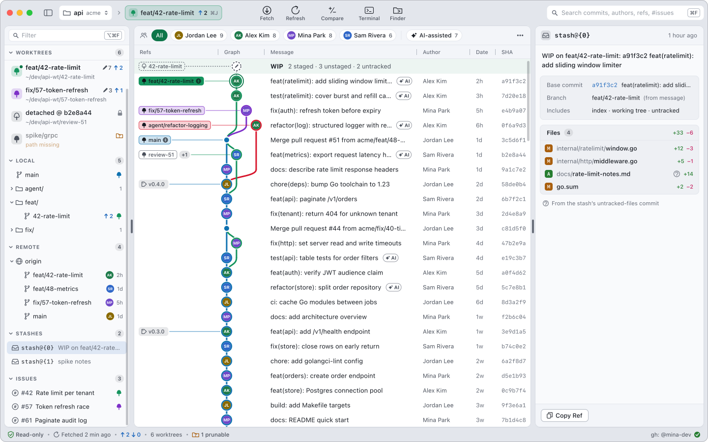 | 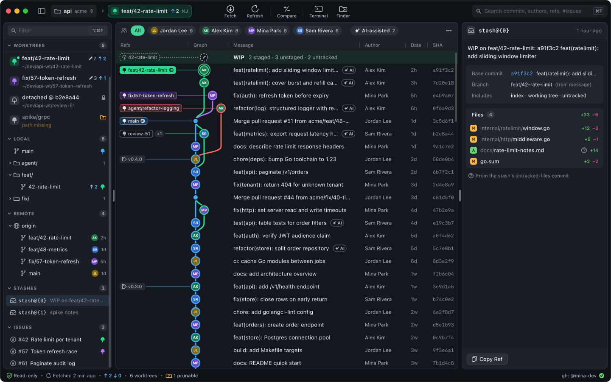 |

원본: [`s04-stash-detail-light.svg`](../../design/mockups/s04-stash-detail-light.svg), [`s04-stash-detail-dark.svg`](../../design/mockups/s04-stash-detail-dark.svg)

**v0.1 제외.** apply, pop, drop, branch from stash. 화면에 안내 문구도 두지 않는다.

---

## S-05 워크트리 상세

**목적.** 워크트리 하나의 경로, HEAD, upstream, 상태, 보안 상태를 보여 준다.

**진입.** 사이드바 워크트리 행 선택 후 `Worktree` 세그먼트.

```
╭────────────────────────────────────────────────────────╮
│ ◆ feat/12-worktree-list             Changes│Worktree   │
├────────────────────────────────────────────────────────┤
│ ╭────────────────────────────────────────────────────╮ │
│ │ Path        ~/dev/overgrove-wt/12-worktree-list  ⧉ │ │
│ │ HEAD        a1b2c3d  feat: add status parser       │ │
│ │ Branch      feat/12-worktree-list                  │ │
│ │ Upstream    origin/feat/12-worktree-list  ↑2 ↓0    │ │
│ │ State       6 changed · 1 untracked · 0 conflicts  │ │
│ │ Lock        Not locked                             │ │
│ │ Last fetch  2 min ago (repository)                 │ │
│ ╰────────────────────────────────────────────────────╯ │
│ ╭ Security ─────────────────────────────── always on ╮ │
│ │  ◈ Hooks disabled                                  │ │
│ │  ◈ fsmonitor disabled                              │ │
│ │  ◈ External diff and textconv disabled             │ │
│ │  ◈ Remote URL credentials masked                   │ │
│ │  ╭ ⚠ Config overrides neutralized          2  ˅ ╮  │ │
│ │  │   filter.lfs.process                         │  │ │
│ │  │   core.sshCommand                            │  │ │
│ │  ╰──────────────────────────────────────────────╯  │ │
│ ╰────────────────────────────────────────────────────╯ │
├────────────────────────────────────────────────────────┤
│ ╭ ± Changes vs [main ⌃]               base 3c5d6f1 ╮ │
│ │ 1 commit ahead · 0 behind · 4 files     +46 −12  │ │
│ │ [Compare with Base…]  ⌘⇧B                        │ │
│ ╰──────────────────────────────────────────────────╯ │
╰────────────────────────────────────────────────────────╯
```

| 요소 | 내용 |
|---|---|
| Path | `~`로 줄인 경로 + 복사 버튼. 심볼릭 링크로 저장소 밖을 가리키면 `⚠ Symlink points outside the repository` (T14) |
| HEAD / Branch | detached면 Branch에 `detached` |
| Upstream | 없으면 `No upstream`. upstream 브랜치가 원격에서 사라졌으면 `gone` |
| State | `WorkingState` 요약 |
| Lock | `locked` + 이유(`git worktree lock --reason`이 있으면) |
| Last fetch | 저장소 단위임을 `(repository)`로 밝힌다. **이 화면에 Fetch 버튼을 두지 않는다.** fetch는 저장소 단위이므로 툴바 하나로 통일한다 |
| 느린 status 카드 | 마지막 status가 1초를 넘으면 정보 카드 아래에 `🐢 Status 5.2 s`와 이유를 보여 준다. 설정 보고가 깨끗하면 복사용 `git status`와 "신뢰하는 저장소에서만"을 붙이고, 발견 항목이 있으면 명령을 제시하지 않는다(#200). 앱은 실행하지 않는다(#168) |
| Base | 기준 브랜치(기본은 기본 브랜치)와 그 대비 요약. S-02와 같은 **하단 고정 비교 카드**로 보여 준다. `Compare with Base…`는 S-11을 연다 (#158, #166) |
| Copy Report | SECURITY 머리 오른쪽의 `doc.on.doc` 버튼. 보안 상태를 텍스트로 복사한다. 키 이름과 판정만 담고 값, 경로, 원격 URL, 브랜치 이름, 오류 문구는 넣지 않는다(#110, [security-review.md T11](threats/T11.md), SEC-T11-06). `Untrusted: yes/no`와 `Remotes on this Mac: n`(개수만)도 넣는다(#107) |
| Pull request (v0.2.0, ADR-0023) | 이 워크트리 브랜치에 이어진 PR이 있으면 정보 카드 아래에 카드 하나: 상태(`Open`, `Draft`, `Merged`, `Closed`), `#123` + 제목, 리뷰 결정(`Approved`, `Changes requested`, `Review required`, 없으면 생략), 기준 브랜치. `Open in Browser`(정확한 PR URL일 때만)·`Copy URL`. 머지된 PR은 사실만 보이고 정리 안내나 명령은 넣지 않는다(ADR-0021). gh가 없거나 로그아웃이면 카드를 숨긴다(#265) |
| 신뢰하지 않음 (#107) | SECURITY 카드의 `Treat as untrusted` 토글. 켜면 이 Mac의 원격(로컬 경로·`file://`)을 fetch하지 않고, Open in Terminal은 항상 확인 후에 연다. 신뢰함이면서 이 Mac에 원격이 있으면 원격 이름(마스킹·이스케이프, 경로·URL 없음)과 함께 "Remotes on this Mac" 경고를 보여 준다. 켜져 있으면 "Untrusted" 상태 줄을 보여 준다. 저장소 단위이고 등록 정보에 저장한다(ADR-0009 후속 작업) |
| SECURITY | 위협 모델 대응이 이 저장소에 적용되었는지 보여 준다. 항상 켜져 있는 항목(hooks, fsmonitor, ext diff, 마스킹)은 `✓`로 표시한다. `RepoConfigInspector`가 무력화한 저장소 설정이 있으면 `⚠` + 개수, 펼치면 키 이름 목록을 보여 준다(값은 보여 주지 않는다). 항목 정의는 [security-review.md](security-review.md)와 ADR-0009를 따른다 |

**데이터.** `Worktree`, `UpstreamStatus`, `WorkingState`, `FetchRecord`, `RepoConfigInspector` 결과.

| 상태 | 표현 |
|---|---|
| prunable | Path에 `⚠ Directory missing`. 나머지 필드는 마지막으로 알려진 값을 흐리게 표시 |
| bare 저장소의 main 항목 | 목록에서 숨기므로 이 화면으로 오지 않는다 |

**목업.** 정보 카드, Security 카드(무력화된 저장소 설정 2개를 펼친 상태, 키 이름만 보이고 값은 없음), 하단 고정 비교 카드. [mockups.md](mockups.md#s-05-워크트리-상세)

| Light | Dark |
|---|---|
| 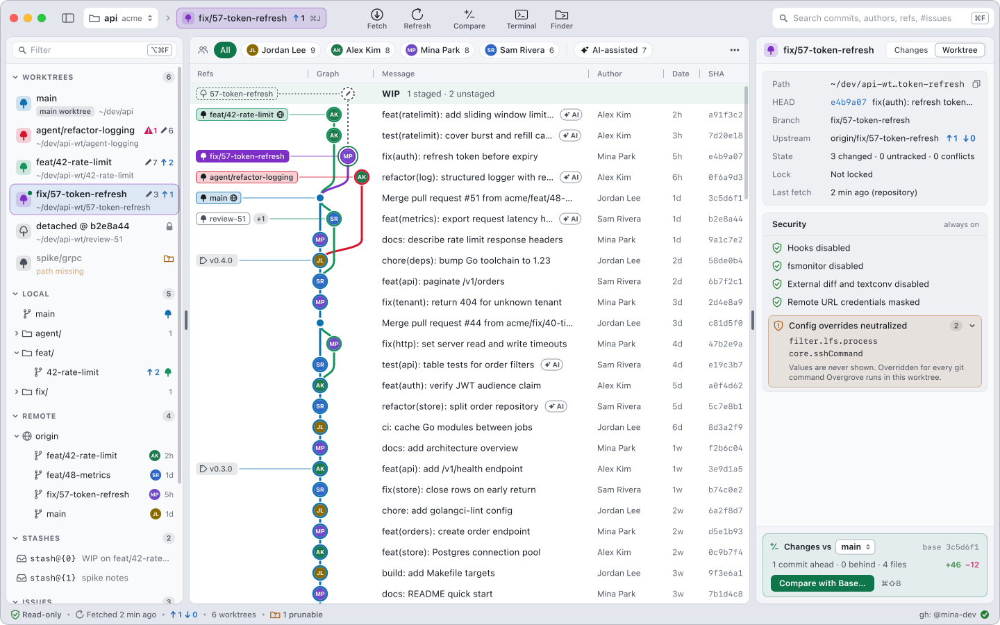 | 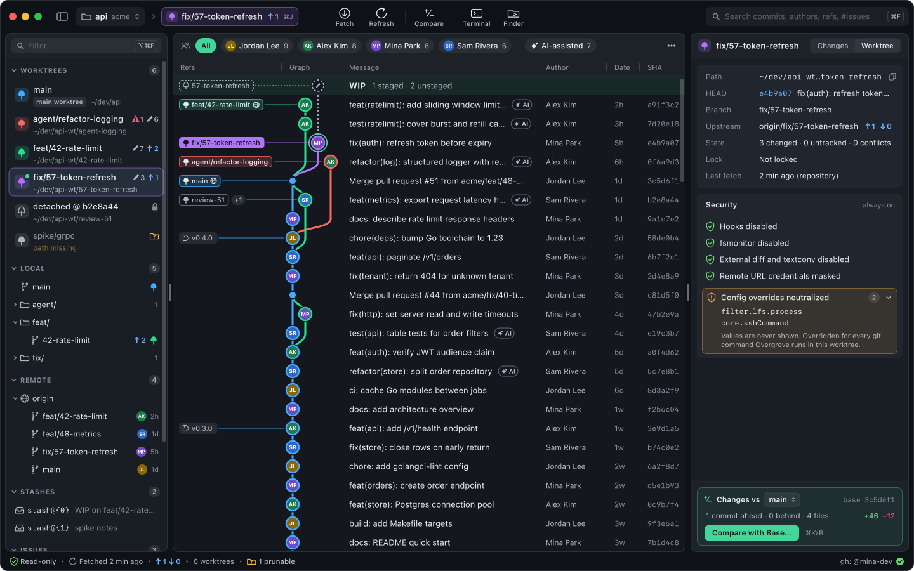 |

**v0.1 제외.** 워크트리 추가·삭제·이동·잠금·prune.

---

## S-06 이슈 패널

**목적.** GitHub 이슈를 읽기 전용으로 보여 주고 브랜치·워크트리·커밋과의 연결을 드러낸다 (ADR-0004). v0.2.0부터 GitLab 이슈도 같은 패널에 보인다(glab, ADR-0026, #154). GitHub 저장소가 원격에 없을 때만, glab이 그 호스트에 로그인됐다고 보고한 GitLab 프로젝트를 읽는다. Gitea 이슈도 보인다(gt, #449): glab이 확인한 호스트가 없을 때만, gt가 자격 증명이 있다고 보고한 인스턴스의 저장소를 읽는다. 한 호스트에 여러 CLI가 로그인돼 있으면 gh → glab → gt 순서로 먼저 확인한 쪽을 쓴다. PR 상태는 GitHub만이다.

**진입.** 사이드바 ISSUES 섹션(목록) → 항목 선택 시 상세 패널(상세).

**계정 행 (ADR-0025 §4, #451).** 이슈를 읽었거나 읽지 못한 동안 ISSUES 머리 아래에 gh가 그 저장소 호스트에서 쓰는 활성 계정을 `login@host`로 보인다. 같은 호스트에 계정이 더 있으면 `+n more`와 복사용 `$ gh auth switch --hostname HOST`를 둔다. 명령에는 검증된 HOST만 넣고 login은 넣지 않으며, 클립보드 값은 제어·bidi 문자를 이스케이프한다(ADR-0021 결정 3). 앱은 계정을 바꾸지 않는다.

**사이드바 목록 행.** `#번호` + 제목(한 줄) + 연결 배지(`tree` 심볼 = 연결된 워크트리 있음, `arrow.triangle.branch` = 연결된 브랜치만 있음). 섹션 헤더 오른쪽에 필터 메뉴: `Open`(기본) / `All` / `Assigned to me` / `Linked`.

```
상세 패널
┌──────────────────────────────────────────┐
│ #12  Worktree list                       │
│ ● Open · updated 3h ago                  │
├──────────────────────────────────────────┤
│ Labels     type:feature  area:ui         │
│ Assignees  @octocat                      │
│ Milestone  v0.1.0                        │
├──────────────────────────────────────────┤
│ LINKED                                   │
│  🌲 feat/12-worktree-list (worktree)     │
│  ⑂ origin/feat/12-worktree-list          │
│  ◉ a1b2c3d feat: add status parser       │
├──────────────────────────────────────────┤
│ [ Open in Browser ]   [ Copy URL ]       │
└──────────────────────────────────────────┘
```

| 요소 | 내용 |
|---|---|
| 상태 | `Open` / `Closed` + 심볼(`number.circle` / `checkmark.seal`)과 텍스트. 중립 알약으로 그리고 상태 색을 쓰지 않는다. 옆에 `updated 3h ago · opened by <이름>` |
| 라벨 | 라벨 이름만 중립 알약으로 표시한다. GitHub 라벨 색은 쓰지 않는다 (상태 색과 충돌하고 대비를 보장할 수 없음) |
| LINKED | 연결된 워크트리, 브랜치, 커밋(최근 5개). 누르면 해당 항목 선택 |
| 본문 | v0.1에서는 표시하지 않는다. Markdown 렌더링과 원격 이미지 로드를 피하기 위해서다. `Open in Browser`로 본다. 그 자리에 `The issue body is not shown in Overgrove. Open it in your browser to read or reply.` 한 줄을 둔다 |
| Open in Browser | `gh`가 준 URL이 `https://`이고 호스트가 저장소 원격의 GitHub 호스트와 같을 때만 연다. GitLab은 glab의 `web_url`이 그 프로젝트의 `https://HOST/NAMESPACE/NAME/-/issues/<iid>` 또는 `…/-/work_items/<iid>`와 정확히 같을 때만 연다(경로는 ASCII 대소문자 무시, ADR-0026 §5). Gitea는 gt의 URL이 그 인스턴스의 `https://HOST[:PORT]/BASE/OWNER/NAME/issues/<n>`과 정확히 같을 때만 연다 |

**데이터.** `Issue`, `GHAuthStatus`, `GHAccount`, 연결 계산 결과.

| 상태 | 사이드바 | 상세 |
|---|---|---|
| `gh` 미설치 | `GitHub CLI not installed` 안내 행 → S-07 | — |
| 미로그인 | `Not logged in to GitHub` + `Run gh auth login in Terminal` | — |
| GitHub 원격 없음 | `No GitHub remote` | — |
| 호스트에 로그인 안 됨 (v0.2.0, #154·#449) | 호스팅 형태의 원격이 있지만 gh도 glab도 gt도 그 호스트에 로그인돼 있지 않음: `Not logged in to HOST` + 복사용 `gh auth login --hostname HOST`, `glab auth login --hostname HOST`, `gt auth login --host https://HOST` + `Check Again`. 그 호스트에서는 아무것도 읽지 않는다(ADR-0026 §7) | — |
| 권한 없음 / 저장소 없음 | `Cannot read issues for owner/repo` + `Details` | — |
| 이슈 없음 | `No open issues` | — |
| 불러오는 중 | 섹션 헤더에 작은 스피너 | — |

**목업 (#176).** 사이드바 ISSUES 섹션(머리 오른쪽 `Open ⌄` 필터)에서 `#42`를 고른 상태. 그래프는 연결된 브랜치의 팁 커밋 행을 점선 테두리와 옅은 레인 색으로 강조만 하고 선택하지 않는다. 상세 패널은 상태, 정보 카드(Labels 중립 알약, Assignees, Milestone), Linked 카드(워크트리, 원격 브랜치, 커밋), 본문 미표시 안내, 아래 고정 `Open in Browser`·`Copy URL`이다. [mockups.md](mockups.md#s-06-이슈-패널)

| Light | Dark |
|---|---|
| 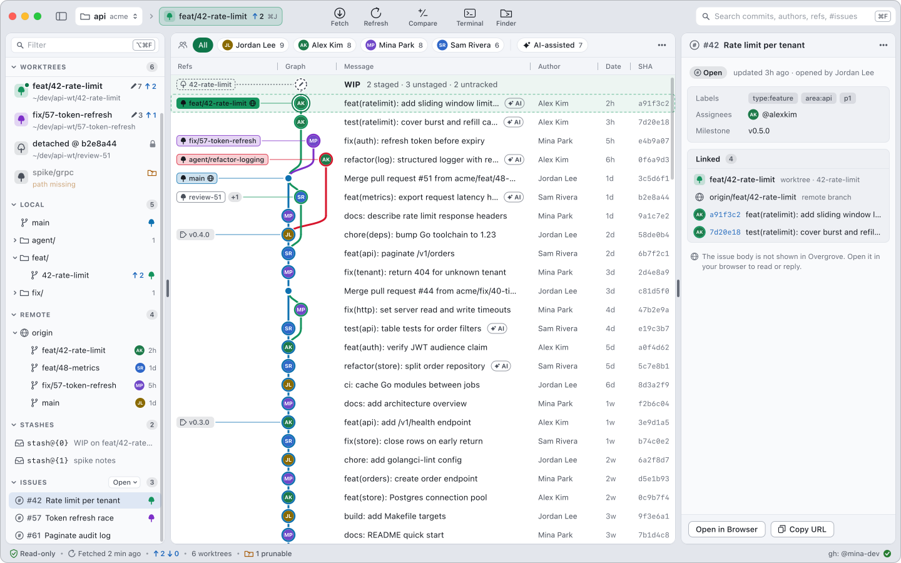 | 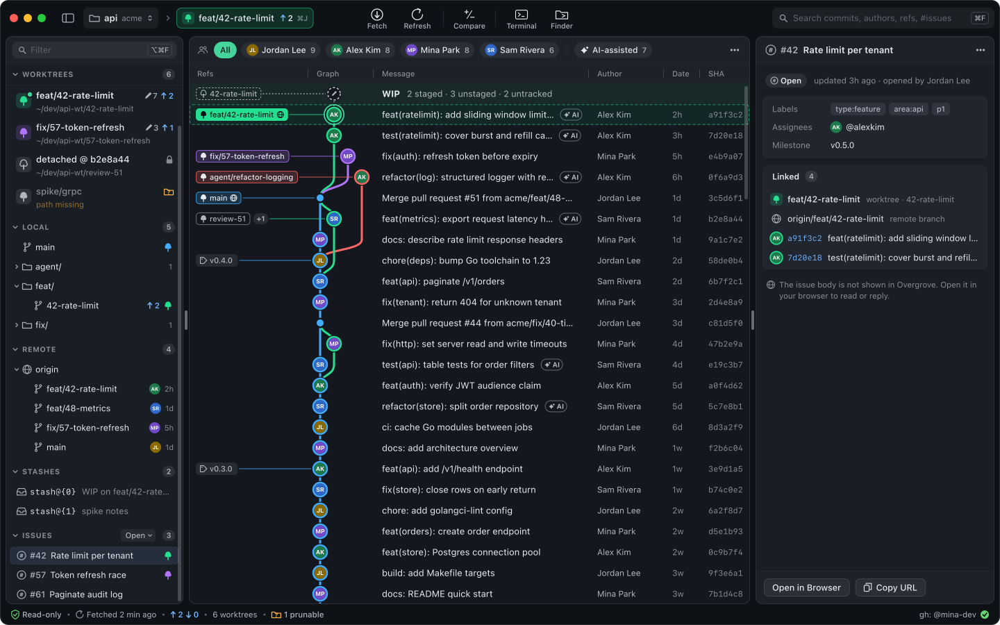 |

원본: [`s06-issue-panel-light.svg`](../../design/mockups/s06-issue-panel-light.svg), [`s06-issue-panel-dark.svg`](../../design/mockups/s06-issue-panel-dark.svg)

**v0.1 제외.** 이슈 생성·수정·코멘트, PR 상태, 본문 렌더링, GitHub Enterprise.

---

## S-07 온보딩

**목적.** 처음 실행했을 때 저장소를 등록하고 git과 gh 상태를 점검한다. 이후에도 상태바와 메뉴(`Help > Setup Assistant`)에서 다시 연다.

```
┌──────────────────────────────────────────────────────────────────────────┐
│                       [mark]  Welcome to Overgrove                        │
│        See every worktree of a repository at a glance. Read-only.         │
├──────────────────────────────────────────────────────────────────────────┤
│ 1  Add a repository      [ Choose Folder… ]      ✓ ~/dev/overgrove         │
│                          Only folders you choose here are ever read.     │
│                                                                          │
│ 2  git                   ✓ git 2.50.1 (Apple Git-155) at /usr/bin/git      │
│                                                                          │
│ 3  GitHub (optional)     ✗ Not logged in                                  │
│                          Run this in Terminal, then check again:         │
│                          ┌──────────────────┐                            │
│                          │ gh auth login    │  [ Copy ]                  │
│                          └──────────────────┘                            │
│                          [ Check Again ]                                 │
│                          Overgrove never asks for or stores tokens.       │
├──────────────────────────────────────────────────────────────────────────┤
│                                                    [ Open Repository ]   │
└──────────────────────────────────────────────────────────────────────────┘
```

| 단계 | 성공 | 실패 표현 |
|---|---|---|
| 1 저장소 | 경로와 `✓` | 저장소가 아님: `This folder is not a Git repository`. 소유권 거부: `Git refused this folder (ownership check)` + 설명 링크. 앱은 `safe.directory`를 바꾸지 않는다 |
| 2 git | 버전과 경로 | 없음: `Install Xcode Command Line Tools: xcode-select --install` (복사 버튼). 2.36 미만: `git 2.36 or later is required` |
| 3 GitHub | `✓ Logged in as @login` | 미설치: `Install GitHub CLI (brew install gh) to see issues` / 미로그인: 위 와이어프레임. **이 단계는 건너뛸 수 있다** |

- 앱은 `gh auth login`이나 `xcode-select --install`을 **직접 실행하지 않는다.** 명령을 복사할 수 있게만 한다 (HANDOFF §7.2).
- `Open Repository`는 1, 2단계가 성공하면 활성화된다.

**목업.** 창 가운데의 패널 하나에 마크, 제목(`typography.large-title`), `Read-only` 배지, 단계 카드 3개를 둔다. 1, 2단계 성공, 3단계(GitHub) 미로그인. [mockups.md](mockups.md#s-07-온보딩)

| Light | Dark |
|---|---|
| 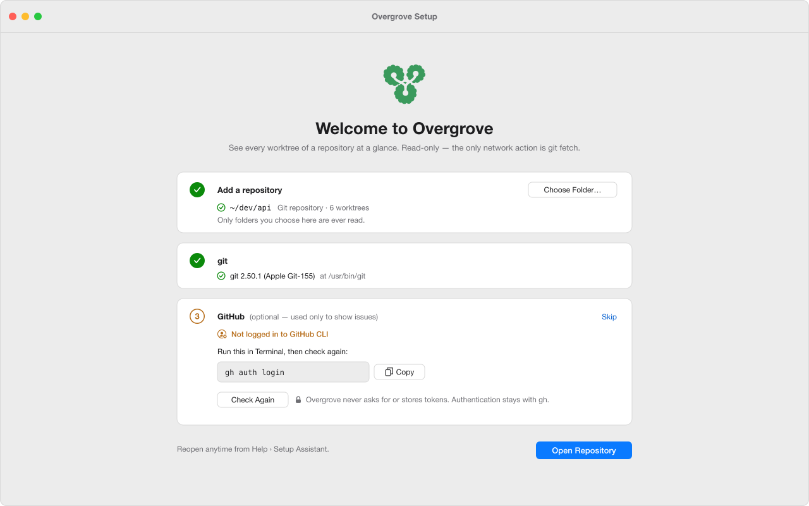 | 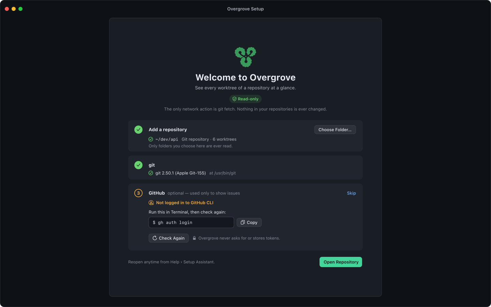 |

---

## S-08 설정

`⌘,`로 여는 표준 Settings 창. 탭은 `General`, `Repositories`, `Advanced`.

```
General
┌──────────────────────────────────────────────────────────────┐
│ Fetch          [ ] Fetch automatically every [10 min ▾]       │
│                    Off by default. Uses your git credentials. │
│ Remote URLs    [ ] Show full remote URLs                       │
│                    Credentials in URLs are always masked.     │
│ Untracked      [✓] Show untracked files                        │
└──────────────────────────────────────────────────────────────┘
Repositories
┌──────────────────────────────────────────────────────────────┐
│ overgrove      ~/dev/overgrove                    [ Remove ]  │
│ api            ~/dev/api                          [ Remove ]  │
│ [ + Add… ]                                                    │
└──────────────────────────────────────────────────────────────┘
Advanced
┌──────────────────────────────────────────────────────────────┐
│ git executable  /usr/bin/git                  [ Choose… ]     │
│                 Must be an absolute path. Checked on change.  │
│ Diagnostics     [ ] Verbose logging (credentials masked)      │
└──────────────────────────────────────────────────────────────┘
```

| 설정 | 기본값 | 저장 | 비고 |
|---|---|---|---|
| 자동 fetch | 끔, 간격 10분 | `UserDefaults` | 켜면 백그라운드 fetch. 창이 비활성일 때는 건너뛴다 |
| 원격 URL 전체 표시 | 끔 | `UserDefaults` | 끄면 호스트와 경로만(`github.com/acme/api`), 켜면 마스킹한 전체 URL. 둘 다 마스킹한 URL에서 만들므로 자격 증명이 나오지 않는다 (T11). S-05의 원격 목록과 사이드바 REMOTE 그룹 툴팁에 적용한다 (#86) |
| untracked 표시 | 켬 | `UserDefaults` | 끄면 `--untracked-files=no` |
| git 실행 파일 | 기본 git(`xcode-select`의 git) | `UserDefaults` (`settings.gitExecutablePath`) | 절대 경로만 허용한다. 경로·소유자·권한·버전 규칙을 고를 때와 git을 찾을 때마다 검사하고, 실제 경로·버전·Apple 서명 여부를 보여 주고, `lazyFetchControlVersion`(2.45.1) 미만이면 partial clone과 이 Mac의 원격(로컬 경로·`file://`)은 fetch하지 않는다고 안내한다(`OlderGitNote`, #383). S-07의 git 단계도 같은 안내를 붙인다. 실패하면 조회를 멈추고 `Use Default`를 보여 준다 ([ADR-0019](../adr/0019-user-chosen-git-executable.md)) |
| 터미널 | Terminal.app | `UserDefaults` (`settings.terminalApp`, bundle identifier) | Advanced › Apps. `Choose…`(응용 프로그램만)와 `Use Default`. 이름, bundle identifier, Apple 서명 여부 또는 `not installed`를 보여 준다 (#124) |
| 에디터 | 없음 | `UserDefaults` (`settings.editorApp`, bundle identifier) | Advanced › Apps. `Choose…`와 `Clear`. 고르면 워크트리 행·작업 트리 파일 행에 `Open in Editor`가 생긴다 (#124) |
| 상세 로그 | 끔 | `UserDefaults` | 로그에도 마스킹을 적용한다 (T16) |

토큰이나 비밀 값을 입력받는 필드는 **없다.**

**신뢰하지 않음 (#107).** Repositories 탭의 각 행에 `Untrusted` 체크박스가 있다. S-05의 `Treat as untrusted`와 같은 값이다.

**v0.1 구현 범위 (#86).** General(자동 fetch, 원격 URL)과 Repositories(목록, Remove, Add…) 탭을 만든다. 자동 fetch 설정은 저장하지만, 스케줄러(#79)가 들어올 때까지 화면에서 숨긴다(`AppSettings.isAutoFetchAvailable`). untracked 표시와 상세 로그는 뒤로 미룬다. Advanced 탭과 git 실행 파일 행은 v0.2.0(#106)에서 들어왔다. 실제 경로, 버전, Apple 서명 여부, partial clone fetch 안내, `Choose…`, `Use Default`를 보여 준다([ADR-0019](../adr/0019-user-chosen-git-executable.md)). Settings에서 저장소를 지우면 그 저장소를 보던 창도 닫고, 등록·fetch 기록·결과 캐시를 함께 지운다(창의 Remove와 같다).

**외형.** Settings 창은 네이티브 컨트롤(`Settings` 씬, `Form`의 grouped 스타일)을 쓰므로 시스템 색을 따른다([ADR-0014](../adr/0014-panel-theme-and-split-layout.md)). 앱 토큰에서 오는 것은 액센트(토글, 선택된 탭 아이콘)뿐이다.

**목업 (#176).** 세 탭(General, Repositories, Advanced)을 나란히 그렸다. 시스템 색은 근삿값이다. General은 자동 fetch(꺼짐, 간격 팝업 비활성), 원격 URL 전체 표시, untracked 표시다. Repositories는 저장소 목록과 `Remove`, `Add…`다. Advanced는 git 실행 파일(`/usr/bin/git`, 확인된 버전 표시)과 상세 로그다. [mockups.md](mockups.md#s-08-설정)

| Light | Dark |
|---|---|
| 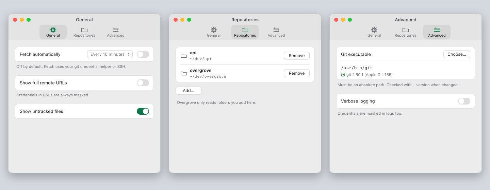 | 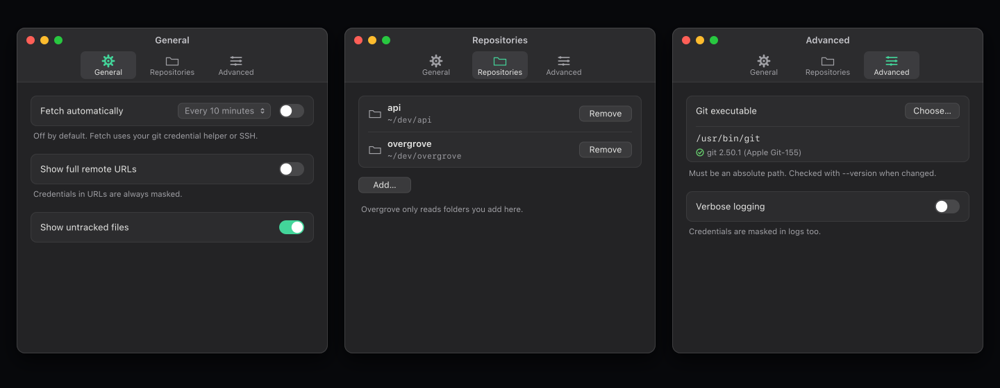 |

원본: [`s08-settings-light.svg`](../../design/mockups/s08-settings-light.svg), [`s08-settings-dark.svg`](../../design/mockups/s08-settings-dark.svg)

---

## S-09 파일 이력

**목적.** 파일 하나를 바꾼 커밋 목록을 보고, 각 커밋에서 그 파일이 어떻게 바뀌었는지 본다.

**진입.** S-02, S-03, S-04, S-10의 파일 컨텍스트 메뉴 `Show History`. 중앙 영역이 바뀌고 `⎋`로 그래프에 돌아간다.

```
┌───────────────────────────────────────────────────────────────────┐
│ ‹ Graph    History of Sources/Parsing/Status.swift   [✓] Follow renames │
├───────────────────────────────────────────────────────────────────┤
│ ◉ a1b2c3d  feat: add status parser          Ko   2h    +42  −8      │
│ ◉ e4f5a6b  fix: handle empty stash          Ko   1d     +3  −1      │
│ ◉ 0b1c2d3  refactor: split parser  (renamed from Parser.swift) 4d   │
│ ◉ 7f8e9d0  chore: bootstrap repo            Ko   5d    +80  −0      │
└───────────────────────────────────────────────────────────────────┘
```

| 요소 | 내용 |
|---|---|
| Follow renames | 기본 켬 (`--follow`). rename이 일어난 행에 `renamed from …` |
| 행 | SHA, 제목, 작성자, 날짜, 그 파일의 `+n −m` |
| 선택 | 상세 패널에 S-03. 행을 두 번 누르거나 `⏎`이면 S-10에 그 커밋의 해당 파일 diff |

| 상태 | 표현 |
|---|---|
| 이력 없음 (untracked 파일) | `This file has no history yet` |
| 긴 이력 | 처음 500개, 스크롤 시 추가 로드 |
| 이력의 처음에 닿음 | 마지막 행 아래에 `Beginning of history · created in <sha> as <path>` |

**목업 (#176).** `internal/http/middleware.go`의 이력. 열 머리는 `Commit | Message | Author | Date | This file`이다. 노드는 그래프와 같은 아바타 노드(원래 레인 색 링)를 한 줄로 잇는다. rename이 일어난 행에는 `renamed from internal/mw/middleware.go` 알약을 둔다. 첫 행을 고른 상태라 상세 패널은 S-03이고, 파일 목록에서 같은 파일이 선택되어 있다. [mockups.md](mockups.md#s-09-파일-이력)

| Light | Dark |
|---|---|
| 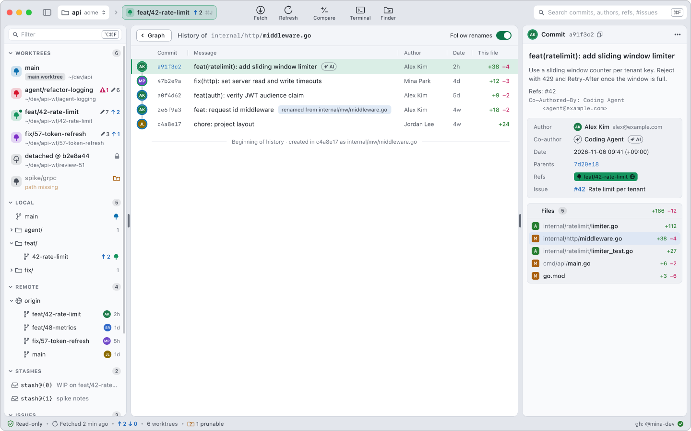 | 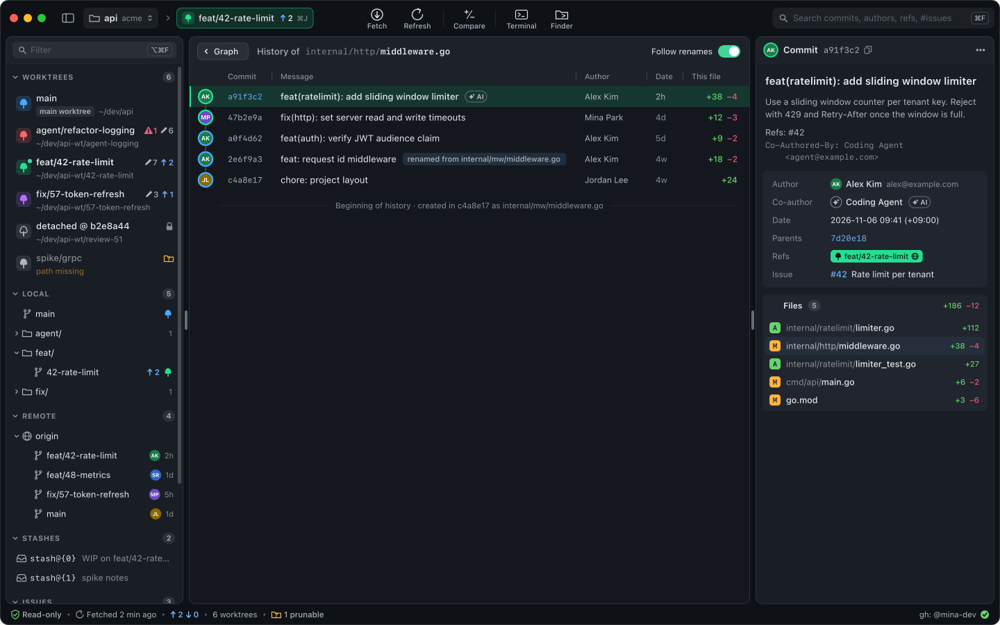 |

원본: [`s09-file-history-light.svg`](../../design/mockups/s09-file-history-light.svg), [`s09-file-history-dark.svg`](../../design/mockups/s09-file-history-dark.svg)

---

## S-10 Diff 뷰어

**목적.** 파일 하나의 diff를 읽기 전용으로 보여 준다.

**진입.** S-02, S-03, S-04, S-09, S-11, S-12에서 파일 선택. 중앙 영역이 바뀌고, 상세 패널의 파일 목록은 그대로 남아 `↑`/`↓`로 다음 파일로 넘어간다. `⎋`로 그래프에 돌아간다.

```
┌─────────────────────────────────────────────────────────────────────────┐
│ ‹ Graph   Sources/Parsing/Status.swift   Staged · M    [Unified|Split]  │
├─────────────────────────────────────────────────────────────────────────┤
│ @@ -40,7 +40,9 @@ struct StatusParser                                    │
│   40   40    func parse(_ data: Data) -> [FileChange] {                 │
│   41      −      let lines = data.split(separator: 0x0A)                │
│        41 +      let records = data.split(separator: 0x00)              │
│        42 +      // porcelain v2 records are NUL-terminated             │
│   42   43        var result: [FileChange] = []                          │
└─────────────────────────────────────────────────────────────────────────┘
```

| 요소 | 내용 |
|---|---|
| 머리 | 경로, 출처(Staged / Unstaged / 커밋 SHA / stash), 변경 종류 |
| 보기 방식 | `Unified`(기본) / `Split`. 선택을 기억한다 |
| 줄 | 이전·이후 줄 번호, `+`/`−` 기호(색만으로 구분하지 않음), 본문은 `typography.mono` |
| 배경 | `color.diff.added-bg`, `removed-bg`. 단어 단위 강조는 `added-word-bg` / `removed-word-bg` (v0.2.0, #122. 아래 "단어 단위 강조") |
| hunk 헤더 | `color.diff.hunk-header-bg` |
| 공백 문자 | 기본은 보이지 않는다. 머리 `⋯` 메뉴의 `Show Whitespace`(v0.2.0, #122)를 켜면 보인다. 아래 "공백 표시" |

diff 명령은 항상 `--no-ext-diff --no-textconv`로 실행한다 (T3). 텍스트 변환이 필요한 파일(예: 이미지, 바이너리)은 내용을 보여 주지 않는다.

| 상태 | 표현 |
|---|---|
| 바이너리 | `Binary file — 12.4 KB → 13.0 KB` |
| 출력 상한 초과 | 상한(10MB, ADR-0008)까지 보여 주고 `Diff truncated at 10 MB` 배너 |
| 큰 diff | 1만 줄을 넘으면 먼저 `Large diff (24,310 lines)` + `Show Diff` 버튼. 누르기 전에는 렌더링하지 않는다 |
| 서브모듈 | `Submodule commit a1b2c3d → e4f5a6b` 한 줄 |
| LFS 포인터 | 포인터 텍스트를 그대로 보여 준다. LFS 필터를 실행하지 않는다 (T4) |
| 심볼릭 링크 | 링크 대상 경로 문자열의 변화만 보여 준다 |

**목업.** S-03의 파일 목록에서 파일을 고른 상태. 상세 패널의 선택 행이 남아 있고 `↑`/`↓`로 다음 파일로 넘어간다. [mockups.md](mockups.md#s-10-diff-뷰어)

| Light | Dark |
|---|---|
| 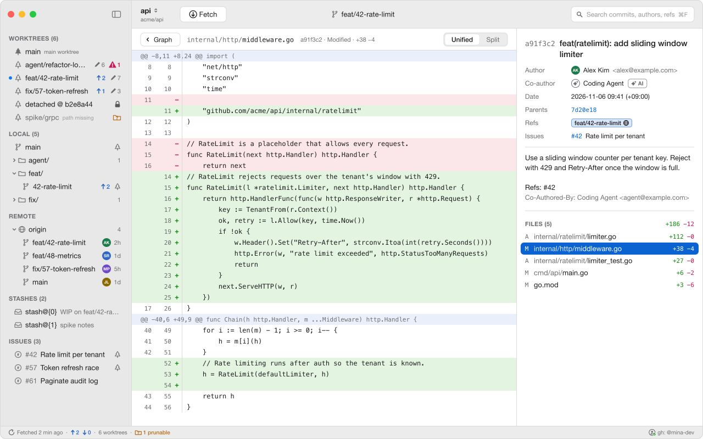 | 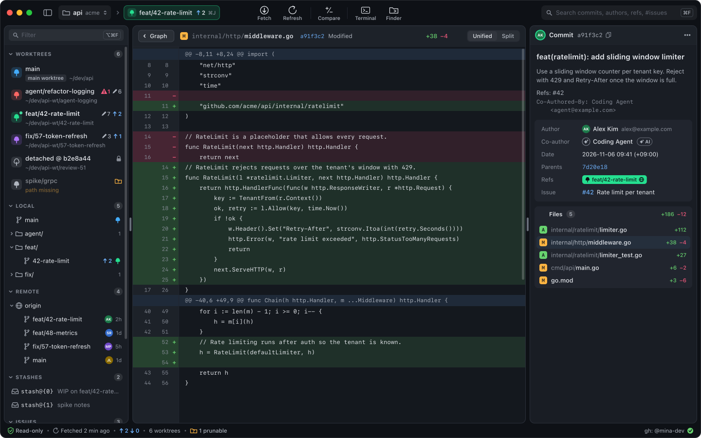 |

**단어 단위 강조 (v0.2.0, #122).** 줄 단위 배경 위에 바뀐 단어만 진하게 칠한다. git의 `--word-diff`는 쓰지 않는다(출력 형식이 달라 파서가 하나 더 필요하다). 앱이 받은 패치에서 계산한다.

- **짝짓기**: hunk 안에서 연속된 `−` 줄 묶음과 바로 뒤의 `+` 줄 묶음을 순서대로 한 줄씩 짝짓는다. 짝이 없는 줄(한쪽이 더 많은 경우)은 줄 단위 배경만 둔다. Split 보기에서는 같은 짝이 좌우에 나란히 온다.
- **단위**: 줄을 토큰으로 나눈다. 글자·숫자·`_`의 연속, 공백의 연속, 그 밖의 문자 하나가 각각 토큰이다. 두 줄의 토큰을 LCS로 맞추고, 맞지 않은 토큰을 `removed-word-bg` / `added-word-bg`로 칠한다.
- **안 칠하는 경우**: 공통 토큰이 하나도 없으면(줄 전체가 바뀜) 칠하지 않는다. 줄 단위 배경으로 충분하고 전체를 진하게 칠하면 읽기 어렵다.
- **상한 (T15)**: 저장소가 정하는 내용이라 계산량을 묶는다. 줄 하나가 1,000 유니코드 스칼라를 넘거나, 한 묶음이 200줄을 넘으면 그 줄·묶음은 줄 단위로 둔다. 파일 하나에서 짝지은 줄이 2,000을 넘으면 그 뒤는 줄 단위로 둔다(설계 때 5,000이었으나 PB-9를 지키려고 낮췄다, [PERF-09 측정](../performance/results/2026-11-08-perf09-word-diff.md)). 두 줄이 공유하는 앞뒤 토큰은 표 없이 건너뛰고, LCS 표는 줄 짝마다 250,000칸, 파일마다 5,000,000칸까지만 만든다. 계산은 화면에 그릴 때가 아니라 패치를 읽을 때 한 번 하고, 큰 diff 규칙(1만 줄 확인)과 같이 쓴다. 구현: `WordDiff`, `DiffDocument.unifiedRows(marked:)` (#387).
- **접근성**: 색에만 의존하지 않도록 VoiceOver 줄 라벨에 `changed: <바뀐 단어>`를 덧붙인다(최대 5개, 나머지는 개수).

**공백 표시 (v0.2.0, #122).** 머리 `⋯` 메뉴의 `Show Whitespace` 토글(기본 끔, 선택을 기억한다). 표시만 바뀌고 git 명령은 같다.

- 탭은 그 자리에 `→`(`text.quaternary`)를 그리고 폭은 그대로 둔다.
- `+`/`−` 줄 끝의 공백과 탭은 `·`·`→`로 그린다. 문맥 줄은 줄 끝 공백을 그리지 않는다(바뀐 곳만 보이게).
- 줄 끝의 CR(CRLF 파일)은 `␍`로 그린다.
- 기호는 이스케이프한 본문의 공백 자리에 그린다. 본문을 선택해 복사하면 그려진 기호도 함께 복사된다(탭은 원래부터 공백으로 펼쳐 보인다).
- "공백 차이 무시"(`-w`, `--ignore-space-change`)는 모든 패치 명령의 인자를 바꾸므로 `later`다.

**v0.1 제외.** 줄 단위 스테이징, 문법 강조, 이미지 diff, 편집.

---

## S-11 기준 브랜치 대비 변경

**목적.** 워크트리가 기준 브랜치에 비해 무엇을 바꿨는지 PR의 "Files changed"처럼 본다. AI 에이전트 작업을 PR 전에 검토하는 핵심 동선이다 (#158, 데이터는 #157).

**진입.**
- 사이드바 워크트리 행 컨텍스트 메뉴 `Compare with Base`
- S-05의 `Compare with Base…` 버튼
- 단축키 `⌘⇧B` (포커스 워크트리 기준. 시스템 예약 아님. [interaction.md §3](interaction.md#3-키보드-단축키) 표에는 #158 구현 때 더한다)

S-09, S-10처럼 **중앙 영역을 잠시 덮는다.** `‹ Graph`나 `⎋`로 그래프에 돌아간다. 상세 패널에는 커밋 목록과 파일 목록이 오고, 파일을 고르면 중앙에 그 파일의 패치(S-10과 같은 뷰어)가 나온다. 앱 안의 다른 화면(S-02, S-03 → S-10)과 같은 방향이다.

```
중앙 영역                                                         상세 패널
┌──────────────────────────────────────────────────────────┐ ┌──────────────────────────────────────┐
│ ‹ Graph  Changes vs [⑂ main ⌃⌄]       Include uncommitted ●│ │ feat/42-rate-limit                    │
│ 2 commits ahead · 0 behind · uncommitted: 5 files ·       │ │ compared with main, including …       │
│ 8 files · +272 −85                  merge base 3c5d6f1    │ │ COMMITS AHEAD (2)                     │
├──────────────────────────────────────────────────────────┤ │  ◌ Uncommitted changes       5 files  │
│ internal/http/middleware.go  Modified · 1 commit + uncom… │ │  AK a91f3c2 feat(ratelimit): …  [AI]  │
├──────────────────────────────────────────────────────────┤ │  AK 7d20e18 test(ratelimit): …  [AI]  │
│ @@ -8,11 +8,24 @@ import (                                │ │ FILES CHANGED (8)           +272 −85  │
│   8   8      "net/http"                                   │ │  M internal/http/middleware.go [WIP]  │
│  11      −                                                │ │  A internal/ratelimit/limiter.go      │
│      11 +    "github.com/acme/api/internal/ratelimit"     │ │  R internal/http/{noop.go → pass…}    │
│ …                                                         │ │ UNTRACKED (2)                         │
└──────────────────────────────────────────────────────────┘ │  ? docs/rate-limit.md                 │
                                                             └──────────────────────────────────────┘
```

| 요소 | 내용 |
|---|---|
| 기준 브랜치 선택 | 팝업 버튼. 기본은 기본 브랜치(`origin/HEAD`가 가리키는 것, 없으면 `main`/`master`). 로컬·원격 브랜치를 고를 수 있다. 고른 값은 워크트리별로 기억한다 |
| `Include uncommitted` | 켜면(기본) 워크트리의 staged·unstaged 변경을 파일 목록과 패치에 합치고 UNTRACKED 섹션을 보인다. 끄면 merge base와 HEAD 사이의 커밋된 변경만 |
| 요약 줄 | ahead 커밋 수, 기준이 앞선 커밋 수(behind), 미커밋 파일 수(토글이 켜졌을 때), 파일 수, `+n −m`, merge base 짧은 SHA |
| COMMITS AHEAD | merge base 이후 이 워크트리 HEAD에만 있는 커밋. 아바타 + SHA + 제목 + AI 배지. 토글이 켜져 있으면 맨 위에 `Uncommitted changes`(점선 WIP 노드)를 둔다. 커밋을 고르면 상세가 S-03으로 바뀌고 S-11은 닫힌다 |
| FILES CHANGED | 종류 글자(M/A/D/R/C/T) + 경로 + `+n −m`. rename은 `{old → new}`. 미커밋 변경이 섞인 파일은 `WIP` 알약을 붙인다(색 없음). 정렬은 경로 오름차순 |
| UNTRACKED | 토글이 켜졌을 때만. `questionmark.circle` + `?` + 경로. 줄 수는 세지 않는다 |
| 패치 머리 | 경로, 변경 종류, 출처(`n commits`, `+ uncommitted`), 그 파일의 `+n −m` |
| 사이드바 배지 (선택) | 워크트리 행에 `plus.forwardslash.minus` + 기준 대비 변경 파일 수. 우선순위는 이슈 번호 다음(가장 낮음). 기본은 끔 |

**데이터.** #157의 비교 결과: merge base, ahead/behind 수, `diff --numstat`/`--name-status`(merge base…HEAD, 토글이 켜지면 작업 트리까지), untracked 목록. 모든 diff는 `--no-ext-diff --no-textconv` (T3). 명령은 [git-command-catalog.md](../architecture/git-command-catalog.md)에 먼저 더한다.

| 상태 | 표현 |
|---|---|
| 로딩 | 요약 줄 자리에 작은 스피너 + `Comparing with main…`. 150ms 규칙은 공통과 같다 |
| 차이 없음 | `checkmark.circle` + `No changes compared with main` |
| 기준 브랜치 없음 | `exclamationmark.triangle` + `Base branch main was not found` + `Choose Base…` |
| 갈라진 지점 없음 | `exclamationmark.triangle` + `No common ancestor with main` (관련 없는 이력) |
| 큰 비교 | 파일 1,000개 초과 시 처음 1,000개 + `Show all 4,213 files`. 패치는 S-10의 큰 diff 규칙을 따른다 |
| detached HEAD | 기준 대비 비교는 HEAD 커밋 기준으로 동작한다. 제목에 `detached @ a1b2c3d` |

**목업.** [mockups.md](mockups.md#s-11-기준-브랜치-대비-변경)

| Light | Dark |
|---|---|
| 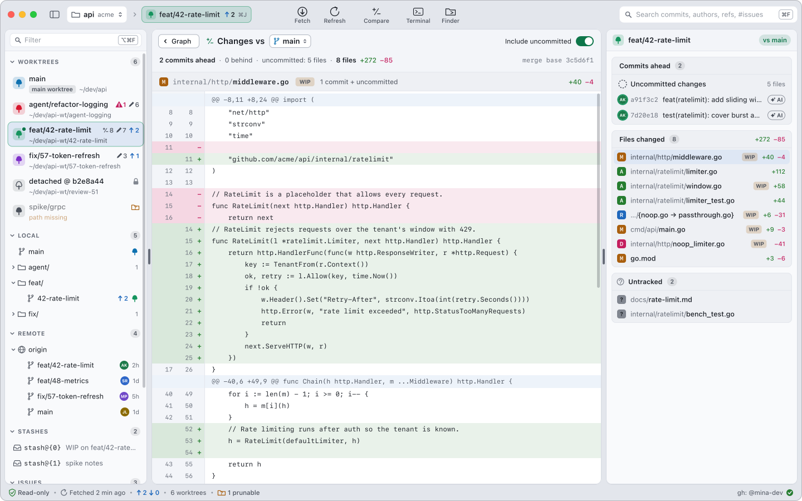 | 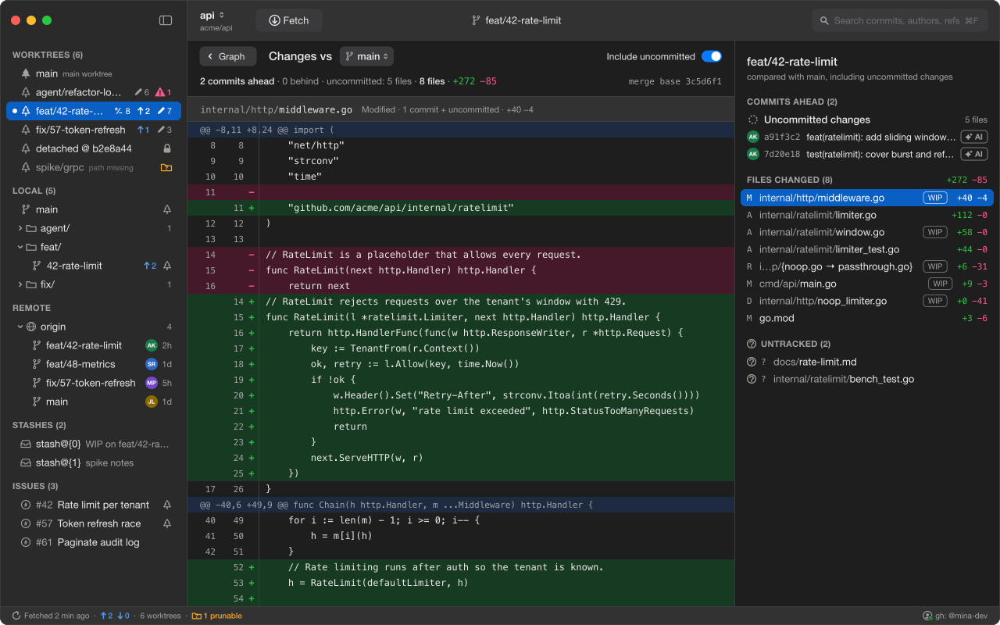 |

**구현 메모 (#158).**
- 비교할 수 있는 워크트리는 상태를 읽은 것뿐이다(#157이 그 워크트리의 status를 쓴다). 사이드바 메뉴, S-05 버튼, 툴바 `Compare`·`⌘⇧B` 모두 그 밖에서는 꺼진다.
- 고른 기준 브랜치는 이 세션 동안 워크트리별로 기억한다(앱을 다시 열면 기본값). 저장해 두는 것은 후속.
- 요약 줄의 merge base SHA와 "갈라진 지점 없음" 상태는 #157의 비교 결과에 없어 아직 보이지 않는다(관련 없는 이력은 git 오류 문구로 보인다). 후속에서 #157 결과에 더한다.
- COMMITS AHEAD의 커밋을 눌러 S-03으로 가는 것은 #69. 지금은 목록만.
- 패치 머리의 출처는 `Committed` / `Committed + uncommitted` / `Untracked`로 보인다. 파일별 커밋 수는 #157 결과에 없다.
- 사이드바 배지(선택, 기본 꺼짐)는 넣지 않았다.

**v0.1 제외.** 병합 가능 여부·충돌 예측, PR 생성, 리뷰 코멘트. 두 임의 커밋 비교는 S-12(v0.2.0, #122)로 따로 둔다.

---

## S-12 두 커밋 비교 (v0.2.0, #122)

**목적.** 그래프의 두 커밋 사이에 무엇이 바뀌었는지 본다. 예: 릴리스 태그 두 개, 에이전트가 만든 커밋 묶음의 처음과 끝. S-11은 워크트리, merge base, 미커밋 토글에 묶여 있어서 따로 둔다.

**진입.** 그래프의 커밋 행 컨텍스트 메뉴 `Compare with Selected Commit`. 다른 커밋이 주 선택일 때만 켜진다(선택한 커밋 자기 자신, WIP 행, 선택이 커밋이 아닐 때는 꺼진다). 주 선택이 **기준(base)**, 메뉴를 연 행이 **대상(target)**이다. 다중 선택은 두지 않는다(주 선택은 하나다, [interaction.md §1.1](interaction.md#11-세-가지-상태)).

S-09, S-11처럼 **중앙 영역을 잠시 덮는다.** `‹ Graph`나 `⎋`로 그래프에 돌아간다. S-11과 S-12는 같이 열리지 않는다(하나를 열면 다른 하나가 닫힌다). 상세 패널에는 두 커밋과 파일 목록이 오고, 파일을 고르면 중앙에 그 파일의 패치(S-10과 같은 뷰어)가 나온다.

```
중앙 영역                                                         상세 패널
┌──────────────────────────────────────────────────────────┐ ┌──────────────────────────────────────┐
│ ‹ Graph  Compare  3c5d6f1 → a91f3c2   [⇄]                │ │ BASE                                  │
│ 8 files · +272 −85                                        │ │  JL 3c5d6f1 Merge pull request #51 …  │
├──────────────────────────────────────────────────────────┤ │ TARGET                                │
│ internal/http/middleware.go  Modified                     │ │  AK a91f3c2 feat(ratelimit): …  [AI]  │
├──────────────────────────────────────────────────────────┤ │ FILES CHANGED (8)           +272 −85  │
│ @@ -8,11 +8,24 @@ import (                                │ │  M internal/http/middleware.go        │
│   8   8      "net/http"                                   │ │  A internal/ratelimit/limiter.go      │
│      11 +    "github.com/acme/api/internal/ratelimit"     │ │  R internal/http/{noop.go → pass…}    │
└──────────────────────────────────────────────────────────┘ └──────────────────────────────────────┘
```

| 요소 | 내용 |
|---|---|
| 머리 | `Compare` + 기준 짧은 SHA `→` 대상 짧은 SHA. `⇄` 버튼은 기준과 대상을 바꾼다(파일 목록과 패치를 다시 읽음) |
| 요약 줄 | 파일 수, `+n −m` |
| BASE / TARGET | 각 커밋 한 행: 아바타 + 짧은 SHA + 제목 + AI 배지. 행을 누르면 S-12를 닫고 그 커밋의 S-03을 연다 |
| COMMITS (#389) | 대상에는 있고 기준에는 없는 커밋(`base..target`), 최신순. 행 모양과 누를 때 동작은 BASE/TARGET과 같다. 최대 500개, 넘으면 `COMMITS (500+)`와 `Showing the newest 500 commits`. 없으면 `a91f3c2 has no commits that 3c5d6f1 does not have`(대상이 기준보다 뒤일 때, `⇄`로 반대 방향을 본다). 읽는 중에는 `Reading commits…`, 실패하면 마스킹한 오류 문구. 파일 목록과 따로 읽고 따로 실패한다 |
| FILES CHANGED | S-11과 같다: 종류 글자(M/A/D/R/C/T) + 경로 + `+n −m`, rename은 `{old → new}`, 경로 오름차순 |
| 패치 머리 | 경로, 변경 종류, 그 파일의 `+n −m` |

**데이터.** 파일 목록과 패치에는 새 git 명령이 없다. 커밋 상세의 `commitFiles`와 `commitPatch`(`diff-tree`, plumbing이라 저장소 diff 설정의 영향을 받지 않는다)에 부모 자리로 기준 커밋을 넘긴다: 기준→대상 두 트리의 차이다. 두 커밋은 그래프가 불러온 커밋이고 `ObjectID`로 검증되며 `--end-of-options` 뒤에 온다. 모든 diff는 `--no-ext-diff --no-textconv` (T3). [git-command-catalog.md](../architecture/git-command-catalog.md)의 두 행에 이 쓰임을 적었다. COMMITS는 `commitsBetween`(#389, 두 `ObjectID`의 `log base..target`)이다.

| 상태 | 표현 |
|---|---|
| 로딩 | 요약 줄 자리에 작은 스피너 + `Comparing 3c5d6f1 with a91f3c2…`. 150ms 규칙은 공통과 같다 |
| 차이 없음 | `checkmark.circle` + `No changes between 3c5d6f1 and a91f3c2` (트리가 같은 두 커밋) |
| 큰 비교 | S-11과 같다: 파일 1,000개 초과 시 처음 1,000개 + `Show all 4,213 files`. 패치는 S-10의 큰 diff 규칙 |
| 실패 | S-03 파일 목록의 오류 표시와 같다(마스킹한 오류 문구) |

**선택과 이력.** S-12를 여는 동안 주 선택(기준 커밋)은 그대로다. 사이드바 항목이나 그래프 행을 고르면 S-12를 닫고 그 항목을 고른다. S-12 열기·닫기와 파일 선택은 선택 이력(`⌘[` / `⌘]`, [interaction.md §1.4](interaction.md#14-선택-이력))에 기록하지 않는다.

**구현 메모 (#388).** `AppState+CommitComparison`, `CommitComparisonModel`, `CommitComparisonCenterView`·`CommitComparisonListView`. 파일 목록은 `RepositoryService.compareCommits`(`commitFiles`에 기준을 부모 자리로)이고 캐시하지 않는다. 패치 머리의 출처는 `3c5d6f1 → a91f3c2 · M`. 고충실도 목업은 그리지 않았고, 렌더 테스트(`CommitComparisonRenderTests`) 스크린샷으로 확인했다.

**제외 (later).** 사이드바 태그·브랜치에서 바로 비교, `⌘`-클릭으로 두 번째 커밋 고르기, 키보드 단축키, merge base 기준 비교(`A...B`).
