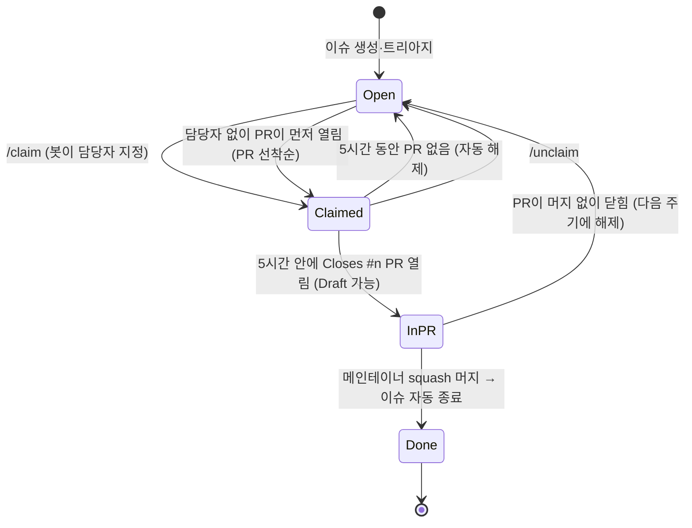

# 협업 규칙 (외부 기여, 이슈 선점, 의존 이슈, AI 기여)

> 상태: Accepted · 관련: [ADR-0013](../adr/0013-external-contributions-and-issue-claiming.md), [ADR-0015](../adr/0015-dependent-issues-stand-in.md), [CONTRIBUTING.md](../../CONTRIBUTING.md), [issues.md](issues.md), [pull-requests.md](pull-requests.md)

이 문서는 메인테이너 외의 협업자(사람, 또는 Claude Code 같은 AI 에이전트를 쓰는 사람)가 이슈를 가져가 개발하는 규칙을 정한다. 영어 요약은 [CONTRIBUTING.md](../../CONTRIBUTING.md)에 있다.

## 1. 역할

| 역할 | 저장소 권한 | 하는 일 |
|---|---|---|
| 메인테이너 (@kkdy21) | admin | 이슈·범위·Phase 승인, AI 검수(`/pr-review`) 후 머지 |
| 협업자 | 없음 (fork 사용) | `/claim`으로 선점, fork에서 개발, PR 제출, 리뷰 대응 |
| 봇 (GitHub Actions) | `issues: write` | 선점 지정·해제, 선점 만료, PR 선착순 지정 |

## 2. 처음 시작하기 (Claude Code 기준)

```sh
gh auth login                                  # GitHub 로그인
gh repo fork kkdy21/overgrove --clone --remote # origin=내 fork, upstream=kkdy21/overgrove
cd overgrove
./scripts/bootstrap.sh                         # Git hooks 설치, 도구 점검
claude                                         # Claude Code 실행 → "백로그 확인해서 진행해줘"
```

"백로그 확인해서 진행해줘"는 `/onboard` 스킬을 실행하고, PR이 Ready가 될 때까지 이어서 진행한다(CLAUDE.md §0.1). `/onboard` 스킬이 하는 일:
1. 셋업 점검
2. 선점 가능한 이슈 목록 제시. 조건은 담당자 없음, Epic·blocked·undecided 아님. 의존 이슈가 끝난 이슈를 먼저 보여 주고, 의존 이슈가 남은 이슈도 후보에 넣는다(§4.1)
3. 사용자가 고른 이슈에 `/claim` 댓글
4. `/issue-start`로 브랜치나 워크트리 생성
5. 첫 커밋 직후 `/pr-open --draft`

프로젝트 지침(`CLAUDE.md`), 권한, hooks, skills, agents가 저장소에 들어 있다. 그래서 클론만 하면 모든 협업자의 Claude Code가 같은 규칙으로 동작한다.

## 3. 이슈 선점 수명 주기



| 규칙 | 값 | 강제 수단 |
|---|---|---|
| 선점 | 이슈에 `/claim` 댓글(첫 단어) | `issue-claim.yml` |
| 해제 | `/unclaim` 또는 자동 만료 | `issue-claim.yml`, `claim-expiry.yml` |
| 선점 기한 | 선점 후 **5시간** 안에 PR(Draft 가능) | `claim-expiry.yml` (30분 주기) |
| 동시 선점 | 1인당 **2개** | `issue-claim.yml` |
| 선점 불가 | Epic, `status:blocked`, `status:needs-decision`, `status:triage`, 닫힌 이슈 | `issue-claim.yml` |
| 남의 이슈 PR | 실패 | `pr-policy` |
| 담당자 없는 이슈 | 먼저 열린 PR이 이긴다. 뒤에 열린 PR은 실패하고, `/claim`도 거부된다 | `pr-policy`, `issue-claim.yml`, `claim-expiry.yml` |
| 인정되는 PR | 열려 있고, `Closes #n`, `<type>/<n>-<slug>` 브랜치, 72시간 안에 갱신 | `claim-expiry.yml`, `pr-policy` |
| 재선점 제한 | 만료된 같은 이슈는 24시간 동안 다시 선점 불가 | `issue-claim.yml` |
| 의존 이슈가 열린 이슈 | 선점할 수 있다. PR은 의존 이슈가 모두 완료된 뒤에야 통과한다(§4.1) | `pr-policy`, `dependency-closed.yml` |
| 메인테이너 | 기한·선점 검사 면제 | — |

- 시각은 봇 댓글의 UTC 마감 시각을 기준으로 한다. GitHub 스케줄 실행은 지연될 수 있어서 실제 해제는 마감보다 조금 늦을 수 있다.
- 5시간 안에 끝낼 필요는 없다. **5시간 안에 Draft PR만 열면** 선점이 유지된다. 이후에는 PR이 열려 있는 동안 계속 유지된다.
- PR이 72시간 넘게 갱신되지 않으면 담당자 지정이 풀린다. 다만 그 PR이 열려 있는 동안에는 다른 사람이 그 이슈를 선점하거나 PR을 낼 수 없고(PR 선착순), 다시 push하면 담당자가 자동으로 돌아온다. 방치된 PR은 메인테이너가 닫는다.

## 4. 개발과 PR

- 브랜치는 fork에서 `<type>/<issue>-<slug>`로 만든다. 기준은 `upstream/main`이다.
- 커밋은 Conventional Commits, 영어 제목으로 쓴다. hook이 `Refs: #n`을 붙인다.
- PR 본문에 `Closes #n`, 템플릿 체크리스트, 검증 방법을 쓴다.
- **rebase와 강제 푸시는 필요 없다.** `main`이 앞서 나가면 `gh pr update-branch <n>`(또는 `git merge upstream/main`)을 쓴다. squash 머지라서 브랜치 안의 merge 커밋은 `main` 이력에 남지 않는다.
- "Allow edits by maintainers"를 켜 둔다. 메인테이너가 브랜치를 대신 최신화할 수 있다.
- 외부 기여자의 **첫 PR**은 메인테이너가 워크플로우 실행을 승인해야 필수 검사가 돈다. 두 번째 PR부터는 자동으로 돈다.

### 4.1 의존 이슈가 아직 끝나지 않았을 때

이슈 A에 이슈 B의 결과물이 필요한데 B가 아직 머지되지 않았어도 **기다리지 않는다**(ADR-0015). 규칙은 세 가지다.

1. **필요한 만큼 직접 만든다.** B에서 A가 쓰는 부분만 내 브랜치에 stand-in(임시 구현)으로 만들고, 블록마다 `// STAND-IN(#<B>)` 주석을 단다. 이름과 시그니처는 B의 명세(이슈 본문, `docs/architecture/`)를 따른다. 그래야 B가 머지된 뒤 고칠 것이 적다.
2. **남의 미머지 코드는 가져오지 않는다.** B의 PR 브랜치를 merge하거나 체크아웃하지 않는다. 그 PR이 넣은 hooks와 테스트가 내 PC에서 실행되기 때문이다. B에 PR이 있으면 `gh pr diff`로 읽어서 이름을 맞추는 데만 쓴다.
3. **PR은 내 이슈만 닫고, B가 끝날 때까지 Draft로 둔다.** B가 A 이슈의 `## 의존성` 절에 없으면 PR 본문에 `Depends on #<B>` 줄을 넣는다. 의존 이슈가 열려 있거나 stand-in이 남아 있으면 `pr-policy`가 실패하므로 순서가 뒤바뀌어 머지될 일은 없다.

Draft PR을 열어 두면 선점은 유지된다. 기다리는 동안 다른 이슈를 해도 된다(동시 선점 2개 안에서).

**B의 상태별로 할 일**

| B의 상태 | 할 일 |
|---|---|
| 다른 사람이 선점했거나 PR이 있다 | 위 1–3대로 stand-in으로 진행한다 |
| 아무도 선점하지 않았다 | B도 직접 `/claim`해서 B 브랜치와 PR을 따로 만들면 좋다. A 브랜치에는 내 B 브랜치를 merge한다(내 코드라서 괜찮다). 선점 한도가 차 있으면 stand-in으로 진행한다 |
| 이슈가 없다(작업 중에 발견) | A 이슈에 댓글로 무엇이 필요한지 적고 메인테이너에게 이슈를 요청한다. 그동안 stand-in으로 진행하고, 이슈가 생기면 PR 본문에 `Depends on #<B>`를 넣는다 |

**B가 어떻게 끝났는지에 따라 할 일**

| 결과 | 할 일 |
|---|---|
| 머지됐다 | `dependency-closed` 봇이 A의 PR에 댓글을 단다. `git merge upstream/main`(메인테이너는 `origin/main`) → stand-in 삭제 → 실제 B에 맞게 A 수정 → 테스트 → Ready. 충돌하면 B 쪽(main)을 택한다 |
| 리뷰에서 바뀌었다 | 머지된 뒤 한 번에 맞춘다. A에 필요한 것이 B에서 빠졌으면 B의 PR에 제안 코멘트를 남긴다 |
| PR이 반려되거나 닫혔다(이슈는 열려 있음) | 계속 기다리거나, B의 선점이 풀리면 B를 직접 가져가 stand-in을 정식 구현으로 키워 B의 PR로 올린다 |
| 오래 머지되지 않는다 | A는 Draft로 둔다. 72시간 갱신이 없으면 담당자 지정은 풀리지만, PR이 열려 있는 동안 다른 사람은 A를 가져갈 수 없고 다시 push하면 담당자가 돌아온다(§3) |
| 완료되지 않고 닫혔다(중복, not planned) | 봇이 알리고 `pr-policy`가 실패한다. 중복이면 `Depends on`을 원본 번호로 바꾼다. 그 밖에는 A 이슈에 댓글을 남겨 메인테이너에게 묻는다. 메인테이너가 stand-in을 A의 정식 코드로 흡수할지, A의 범위를 바꿀지 정하고 A 이슈의 의존성 절을 고친다 |

- B의 담당자는 A를 신경 쓰지 않아도 된다. B가 바뀌면 B에 의존하는 A가 맞춘다.
- 의존이 순환하면(A에는 B가, B에는 A가 필요하면) 멈추고 메인테이너에게 묻는다.
- 의존성 상태가 바뀐 뒤 `pr-policy`를 다시 돌리려면 push하거나 PR 본문을 고친다.

## 5. AI 기여 규칙

- AI로 만든 코드도 **제출한 사람이 책임진다.** 직접 읽고, 로컬에서 테스트하고, 설명할 수 있어야 한다.
- 큰 변경을 AI로 만들었다면 PR 본문에 `AI-assisted: <도구>`를 적는다. 커밋의 `Co-Authored-By` 트레일러도 허용한다.
- 저장소의 `CLAUDE.md`, hooks, 금지 규칙을 끄거나 우회하지 않는다. `--no-verify`, `core.hooksPath` 변경은 금지다.
- 이슈 하나에 PR 하나. AI가 범위를 넓히면 범위 밖 변경을 빼고 `later` 이슈로 제안한다.
- 같은 이슈를 여러 에이전트로 동시에 돌리지 않는다. 비교 실험은 자기 fork 안에서만 하고 PR은 하나만 올린다.

## 6. 메인테이너의 검수와 머지

- `/pr-review` 스킬이 다음을 점검하고 Conventional Comments로 리뷰를 남긴다.
  - 연결 이슈의 완료 조건, 선점, 필수 검사
  - 범위(`scope-guard`), 보안(`security-reviewer`), 테스트, 문서
- **모든 협업자 PR은 검수를 거친다.** 메인테이너 계정의 Approve 리뷰가 있어야 머지한다. 메인테이너가 판정을 확인하면 squash 머지(또는 auto-merge)한다. 머지 권한은 메인테이너에게만 있다.
- 리뷰 스레드는 코멘트 작성자가 resolve한다. 모든 스레드가 해결되어야 머지할 수 있다(룰셋).

## 7. 분쟁과 예외

- 선점이나 PR 선착순에 이견이 있으면 이슈에서 논의한다. 메인테이너가 담당자를 직접 바꿀 수 있다.
- 같은 이슈의 PR이 둘 이상 생기면 먼저 열린 PR을 리뷰한다. 뒤의 PR에서 좋은 부분은 앞 PR에 제안으로 옮긴다.
- 보안 문제는 이 흐름 밖에서 비공개로 제보한다([SECURITY.md](../../SECURITY.md)).
