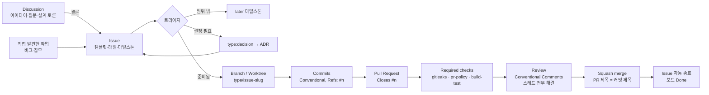

# 개발 흐름 (이슈 기반)

> 상태: Accepted · 관련: [issues.md](issues.md), [pull-requests.md](pull-requests.md), [branching-and-commits.md](branching-and-commits.md), [discussions.md](discussions.md), ADR-0012, ADR-0015, ADR-0016

Overgrove의 모든 작업은 GitHub 이슈에서 시작해서 이슈가 닫히며 끝난다. **이슈 없는 PR은 머지하지 않는다.**

## 1. 전체 흐름



## 2. 단계별 규칙

| 단계 | 규칙 | 산출물 | 보드 Status |
|---|---|---|---|
| 토론 | 확정되지 않은 아이디어, 설계 질문은 Discussions에서 시작한다 | Discussion | — |
| 이슈 | 템플릿을 쓴다. 제목은 영어 Conventional 형식, 본문은 한국어 가능. 완료 조건은 검증 가능한 체크리스트로 쓴다 | Issue | Backlog |
| 준비 | 완료 조건이 명확하고 의존 이슈가 모두 끝났으면 Ready로 옮긴다. Ready는 바로 시작하기 좋은 이슈라는 뜻이다. 의존 이슈가 남은 이슈도 착수할 수 있다([collaboration.md §4.1](collaboration.md#41-의존-이슈가-아직-끝나지-않았을-때)) | — | Ready |
| 시작 | 담당자를 지정하고(협업자는 `/claim`) 브랜치나 워크트리를 만든다. 협업자는 5시간 안에 Draft PR을 연다 | `feat/12-worktree-list` | In progress |
| 구현 | 명세 → 테스트 → 구현 순서. 명세가 바뀌면 같은 PR에서 문서도 고친다 | 커밋 | In progress |
| PR | `Closes #n`, 템플릿 체크리스트, 보안 영향 섹션을 채운다 | Pull request | In review |
| 리뷰 | 필수 검사 통과(`pr-policy`는 의존 이슈가 모두 끝나야 통과), 리뷰 스레드 전부 해결 | 리뷰 코멘트 | In review |
| 머지 | squash merge, 브랜치 자동 삭제 | `main`의 커밋 1개 | Done |

### 2.1 보드 자동화

보드 Status는 사람이 옮기지 않는다. 이슈·PR·선점 상태가 바뀌면 워크플로우가 [`scripts/github/board-sync.sh`](../../scripts/github/board-sync.sh)로 다시 계산한다([ADR-0016](../adr/0016-board-status-automation.md), 설정은 [github-settings.md §2](github-settings.md#보드-자동화-adr-0016)). 위에서부터 처음 맞는 규칙을 쓴다.

| 이슈 상태 | Status | 언제 바뀌나 |
|---|---|---|
| 닫힘(완료, not planned 모두) | Done | 머지로 닫히거나 직접 닫을 때 |
| `type:epic` | 그대로(새 Epic은 Backlog) | Epic은 메인테이너가 옮긴다 |
| 세는 PR(아래)이 열려 있고 Draft가 아님 | In review | PR을 열거나 Ready로 바꿀 때 |
| 세는 PR이 Draft이거나 담당자가 있음 | In progress | `/claim`, 담당자 지정, Draft PR |
| 그 밖에 In progress·In review·Ready였음 | 준비됨이면 Ready, 아니면 Backlog | 선점 해제·만료, PR 닫힘, 막는 라벨이나 열린 의존 이슈가 생김 |
| 그 밖에 Backlog·보드에 없음·다시 열림 | 의존성이 있고 준비됨이면 Ready, 아니면 Backlog | 의존 이슈가 끝남, 새 이슈 |

- **준비됨**의 조건은 네 가지다.
  - `type:*` 라벨이 있다. 템플릿이나 트리아지가 붙인다
  - `status:triage`, `status:blocked`, `status:needs-decision` 라벨이 없다
  - 마일스톤이 `later`가 아니다
  - `## 의존성`의 이슈가 모두 메인테이너가 완료로 닫은 이슈다(`pr-policy`와 같은 기준)
- **PR이 세는 경우**: `<type>/<n>-<slug>` 브랜치의 이슈 #n 하나만 센다. PR 작성자가 그 이슈의 담당자이거나 메인테이너일 때, 또는 담당자가 아직 없을 때(PR 선착순)만이다. "Closes #1 #2"처럼 여러 이슈를 적어도 남의 이슈는 움직이지 않는다.
- **의존성이 없는 Backlog 이슈는 자동으로 Ready가 되지 않는다.** 완료 조건이 명확한지는 사람이 판단한다(트리아지, `/issue-triage`).
- 협업자는 보드를 고칠 권한이 없어도 된다. `/claim`과 PR만으로 보드가 따라온다.
- 반영 시점:
  - 이슈·PR 이벤트: 몇 분 안
  - 선점 봇이 바꾼 담당자: 같은 실행 안
  - 놓친 변경: 30분마다 하는 전체 정리
- `PROJECT_TOKEN`이 아직 없으면 메인테이너 세션이 `scripts/github/board-sync.sh reconcile`로 맞춘다.

## 3. 크기와 단위

- **한 이슈 = 한 브랜치 = 한 PR.** PR이 400줄(테스트 제외)을 넘을 것 같으면 이슈를 나눈다.
- Phase나 큰 주제는 Epic 이슈(`type:epic`)로 묶고, 하위 이슈를 GitHub 네이티브 sub-issue로 연결한다.
- 작은 잡무도 `type:chore` 이슈를 만든다. 템플릿이 짧아서 1분이면 된다.
- 조사 작업은 `type:spike`로 시간 상자를 둔다. 스파이크 코드는 머지하지 않는다. 결과는 이슈 코멘트, 문서, ADR로 남긴다.

## 4. 역할

| 역할 | 누가 | 하는 일 |
|---|---|---|
| 메인테이너 | @kkdy21 | 이슈 승인, 범위·결정 승인, Phase 승인, 머지 결정 |
| 구현 에이전트 | Claude Code (프로젝트 하네스) | 이슈 초안, 구현, 테스트, PR 초안. 공개 글쓰기 전에 승인을 요청한다 |
| 협업자 | 누구나 (fork) | `/claim`으로 이슈 선점(5시간 안에 Draft PR), fork에서 구현, PR 제출, 리뷰 대응. 규칙: [collaboration.md](collaboration.md) |

Claude Code 하네스 사용법은 [claude-code-harness.md](claude-code-harness.md)에 있다.

## 5. 워크트리로 병렬 작업하기

이 프로젝트 자체가 워크트리 도구이므로 개발에도 워크트리를 쓴다(dogfooding).

```sh
git fetch origin
git worktree add ../overgrove-worktrees/12-worktree-list -b feat/12-worktree-list origin/main
cd ../overgrove-worktrees/12-worktree-list
# 작업 → PR → 머지 후
git worktree remove ../overgrove-worktrees/12-worktree-list
```

- `core.hooksPath=.githooks`는 저장소 설정이라 모든 워크트리에 적용된다.
- 워크트리마다 브랜치는 하나다. 같은 브랜치를 두 워크트리에서 체크아웃하지 않는다.

### 5.1 같은 계정으로 여러 세션을 돌릴 때

메인테이너 계정으로 Claude Code 세션 여러 개를 동시에 돌리면 선점 봇이 세션을 구분하지 못한다. 담당자가 모두 같은 계정이기 때문이다. 메인테이너는 동시 선점 한도(2개)에서도 빠진다. 그래서 아래를 지킨다.

1. **세션마다 워크트리를 따로 쓴다.** 한 폴더에서 두 세션이 브랜치를 바꾸면 서로의 작업 파일을 덮는다.
2. **담당자가 없는 이슈만 고르고, 고르는 즉시 담당자를 지정한다**(`gh issue edit <n> --add-assignee @me`). 담당자 지정이 세션 사이의 잠금이다. 보드도 곧 In progress가 된다.
3. **담당자가 나인 이슈를 이어받기 전에 다른 세션이 하고 있는지 확인한다.** 아래 셋 중 하나라도 있는데 이 세션이 만든 것이 아니면 멈추고 사용자에게 묻는다.
   - 그 이슈의 원격 브랜치: `git ls-remote --heads origin "refs/heads/*/<n>-*"`
   - 그 이슈를 닫는 열린 PR: `gh issue view <n> --json closedByPullRequestsReferences`
   - 그 이슈의 로컬 워크트리: `git worktree list`
4. **첫 커밋 직후 push하고 Draft PR을 연다.** 협업자 규칙과 같다. 다른 세션이 브랜치와 PR로 진행 중임을 알 수 있다.
5. **머지는 하나씩 한다.** 머지 직전에 `gh pr view <n> --json mergeStateStatus`로 최신인지 확인한다. 뒤처졌으면 `git merge origin/main`으로 맞춘다(rebase·강제 푸시 금지).
6. **공유 문서는 작게 고친다.** `CLAUDE.md`, `docs/roadmap.md`, `CHANGELOG.md`는 여러 세션이 함께 고치는 일이 잦다. 충돌하면 main 쪽 내용을 살리고 내 변경만 다시 얹는다.

## 6. 막혔을 때

| 상황 | 할 일 |
|---|---|
| 명세가 모호하다 | 추측해서 구현하지 않는다. 이슈에 질문 코멘트를 달거나 `type:decision` 이슈를 만든다 |
| 결정이 필요하다 | 이슈에 `status:needs-decision`을 붙이고 decision 이슈를 링크한다 |
| 다른 이슈의 결과물이 필요하다 | 기다리지 않는다. stand-in으로 개발하고 PR은 Draft로 둔다. 이슈 본문에 없는 의존성은 PR 본문에 `Depends on #<n>`으로 적는다([collaboration.md §4.1](collaboration.md#41-의존-이슈가-아직-끝나지-않았을-때)) |
| 외부 요인을 기다린다 | 메인테이너가 `status:blocked`를 붙이고 이유를 코멘트로 남긴다. 다른 저장소의 수정, 도구 출시처럼 이 저장소의 이슈가 아닌 것만 해당한다 |
| 범위 밖 아이디어가 생겼다 | 구현하지 않고 `later` 마일스톤 이슈로 남긴다 |
| 보안 문제를 발견했다 | 공개 이슈를 만들지 않는다. [SECURITY.md](../../SECURITY.md) 절차를 따른다 |
