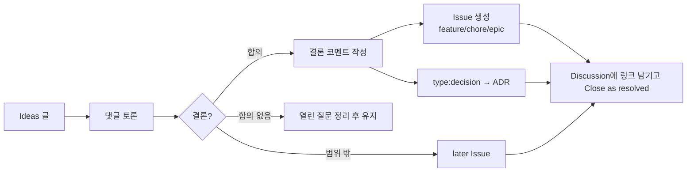

# Discussions 운영

> 상태: Accepted · 관련: [`.github/DISCUSSION_TEMPLATE/`](../../.github/DISCUSSION_TEMPLATE/), [issues.md](issues.md), Claude Code skill `discussion-to-issue`

이슈는 **할 일**을 추적하고, Discussion은 **아직 할 일이 되지 않은 생각**을 다룬다. 결론이 나면 이슈로 옮긴다.

## 1. 카테고리

GitHub 기본 카테고리를 그대로 쓴다. API로 카테고리를 만들 수 없어서, 기본 이름에 쓰임새를 정해 둔다.

| 카테고리 | 형식 | 쓰임 | 템플릿 |
|---|---|---|---|
| 📣 Announcements | 공지 | 릴리스, Phase 승인, 정책 변경. 메인테이너만 글을 쓴다 | — |
| 💡 Ideas | 열린 토론 | 기능 아이디어, **설계 제안**, UX 논의 | `ideas.yml` |
| 🙏 Q&A | 질문·답변 | 빌드 방법, 사용법, 동작 질문. 답변 채택 | `q-a.yml` |
| 💬 General | 열린 토론 | 그 밖의 이야기 | — |
| 🗳️ Polls | 투표 | 선택지 의견 수렴(결정 자체는 ADR로 한다) | — |
| 🙌 Show and tell | 공유 | 사용 사례, 스크린샷 | — |

## 2. 토론에서 이슈로

1. 토론이 충분히 진행되면 메인테이너(또는 `/discussion-to-issue`)가 **결론 코멘트**를 단다. 내용은 문제 / 합의된 결론 / 기각된 대안과 이유 / 열린 질문 / 범위 판단이다.
2. 결론에 따라 이슈를 만든다. 결정 자체가 핵심이면 `type:decision` 이슈를 만들고 ADR로 기록한다.
3. 이슈 본문 "참고"에 Discussion 링크를, Discussion에 이슈 링크를 남긴다.
4. Discussion을 "resolved"로 닫는다. 이후 논의는 이슈에서 한다.

## 3. 코멘트 규칙

- 한 댓글에는 주제를 하나만 쓴다. 다른 주제는 답글 스레드나 새 Discussion으로 분리한다.
- 의견을 낼 때는 근거를 함께 쓴다. 근거는 목표(G), 비목표(N), 성능 예산(PB), 위협(T)으로 연결한다.
- 동의는 👍 리액션으로 한다. "+1" 댓글은 달지 않는다.
- **보안 취약점의 세부 내용은 Discussion에 쓰지 않는다.** 이미 올라왔으면 메인테이너가 숨기고 비공개 제보로 안내한다.
- 범위 밖 제안도 환영한다. 다만 결론은 대부분 `later`가 된다는 점을 미리 알린다.

## 4. 결정 기록 원칙

- Discussion과 Poll은 의견을 모으는 곳이고, **결정은 ADR에 남긴다.** Discussion만 보고 결정 내용을 알아낼 수 있으면 안 된다. ADR 링크가 있어야 한다.
- 결정이 뒤집히면 새 ADR을 만들고 기존 ADR을 `Superseded`로 바꾼다. Discussion은 다시 열지 않고 새로 만든다.
