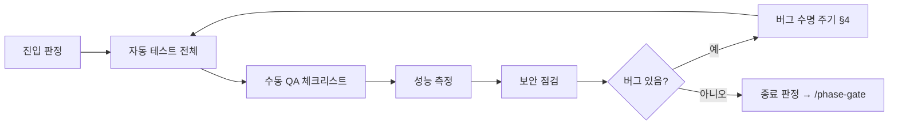
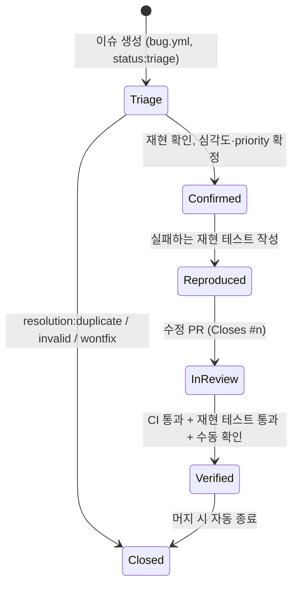

# QA 프로세스

> 상태: Accepted (Phase 2 게이트, 2026-11-05) · 관련: [checklist.md](checklist.md), [bug-triage.md](bug-triage.md), [release-checklist.md](release-checklist.md), [test-strategy.md](../testing/test-strategy.md), [phase-gates.md](../process/phase-gates.md)

Phase 4(검증)의 흐름과 버그 처리 방식을 정한다. Overgrove는 메인테이너 1명과 Claude Code가 개발한다. 그래서 QA는 "다른 사람이 확인한다" 대신 **증거를 남기고 메인테이너가 승인한다**는 방식으로 운영한다.

---

## 1. 역할

| 역할 | 담당 | 하는 일 |
|---|---|---|
| 메인테이너 | 사람 (1명) | 진입·종료 판정, 수동 QA 중 사람의 판단이 필요한 항목(시각 품질, 사용감, 접근성), 버그 심각도 확정, 릴리스 승인 |
| Claude Code | AI 에이전트 | 자동 테스트 실행과 결과 정리, 체크리스트 중 명령으로 확인 가능한 항목 실행, 버그 재현 테스트 작성, 증거 수집, `/phase-gate` 보고서 작성 |
| `security-reviewer` 에이전트 | Claude Code 하위 에이전트 | 보안 관련 변경과 SEC 테스트 결과를 위협 모델(T1–T18) 기준으로 검토 |
| 외부 기여자 | 선택 | 버그 제보 (`bug.yml` 템플릿), 재현 정보 제공 |

Claude Code가 "통과"로 표시한 항목은 메인테이너가 확인하기 전까지 **잠정**이다. 특히 UI, 접근성, 다크 모드 항목은 반드시 사람이 본다.

---

## 2. Phase 4 흐름



### 2.1 진입 기준

다음이 모두 참이어야 Phase 4를 시작한다.
- `v0.1.0` 마일스톤의 `phase:dev` 이슈가 모두 닫혔거나, `later`로 옮기는 데 메인테이너가 동의했다.
- `main`에서 필수 검사(`gitleaks`, `pr-policy`, `build-test`)가 통과한다.
- parsing-spec 표의 모든 행과 security-review의 모든 "검증" 항목에 테스트가 있다 (`/phase-gate`가 누락을 보고).
- QA용 빌드를 소스에서 만들 수 있다 (README 절차대로).

### 2.2 종료 기준

- 자동 테스트가 전부 통과한다. 건너뛴 테스트가 있으면 각각 이슈 번호가 있어야 하고, 보안 테스트는 하나도 건너뛰지 않았어야 한다.
- 수동 QA 체크리스트의 모든 항목이 "통과" 또는 "해당 없음(사유 기재)"이다.
- 성능 예산 PB-1–PB-8을 모두 지킨다 ([performance-budget.md](../performance/performance-budget.md)).
- 열린 버그 가운데 S1, S2가 없다. S3 이하는 `v0.2.0`이나 `later`로 옮기고 릴리스 노트의 "알려진 문제"에 적는다.
- [release-checklist.md](release-checklist.md)로 넘어갈 준비가 됐다고 메인테이너가 승인한다.

---

## 3. QA 실행 방법

1. **QA 이슈를 만든다.** `test(qa): v0.1.0 QA pass` 이슈(`type:test`, `phase:qa`)를 만들고, [checklist.md](checklist.md)를 본문 task list로 복사한다.
2. **환경을 기록한다.** macOS 버전, 칩, git 경로와 버전, gh 버전과 로그인 여부, Xcode 버전, 커밋 SHA.
3. **픽스처를 준비한다.**
   ```sh
   scripts/make-fixture-repo.sh ~/tmp/qa-fixture
   scripts/make-fixture-repo.sh --malicious ~/tmp/qa-malicious
   scripts/make-bench-repo.sh --commit-graph ~/tmp/qa-bench
   ```
4. **체크리스트를 순서대로 실행한다.** 항목마다 결과(통과, 실패, 해당 없음)와 증거를 QA 이슈 코멘트로 남긴다.
5. **실패하면 즉시 버그 이슈를 만든다** (§4). QA 이슈의 해당 항목에 버그 번호를 링크한다.
6. **다 끝나면** Claude Code가 결과를 요약하고 `/phase-gate`로 메인테이너 승인을 받는다.

### 3.1 증거 남기는 법

| 항목 종류 | 증거 |
|---|---|
| 화면 동작 | 스크린샷 또는 짧은 화면 녹화. 라이트·다크 둘 다 필요한 항목은 둘 다 남긴다 |
| 명령으로 확인 가능 | 실행한 명령과 출력 요약 (예: `ls canary/ \| wc -l` → `0`) |
| 성능 | `measure-git-baseline.sh` 출력 표, XCTest 성능 결과, Instruments 요약 |
| 접근성 | VoiceOver 읽기 순서 메모, Accessibility Inspector 감사 결과 |

**공개 저장소 주의.** 스크린샷과 로그에 다음이 나오면 안 된다.
- 개인 홈 경로(`/Users/<이름>`)
- 사내·개인 저장소 이름, 실제 원격 URL, 이메일
- gh 로그인 계정 외의 개인 정보

그래서 QA는 픽스처 저장소로 한다. 실제 저장소로 확인할 일이 있으면 증거를 공개 이슈에 올리지 말고 메인테이너 로컬에만 둔다. 경로가 보이는 스크린샷은 `~/tmp/...`처럼 일반적인 위치를 쓴다.

---

## 4. 버그 수명 주기



| 단계 | 할 일 | 완료 조건 |
|---|---|---|
| Triage | [bug-triage.md](bug-triage.md)에 따라 분류한다. 라벨은 `type:bug`, `area:*`, `priority:*`, 해당 Phase | `status:triage` 제거 |
| Reproduced | 재현 테스트를 **수정 전에** 쓴다. ID는 해당 층의 체계를 따른다(PAR, INT, SEC 등). 실패를 확인하고 커밋한다 | 수정 전 커밋에서 테스트가 실패함 |
| InReview | 수정 PR 본문에 `Closes #n`, 재현 테스트 ID, 원인 한 줄을 적는다. 보안 버그는 `security-reviewer` 검토를 받는다 | 필수 검사 통과 |
| Verified | 메인테이너가 원래 재현 절차를 수동으로 다시 해 본다 (UI 버그) | 머지 |

- 재현 테스트를 자동화할 수 없는 버그(순수 시각 문제 등)는 수동 QA 체크리스트에 새 항목(QA-xx)을 추가하는 것으로 대신한다. PR 본문에 그 사유를 적는다.
- 보안 취약점은 이 흐름을 공개 이슈로 진행하지 않는다 ([bug-triage.md §4](bug-triage.md)).

---

## 5. Phase 4 밖의 QA

- Phase 3 동안에도 UI 기능 PR은 체크리스트의 관련 영역 항목을 PR 작성자가 직접 확인한다. PR 템플릿에는 스크린샷 항목이 있다.
- 릴리스 뒤 들어온 버그는 같은 수명 주기를 따른다. 핫픽스 절차는 [release.md](../process/release.md)에 있다.
