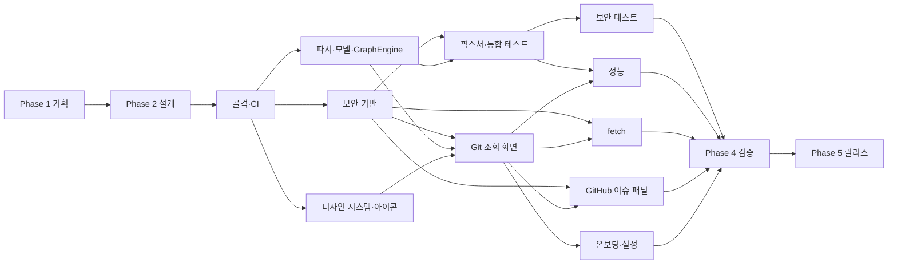

# 로드맵

> 상태: Accepted (Phase 1 게이트, 2026-11-05) · 관련: [prd.md](prd.md), [scope-mvp.md](scope-mvp.md), [process/phase-gates.md](process/phase-gates.md), [process/issues.md](process/issues.md)

이 문서는 Phase, 마일스톤, Epic, 하위 이슈의 **원본 목록**이다. GitHub 이슈는 이 문서와 1:1로 대응하는 시드(`issues-seed.json`, 저장소 밖 작업 파일)로 만든다. 이슈가 만들어진 뒤에는 GitHub 이슈가 진행 상황의 기준이 되고, 이 문서는 구조와 순서를 설명하는 데 쓴다.

규모: Epic 15개, Epic 하위 이슈 97개, Epic에 속하지 않은 v0.1.0 이슈 7개, v0.2.0 이슈 7개, later 이슈 16개 (총 142개). 표의 키 옆 `(#n)`이 GitHub 이슈 번호다. 운영 중에 생겨 곧바로 닫힌 이슈(README·CI 정비, 버그 수정, 프로세스 변경 등 #125–#151의 일부와 #172)는 표에 넣지 않는다.

> 진행 상황 (2026-11-06): Phase 3 진행 중. 골격·CI(#30–#32)와 실행·보안 기반 Epic(#5)을 마쳤고, 모델(#49)과 설정·버전·gh 파서(#56)가 들어왔다. 화면 목업 1차(#159)에 이어 메인테이너 피드백을 반영한 패널 테마 재디자인(#166, ADR-0014)을 마쳤다. 협업자 본격 모집 전이며, 지금 선점할 수 있는 이슈는 [보드의 Ready to claim 뷰](https://github.com/users/kkdy21/projects/4/views/3)에서 본다.

---

## 1. Phase와 게이트

| Phase | 라벨 | 목적 | 주요 산출물 | 게이트 |
|---|---|---|---|---|
| 1 기획 | `phase:plan` | 무엇을 왜 만드는가 | PRD, MVP 범위, 용어집, ADR, GitHub 운영 체계 | PRD·범위·보안 원칙·인증 방식 승인 |
| 2 설계 | `phase:design` | 어떻게 보이고 어떻게 동작하는가 | 정보 구조, 화면, 상호작용, 토큰·아이콘, 아키텍처, 명령 카탈로그, 파싱 명세, 보안 검토, 테스트·성능·QA 계획 | 화면 흐름·데이터 흐름·보안 체크리스트 승인 |
| 3 개발 | `phase:dev` | 명세대로 구현 | 앱 코드, 테스트, CI | Epic별 완료 조건, 빌드·테스트·보안 체크리스트 보고 |
| 4 검증 | `phase:qa` | 릴리스 가능한가 | QA·보안·성능 보고서 | 열린 p0·p1 버그 0건, DoD 충족 |
| 5 릴리스 | `phase:release` | 공개 | README, CHANGELOG, 태그, Release | 릴리스 체크리스트 통과, 게시 승인 |

Phase 1·2 산출물은 저장소 셋업에서 초안으로 작성되었다. 그래서 Phase 1·2 하위 이슈는 **검토·승인 작업**이다. 게이트 절차는 [process/phase-gates.md](process/phase-gates.md)에 있다.

## 2. 마일스톤

| 마일스톤 | 의미 | 포함 |
|---|---|---|
| `v0.1.0` | MVP | Phase 1~5의 모든 Epic과 하위 이슈, Epic에 속하지 않은 v0.1.0 이슈(§6 끝) |
| `v0.2.0` | 보안·설정 강화 | §9 |
| `later` | 범위 밖 아이디어 보관 | §10 |

## 3. 실행 순서와 의존성

핵심 원칙은 **보안 기반과 파서 테스트를 기능 화면보다 먼저 끝내는 것**이다 (HANDOFF §12-5). Epic 사이의 큰 순서는 다음과 같다. 이슈 단위 의존성은 각 표의 '의존성' 열에 있다.

Phase 3 안에서 먼저 끝내야 하는 이슈(p0, 기능 화면의 선행 조건)는 다음과 같다.

1. P3-SKEL-01 → P3-SEC-01 → P3-SEC-02 → P3-SEC-03 → P3-SEC-04 (P3-PARSE-08 필요)
2. P3-PARSE-01 → P3-PARSE-02·03·04·05·08 → P3-PARSE-10
3. P3-FIX-01 → P3-FIX-02 → P3-SECTEST-01
4. 그 다음 P3-UI-*, P3-SYNC-*, P3-GH-*

화면 디자인은 #166에서 확정했다([art-direction.md](design/art-direction.md)). 파서·GraphEngine(P3-PARSE), 픽스처·통합 테스트(P3-FIX), 보안 테스트(P3-SECTEST), 디자인 시스템(P3-DS), fetch 계층(P3-SYNC-01·03·05)은 화면과 별개로 진행할 수 있다. 화면 착수 순서는 #164에서, 자동 새로고침을 v0.1에 넣을지는 #163에서 정한다.

## 4. Phase 1 — 기획

**EPIC-P1 (#1)** — [EPIC] Phase 1 — Planning (`type:epic`, `priority:p0`)

메인테이너가 기획 산출물과 보안 원칙·인증 방식을 검토하고 승인한다.

| Key | 제목 | 유형 · 영역 · 우선순위 | 규모 | 의존성 |
|---|---|---|---|---|
| P1-01 (#16) | docs: review and approve PRD | docs · docs · p0 | S | — |
| P1-02 (#17) | docs: review and approve MVP scope and definition of done | docs · docs · p0 | S | P1-01 |
| P1-03 (#18) | docs: review accepted ADRs 0001-0008, 0011 and 0012 | decision · docs · p0 | S | — |
| P1-04 (#19) | docs: confirm performance budget PB-1 to PB-8 | decision · docs · p1 | S | — |
| P1-05 (#20) | chore(ci): verify GitHub operations setup | chore · ci · p0 | S | — |
| P1-06 (#21) | docs: decide UI language for v0.1.0 (status:needs-decision) | decision · ui · p1 | S | — |

## 5. Phase 2 — 설계

**EPIC-P2 (#2)** — [EPIC] Phase 2 — Design (`type:epic`, `priority:p0`)

화면 흐름, 데이터 흐름, 보안 체크리스트를 승인해 Phase 3 착수 조건을 갖춘다.

| Key | 제목 | 유형 · 영역 · 우선순위 | 규모 | 의존성 |
|---|---|---|---|---|
| P2-01 (#22) | docs: review information architecture and screen specs S-01 to S-10 | docs · ui · p0 | M | — |
| P2-02 (#23) | docs: review interaction spec | docs · ui · p0 | S | P2-01 |
| P2-03 (#24) | docs(security): review threat model T1-T18 and accept ADR-0009 | decision · security · p0 | M | — |
| P2-04 (#25) | docs: accept ADR-0010 commit graph layout | decision · git-core · p1 | S | — |
| P2-05 (#26) | docs: review architecture overview, git command catalog and parsing spec | docs · git-core, parser · p0 | M | P2-03 |
| P2-06 (#27) | docs(design): review design tokens and app icon | docs · ui · p1 | S | — |
| P2-07 (#28) | docs: review test strategy, fixtures, performance plan and QA process | docs · docs · p1 | S | — |

P2-08(#29)은 Phase 3 화면 Epic으로 옮겼다(§6 EPIC-P3-UI).

## 6. Phase 3 — 개발

### EPIC-P3-SKEL (#3) — [EPIC] Phase 3 — Project skeleton and CI

빌드·테스트·린트가 CI에서 도는 빈 앱 골격을 만든다.

| Key | 제목 | 유형 · 영역 · 우선순위 | 규모 | 의존성 |
|---|---|---|---|---|
| P3-SKEL-01 (#30) | chore: create Xcode project with app and test targets | chore · ci · p0 | M | P2-05 |
| P3-SKEL-02 (#31) | ci: run xcodebuild build and test in build-test job | chore · ci · p0 | S | P3-SKEL-01 |
| P3-SKEL-03 (#32) | ci: add swift-format lint step | chore · ci · p1 | S | P3-SKEL-02 |
| P3-SKEL-04 (#33) | ci: fail build when Swift package dependencies appear | chore · ci, security · p1 | S | P3-SKEL-02 |
| P3-SKEL-05 (#34) | ci: enable CodeQL analysis for Swift | chore · ci, security · p2 | S | P3-SKEL-02 |

### EPIC-P3-DS (#4) — [EPIC] Phase 3 — Design system and app icon

토큰과 아이콘을 앱 리소스로 재현 가능하게 생성한다.

| Key | 제목 | 유형 · 영역 · 우선순위 | 규모 | 의존성 |
|---|---|---|---|---|
| P3-DS-01 (#35) | feat(ui): generate DesignSystem tokens from tokens.json | feature · ui · p1 | M | P3-SKEL-01 |
| P3-DS-02 (#36) | chore(design): add palette contrast validation script | chore · ui · p1 | S | P3-DS-01 |
| P3-DS-03 (#37) | feat(ui): add high contrast color variants | feature · ui · p2 | S | P3-DS-01 |
| P3-DS-04 (#38) | chore(design): render AppIcon PNG set from SVG master | chore · ui · p1 | S | P3-SKEL-01 |
| P3-DS-05 (#39) | spike(design): check Icon Composer .icon fallback for macOS 14 | spike · ui · p2 | S | P3-DS-04 |
| P3-DS-06 (#40) | spike(ui): verify SF Symbols names and OS availability (good first issue) | spike · ui · p2 | S | — |

### EPIC-P3-SEC (#5) — [EPIC] Phase 3 — Security foundation (execution layer)

ProcessRunner부터 RepoConfigInspector까지 git 실행 계층을 명세대로 구현한다.

| Key | 제목 | 유형 · 영역 · 우선순위 | 규모 | 의존성 |
|---|---|---|---|---|
| P3-SEC-01 (#41) | feat(git): add ProcessRunner with timeout, output cap and cancellation | feature · git-core, security · p0 | M | P3-SKEL-01 |
| P3-SEC-02 (#42) | feat(git): add GitEnvironment with env allowlist and common hardening args | feature · git-core, security · p0 | M | P3-SEC-01 |
| P3-SEC-03 (#43) | feat(git): add GitCommand allowlist types and GitClient actor | feature · git-core, security · p0 | M | P3-SEC-02 |
| P3-SEC-04 (#44) | feat(security): add RepoConfigInspector to neutralize repo-local config | feature · security, git-core · p0 | L | P3-SEC-03, P3-PARSE-08 |
| P3-SEC-05 (#45) | feat(security): add CredentialMasker for URLs, stderr and logs | feature · security · p0 | S | P3-SKEL-01 |
| P3-SEC-06 (#46) | feat(security): validate object IDs, full ref names and path arguments | feature · security · p0 | S | P3-SEC-03 |
| P3-SEC-07 (#47) | feat(security): add PathValidator for registration and symlink escape | feature · security · p1 | S | P3-SKEL-01 |
| P3-SEC-08 (#48) | feat(git): add GitError taxonomy and stderr classification | feature · git-core · p1 | S | P3-SEC-05 |

### EPIC-P3-PARSE (#6) — [EPIC] Phase 3 — Parsers, models and graph engine

모든 파서와 GraphEngine을 테스트와 함께 구현한다.

| Key | 제목 | 유형 · 영역 · 우선순위 | 규모 | 의존성 |
|---|---|---|---|---|
| P3-PARSE-01 (#49) | feat(models): add value models | feature · parser · p0 | S | P3-SKEL-01 |
| P3-PARSE-02 (#50) | feat(parser): add WorktreeParser | feature · parser · p0 | S | P3-PARSE-01 |
| P3-PARSE-03 (#51) | feat(parser): add StatusParser for porcelain v2 | feature · parser · p0 | M | P3-PARSE-01 |
| P3-PARSE-04 (#52) | feat(parser): add StashParser | feature · parser · p0 | S | P3-PARSE-01 |
| P3-PARSE-05 (#53) | feat(parser): add LogParser | feature · parser · p0 | S | P3-PARSE-01 |
| P3-PARSE-06 (#54) | feat(parser): add RefParser and RevListParser | feature · parser · p1 | S | P3-PARSE-01 |
| P3-PARSE-07 (#55) | feat(parser): add NumstatParser for diff-tree and stash show | feature · parser · p1 | S | P3-PARSE-01 |
| P3-PARSE-08 (#56) | feat(parser): add ConfigParser, VersionParser and gh JSON parsers | feature · parser, security · p0 | S | P3-PARSE-01 |
| P3-PARSE-09 (#57) | feat(parser): add IssueRefExtractor | feature · parser, github · p1 | S | P3-PARSE-01 |
| P3-PARSE-10 (#58) | test(parser): add adversarial parser inputs | test · parser, security · p0 | M | P3-PARSE-02, P3-PARSE-03, P3-PARSE-05 |
| P3-PARSE-11 (#59) | feat(graph): add GraphEngine lane layout | feature · git-core · p0 | L | P3-PARSE-05 |
| P3-PARSE-12 (#160) | feat(parser): read co-author trailers to mark AI-assisted commits | feature · parser · p2 | S | P3-PARSE-05 |

### EPIC-P3-FIX (#7) — [EPIC] Phase 3 — Fixtures and integration tests

픽스처 저장소로 실제 git과 앱 결과를 비교하는 통합 테스트를 만든다.

| Key | 제목 | 유형 · 영역 · 우선순위 | 규모 | 의존성 |
|---|---|---|---|---|
| P3-FIX-01 (#60) | test: wire fixture repository script into integration test support | test · ci · p0 | M | P3-SEC-01 |
| P3-FIX-02 (#61) | test(security): add canary-based harness for malicious fixture | test · security · p0 | M | P3-FIX-01 |
| P3-FIX-03 (#62) | test: add integration tests for worktree, status, stash and log | test · git-core · p0 | M | P3-FIX-01, P3-SEC-04, P3-PARSE-03 |
| P3-FIX-04 (#63) | ci: run integration tests in CI and report git version | chore · ci · p1 | S | P3-FIX-03, P3-SKEL-02 |

### EPIC-P3-UI (#8) — [EPIC] Phase 3 — Git views

S-01~S-05, S-09, S-10 화면과 기준 브랜치 비교 화면(S-11, #158)을 명세대로 구현한다.

| Key | 제목 | 유형 · 영역 · 우선순위 | 규모 | 의존성 |
|---|---|---|---|---|
| P3-UI-01 (#64) | feat(ui): main window layout with toolbar, sidebar, graph, detail and status bar | feature · ui · p0 | M | P3-DS-01, P3-SEC-03, P3-UI-15 |
| P3-UI-02 (#65) | feat(ui): worktree list with change counts and ahead/behind | feature · ui · p0 | M | P3-UI-01, P3-PARSE-02, P3-PARSE-03 |
| P3-UI-03 (#66) | feat(ui): WIP detail with staged, unstaged, untracked and conflicted | feature · ui · p0 | M | P3-UI-01, P3-PARSE-03 |
| P3-UI-04 (#67) | feat(ui): worktree detail with security status | feature · ui · p1 | M | P3-UI-01, P3-SEC-04 |
| P3-UI-05 (#68) | feat(ui): commit graph with WIP row and paging | feature · ui · p0 | L | P3-UI-01, P3-PARSE-11 |
| P3-UI-06 (#69) | feat(ui): commit detail and diff viewer | feature · ui · p1 | M | P3-UI-05, P3-PARSE-07 |
| P3-UI-07 (#70) | feat(ui): file history | feature · ui · p2 | S | P3-UI-06 |
| P3-UI-08 (#71) | feat(ui): stash list and stash detail | feature · ui · p0 | M | P3-UI-01, P3-PARSE-04, P3-PARSE-07 |
| P3-UI-09 (#72) | feat(ui): local and remote branch lists | feature · ui · p1 | S | P3-UI-01, P3-PARSE-06 |
| P3-UI-10 (#73) | feat(ui): keyboard shortcuts, focus and context menus | feature · ui · p1 | M | P3-UI-02, P3-UI-05 |
| P3-UI-11 (#74) | feat(ui): search over commits, authors, branches and issue numbers | feature · ui · p2 | S | P3-UI-05 |
| P3-UI-12 (#75) | feat(ui): accessibility labels and VoiceOver pass | feature · ui · p1 | S | P3-UI-03, P3-UI-05 |
| P2-08 (#29) | spike(ui): check SwiftUI feasibility of the panel theme (ADR-0014) with preview mocks | spike · ui · p1 | S | P2-01, P2-06, V1-02, V1-06 |
| P3-UI-13 (#157) | feat(git): compare a worktree with its base branch (merge-base diff) | feature · git-core, parser · p1 | M | P3-PARSE-07 |
| P3-UI-14 (#158) | feat(ui): PR-style changes view of a worktree against its base branch | feature · ui · p1 | M | P3-UI-06, P3-UI-13 |
| P3-UI-15 (#174) | feat(ui): add PanelSplitView with grips, collapse, and persisted panel widths | feature · ui · p0 | M | P3-DS-01 |

P2-08(#29)은 #174가 같은 범위(분할 컨테이너와 성능 확인)를 구현 이슈로 정의해 닫았다(2026-11-06).

### EPIC-P3-SYNC (#9) — [EPIC] Phase 3 — Fetch and sync

안전한 fetch와 ahead/behind 갱신을 구현한다.

| Key | 제목 | 유형 · 영역 · 우선순위 | 규모 | 의존성 |
|---|---|---|---|---|
| P3-SYNC-01 (#76) | feat(git): fetch per remote with progress, cancel and timeout | feature · git-core, security · p0 | M | P3-SEC-04 |
| P3-SYNC-02 (#77) | feat(ui): show last fetch time and refresh ahead/behind after fetch | feature · ui · p0 | S | P3-SYNC-01, P3-UI-02 |
| P3-SYNC-03 (#78) | feat(git): classify fetch failures and show guidance | feature · git-core, ui · p1 | S | P3-SYNC-01, P3-SEC-08 |
| P3-SYNC-04 (#79) | feat: add optional auto fetch (default off) | feature · git-core, ui · p2 | S | P3-SYNC-01, P3-ONB-03 |
| P3-SYNC-05 (#161) | feat(security): allow only built-in git transports with GIT_ALLOW_PROTOCOL | feature · security, git-core · p1 | S | — |

### EPIC-P3-GH (#10) — [EPIC] Phase 3 — GitHub issues panel

이슈 패널과 이슈 번호 연결을 구현한다.

| Key | 제목 | 유형 · 영역 · 우선순위 | 규모 | 의존성 |
|---|---|---|---|---|
| P3-GH-01 (#80) | feat(github): add GHClient with gh auth status | feature · github, security · p1 | M | P3-SEC-01, P3-PARSE-08 |
| P3-GH-02 (#81) | feat(ui): add issues panel | feature · ui, github · p1 | M | P3-GH-01, P3-UI-01 |
| P3-GH-03 (#82) | feat(github): link issue numbers from branches and commits | feature · github · p1 | S | P3-GH-02, P3-PARSE-09 |
| P3-GH-04 (#83) | feat(github): degraded mode when gh is missing or logged out | feature · github, ui · p1 | S | P3-GH-01 |

### EPIC-P3-ONB (#11) — [EPIC] Phase 3 — Onboarding and settings

온보딩과 설정 화면을 구현한다.

| Key | 제목 | 유형 · 영역 · 우선순위 | 규모 | 의존성 |
|---|---|---|---|---|
| P3-ONB-01 (#84) | feat: add repository via NSOpenPanel and manage registered repositories | feature · ui, security · p0 | M | P3-SEC-07, P3-UI-01 |
| P3-ONB-02 (#85) | feat(ui): onboarding with git version and gh status checks | feature · ui · p1 | S | P3-ONB-01, P3-GH-01 |
| P3-ONB-03 (#86) | feat(ui): settings for auto fetch and remote URL display | feature · ui · p2 | S | P3-ONB-01 |

### EPIC-P3-PERF (#12) — [EPIC] Phase 3 — Performance

성능 예산을 충족하도록 조회를 최적화하고 측정 테스트를 만든다.

| Key | 제목 | 유형 · 영역 · 우선순위 | 규모 | 의존성 |
|---|---|---|---|---|
| P3-PERF-01 (#87) | perf: parallel per-worktree queries with limit, cancellation and debounce | feature · git-core · p1 | M | P3-FIX-03 |
| P3-PERF-02 (#88) | perf: add in-memory result cache and invalidation | feature · git-core · p1 | M | P3-PERF-01 |
| P3-PERF-03 (#89) | perf: measure graph paging on 100k commits and decide skip vs streaming | feature · git-core, ui · p1 | M | P3-UI-05 |
| P3-PERF-04 (#90) | test(perf): add XCTest performance tests against bench repository | test · ci · p1 | M | P3-PERF-01 |
| P3-PERF-05 (#91) | perf: decide untracked display cap and untracked-files mode | decision · git-core · p1 | S | P3-PERF-04 |
| P3-PERF-06 (#167) | docs(perf): re-measure git baseline on Apple Git 2.54; add stale-index and large-repo scenarios | docs · docs, git-core · p1 | M | — |
| P3-PERF-07 (#168) | feat(ui): explain slow status caused by a stale index | feature · ui, git-core · p2 | S | P3-PERF-01 |

### EPIC-P3-SECTEST (#13) — [EPIC] Phase 3 — Security tests

SEC 테스트 전체를 작성하고 CI에서 실행한다.

| Key | 제목 | 유형 · 영역 · 우선순위 | 규모 | 의존성 |
|---|---|---|---|---|
| P3-SECTEST-01 (#92) | test(security): add SEC tests for config execution threats T1-T8 | test · security · p0 | M | P3-FIX-02, P3-SEC-04 |
| P3-SECTEST-02 (#93) | test(security): add SEC tests for injection, environment and credentials T9-T12 | test · security · p0 | M | P3-SEC-06, P3-SEC-05, P3-SYNC-01 |
| P3-SECTEST-03 (#94) | test(security): add SEC tests for writes, file system, resources and logs T13-T16 | test · security · p1 | M | P3-SEC-01, P3-SEC-07 |
| P3-SECTEST-04 (#95) | chore(security): verify supply chain and secret scanning controls T17-T18 | chore · security, ci · p1 | S | P3-SKEL-04 |

### Epic에 속하지 않은 v0.1.0 이슈

설계 보완, 문서, 결정처럼 특정 Epic에 묶기 어려운 v0.1.0 이슈다.

| Key | 제목 | 유형 · 영역 · 우선순위 | 규모 | 의존성 |
|---|---|---|---|---|
| V1-01 (#152) | docs: guide for self-hosted and corporate git servers (tokens, SSH, CA, proxy) | docs · docs · p1 | M | P3-SYNC-03, P3-SYNC-05 |
| V1-02 (#159) | docs(design): reference survey and high-fidelity mockups for key screens | docs · ui · p1 | L | — |
| V1-03 (#162) | docs: sync README, roadmap and scope with the current plan; add a Korean README | docs · docs · p1 | S | — |
| V1-04 (#163) | decision: auto refresh in v0.1 — manual only, or watch while the window is visible? (status:needs-decision) | decision · git-core, ui · p1 | S | — |
| V1-05 (#164) | decision: v0.1 build order — worktree review flow before the commit graph? (status:needs-decision) | decision · ui, git-core · p1 | S | — |
| V1-06 (#166) | docs(design): redesign with boxed resizable panels and a vivid original lane palette | docs · ui · p0 | L | V1-02 |
| V1-07 (#175) | docs: sync roadmap and gate log after the redesign; harden the scenario script | docs · docs · p1 | S | — |

## 7. Phase 4 — 검증

**EPIC-P4 (#14)** — [EPIC] Phase 4 — QA (`type:epic`, `priority:p0`)

DoD D1–D10, D15를 검증한다.

| Key | 제목 | 유형 · 영역 · 우선순위 | 규모 | 의존성 |
|---|---|---|---|---|
| P4-01 (#96) | test: run manual QA checklist on macOS 14 and latest macOS | test · ui · p0 | M | EPIC-P3-UI |
| P4-02 (#97) | test(security): produce security test pass report T1-T18 | test · security · p0 | S | EPIC-P3-SECTEST |
| P4-03 (#98) | perf: produce performance budget verification report PB-1 to PB-8 | test · git-core · p0 | S | EPIC-P3-PERF |
| P4-04 (#99) | test: verify git compatibility matrix (2.36, Apple Git, Homebrew git) (help wanted) | test · git-core · p1 | M | P3-FIX-04 |
| P4-05 (#100) | chore: run bug bash and triage | chore · ui · p1 | S | P4-01 |

## 8. Phase 5 — 릴리스

**EPIC-P5 (#15)** — [EPIC] Phase 5 — Open source release (`type:epic`, `priority:p0`)

문서, 태그, 릴리스 노트를 준비한다.

| Key | 제목 | 유형 · 영역 · 우선순위 | 규모 | 의존성 |
|---|---|---|---|---|
| P5-01 (#101) | docs: update README with screenshots, requirements, build steps and security notes | docs · docs · p0 | M | P4-01 |
| P5-02 (#102) | docs: finalize CONTRIBUTING, SECURITY and CODE_OF_CONDUCT | docs · docs · p1 | S | — |
| P5-03 (#103) | docs: write CHANGELOG for v0.1.0 | docs · docs · p0 | S | P4-05 |
| P5-04 (#104) | test: verify build from source on a clean Mac using README only | test · docs · p0 | S | P5-01 |
| P5-05 (#105) | chore: tag v0.1.0 and publish GitHub Release | chore · ci · p0 | S | P5-03, P5-04, P4-02, P4-03 |

## 9. v0.2.0 — 보안·설정 강화

Epic 없이 독립 이슈로 둔다.

| Key | 제목 | 유형 · 영역 · 우선순위 | 규모 | 의존성 |
|---|---|---|---|---|
| V2-01 (#106) | feat(git): configurable git executable path | feature · git-core · p2 | M | — |
| V2-02 (#107) | feat(security): add untrusted repository mode | feature · security · p2 | M | — |
| V2-03 (#108) | feat(git): inspect submodule status safely | feature · git-core, security · p2 | M | — |
| V2-04 (#109) | perf: persist cache across launches | feature · git-core · p2 | M | — |
| V2-05 (#110) | feat(security): export masked security report | feature · security, ui · p2 | M | — |
| V2-06 (#153) | decision: pass shell proxy environment variables to git? (status:needs-decision) | decision · security · p2 | S | — |
| V2-07 (#155) | decision: scope of write operations after v0.1 | decision · git-core · p1 | S | — |

V2-07(#155)은 "조회 전용 유지"로 결정했다(2026-11-06). ADR을 쓴 뒤 닫는다.

## 10. later — 백로그

범위 밖 아이디어를 보관한다. 착수하려면 먼저 범위 변경을 결정하고(`type:decision`), 필요하면 ADR을 쓴다.

| Key | 제목 | 유형 · 영역 · 우선순위 | 규모 | 의존성 |
|---|---|---|---|---|
| L-01 (#111) | feat: add pull action with safety design | feature · git-core, security · p2 | M | — |
| L-02 (#112) | feat: stage and unstage toggles | feature · git-core, ui · p2 | M | — |
| L-03 (#113) | feat: interactive rebase UI | feature · git-core, ui · p2 | M | — |
| L-04 (#114) | feat: stash apply, pop and drop | feature · git-core, ui · p2 | M | — |
| L-05 (#115) | feat(github): show pull request status | feature · github · p2 | M | — |
| L-06 (#116) | feat(github): create and edit issues | feature · github · p2 | M | — |
| L-07 (#117) | feat(github): support GitHub Enterprise hosts and multiple accounts | feature · github · p2 | M | — |
| L-08 (#118) | feat(github): evaluate GitHub App based authentication | feature · github, security · p2 | M | — |
| L-09 (#119) | feat: auto refresh with FSEvents | feature · git-core, ui · p2 | M | — |
| L-10 (#120) | feat(ui): Korean localization with String Catalog | feature · ui · p2 | M | — |
| L-11 (#121) | feat(ui): graph zoom and stash nodes in graph | feature · ui · p2 | M | — |
| L-12 (#122) | feat(ui): compare two commits and richer diff display | feature · ui · p2 | M | — |
| L-13 (#123) | feat(ui): tags section and selection history navigation | feature · ui · p2 | M | — |
| L-14 (#124) | feat(ui): Quick Look, open on GitHub and custom terminal or editor | feature · ui, security · p2 | M | — |
| L-15 (#154) | feat(github): issue panel providers for GitLab (glab) and Forgejo/Gitea (tea) | feature · github · p2 | M | — |
| L-16 (#156) | feat(git): clean up finished and prunable worktrees safely | feature · git-core, security · p2 | M | V2-07 |

## 11. 이슈 생성과 운영 규칙

1. **시드에서 생성한다.** 각 항목은 `key`, 제목(영어), 라벨, 마일스톤, 본문(한국어)을 가진다. Epic 항목은 `is_epic: true`와 `children`을 가진다.
2. **키를 번호로 바꾼다.** 생성 순서는 Epic → 하위 이슈 → 독립 이슈다. 생성 후 Epic 본문과 하위 이슈 '의존성' 절의 `key`를 실제 이슈 번호(`#n`)로 바꾼다.
3. **하위 이슈를 연결한다.** GitHub 네이티브 sub-issue로 Epic에 연결하고, Epic 본문 task list에도 번호를 둔다.
4. **보드 필드를 맞춘다.** Projects 보드의 Phase·Area·Priority는 라벨에서, Size는 시드의 `size`에서 가져온다. 초기 Status는 Phase 1·2 하위 이슈만 `Ready`, 나머지는 `Backlog`다.
5. **이 문서와 함께 바꾼다.** 이슈를 추가·삭제·분할하면 이 문서의 표도 같은 PR에서 고친다.
6. **공개 저장소 규칙.** 이슈 본문에 개인 경로, 토큰, 내부 저장소 이름을 넣지 않는다. 문서 링크는 `https://github.com/kkdy21/overgrove/blob/main/...` 형식을 쓴다.
