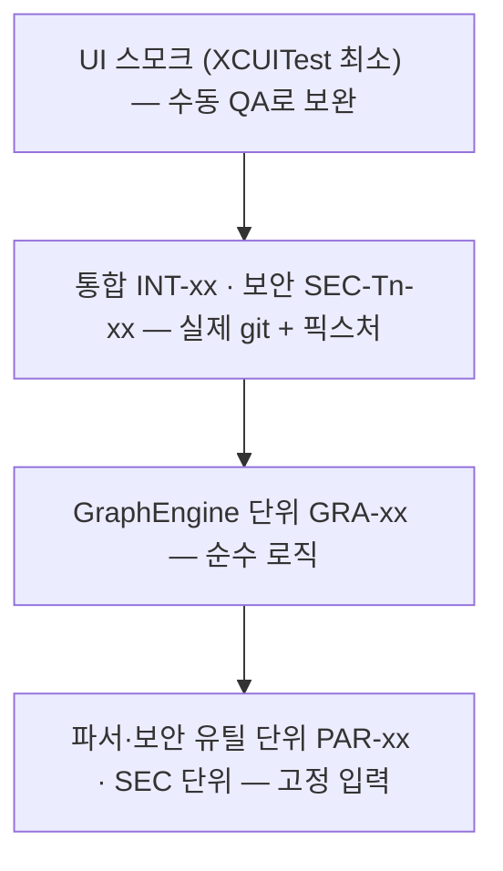

# 테스트 전략

> 상태: Accepted (Phase 2 게이트, 2026-11-05) · 관련: [fixtures.md](fixtures.md), [security-review.md](../design/security-review.md), [parsing-spec.md](../architecture/parsing-spec.md), [performance-budget.md](../performance/performance-budget.md), ADR-0006, ADR-0008

Overgrove에서 가장 위험한 곳은 두 군데다.
- **git 출력 파싱.** 형식, 로케일, 특수 파일명에 따라 결과가 틀어질 수 있다.
- **신뢰할 수 없는 저장소에 대한 git 실행.** 악성 설정이 임의 명령을 실행할 수 있다.

테스트는 이 두 위험을 먼저 막도록 설계한다. UI 테스트는 최소로 둔다.

---

## 1. 원칙

1. **명세 → 테스트 → 구현.** 파서와 명령 카탈로그는 [parsing-spec.md](../architecture/parsing-spec.md)와 [git-command-catalog.md](../architecture/git-command-catalog.md)의 표가 테스트 목록의 원본이다. 명세에 없는 동작을 구현하지 않는다.
2. **버그는 재현 테스트가 먼저다.** `type:bug` 이슈를 고치는 PR에는 수정 전에 실패하던 테스트가 있어야 한다 ([qa/process.md](../qa/process.md)).
3. **파서 PR에는 테스트가 함께 있다.** 테스트 없는 파서 변경은 리뷰하지 않는다.
4. **실제 git으로 검증한다.** 파서 단위 테스트는 고정 문자열로 빠르게 돌린다. 같은 경로는 통합 테스트에서 실제 git 출력으로 한 번 더 확인한다. 문자열은 손으로 만들지 말고, 픽스처에서 캡처한 출력을 그대로 쓴다.
5. **보안 테스트는 "실행되지 않음"을 증명한다.** 악성 픽스처의 canary 디렉터리가 비어 있음을 확인한다 (§5).
6. **외부 의존성 없이 XCTest만 쓴다** (ADR-0006). 스냅샷 라이브러리, 목(mock) 프레임워크를 쓰지 않는다.

---

## 2. 테스트 피라미드



| 층 | 대상 | 실행 시간 목표 | 개수 목표 (v0.1.0) | 실행 시점 |
|---|---|---|---|---|
| 파서·보안 유틸 단위 | `Parsing/`, `Security/`(CredentialMasker, PathValidator), `RepoConfigInspector`의 판정 로직, 명령 인자 조립 | 전체 5초 이내 | 150개 이상 | 로컬 저장 시, 모든 PR |
| GraphEngine 단위 | 레인 계산, 병합·분기, 페이지 경계 | 전체 3초 이내 | 30개 이상 | 모든 PR |
| 통합 / 보안 | `GitClient` + 실제 `/usr/bin/git` + 픽스처 | 전체 90초 이내 | INT 20개, SEC 50개 이상 | 모든 PR (필수 검사 `build-test`) |
| 성능 | PERF-xx ([benchmark-plan.md](../performance/benchmark-plan.md)) | 수 분 | 8개 | 성능 관련 PR, 릴리스 전, 주간 |
| UI 스모크 | 앱 실행, 저장소 열기, 주요 화면 전환 | 1분 이내 | 5개 이하 | 릴리스 전 (Phase 4) |

---

## 3. 테스트 ID 체계

모든 테스트 메서드 이름에 ID를 넣는다. 그래야 문서, 이슈, CI 로그를 서로 추적할 수 있다.

```swift
func test_PAR_STATUS_08_renameRecordHasOriginalPathField() { … }
func test_SEC_T4_01_cleanFilterDoesNotRunOnStatus() { … }
```

| 접두사 | 범위 | 원본 목록 | 비고 |
|---|---|---|---|
| `PAR-{파서}-{nn}` | 파서 단위 | [parsing-spec.md](../architecture/parsing-spec.md) 각 절의 표 | 파서 이름: `WT`, `STATUS`, `STASH`, `LOG`, `REF`, `REVLIST`, `NUMSTAT`, `CONFIG`, `GH`, `ISSUE`, `VER`, `FETCH`, 교차 파서 속성 `PROP` |
| `GRA-{nn}` | GraphEngine | 이 문서 §4.2 | |
| `INT-{nn}` | 통합 | [fixtures.md §7](fixtures.md) | |
| `SEC-T{n}-{nn}` | 보안 | [security-review.md §2](../design/security-review.md) 각 위협의 "검증" 항목 | 위협 하나에 테스트 1개 이상 |
| `PERF-{nn}` | 성능 | [benchmark-plan.md §3](../performance/benchmark-plan.md) | PB-x와 연결 |
| `QA-{영역}-{nn}` | 수동 QA | [qa/checklist.md](../qa/checklist.md) | 자동화되면 해당 테스트 ID를 체크리스트에 적는다 |

번호는 한 번 쓰면 재사용하지 않는다. 테스트를 지우면 원본 표에 "폐기"로 남긴다.

---

## 4. 층별 지침

### 4.1 파서 단위 (`OvergroveTests/Parsing/`)

- 입력은 `Data`(바이트)로 준다. `String`으로 바꿔서 주지 않는다. 파서가 바이트를 다루는지 확인하기 위해서다.
- 고정 입력은 `OvergroveTests/Parsing/Samples/<파서>/<케이스>.bin`에 둔다. 픽스처 저장소에서 캡처한다. 캡처 명령은 같은 이름의 `.cmd` 파일에 적는다.
- 각 파서는 다음 악성 입력 묶음을 반드시 통과해야 한다.

| 묶음 | 내용 |
|---|---|
| 특수 파일명 | 공백, 개행, 탭, 따옴표, 역슬래시, `-`·`--` 시작, `:(exclude)` 모양, NFC/NFD, 이모지, 올바르지 않은 UTF-8 |
| 구조 손상 | 잘린 마지막 레코드, 빈 입력, 필드 수 부족·초과, 알 수 없는 헤더나 레코드, NUL 누락 |
| 크기 | 레코드 10만 개(성능 회귀 방지, 1초 이내), 경로 4096바이트 |
| 버전 차이 | 알 수 없는 속성이나 헤더를 무시하는지 (git이 새 필드를 추가해도 깨지지 않게) |

- 파싱 실패는 예외 대신 결과 타입으로 돌려준다. "어떤 레코드를 건너뛰었는지"를 셀 수 있어야 한다 (PAR-STATUS-15).

### 4.2 GraphEngine 단위 (`OvergroveTests/GraphEngine/`)

입력은 `(oid, parents)` 목록이다. 기대값은 커밋별 레인 번호와 간선 목록이다.

| ID | 케이스 |
|---|---|
| GRA-01 | 직선 이력 (레인 1개) |
| GRA-02 | 병합 1회 (부모 2개, 레인 분기 후 합류) |
| GRA-03 | octopus 병합 (부모 3개 이상) |
| GRA-04 | 여러 루트 (서로 연결되지 않은 이력) |
| GRA-05 | 페이지 경계에서 끊긴 간선 (다음 페이지에서 이어짐) |
| GRA-06 | 장수 브랜치 2개 + 단기 브랜치 다수 (bench 저장소 패턴의 축소판) |
| GRA-07 | 부모가 목록에 없는 커밋 (shallow, 잘린 이력) |
| GRA-08 | 결정성: 같은 입력을 두 번 계산하면 같은 결과 |
| GRA-09 | 10만 커밋 레인 계산 시간과 메모리 (PERF-04와 연결) |

### 4.3 통합 (`OvergroveTests/Integration/`)

- 실제 `GitClient`가 실제 git을 실행한다. 목(mock)으로 바꾸지 않는다.
- 픽스처는 [fixtures.md](fixtures.md)를 따른다. 기대값은 fixtures.md의 표를 코드 상수로 옮긴 것이다.
- git 실행 파일은 앱과 같은 방식으로 정한다 (ADR-0008).
  - CI의 git 버전을 테스트 로그 첫 줄에 출력한다.
  - 최소 지원 버전(2.36)에서의 실행은 Phase 4 호환성 매트릭스 이슈에서 다룬다.

### 4.4 보안 (`OvergroveTests/Security/`)

§5 참고.

### 4.5 UI 스모크

- XCUITest는 앱 실행, 픽스처 저장소 열기, 워크트리 선택, WIP 상세, 커밋 상세 열기 정도만 확인한다.
- 레이아웃과 시각 품질은 수동 QA(QA-xx)와 스크린샷 비교로 본다. 스크린샷 비교는 사람이 하고 자동 픽셀 비교는 하지 않는다.
- SwiftUI 뷰 로직은 가능한 한 `@Observable` 상태 객체로 빼서 단위 테스트로 검증한다.

---

## 5. 보안 테스트 방식 (canary)

1. `scripts/make-fixture-repo.sh --malicious <dir>`로 악성 픽스처를 만든다. 페이로드는 실행되면 `<dir>/canary/<ID>` 파일을 남긴다.
2. 앱의 `GitClient`로 카탈로그의 모든 명령을 실행한다. fetch도 포함하며, 대상은 로컬 경로 원격 `origin`과 연결되지 않는 원격들(`sshremote`, `gitremote`, `extremote`, `redirected`)이다.
3. 각 명령 뒤에 `canary/`가 비어 있음을 확인한다. 실패 메시지에는 생긴 파일 이름(=실행된 경로)을 넣는다.
4. T8(자동 maintenance)은 canary가 없다. 그래서 보안 테스트 실행기만 `GIT_TRACE`를 켜고, 자식 프로세스에 `maintenance run`과 `gc --auto`가 없음을 확인한다 ([fixtures.md §8.3](fixtures.md)).
5. **대조군을 함께 둔다.** 같은 픽스처에서 보안 인자 없이 실행하면 canary가 생기는지 확인하는 테스트를 하나씩 둔다. 이름은 `test_SEC_T4_00_control_…`로 붙인다. 대조군이 실패하면 픽스처나 git 동작이 바뀐 것이므로 보안 테스트가 헛돌고 있다는 뜻이다.
   - 대조군 실행은 앱의 `GitClient`를 거치지 않는 테스트 전용 실행기로 한다. 실행기는 `OvergroveTests/Support/`에 둔다.
6. **인자 스냅샷.** 모든 `GitCommand` case의 최종 인자 배열(공통 인자 포함)을 문자열로 고정해 비교한다 (SEC-T9-01). 새 case를 추가하면 스냅샷도 갱신해야 하므로 리뷰에서 바로 보인다.
7. **정적 검사.** `scripts/lint/check-forbidden-apis.sh`가 다음을 막는다 (SEC-T13-03, SEC-T7-02).
   - `Overgrove/Execution/` 밖의 `Process`, `NSTask`, `posix_spawn`
   - 소스 안의 `%G` 포맷 문자열

실측으로 확인한 보안 인자별 효과는 [fixtures.md §8.2](fixtures.md)에 있다. 원안(HANDOFF §6.2)의 인자만으로는 T4, T5, T6, T7, T8이 막히지 않는다는 사실이 SEC 테스트를 반드시 실제 git으로 돌려야 하는 이유다.

---

## 6. 픽스처 수명 관리

| 픽스처 | 생성 | 공유 범위 | 정리 |
|---|---|---|---|
| 일반 (`make-fixture-repo.sh`) | 테스트 클래스 `setUp()` (class) | 읽기 전용 테스트끼리 공유 | 클래스 `tearDown()` |
| 일반, 상태 변경 테스트(fetch 등) | 테스트 메서드마다 | 공유 안 함 | 메서드 `tearDown` |
| 악성 (`--malicious`) | 테스트 메서드마다 (canary 판정을 독립시키기 위해) | 공유 안 함 | 메서드 `tearDown` |
| bench (`make-bench-repo.sh`) | 성능 측정 전 한 번 (약 30초) | 성능 테스트 전체 | 수동 또는 CI 작업 종료 시 |

- 모두 `FileManager.default.temporaryDirectory` 아래 고유 디렉터리에 만든다.
- 테스트가 실패하면 환경 변수 `OVERGROVE_KEEP_FIXTURES=1`일 때 지우지 않고 경로를 로그에 남긴다. 기본값은 지우는 것이다.
- 픽스처를 저장소에 커밋하지 않는다. 항상 스크립트로 만든다. 바이너리 픽스처나 압축된 `.git`은 리뷰가 불가능하기 때문이다.

---

## 7. 커버리지 목표

| 대상 | 라인 커버리지 목표 | 비고 |
|---|---|---|
| `Parsing/` | 95% 이상 | 모든 분기, 오류 경로 포함 |
| `Security/`, `Git/RepoConfigInspector`, `Git/GitEnvironment` | 95% 이상 | |
| `Execution/` | 90% 이상 | 타임아웃, 출력 상한, 종료 처리 (SEC-T15-xx) |
| `GraphEngine/` | 90% 이상 | |
| `Git/`, `GitHub/` (그 외) | 80% 이상 | |
| `Features/` (뷰) | 측정하지 않음 | 상태 객체는 80% 이상 |

커버리지는 숫자보다 **위협 ID와 명세 표의 모든 행에 테스트가 있는지**를 우선한다. `/phase-gate` 보고서는 두 가지를 표시한다.
- parsing-spec 표의 행 중 테스트가 없는 것
- security-review의 "검증" 항목 중 테스트가 없는 것

---

## 8. CI 실행 범위

필수 상태 검사 `build-test`(`.github/workflows/ci.yml`)는 다음을 순서대로 한다.

| 단계 | Phase 3 이전 (지금) | Phase 3 이후 |
|---|---|---|
| 도구 확인 | 툴체인 버전 출력 | 동일 |
| 저장소 도구 검증 | 스크립트 문법, JSON 설정 검증 | 동일 |
| 픽스처 스모크 | `make-fixture-repo.sh` 일반·악성 생성 성공 | 동일 |
| 포맷·린트 | 건너뜀 (소스 없음) | `swift format lint --strict` |
| 빌드·테스트 | 건너뜀 (Xcode 프로젝트 없음) | `xcodebuild test`: 단위 + GraphEngine + 통합 + 보안 |
| 통합 보고 | — | 테스트가 쓴 git(`$DEVELOPER_DIR/usr/bin/git`)과 PATH git 버전, 통합 스위트 결과를 job summary에 남긴다. `*IntegrationTests` 스위트가 하나도 돌지 않았으면 실패한다 (#63) |

- 성능 테스트(PERF)는 필수 검사에 넣지 않는다. CI 러너의 성능이 들쭉날쭉하기 때문이다.
  - 대신 `perf` 라벨이 붙은 PR과 주간 예약 실행에서 돌리고 결과를 아티팩트로 남긴다.
  - 회귀 판정은 같은 장비의 이전 값과 비교한다 ([benchmark-plan.md §5](../performance/benchmark-plan.md)).
- 보안 테스트는 필수 검사 안에서 항상 돈다. 건너뛰기 옵션을 두지 않는다.
- CI 로그에 픽스처 경로, git 버전, macOS 버전을 남긴다. 자격 증명은 픽스처에 실제로 없지만, 실패 출력도 `CredentialMasker`를 거친 뒤에만 남긴다.

---

## 9. 불안정한(flaky) 테스트 정책

1. 불안정한 테스트를 재시도로 덮지 않는다. XCTest 재시도 옵션을 켜지 않는다.
2. 발견하면 즉시 `type:bug` + `area:ci` 이슈를 만든다. 원인을 찾을 때까지 그 테스트만 `XCTSkip("flaky: #<이슈>")`으로 표시한다.
   - 보안 테스트(SEC)는 건너뛸 수 없다. 불안정하면 머지를 멈추고 먼저 고친다.
3. 시간에 의존하는 테스트는 시계를 주입한다. `sleep`으로 기다리지 않는다. 타임아웃 테스트(SEC-T15-02)는 짧은 제한값을 주입해 1초 안에 끝낸다.
4. 파일 시스템 이벤트, 병렬 실행, 프로세스 종료 순서처럼 비결정적인 요소는 테스트 경계 밖으로 뺀다. 남는 것은 결과 상태만 비교한다.
5. 같은 테스트가 2주 안에 두 번 불안정하면 `priority:p1`로 올린다.

---

## 10. 결정이 필요한 것

- XCUITest를 CI에서 돌릴지(러너에서 화면 권한 문제가 생길 수 있음). 지금은 릴리스 전 수동 실행으로 둔다. Phase 4에서 `type:spike` 이슈로 확인한다.
- 최소 git 버전(2.36) 호환성 매트릭스를 CI에서 어떻게 만들지. Homebrew에서 특정 버전을 받는 것은 외부 의존성 문제가 있으므로 별도 ADR이 필요하다.
